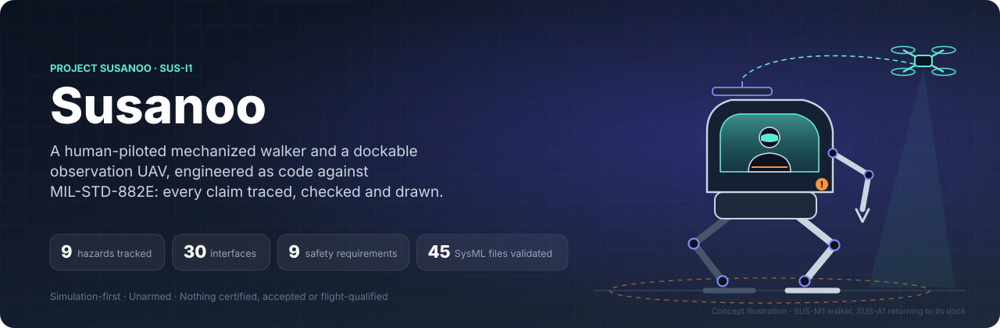
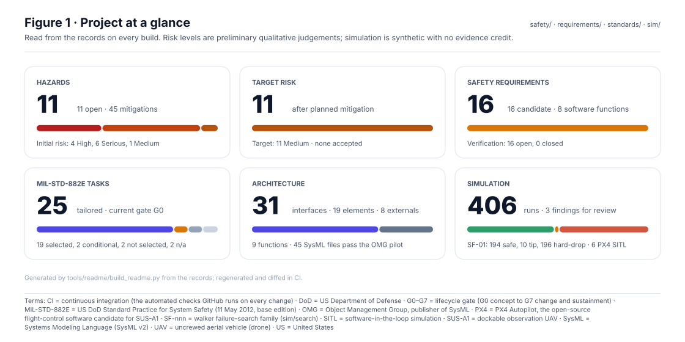
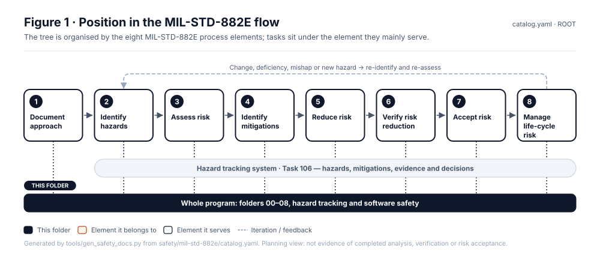

<p align="center">
  
</p>

<p align="center">
  <a href="https://github.com/jherrodthomas/Project-Susanoo/actions/workflows/pdac-validate.yml"></a>
  <a href="https://github.com/jherrodthomas/Project-Susanoo/actions/workflows/docs-check.yml"></a>
  <a href="https://github.com/jherrodthomas/Project-Susanoo/actions/workflows/px4-sitl.yml"></a>
</p>

<p align="center">
  <a href="concept/CONOPS.md"><b>CONOPS</b></a> ·
  <a href="architecture/item-definition.yaml"><b>Item definition</b></a> ·
  <a href="safety/mil-std-882e/README.md"><b>882E work products</b></a> ·
  <a href="docs/wiki/Hazard-Tracking-Log.md"><b>Hazard log</b></a> ·
  <a href="models/sysml/README.md"><b>SysML model</b></a> ·
  <a href="sim/README.md"><b>Simulation</b></a> ·
  <a href="docs/wiki/Decision-Inbox.md"><b>Decision inbox</b></a>
</p>

**Susanoo** is an open, simulation-first engineering demonstrator: a **human-piloted mechanized walker (SUS-M1)** for
material handling, inspection and field support, and an **unarmed observation UAV (SUS-A1)** that launches from and
docks on its back. It is built as **Product Development as Code**. Hazards, requirements, interfaces, the standard
itself and the decisions waiting on a human are typed records. A model, a validator, simulations and every figure on
this page are generated from those records and checked in CI.

> [!IMPORTANT]
> **Concept stage.** No prototype, certification, qualification, airworthiness approval or risk acceptance is
> claimed. Risk levels are preliminary judgements, simulation is synthetic with no evidence credit, and every
> authority is simulated until the project lead records otherwise.

<!-- terms:start (generated by tools/terms/terms.py; do not edit by hand) -->
<details><summary><b>Terms on this page (39)</b>: abbreviations and codes explained</summary>

| Term | Meaning |
|---|---|
| 1A–4F | risk assessment code, severity 1–4 plus probability A–F (e.g. 1C) |
| 3D | three-dimensional |
| AI | artificial intelligence (here, an AI assistant drafting at independence level I0) |
| ARP4754B | SAE guidelines for development of civil aircraft and systems |
| ARP4761A | SAE guidelines for the safety assessment process on civil aircraft |
| CI | continuous integration (the automated checks GitHub runs on every change) |
| CONOPS | concept of operations |
| DO-178C | RTCA software considerations in airborne systems |
| DO-254 | RTCA design assurance for airborne electronic hardware |
| DoD | US Department of Defense |
| F-nnn | system function in the item definition |
| G0–G7 | lifecycle gate (G0 concept to G7 change and sustainment) |
| HAZ-nnn | hazard record (safety/hazards/HAZ-xxx-nnn.yaml) |
| I0–I3 | review independence level (I0 none, e.g. the author or an AI, to I3 independent organisation) |
| ID | identifier |
| IEC | International Electrotechnical Commission (IEC 61508 functional safety) |
| IF-PX4-nnn | PX4 integration interface (integrations/px4/interface-contract.md) |
| ISO | International Organization for Standardization (ISO 12100 machinery risk, ISO 13849 control safety, ISO 26262 road vehicles) |
| JDK | Java Development Kit |
| MIL-STD-1472 | US DoD design criteria for human engineering |
| MIL-STD-882E | US DoD Standard Practice for System Safety (11 May 2012, base edition) |
| MOD-nnn | operating mode from the CONOPS (MOD-01 to MOD-10) |
| OMG | Object Management Group, publisher of SysML |
| PDaC | Product Development as Code |
| PX4 | PX4 Autopilot, the open-source flight-control software candidate for SUS-A1 |
| R01 … | validator rule in tools/pdac (R13 = only a named human review accepts anything) |
| RTCA | RTCA, Inc., publisher of DO-178C and DO-254 |
| S3-nnn | 3D hazard scene (sim/scenes3d) |
| SAE | SAE International, publisher of ARP4754B and ARP4761A |
| SC-nnn | 2D walker scene (sim/figures) |
| SF-nnn | walker failure-search family (sim/search) |
| SITL | software-in-the-loop simulation |
| SUS-A1 | dockable observation UAV |
| SUS-I1 | integrated mechanized walker and observation UAV |
| SUS-M1 | piloted walker |
| SysML | Systems Modeling Language (SysML v2) |
| UAV | uncrewed aerial vehicle (drone) |
| US | United States |
| YAML | a plain-text data format used for the records |

All terms: [abbreviations and record codes](https://github.com/jherrodthomas/Project-Susanoo/blob/main/docs/terms.md).

</details>
<!-- terms:end -->

---

## The problem

**1 · A novel, human-occupied machine has no ready-made safety case.** A piloted walker that carries a drone is not a
vehicle, an aircraft or a fixed machine. MIL-STD-882E, ISO 12100 / 13849, ARP4761A and MIL-STD-1472 each cover a
slice of it. The hard hazards sit in the gaps between them: the dock interface, the protective stop, the moment the UAV
returns to a moving walker.

**2 · Safety documentation drifts away from the design.** The hazard log lives in a spreadsheet, the architecture in a
drawing and the requirements in a document, each edited by hand. By the first design review they disagree, and nobody
can tell which one is true.

**3 · Compliance gets claimed instead of shown.** "Compliant with MIL-STD-882E" is easy to write and hard to check
without a clause mapping, traceable evidence and a named human who accepted the residual risk.

### Pain points, and what Susanoo does about them

| Pain point | What usually happens | What Susanoo does | See it |
|---|---|---|---|
| Diagrams go stale | Hand-drawn, out of date by the next review | Every figure is generated from records; CI regenerates and diffs it | [882E tree](safety/mil-std-882e/README.md) · [standard](framework/documentation-standard.md) |
| Hazard log nobody trusts | A spreadsheet with free-text risk | One YAML record per hazard, validated against MIL-STD-882E modelled as data (20 rules) | [`safety/hazards/`](safety/hazards/) · [`tools/pdac`](tools/pdac/README.md) |
| Models and documents disagree | Element names and IDs drift between tools | One item definition; the SysML v2 model is checked against it and passes the OMG pilot | [`architecture/`](architecture/item-definition.yaml) · [`models/sysml/`](models/sysml/README.md) |
| Simulation quietly becomes "evidence" | Plots pasted into reports | Every result is stamped *synthetic, no evidence credit* until a fidelity case is approved | [`sim/`](sim/README.md) |
| Automation "approves" things | Green CI read as sign-off | AI drafts at independence level I0; only a recorded human review accepts anything (rule R13) | [`CLAUDE.md`](CLAUDE.md) |
| Questions for the lead get lost | Buried in chat threads | A decision register with options, a recommendation and a generated inbox | [`decisions/`](decisions/register.yaml) · [inbox](docs/wiki/Decision-Inbox.md) |
| The standard is quoted, not applied | Copied clauses, vague tailoring | 882E (2012) encoded as data, tailored per task with rationale, no copied text | [`standards/`](standards/mil-std-882e/model.yaml) |

---

## The system

<p align="center">
  
</p>

| SUS-M1 · Piloted walker | SUS-A1 · Observation UAV | SUS-I1 · Integration |
|---|---|---|
| Protected pilot station, legs and manipulators, series-hybrid power, and an **independent safety monitor** that owns the protective stop. | Unarmed quadrotor on a pinned **PX4** baseline, docking on the walker for retention, charging and data. | An **integration manager** that grants launch and recovery only from a safe walker state (fail-closed), plus ground support. |

<table>
  <tr>
    <td width="55%"></td>
    <td width="45%"></td>
  </tr>
  <tr>
    <td colspan="2" align="center"><sub>Hazard scene S3-01 and scenario SC-01: a slow supply leak on a 9° slope tips the walker before load holding engages. Synthetic; this finding fed back into HAZ-WLK-002. <a href="docs/3d/index.html">All 3D scenes</a></sub></td>
  </tr>
</table>

---

## By the numbers

<p align="center"></p>

<!-- readme:numbers:start (generated by tools/readme/build_readme.py; do not edit) -->
| What | Count | Source |
|---|---|---|
| Hazards tracked (Task 106) | **21** (21 open) · initial 7 High, 10 Serious, 4 Medium → target 1 Serious, 20 Medium | [`safety/hazards/`](safety/hazards/) |
| Mitigations planned | **73** | hazard records |
| Safety requirements | **22** (22 candidate, 22 with verification open) | [`requirements/`](requirements/) |
| Safety-significant software functions | **8** | [`safety/software/`](safety/software/) |
| Architecture | **19** elements, **8** externals, **31** interfaces, **9** functions | [`architecture/item-definition.yaml`](architecture/item-definition.yaml) |
| MIL-STD-882E tasks | **25** tailored: 19 selected, 2 conditional, 2 not selected, 2 n/a · gate **G0** | [`standards/tailoring/`](standards/tailoring/mil-std-882e.yaml) |
| SysML v2 files passing the OMG pilot | **45** | [`models/sysml/`](models/sysml/model/) |
| Work-product folders with generated figures | **39** | [`safety/mil-std-882e/`](safety/mil-std-882e/README.md) |
| Decisions for the lead | **0** open of 18 | [`decisions/register.yaml`](decisions/register.yaml) |
| Simulation runs (synthetic) | **400** walker Monte Carlo + **6** PX4 SITL · **3** findings | [`sim/results/`](sim/results/) |
<!-- readme:numbers:end -->

## Where the risk is

<p align="center"></p>

<!-- readme:hazards:start (generated by tools/readme/build_readme.py; do not edit) -->
| Hazard | What could go wrong | Initial | Target | Mitigations |
|---|---|---|---|---|
| [`HAZ-DCK-001`](safety/hazards/HAZ-DCK-001.yaml) | Rotor start while UAV is retained or a person is at the dock | 2C Serious | 2E Medium | 4 |
| [`HAZ-DCK-002`](safety/hazards/HAZ-DCK-002.yaml) | False retained state releases UAV under motion | 2D Medium | 2E Medium | 3 |
| [`HAZ-DCK-003`](safety/hazards/HAZ-DCK-003.yaml) | UAV battery thermal event while charging on the dock | 2D Medium | 2E Medium | 3 |
| [`HAZ-DCK-004`](safety/hazards/HAZ-DCK-004.yaml) | Charging connector energised at UAV release or launch | 3D Medium | 3E Medium | 2 |
| [`HAZ-DCK-005`](safety/hazards/HAZ-DCK-005.yaml) | Electrical exposure at the dock while charging with a person present | 3D Medium | 3E Medium | 2 |
| [`HAZ-INT-001`](safety/hazards/HAZ-INT-001.yaml) | UAV launch or recovery outside the safe envelope | 2C Serious | 2E Medium | 7 |
| [`HAZ-INT-002`](safety/hazards/HAZ-INT-002.yaml) | Pilot acts on misleading UAV imagery or position | 1D Serious | 1E Medium | 2 |
| [`HAZ-INT-003`](safety/hazards/HAZ-INT-003.yaml) | Pilot acts on stale or frozen UAV imagery | 1D Serious | 1E Medium | 2 |
| [`HAZ-MAN-001`](safety/hazards/HAZ-MAN-001.yaml) | Person struck or pinned by the arms or claws | 1C High | 1E Medium | 3 |
| [`HAZ-MAN-002`](safety/hazards/HAZ-MAN-002.yaml) | Carried load swings, shifts or drops while walking | 1C High | 1D Serious | 3 |
| [`HAZ-PIL-001`](safety/hazards/HAZ-PIL-001.yaml) | Unintended leg motion during pilot ingress or egress | 1C High | 1E Medium | 5 |
| [`HAZ-PIL-002`](safety/hazards/HAZ-PIL-002.yaml) | Uncontrolled vertical drop of the cockpit on loss of leg support | 2C Serious | 2E Medium | 4 |
| [`HAZ-PIL-003`](safety/hazards/HAZ-PIL-003.yaml) | Fall from height during emergency egress | 1D Serious | 1E Medium | 3 |
| [`HAZ-PIL-004`](safety/hazards/HAZ-PIL-004.yaml) | Normal egress blocked when the walker cannot lower | 1D Serious | 1E Medium | 3 |
| [`HAZ-PWR-001`](safety/hazards/HAZ-PWR-001.yaml) | Residual hydraulic pressure during maintenance | 1D Serious | 1E Medium | 4 |
| [`HAZ-PWR-002`](safety/hazards/HAZ-PWR-002.yaml) | Battery thermal runaway near the pilot station | 1D Serious | 1E Medium | 4 |
| [`HAZ-PWR-003`](safety/hazards/HAZ-PWR-003.yaml) | Fuel leak and fire at the engine-generator | 1D Serious | 1E Medium | 3 |
| [`HAZ-SAF-001`](safety/hazards/HAZ-SAF-001.yaml) | Protective stop does not reach a safe state | 1C High | 1E Medium | 3 |
| [`HAZ-WLK-001`](safety/hazards/HAZ-WLK-001.yaml) | Stale or lost feedback causes runaway motion | 1C High | 1E Medium | 3 |
| [`HAZ-WLK-002`](safety/hazards/HAZ-WLK-002.yaml) | Walker tip-over or fall with pilot aboard | 1C High | 1E Medium | 7 |
| [`HAZ-WLK-003`](safety/hazards/HAZ-WLK-003.yaml) | Crushing under the pod or legs while kneeling or rising | 1C High | 1E Medium | 3 |
<!-- readme:hazards:end -->

The full log, with causal factors, mitigations in design order of precedence, and software contributions, is generated
from the records as the [Hazard Tracking Log](docs/wiki/Hazard-Tracking-Log.md).

## What simulation found

<p align="center"></p>

Two results changed the design intent:
- **Load holding must hold.** In failure search SF-01, every sample in which load holding failed ended in a tip or a
  hard drop.
- **PX4's own return-to-launch is unsafe here.** It brings the UAV back inside the pilot keep-out, or to where the dock
  *used to be* before the walker moved. Recovery therefore needs an explicit permit from the integration manager
  (IF-PX4-005/006).

Both are recorded against the hazards as drafts for the safety lead. See [walker results](sim/results/search-SF-01.md)
and [UAV results](sim/results/uav/summary.md).

---

## How it works

<p align="center"></p>

The work-product tree follows the **eight MIL-STD-882E process elements**, from documenting the approach through
managing life-cycle risk. Every hazard, mitigation, piece of evidence and decision lands in one hazard tracking
system. Each folder README carries a generated flow position, block, boundary, SysML, and inputs/outputs figure.

<p align="center"></p>

1. **Records are the source of truth:** YAML under `standards/`, `architecture/`, `safety/`, `requirements/`,
   `decisions/` and `sim/spec/`.
2. **Validators enforce the standard:** `tools/pdac` applies MIL-STD-882E rules, `tools/sysml` checks the model
   against the records, and the OMG pilot checks SysML v2 conformance.
3. **Everything else is generated:** wiki pages, figures, the SysML views, simulation scenes and this README's numbers.
4. **CI regenerates and diffs:** a stale figure, a broken link, an unresolved ID or a weakened rule fails the build.
5. **Humans decide:** risk acceptance, baselines and gate passes need a named human reviewer. CI passing never counts.

---

## Repository map

| Folder | What lives there |
|---|---|
| [`concept/`](concept/README.md) | CONOPS, modes MOD-01..10, scenarios, preliminary architecture, trade studies |
| [`architecture/`](architecture/item-definition.yaml) | Item definition: elements, externals, interfaces IF-nnn, functions |
| [`models/sysml/`](models/sysml/README.md) | SysML v2 model, checked against the records and the OMG pilot |
| [`requirements/`](requirements/) | System safety requirements SYS-nnn with allocation and verification |
| [`safety/`](safety/mil-std-882e/README.md) | Hazard records, software safety functions, events, and the 882E work-product tree |
| [`standards/`](standards/mil-std-882e/model.yaml) | MIL-STD-882E (2012) as data, plus project tailoring |
| [`sim/`](sim/README.md) | Walker plant model, failure search, PX4 SITL scenarios, 2D and 3D scenes |
| [`integrations/px4/`](integrations/px4/README.md) | PX4 baseline, interface contract, fail-closed launch permit |
| [`decisions/`](decisions/register.yaml) · [`reviews/`](reviews/README.md) | Questions for the lead; human review records |
| [`framework/`](framework/README.md) | Lifecycle, process contracts, traceability, documentation standard |
| [`tools/`](tools/) | Validators, generators and the figure kit |

## Run it

Set up once (Python 3.12, Node 22; JDK 21 for SysML conformance):

```bash
pip install -r tools/pdac/requirements.txt -r tools/sysml/pilot/requirements.txt
```

```bash
npm ci --prefix tools/figures
```

Validate the records and check that everything generated is current:

```bash
python -m tools.pdac.validate
```

```bash
python tools/check_readme_diagrams.py
```

```bash
python -m tools.readme.build_readme --check
```

The full list of checks, the same ones CI runs, is in [`CLAUDE.md`](CLAUDE.md).

---

## Standards and scope

MIL-STD-882E (11 May 2012, base edition) is the integrated system safety method. ISO 12100, ISO 13849 and IEC 61508
methods are evaluated for machinery and control-system risks, and MIL-STD-1472 informs operator human factors.
SAE ARP4754B and ARP4761A are adopted voluntarily for UAV development and aircraft safety assessment; DO-178C/DO-254
need separate applicability decisions. The ARP4761A failure-condition scale is kept apart from 882E risk.

**Not in scope:** weapons or armament of any kind, autonomous walker operation without a pilot, public-road
operation, and authorized human-occupied testing (which requires separate review and test authorization).

<details>
<summary><b>All documentation</b></summary>

- [Concept and CONOPS](concept/CONOPS.md) · [System architecture](concept/architecture.md) · [Trade studies](concept/trade-studies.md)
- [Integrated standards framework](framework/README.md) · [Standards applicability](framework/standards-applicability.md)
- [Lifecycle and review gates](framework/lifecycle.md) · [Process contracts](framework/process-contracts.md) · [PDaC traceability](framework/traceability.md)
- [Execution plan](framework/execution-plan.md) · [MIL-STD-882E conformance review and build plan](framework/882e-conformance-review.md)
- [LionDriver port plan](framework/liondriver-port-plan.md) · [Documentation standard](framework/documentation-standard.md)
- [MIL-STD-882E work-product tree](safety/mil-std-882e/README.md) · [Hazard tracking log](docs/wiki/Hazard-Tracking-Log.md) · [PDaC validator](tools/pdac/README.md)
- [Product manifest](pdac/product.yaml)

</details>

<sub>Original design. Susanoo is an unarmed civil demonstrator; any change toward armament is outside the project
charter. The front-page figures and numbers are generated by <code>tools/readme/build_readme.py</code> from the records.</sub>
