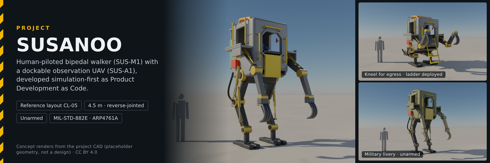

<p align="center">
  
</p>

# Project Susanoo

**SUS-M1 — Human-Piloted Mechanized Platform with Integrated Observation UAV**

Project Susanoo is an open-source, simulation-first product-development demonstrator centered on a **human-piloted mechanized walker** and a **dockable, unarmed observation UAV (SUS-A1)**. The platform explores material handling, logistics, inspection, and field support—not weapon systems.

The design reference is an industrial, open-frame, hydraulically actuated mechanized walker with a protected operator station. Hydraulic actuation is an **initial hypothesis**, subject to an electrohydraulic/electromechanical trade study. The UAV provides aerial observation and can dock with the platform, with deployment and recovery envelopes to be defined and verified.

## Product Development as Code (PDaC)
PDaC is **Product Development as Code**, not a synonym for digital thread: typed product objects, versioned configurations, executable rules, controlled changes, evidence, approvals, and releases. A traceable digital thread is one outcome.

## Start here
- [Concept and CONOPS](concept/CONOPS.md)
- [System architecture](concept/architecture.md)
- [Actuation and UAV integration trade studies](concept/trade-studies.md)
- [Integrated standards framework](framework/README.md)
- [Standards applicability](framework/standards-applicability.md)
- [Lifecycle and review gates](framework/lifecycle.md)
- [Process contracts](framework/process-contracts.md)
- [PDaC traceability](framework/traceability.md)
- [Execution plan](framework/execution-plan.md)
- [Preliminary Hazard List](safety/preliminary-hazard-list.md)
- [Concept layouts (FreeCAD mockups)](cad/README.md)
- [PDaC records and checks](pdac/README.md)

## Assurance approach
MIL-STD-882E is the integrated system safety method. ISO 12100, ISO 13849 and IEC 61508 methods are evaluated for machinery and control-system risks; MIL-STD-1472 informs operator human factors. SAE ARP4754B and ARP4761A are voluntarily adopted for the UAV development and aircraft safety assessment; DO-178C/DO-254 require separate applicability decisions.

## Status
<!-- BEGIN GENERATED: status (tools/pdac/generate.py) -->
**Status:** Concept. Simulation-first; no hardware built, no certification, qualification, airworthiness approval or formal risk acceptance claimed.

**PDaC records** (`b57973e8c0c0`): 15 scenarios · [24 hazards](safety/preliminary-hazard-list.md) (initial risk, proposed: 10 high, 10 serious, 4 medium) · 20 requirements (20 candidate) · 3 open trade studies · 0 recorded approvals · release `SUS-I1-R0.2` planned. No risk has been accepted.
<!-- END GENERATED: status -->

## Checking the records
The PDaC records live in [`pdac/`](pdac/README.md). Python 3.12+ and the pinned packages in [`tools/requirements.txt`](tools/requirements.txt) are all that is needed:

```bash
python3 -m pip install -r tools/requirements.txt
python3 tools/pdac/validate.py          # checks P1-P9
python3 tools/pdac/generate.py --check  # generated tables and pages are current
python3 tools/check_links.py            # relative links resolve
```

CI runs the same commands on every pull request. A passing check means the records are consistent; it never means anything has been reviewed, accepted or approved.

## License
- Code, schemas and machine-readable records (`tools/`, `pdac/`, `.github/`, `cad/params/`): [Apache License 2.0](LICENSE).
- Hardware design files: none yet; a licence (CERN-OHL-P proposed) is decided before the first design-level CAD.
- Documentation (Markdown pages, including `docs/wiki/`, and figures): [Creative Commons Attribution 4.0 International](LICENSE-docs).

See [NOTICE](NOTICE). Standards are cited by number and clause only; no standards text is reproduced.
