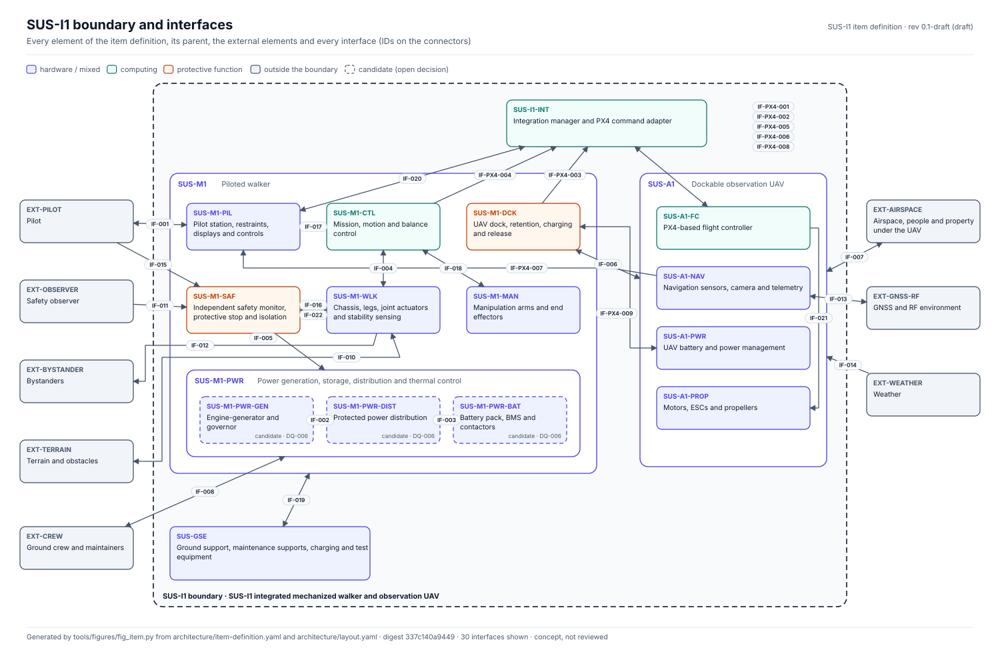
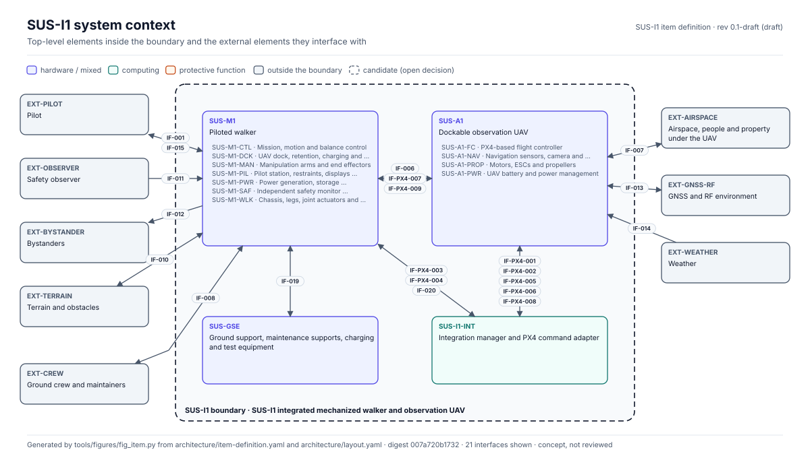
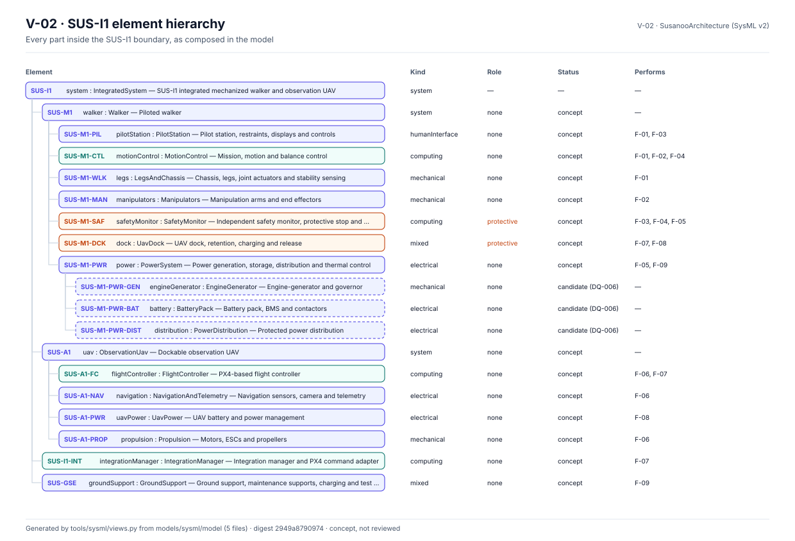
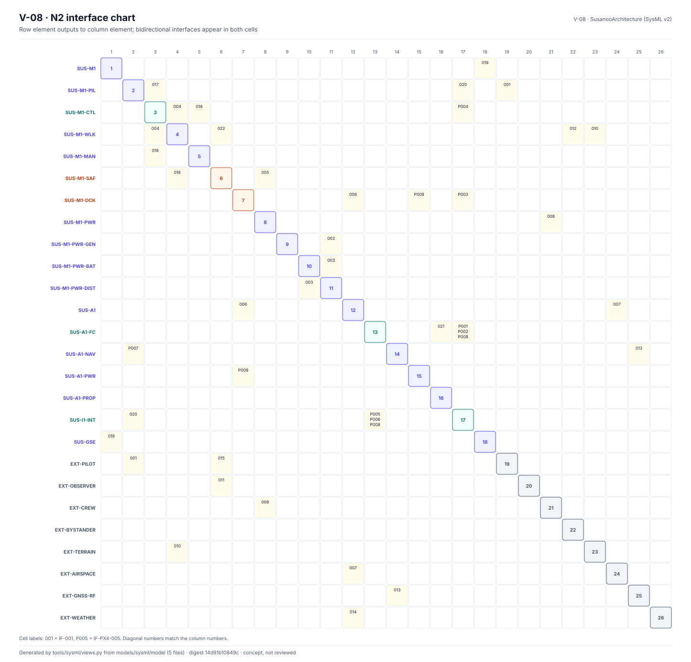

<!-- GENERATED by tools/previews/build_previews.py from docs/previews.yaml; do not edit. Edit the entry there and re-run. -->

# Architecture records

The SUS-I1 item definition, the single source for every element, external element and interface, and the hand-placed layout used to draw it. Figures, SysML checks and the wiki item-definition page are built from here.

<!-- terms:start (generated by tools/terms/terms.py; do not edit by hand) -->

<b>Terms on this page (3)</b>: abbreviations and codes explained

| Term | Meaning |
|---|---|
| SUS-I1 | integrated mechanized walker and observation UAV |
| SysML | Systems Modeling Language (SysML v2) |
| UAV | uncrewed aerial vehicle (drone) |

All terms: [abbreviations and record codes](https://github.com/jherrodthomas/Project-Susanoo/blob/main/docs/terms.md).

<!-- terms:end -->

<!-- preview:start (generated by tools/previews/build_previews.py from docs/previews.yaml; do not edit by hand) -->

SUS-I1 boundary and interfaces, drawn from item-definition.yaml

<table>
<tr><td width="33%" valign="top"> System context: SUS-I1 and its external elements</td><td width="33%" valign="top"> SysML part hierarchy checked against this record</td><td width="33%" valign="top"> N2 interface chart</td></tr>
</table>

**Open:** [SUS-I1 item definition (wiki page)](../docs/wiki/SUS-I1-Item-Definition.md)

<!-- preview:end -->

## Folder contents

| Item | Title |
|---|---|
| [`item-definition.yaml`](item-definition.yaml) | SUS-I1 integrated mechanized walker and observation UAV |
| [`layout.yaml`](layout.yaml) |  |
