# Concept layouts (FreeCAD) — review and alignment

**ID:** SUS-CAD-001 · **Revision:** 0.1-draft · **Status:** Draft, not reviewed

> **Concept mockups, not designs.** Every layout below is built from primitive solids placed by placeholder parameters. Dimensions, masses and every metric are properties of that placeholder geometry. They exist so the team can look at the same picture, compare the trade-study alternatives side by side, and see early where an option makes a hazard worse. They select nothing: the trade studies (TS-001 to TS-004) are decided by the lead.

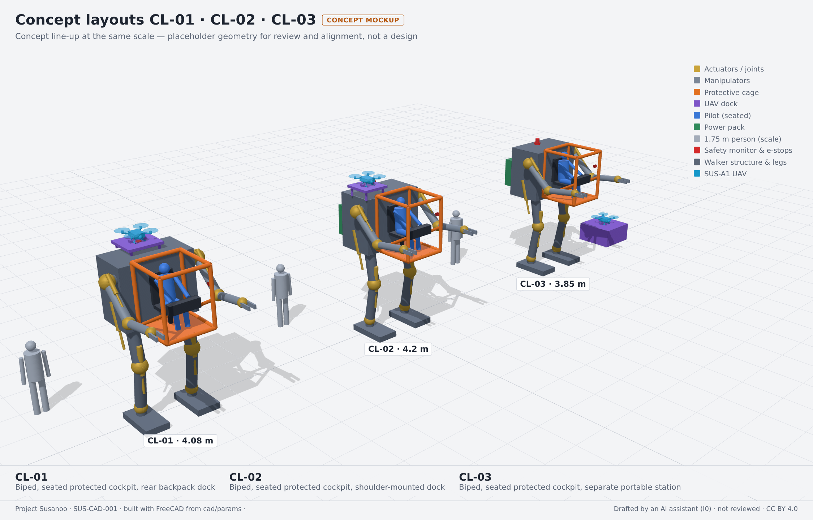

## 1. What the layouts compare

Each layout (`CL-nn`) is one combination of trade-study alternatives. Locomotion is **bipedal** (TS-003, decided by the project lead). All three layouts share the same biped, the actuation hypothesis (centralized hydraulic, drawn as yellow cylinders) and the seated protected cockpit, so they differ only in where the UAV docks (TS-004). Standing and remote-pilot alternatives (TS-002) and electric actuation (TS-001) are not modelled yet.

What to look for in the review:

| Question | Where it shows | Records it informs |
|---|---|---|
| Can it stand without active balance? | Plan view: centre of gravity against the support polygon; static margin and tip angle | HAZ-006, HAZ-021, SYS-008, SYS-009 |
| How far does the pilot drop on egress? | Side view: cockpit floor height | HAZ-008, SYS-012 |
| How close are docked rotors to the pilot? | Dock view: shortest rotor-to-pilot distance | HAZ-011, HAZ-012, SYS-003 |
| How big is it next to a person? | Every view: the 1.75 m figure | HAZ-009 |

Metric definitions: *static margin* is the shortest horizontal distance from the centre of gravity to the edge of the support polygon (the convex hull of the ground contacts); *static tip angle* is the angle whose tangent is margin ÷ CG height; *placeholder mass* comes from solid volumes times the effective densities in [`params/common.yaml`](params/common.yaml). Values in red on the images are below 0.3 m static margin or 1.0 m rotor clearance, the project's provisional review flags. They are not requirements.

## 2. Layouts

<!-- BEGIN GENERATED: cad-concepts (tools/pdac/generate.py) -->
*Metrics from [`metrics.json`](metrics.json) (FreeCAD 1.1.3); ⚠ marks the provisional review flags of §1.*

| | CL-01 | CL-02 | CL-03 |
|---|---|---|---|
| Locomotion (TS-003) | bipedal | bipedal | bipedal |
| UAV dock (TS-004) | rear backpack dock | shoulder-mounted dock | separate portable station |
| Envelope L × W × H | 3.4 × 2.4 × 4.1 m | 3.4 × 2.4 × 4.2 m | 3.4 × 2.4 × 3.9 m |
| Overall height | 4.08 m | 4.20 m | 3.85 m |
| Pilot eye height | 3.54 m | 3.54 m | 3.54 m |
| Cockpit floor (egress drop) | 2.33 m | 2.33 m | 2.33 m |
| CG height | 2.63 m | 2.63 m | 2.63 m |
| Static margin | 0.14 m ⚠ | 0.14 m ⚠ | 0.14 m ⚠ |
| Static tip angle | 3.1° | 3.2° | 3.1° |
| Rotor ↔ pilot (docked) | 0.79 m ⚠ | 0.63 m ⚠ | 3.14 m |
| Placeholder mass | ~5.0 t | ~5.0 t | ~5.0 t |

### CL-01 · Biped, seated protected cockpit, rear backpack dock

Options: TS-001 centralized hydraulic; TS-002 seated protected cockpit; TS-003 bipedal; TS-004 rear backpack dock. Informs: HAZ-005, HAZ-006, HAZ-008, HAZ-011, HAZ-021, SYS-003, SYS-008, SYS-009, SYS-010, SYS-012. Parameters: [`params/CL-01.yaml`](params/CL-01.yaml).

- Common to every biped layout: the static margin is small and the CG is high above two feet, so standing still depends on active balance. Loss of actuation energy or a zero-torque stop means a fall unless SYS-008 holds posture (HAZ-005, HAZ-021).
- Common to every biped layout: the cockpit floor is above the head of a standing person, so egress and extraction (SYS-012) need a ladder, a lowered posture or a kneel mode.
- The rear dock sits above the cockpit roof line, so the docked rotors still come within the provisional 1 m flag of the pilot's head.

| | |
|---|---|
| 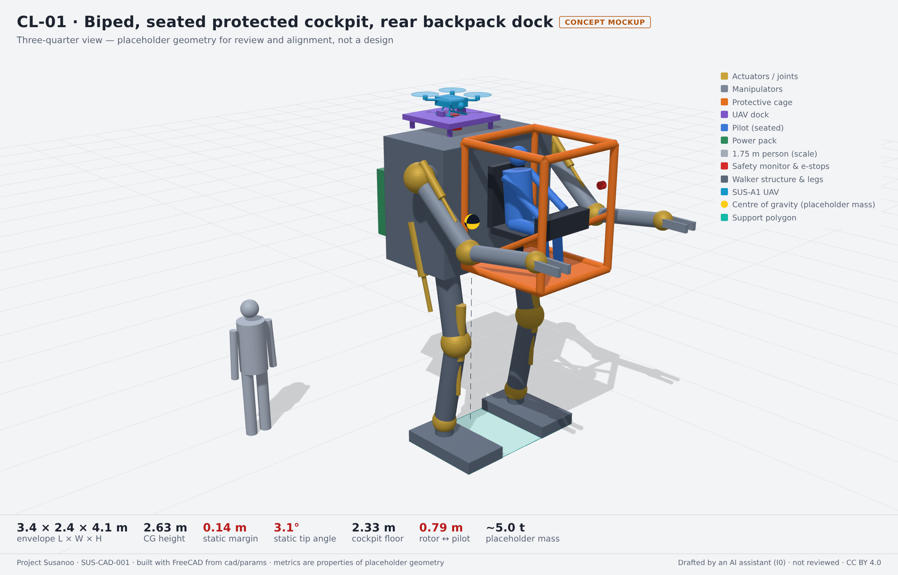 | 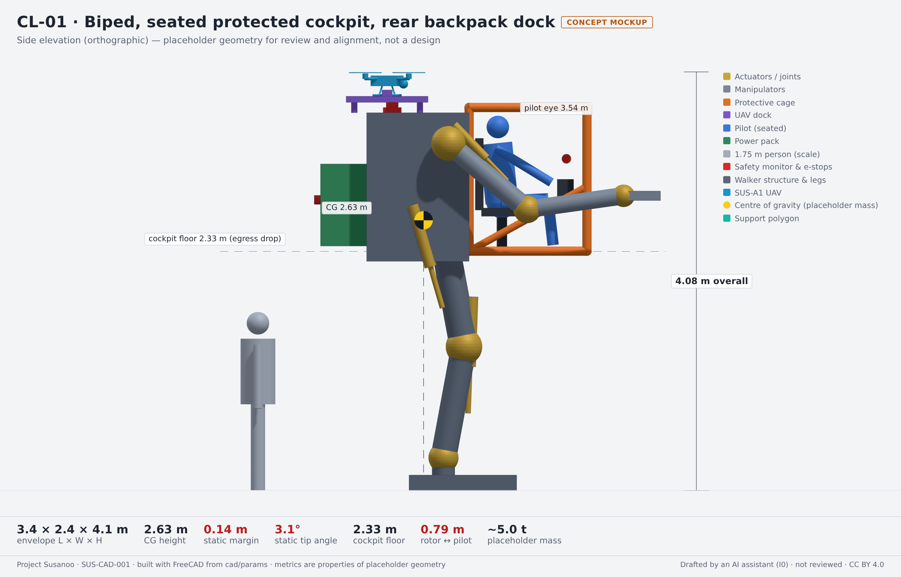 |
| 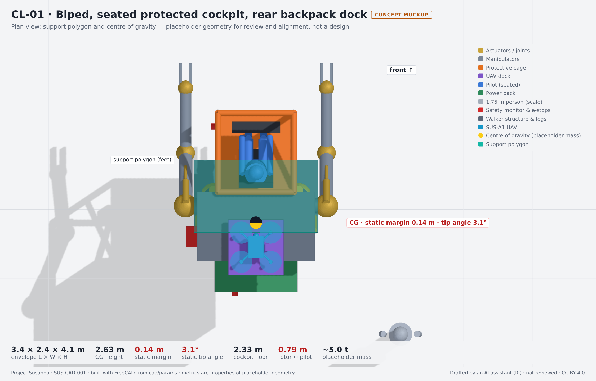 | 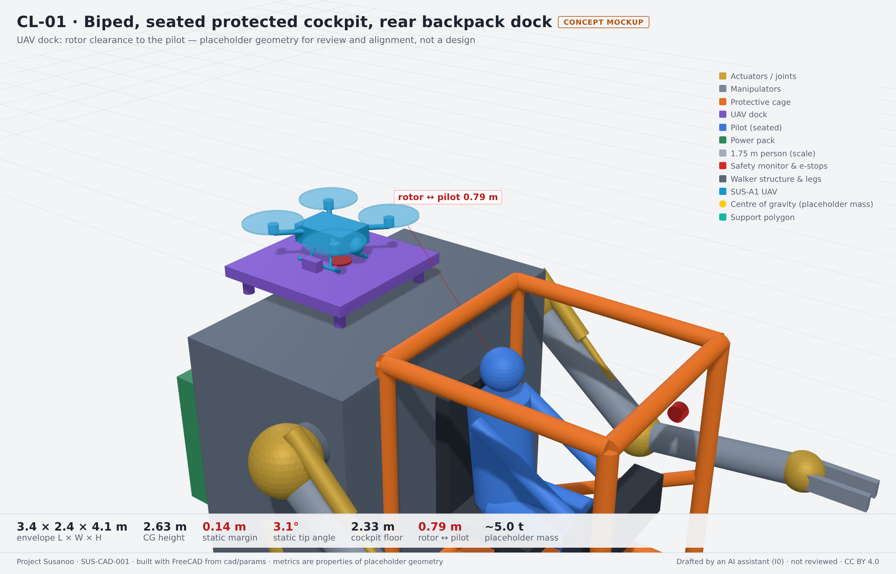 |

### CL-02 · Biped, seated protected cockpit, shoulder-mounted dock

Options: TS-001 centralized hydraulic; TS-002 seated protected cockpit; TS-003 bipedal; TS-004 shoulder-mounted dock. Informs: HAZ-006, HAZ-011, HAZ-012, SYS-003, SYS-006. Parameters: [`params/CL-02.yaml`](params/CL-02.yaml).

- The shoulder dock puts the docked rotors beside the cage at pilot head height, the closest of the three layouts: HAZ-011 and HAZ-012 dominate, and SYS-003 rotor inhibit plus a rotor guard would be needed if this option is kept.
- The UAV is light against the walker: the dock position changes the CG by millimetres, so TS-004 is decided by rotor clearance, access and approach geometry, not by stability.

| | |
|---|---|
| 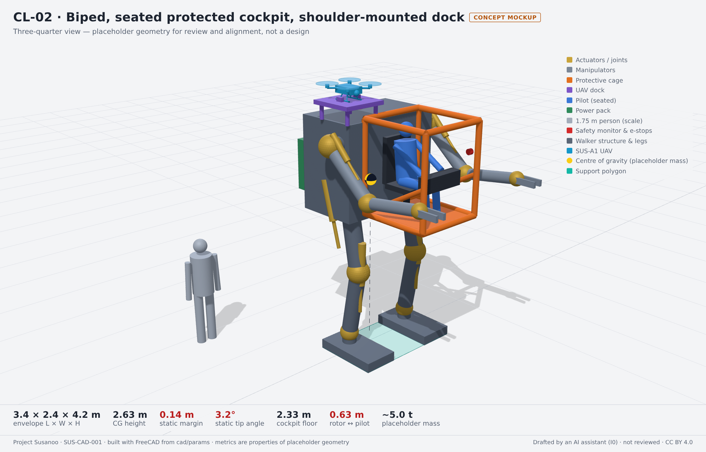 | 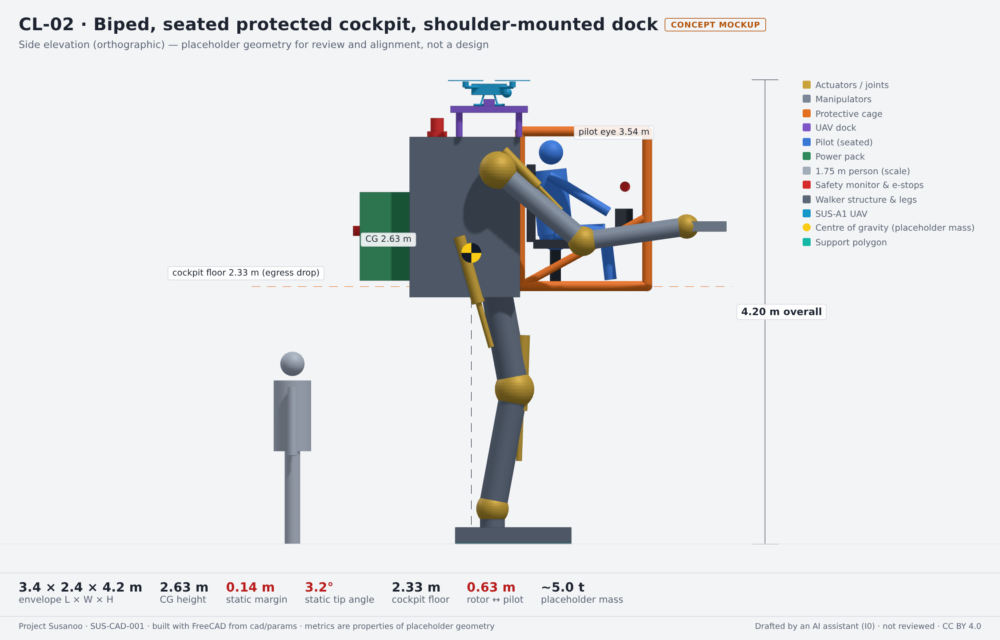 |
| 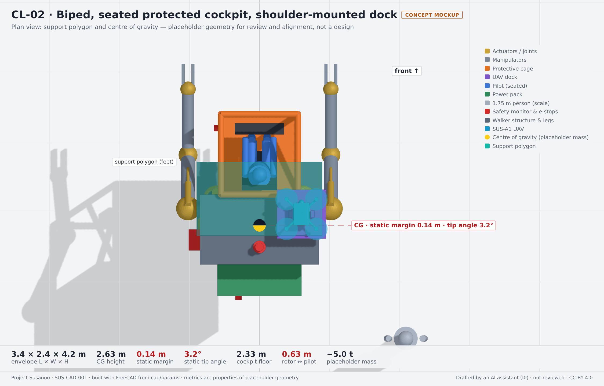 | 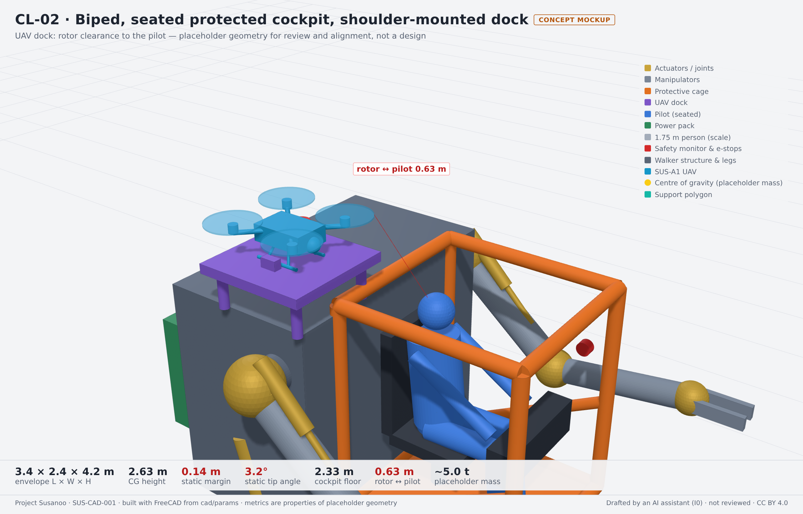 |

### CL-03 · Biped, seated protected cockpit, separate portable station

Options: TS-001 centralized hydraulic; TS-002 seated protected cockpit; TS-003 bipedal; TS-004 separate portable station. Informs: HAZ-011, HAZ-013, HAZ-016, SYS-005, SYS-006, SYS-016. Parameters: [`params/CL-03.yaml`](params/CL-03.yaml).

- The off-board station keeps rotors metres from the pilot and removes dock-retention loads while walking (HAZ-013), at the cost of launching and recovering only where the station is.
- Nothing is mounted on top of the walker, so this is the lowest of the three bipeds and its hull top stays free for sensors or a beacon.

| | |
|---|---|
| 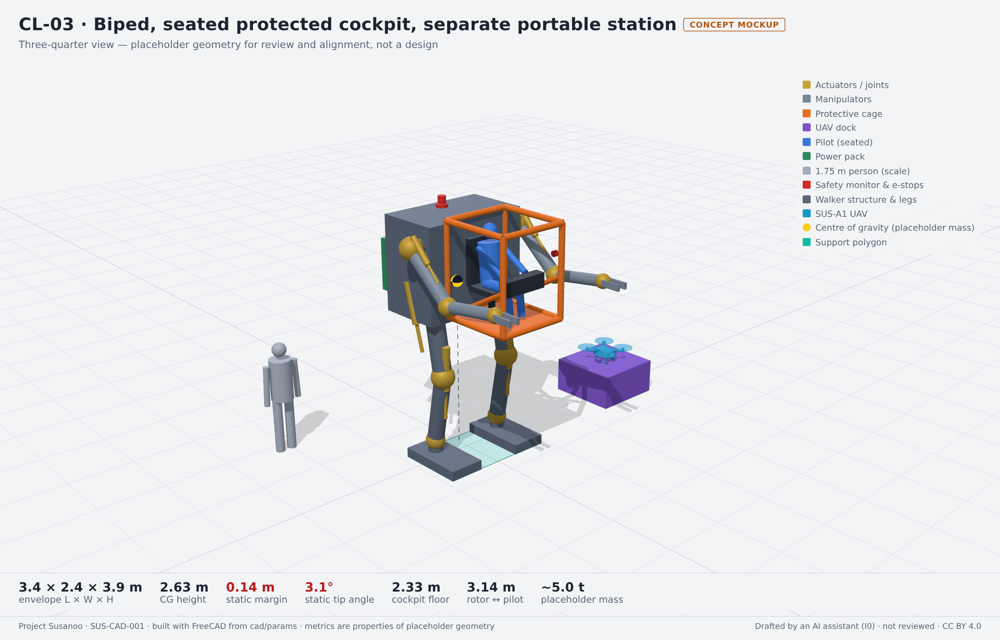 | 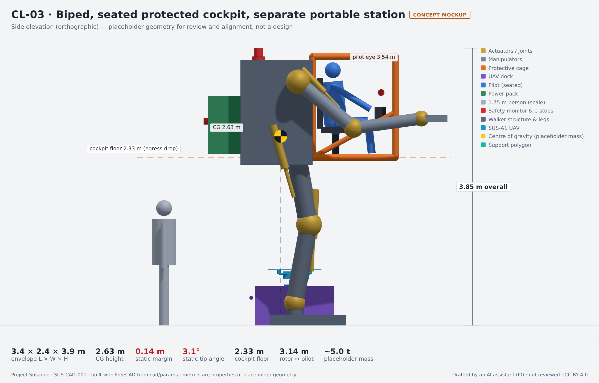 |
| 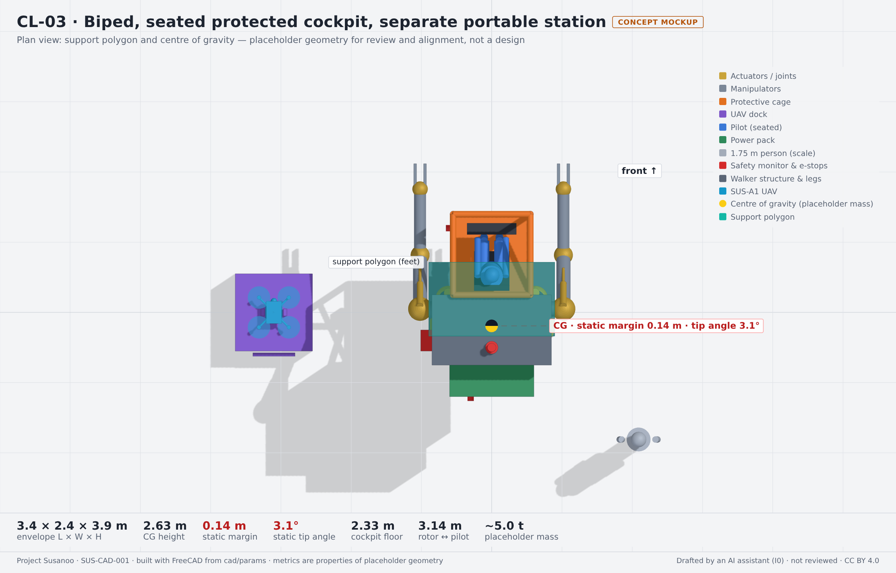 | 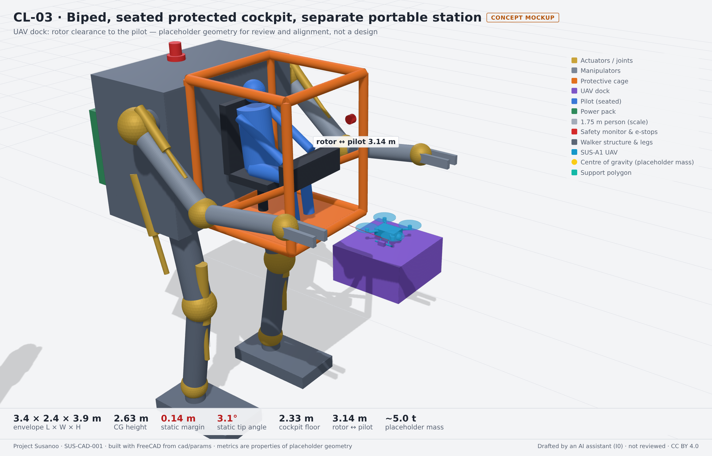 |
<!-- END GENERATED: cad-concepts -->

## 3. How the layouts are made

| Step | Tool | Output |
|---|---|---|
| Parameters | [`params/CL-nn.yaml`](params/), [`params/common.yaml`](params/common.yaml) | One file per layout; placeholders, metres |
| Geometry and metrics | [`tools/cad/build_concepts.py`](../tools/cad/build_concepts.py) under FreeCAD 1.1 | `build/cad/CL-nn/`: `.FCStd`, `.step`, STL per part class; [`metrics.json`](metrics.json) (committed) |
| Review images | [`tools/cad/render.cjs`](../tools/cad/render.cjs) and [`viewer.html`](../tools/cad/viewer.html) (three.js in headless Chromium) | [`renders/`](renders/) (committed) |
| This page | `tools/pdac/generate.py` | Section 2, from the layout records and `metrics.json` |

Run everything with `tools/cad/make.sh` (it needs a FreeCAD 1.1 environment, see [`tools/cad/environment.yml`](../tools/cad/environment.yml), and Node with Playwright). CI ([`.github/workflows/cad.yaml`](../.github/workflows/cad.yaml)) rebuilds the geometry on every change to `cad/` or `tools/cad/`, fails if `metrics.json` is out of date, and attaches the STEP, FCStd and STL files to the run. CAD files are not committed; they are reproducible from the parameters.

The layout records are in [`pdac/items/concept-layouts.yaml`](../pdac/items/concept-layouts.yaml); the validator checks that each layout names real trade-study alternatives, that its parameter file exists and that `metrics.json` is current for it.

## 4. Next

1. Review the layouts with the systems, safety and human-factors leads; record what each one rules in or out against the trade-study criteria.
2. Add the missing alternatives: standing and remote pilot (TS-002), electromechanical actuation (TS-001).
3. Replace effective densities with a mass budget once a parts breakdown exists, and add a kneel or lowered-egress posture to each layout.
4. Decide the licence for hardware design files (CERN-OHL-P proposed) before the first design-level CAD.
