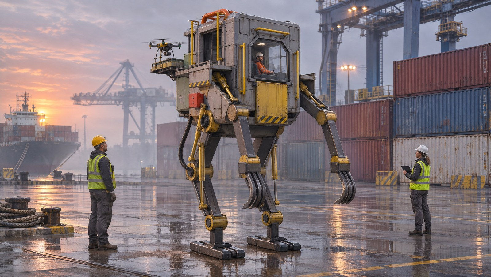
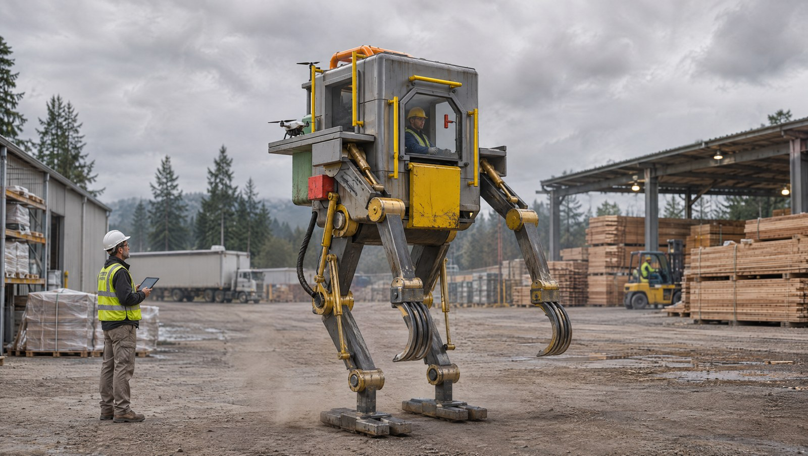
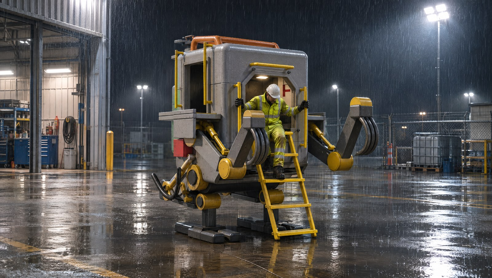
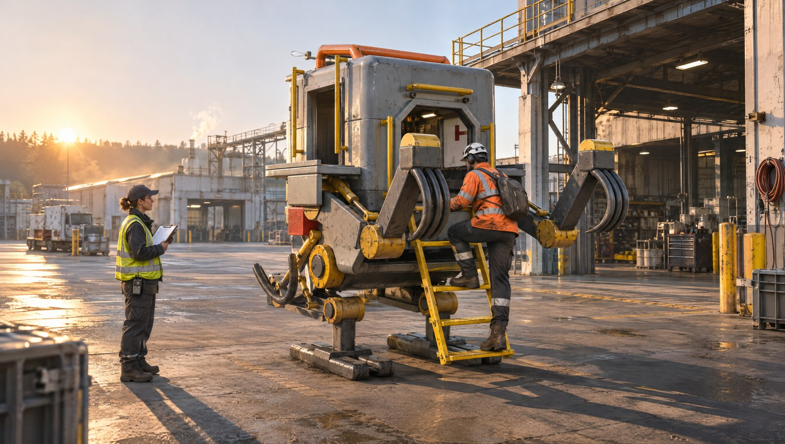
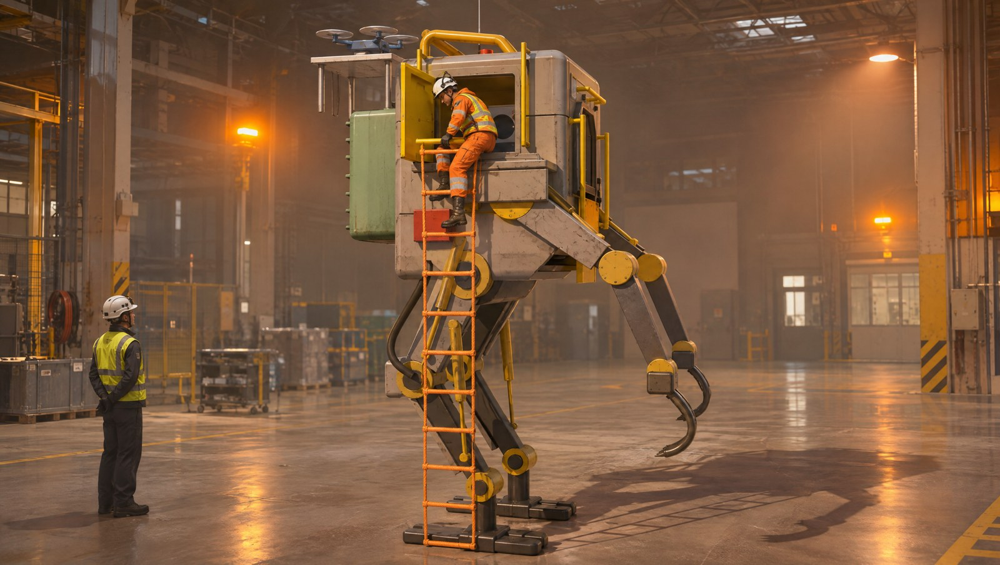
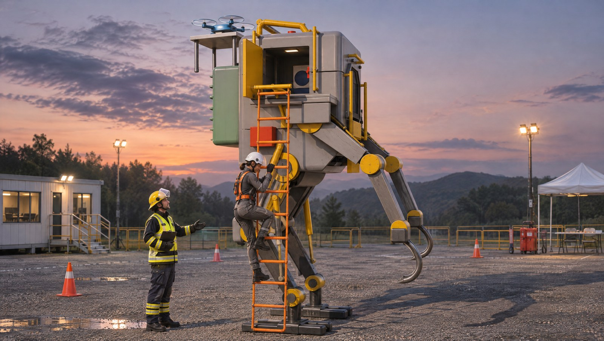

# CL-05 concept art (AI-generated)

> **AI concept art, not engineering.** Every image on this page was generated by an image model from one of the project's own Blender renders of the CL-05 reference layout. They are for communication and alignment only. Where an image differs from the CAD (the [model](../params/CL-05.yaml), [metrics](../metrics.json), [drawing sheets](../drawings/) and [renders](../renders/blender/)), the CAD is the design and the image is artistic licence. No dimension, clearance or safety property may be read from these images.

| Field | Value |
|---|---|
| Tool | Higgsfield, model `gpt_image_2_6`, image-to-image, quality high, 2K, 16:9, via the Higgsfield MCP connector |
| Generated | 2026-11-11, by Claude (AI assistant) at the project lead's request; not reviewed |
| Source renders | [`renders/blender/`](../renders/blender/), imported by URL from this repository's branch |
| Prompt constraints | Keep the machine's geometry and parts unchanged; unarmed civilian machine (no weapons, military insignia or camouflage); no text or logos |
| Rights | Higgsfield's help center states it claims no ownership of outputs and does not restrict commercial use. Higgsfield's terms prohibit using outputs to train AI models. Purely AI-generated images may not be protected by copyright in some jurisdictions; to the extent rights exist, the files are offered under [CC BY 4.0](../../LICENSE-docs) like the rest of the documentation |

## Images

| Image | Source render, job | What differs from the CAD |
|---|---|---|
|  **Container port, dawn** | `CL-05-hero.jpg`, job `04756f8e` | Drone shown on a side platform at shoulder height instead of the raised rear dock; feet drawn as flat skids |
|  **Lumber yard, overcast** | `CL-05-hero.jpg`, job `18b97885` | Same drone placement as above |
|  **Kneel for egress, night rain** | `CL-05-kneel.jpg`, job `aaf0cb10` | Close to the CAD |
|  **Kneel for ingress, morning** | `CL-05-kneel.jpg`, job `f27db76a` | Stowed claws drawn closer to the opening than the CAD places them |
|  **Emergency exit drill, warehouse** | `CL-05-emergency.jpg`, job `3ec32fc5` | The rope ladder hangs flat against the hull over the safety box and leg instead of from the swing-out davit 0.60 m out: the snag the davit exists to avoid |
|  **Emergency egress training, dusk** | `CL-05-emergency.jpg`, job `ec01b505` | The pilot wears a fall-arrest harness: a candidate control for HAZ-023 suggested by the image, to be evaluated, not evidence |

## Ideas worth carrying back to the design

- A fall-arrest harness and anchor point for emergency descent from the side hatch (HAZ-023, SYS-012).
- Hazard striping on the lower front panel and step edges, as the images add on their own.
