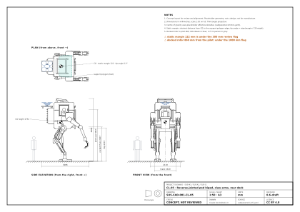
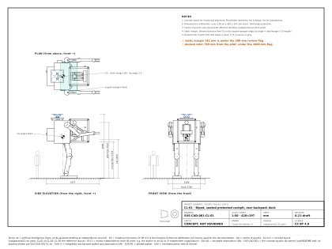
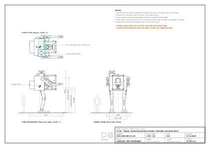
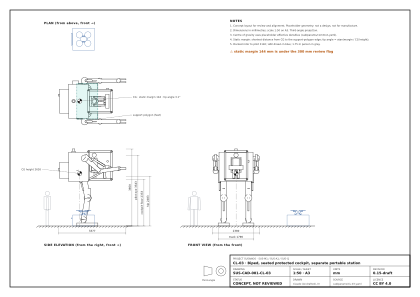
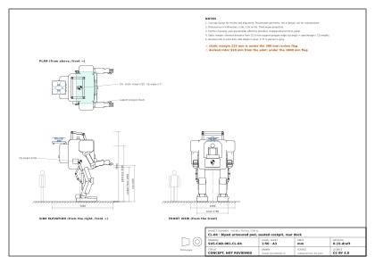
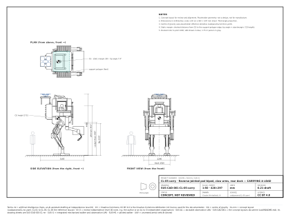
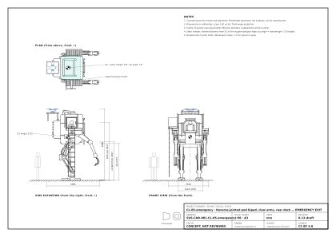
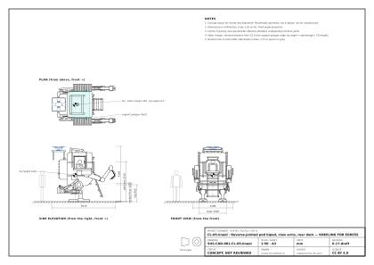

<!-- GENERATED by tools/previews/build_previews.py from docs/previews.yaml; do not edit. Edit the entry there and re-run. -->

# Concept layout drawing sheets

One drawing sheet per concept layout (SUS-CAD-001-CL-nn), built from the FreeCAD models, plus all sheets in one PDF (`concept-layouts.pdf`). Concept layouts, not a design.

<!-- terms:start (generated by tools/terms/terms.py; do not edit by hand) -->

<b>Terms on this page (5)</b>: abbreviations and codes explained

| Term | Meaning |
|---|---|
| CAD | computer-aided design |
| CL-nnn | concept layout (cad/params/CL-nn.yaml; CL-01 to CL-05, CL-05 the reference layout) |
| FreeCAD | open-source parametric CAD program used for the concept layouts |
| PDF | Portable Document Format |
| SUS-CAD-001 | the concept layouts document (cad/README.md); its drawing sheets are SUS-CAD-001-CL-nn |

All terms: [abbreviations and record codes](https://github.com/jherrodthomas/Project-Susanoo/blob/main/docs/terms.md).

<!-- terms:end -->

<!-- preview:start (generated by tools/previews/build_previews.py from docs/previews.yaml; do not edit by hand) -->

CL-05, the reference layout

<table>
<tr><td width="33%" valign="top"> CL-01.svg</td><td width="33%" valign="top"> CL-02.svg</td><td width="33%" valign="top"> CL-03.svg</td></tr>
<tr><td width="33%" valign="top"> CL-04.svg</td><td width="33%" valign="top"> CL-05-carry.svg</td><td width="33%" valign="top"> CL-05-emergency.svg</td></tr>
<tr><td width="33%" valign="top"> CL-05-kneel.svg</td></tr>
</table>

**Open:** [All sheets (PDF)](concept-layouts.pdf) · [Concept layouts review](../README.md)

<!-- preview:end -->

## Folder contents

| Item | Title |
|---|---|
| [`CL-01.svg`](CL-01.svg) | CL-01 concept layout drawing |
| [`CL-02.svg`](CL-02.svg) | CL-02 concept layout drawing |
| [`CL-03.svg`](CL-03.svg) | CL-03 concept layout drawing |
| [`CL-04.svg`](CL-04.svg) | CL-04 concept layout drawing |
| [`CL-05-carry.svg`](CL-05-carry.svg) | CL-05-carry concept layout drawing |
| [`CL-05-emergency.svg`](CL-05-emergency.svg) | CL-05-emergency concept layout drawing |
| [`CL-05-kneel.svg`](CL-05-kneel.svg) | CL-05-kneel concept layout drawing |
| [`CL-05.svg`](CL-05.svg) | CL-05 concept layout drawing |
| [`concept-layouts.pdf`](concept-layouts.pdf) |  |
