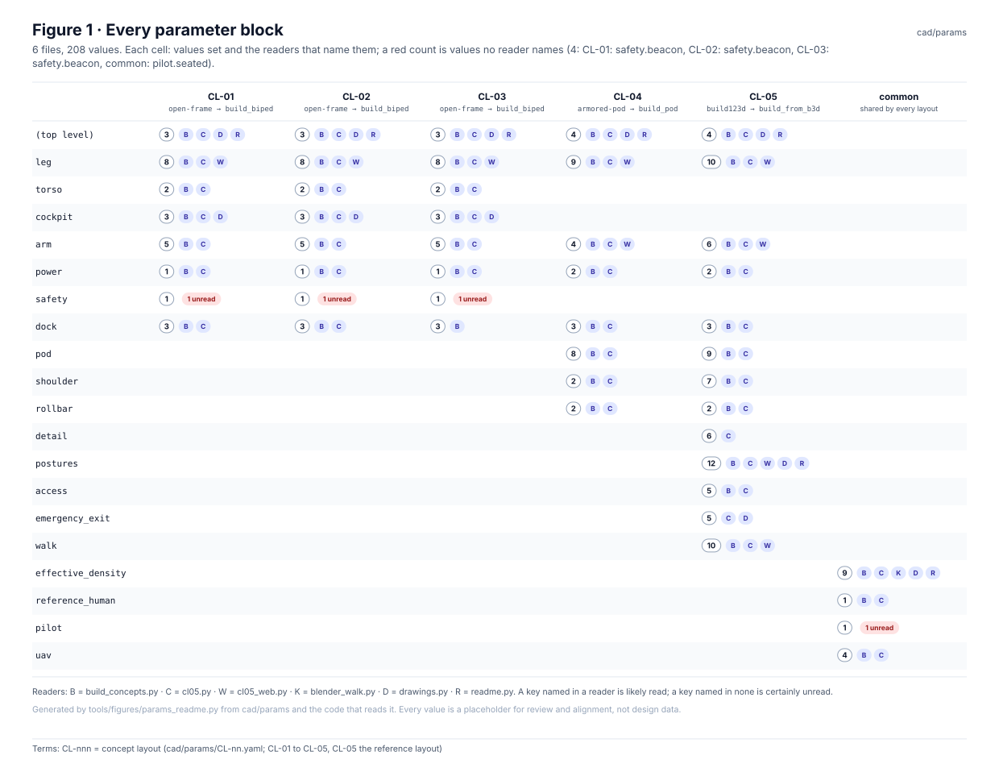
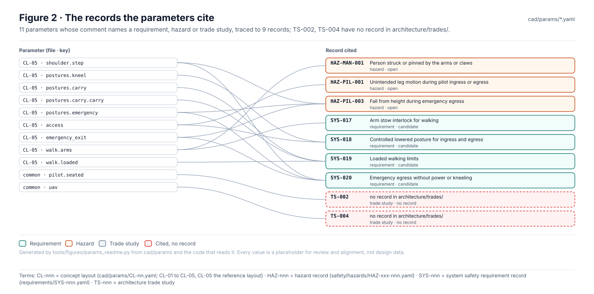
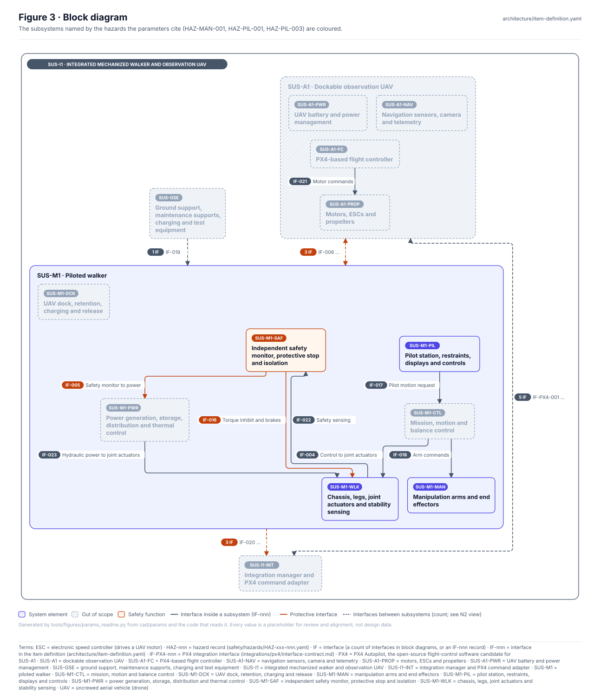
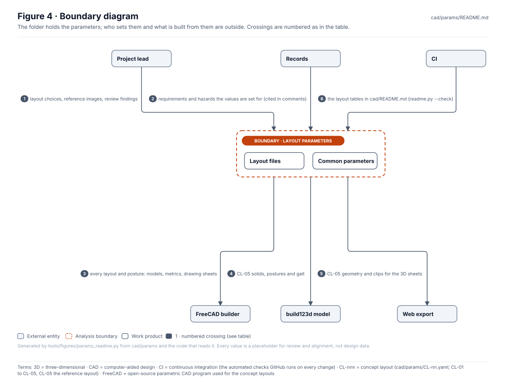
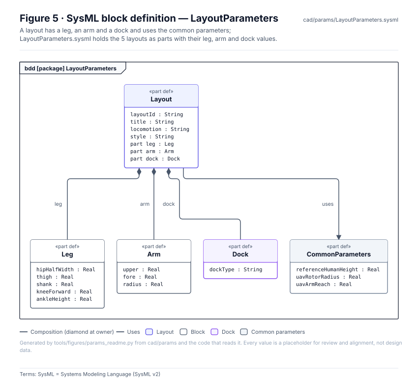
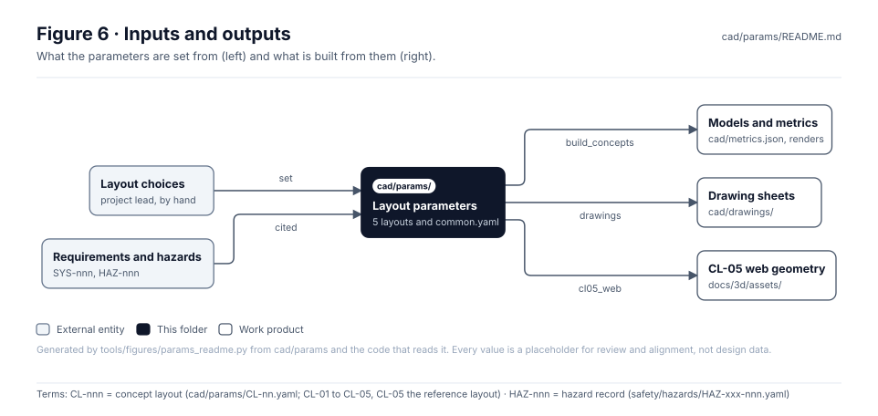

<!-- GENERATED by tools/figures/params_readme.py from cad/params and the code that reads it; edit those and regenerate. -->

# Concept layout parameters

> **Status:** 5 layouts and `common.yaml`, 208 placeholder values; 11 parameters cite 9 records. Set but named by no reader: `CL-01: safety.beacon`, `CL-02: safety.beacon`, `CL-03: safety.beacon`, `common: pilot.seated`. Cited trade studies with no record: TS-002, TS-004. Values are for review and alignment, **not design data**.

<!-- terms:start (generated by tools/terms/terms.py; do not edit by hand) -->

<b>Terms on this page (11)</b>: abbreviations and codes explained

| Term | Meaning |
|---|---|
| 3D | three-dimensional |
| CAD | computer-aided design |
| CI | continuous integration (the automated checks GitHub runs on every change) |
| CL-nnn | concept layout (cad/params/CL-nn.yaml; CL-01 to CL-05, CL-05 the reference layout) |
| FreeCAD | open-source parametric CAD program used for the concept layouts |
| HAZ-nnn | hazard record (safety/hazards/HAZ-xxx-nnn.yaml) |
| OMG | Object Management Group, publisher of SysML |
| SVG | Scalable Vector Graphics, the figure file format |
| SYS-nnn | system safety requirement record (requirements/SYS-nnn.yaml) |
| SysML | Systems Modeling Language (SysML v2) |
| TS-nnn | architecture trade study |

All terms: [abbreviations and record codes](https://github.com/jherrodthomas/Project-Susanoo/blob/main/docs/terms.md).

<!-- terms:end -->

| Field | Value |
|---|---|
| Files | [`CL-01.yaml`](CL-01.yaml), [`CL-02.yaml`](CL-02.yaml), [`CL-03.yaml`](CL-03.yaml), [`CL-04.yaml`](CL-04.yaml), [`CL-05.yaml`](CL-05.yaml), [`common.yaml`](common.yaml) |
| Read by | [`build_concepts.py`](../../tools/cad/build_concepts.py), [`cl05.py`](../../tools/cad/b3d/cl05.py), [`cl05_web.py`](../../tools/cad/b3d/cl05_web.py), [`cl05_terrain.py`](../../tools/cad/b3d/cl05_terrain.py), [`blender_walk.py`](../../tools/cad/blender_walk.py), [`drawings.py`](../../tools/cad/drawings.py), [`readme.py`](../../tools/cad/readme.py) |
| Review | [`cad/README.md`](../README.md) (concept layouts review) |
| SysML | [`LayoutParameters.sysml`](LayoutParameters.sysml) (generated) |

## Purpose

The parameters of each concept layout (`CL-nn.yaml`) and those they share (`common.yaml`). Each layout's `style` selects its builder in `build_concepts.py`; CL-05, the reference layout, is authored in build123d (`tools/cad/b3d/cl05.py`) with postures, access and exit aids and a walk cycle. The FreeCAD models, metrics, drawing sheets, renders and the CL-05 web geometry are all built from these files.

## Parameter blocks

| File | Title | Style → builder | Values | Blocks |
|---|---|---|---|---|
| [`CL-01.yaml`](CL-01.yaml) | Biped, seated protected cockpit, rear backpack dock | `open-frame` → `build_biped` | 26 | `(top level)`, `leg`, `torso`, `cockpit`, `arm`, `power`, `safety`, `dock` |
| [`CL-02.yaml`](CL-02.yaml) | Biped, seated protected cockpit, shoulder-mounted dock | `open-frame` → `build_biped` | 26 | `(top level)`, `leg`, `torso`, `cockpit`, `arm`, `power`, `safety`, `dock` |
| [`CL-03.yaml`](CL-03.yaml) | Biped, seated protected cockpit, separate portable station | `open-frame` → `build_biped` | 26 | `(top level)`, `leg`, `torso`, `cockpit`, `arm`, `power`, `safety`, `dock` |
| [`CL-04.yaml`](CL-04.yaml) | Biped armoured pod, seated cockpit, rear dock | `armored-pod` → `build_pod` | 34 | `(top level)`, `leg`, `pod`, `shoulder`, `arm`, `power`, `rollbar`, `dock` |
| [`CL-05.yaml`](CL-05.yaml) | Reverse-jointed pod biped, claw arms, rear dock | `build123d` → `build_from_b3d` | 81 | `(top level)`, `leg`, `pod`, `shoulder`, `arm`, `power`, `rollbar`, `dock`, `detail`, `postures`, `access`, `emergency_exit`, `walk` |
| [`common.yaml`](common.yaml) | Shared parameters for every concept layout. Units: metres, kilograms per cubic metre. | every layout | 15 | `effective_density`, `reference_human`, `pilot`, `uav` |

## Records the parameters cite

| Parameter | Cites |
|---|---|
| `CL-05` · `shoulder.step` | SYS-020 (requirement, candidate), HAZ-PIL-003 (hazard, open) |
| `CL-05` · `postures.kneel` | SYS-018 (requirement, candidate) |
| `CL-05` · `postures.carry` | SYS-019 (requirement, candidate) |
| `CL-05` · `postures.carry.carry` | SYS-019 (requirement, candidate) |
| `CL-05` · `postures.emergency` | SYS-020 (requirement, candidate), HAZ-PIL-003 (hazard, open) |
| `CL-05` · `access` | SYS-018 (requirement, candidate), HAZ-PIL-001 (hazard, open) |
| `CL-05` · `emergency_exit` | SYS-020 (requirement, candidate), HAZ-PIL-003 (hazard, open) |
| `CL-05` · `walk.arms` | SYS-017 (requirement, candidate), HAZ-MAN-001 (hazard, open) |
| `CL-05` · `walk.loaded` | SYS-019 (requirement, candidate) |
| `common` · `pilot.seated` | TS-002 (trade study, no record) |
| `common` · `uav` | TS-004 (trade study, no record) |

## Block diagram

## Boundary diagram

| # | From | To | Crossing / interaction |
|---|---|---|---|
| 1 | Project lead | Layout parameters | layout choices, reference images, review findings |
| 2 | Records | Layout parameters | requirements and hazards the values are set for (cited in comments) |
| 3 | Layout parameters | FreeCAD builder | every layout and posture: models, metrics, drawing sheets |
| 4 | Layout parameters | build123d model | CL-05 solids, postures and gait |
| 5 | Layout parameters | Web export | CL-05 geometry and clips for the 3D sheets |
| 6 | CI | Layout parameters | the layout tables in cad/README.md (readme.py --check) |

**Explicitly excluded:** the models, metrics, drawings and renders built from the parameters (see [`cad/`](../README.md)), and any design data: no value here is a requirement.

## SysML model

[`LayoutParameters.sysml`](LayoutParameters.sysml) is generated from the parameter files and validated with the project model by the OMG pilot in CI.

## Inputs and outputs

| Input | Source |
|---|---|
| Layout choices | the project lead's review, set by hand |
| Requirements and hazards | cited in the comments (Figure 2) |

| Output | Destination |
|---|---|
| Models, metrics, renders | [`cad/`](../README.md) (`build_concepts.py`) |
| Drawing sheets | [`cad/drawings/`](../drawings/README.md) |
| CL-05 web geometry | [`docs/3d/assets/`](../../docs/3d/assets/README.md) (`cl05_web.py`) |

## Changing a parameter

1. Change the value in its file and say why in the comment; cite the requirement or hazard it serves.
2. Rebuild the layouts (`tools/cad/make.sh`, see [`cad/README.md`](../README.md)) and, for CL-05, the web geometry; review the metrics against the provisional flags.
3. Regenerate this page and run the full check list in [`CLAUDE.md`](../../CLAUDE.md).

## Folder contents

| Item | Description | State |
|---|---|---|
| [`CL-01.yaml`](CL-01.yaml) | Biped, seated protected cockpit, rear backpack dock | hand-written |
| [`CL-02.yaml`](CL-02.yaml) | Biped, seated protected cockpit, shoulder-mounted dock | hand-written |
| [`CL-03.yaml`](CL-03.yaml) | Biped, seated protected cockpit, separate portable station | hand-written |
| [`CL-04.yaml`](CL-04.yaml) | Biped armoured pod, seated cockpit, rear dock | hand-written |
| [`CL-05.yaml`](CL-05.yaml) | Reverse-jointed pod biped, claw arms, rear dock | hand-written |
| [`common.yaml`](common.yaml) | Shared parameters for every concept layout. Units: metres, kilograms per cubic metre. | hand-written |
| [`LayoutParameters.sysml`](LayoutParameters.sysml) | The layouts as SysML | generated |
| [`figures/`](figures/) | Generated SVG figures (do not edit) | generated |
| `README.md` | This page | generated |

<!-- END GENERATED: content below this line is human-authored and preserved -->
