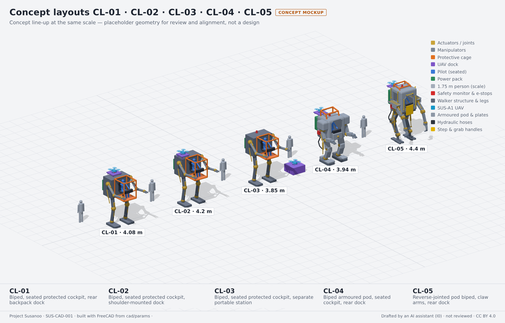
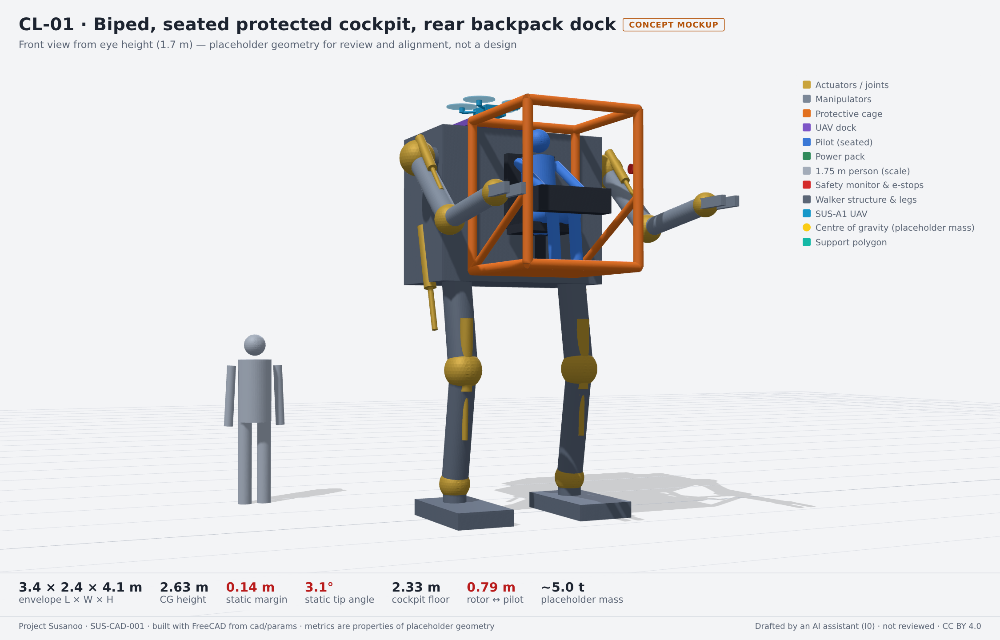
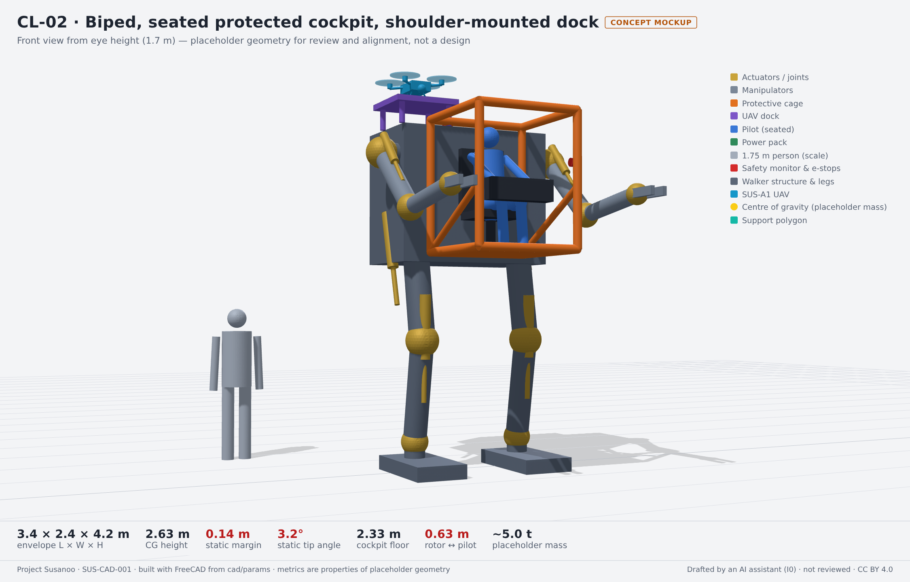
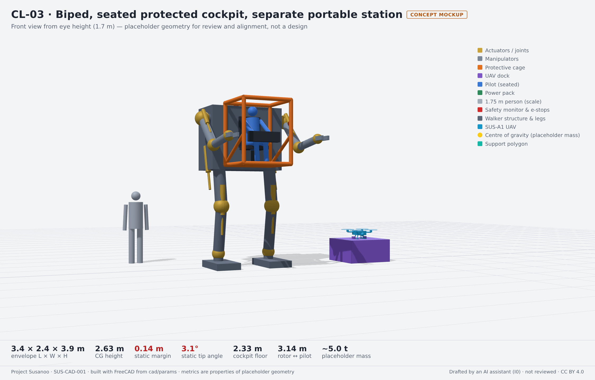
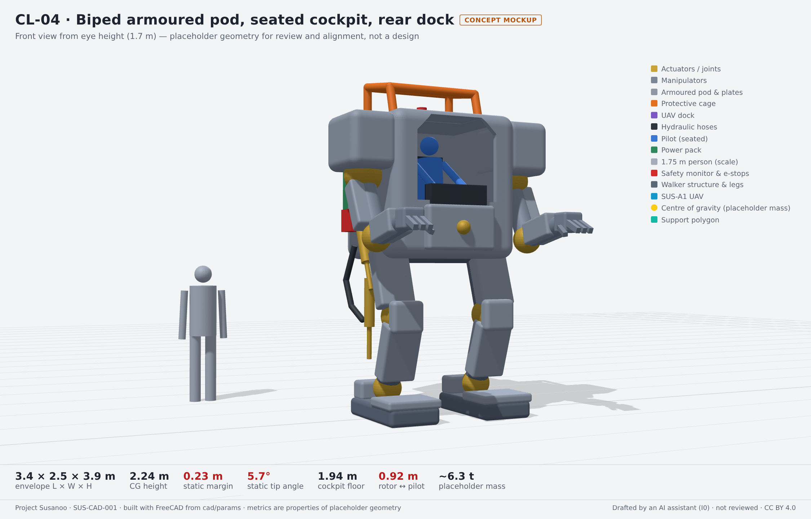
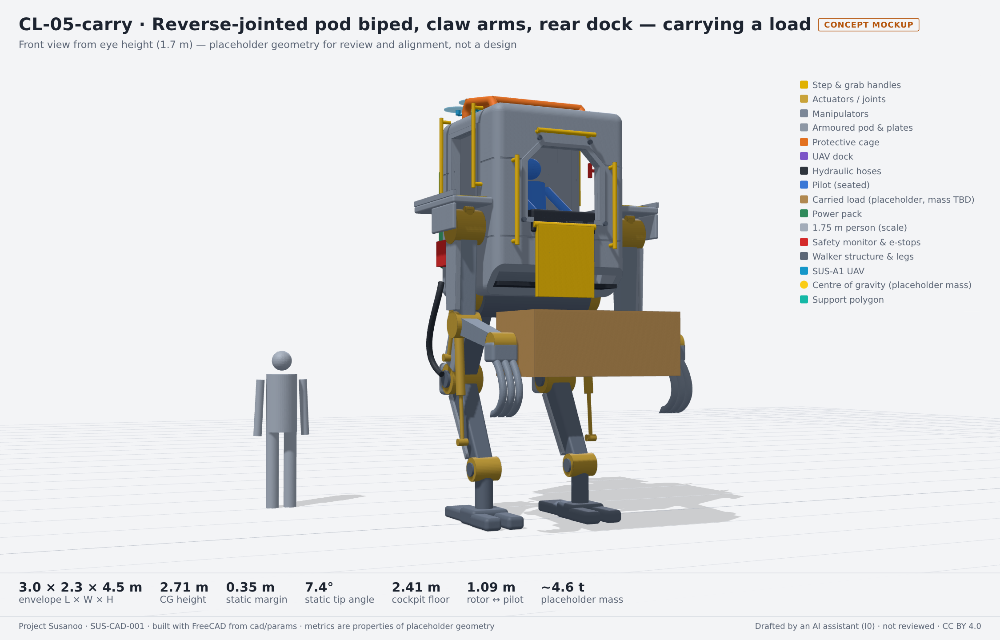
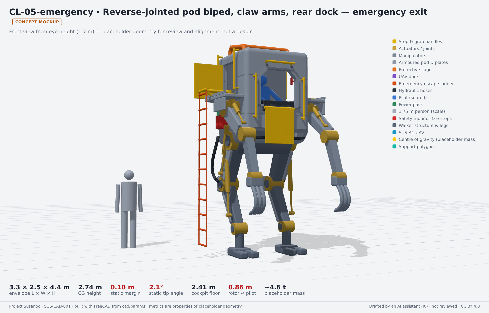
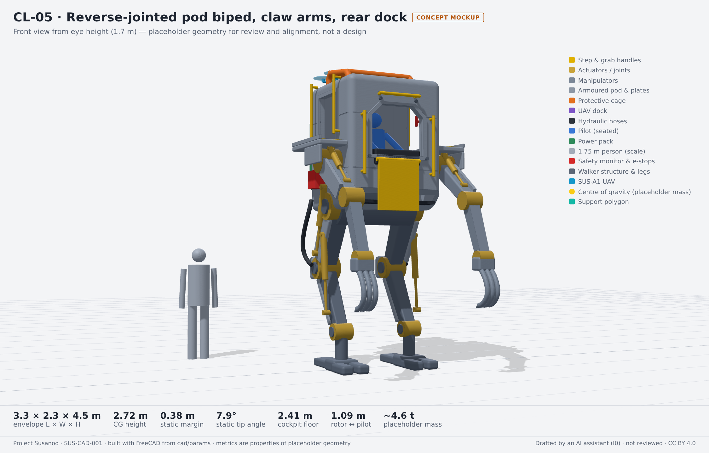
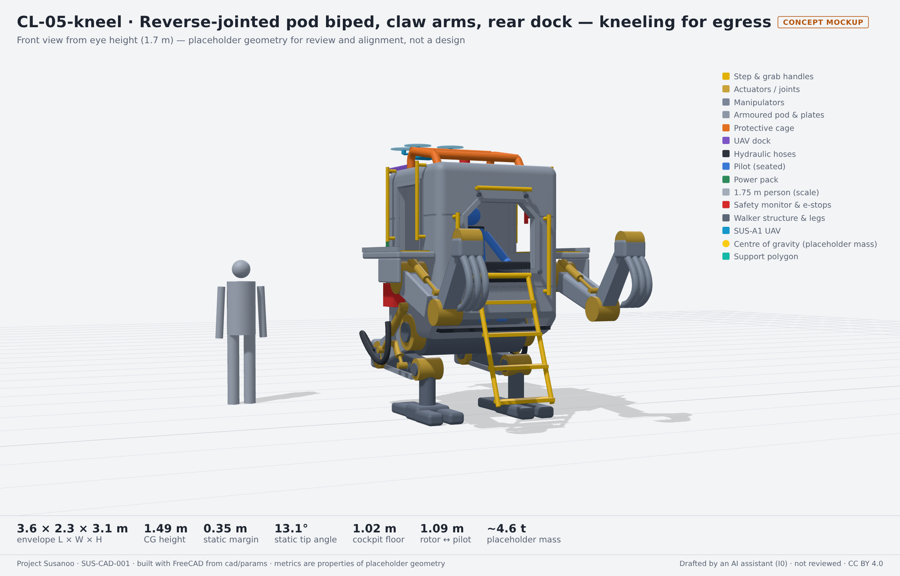

<!-- GENERATED by tools/previews/build_previews.py from docs/previews.yaml; do not edit. Edit the entry there and re-run. -->

# Concept layout renders

Review renders of every concept layout from five views (hero, iso, side, top, dock), rendered locally from the FreeCAD models (`tools/cad/make.sh`). Concept layouts, not a design.

<!-- terms:start (generated by tools/terms/terms.py; do not edit by hand) -->

<b>Terms on this page (3)</b>: abbreviations and codes explained

| Term | Meaning |
|---|---|
| CAD | computer-aided design |
| CL-nnn | concept layout (cad/params/CL-nn.yaml; CL-01 to CL-05, CL-05 the reference layout) |
| FreeCAD | open-source parametric CAD program used for the concept layouts |

All terms: [abbreviations and record codes](https://github.com/jherrodthomas/Project-Susanoo/blob/main/docs/terms.md).

<!-- terms:end -->

<!-- preview:start (generated by tools/previews/build_previews.py from docs/previews.yaml; do not edit by hand) -->

All concept layouts side by side

<table>
<tr><td width="33%" valign="top"> CL-01-hero.png</td><td width="33%" valign="top"> CL-02-hero.png</td><td width="33%" valign="top"> CL-03-hero.png</td></tr>
<tr><td width="33%" valign="top"> CL-04-hero.png</td><td width="33%" valign="top"> CL-05-carry-hero.png</td><td width="33%" valign="top"> CL-05-emergency-hero.png</td></tr>
<tr><td width="33%" valign="top"> CL-05-hero.png</td><td width="33%" valign="top"> CL-05-kneel-hero.png</td></tr>
</table>

**Open:** [Blender renders](blender/README.md) · [Concept layouts review](../README.md)

<!-- preview:end -->

## Folder contents

| Item | Title |
|---|---|
| [`blender/`](blender/) | Blender renders of CL-05 |
| [`CL-01-dock.png`](CL-01-dock.png) |  |
| [`CL-01-hero.png`](CL-01-hero.png) |  |
| [`CL-01-iso.png`](CL-01-iso.png) |  |
| [`CL-01-side.png`](CL-01-side.png) |  |
| [`CL-01-top.png`](CL-01-top.png) |  |
| [`CL-02-dock.png`](CL-02-dock.png) |  |
| [`CL-02-hero.png`](CL-02-hero.png) |  |
| [`CL-02-iso.png`](CL-02-iso.png) |  |
| [`CL-02-side.png`](CL-02-side.png) |  |
| [`CL-02-top.png`](CL-02-top.png) |  |
| [`CL-03-dock.png`](CL-03-dock.png) |  |
| [`CL-03-hero.png`](CL-03-hero.png) |  |
| [`CL-03-iso.png`](CL-03-iso.png) |  |
| [`CL-03-side.png`](CL-03-side.png) |  |
| [`CL-03-top.png`](CL-03-top.png) |  |
| [`CL-04-dock.png`](CL-04-dock.png) |  |
| [`CL-04-hero.png`](CL-04-hero.png) |  |
| [`CL-04-iso.png`](CL-04-iso.png) |  |
| [`CL-04-side.png`](CL-04-side.png) |  |
| [`CL-04-top.png`](CL-04-top.png) |  |
| [`CL-05-carry-dock.png`](CL-05-carry-dock.png) |  |
| [`CL-05-carry-hero.png`](CL-05-carry-hero.png) |  |
| [`CL-05-carry-iso.png`](CL-05-carry-iso.png) |  |
| [`CL-05-carry-side.png`](CL-05-carry-side.png) |  |
| [`CL-05-carry-top.png`](CL-05-carry-top.png) |  |
| [`CL-05-dock.png`](CL-05-dock.png) |  |
| [`CL-05-emergency-dock.png`](CL-05-emergency-dock.png) |  |
| [`CL-05-emergency-hero.png`](CL-05-emergency-hero.png) |  |
| [`CL-05-emergency-iso.png`](CL-05-emergency-iso.png) |  |
| [`CL-05-emergency-side.png`](CL-05-emergency-side.png) |  |
| [`CL-05-emergency-top.png`](CL-05-emergency-top.png) |  |
| [`CL-05-hero.png`](CL-05-hero.png) |  |
| [`CL-05-iso.png`](CL-05-iso.png) |  |
| [`CL-05-kneel-dock.png`](CL-05-kneel-dock.png) |  |
| [`CL-05-kneel-hero.png`](CL-05-kneel-hero.png) |  |
| [`CL-05-kneel-iso.png`](CL-05-kneel-iso.png) |  |
| [`CL-05-kneel-side.png`](CL-05-kneel-side.png) |  |
| [`CL-05-kneel-top.png`](CL-05-kneel-top.png) |  |
| [`CL-05-side.png`](CL-05-side.png) |  |
| [`CL-05-top.png`](CL-05-top.png) |  |
| [`lineup.png`](lineup.png) |  |
