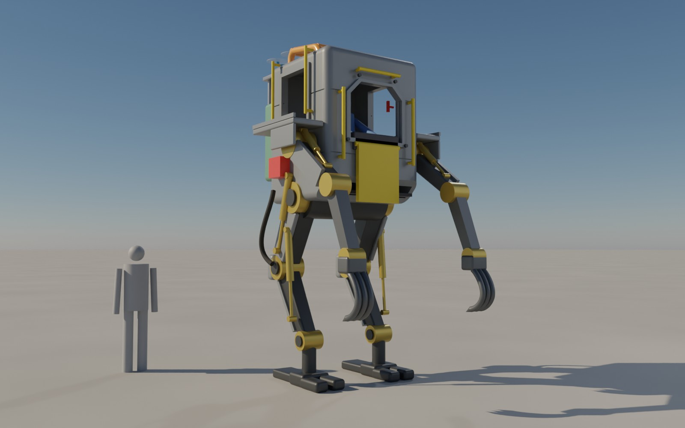
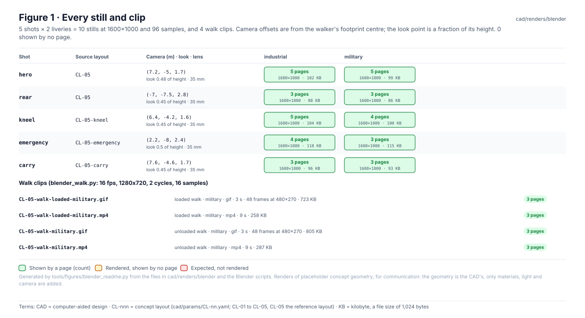
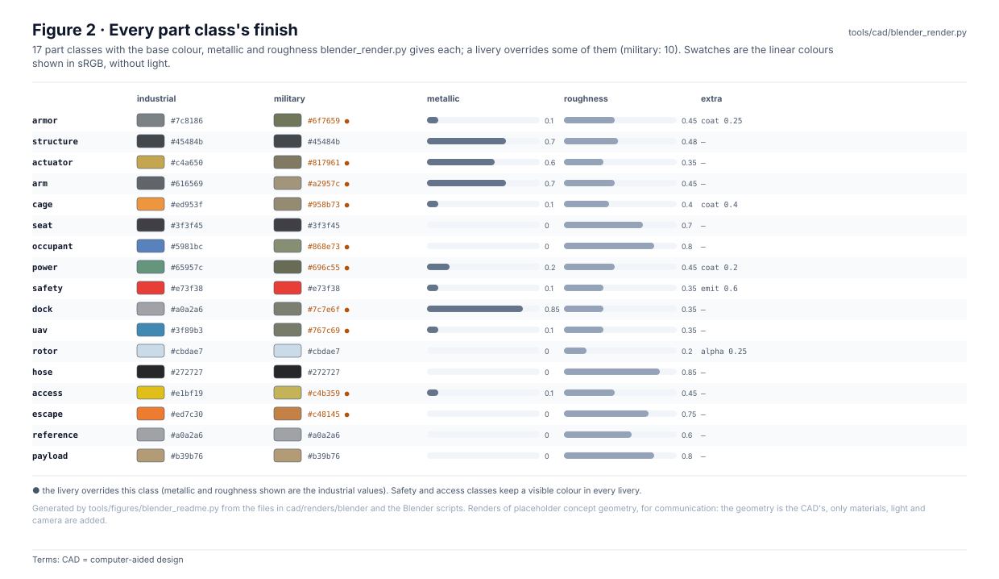
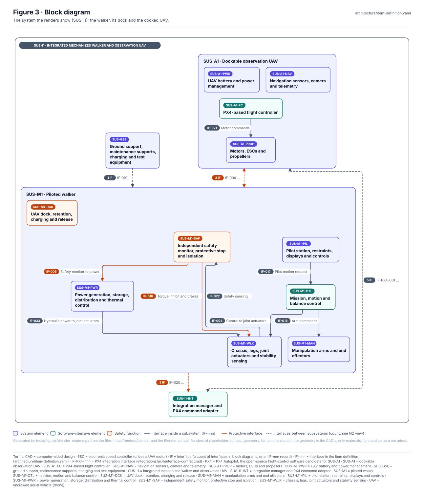
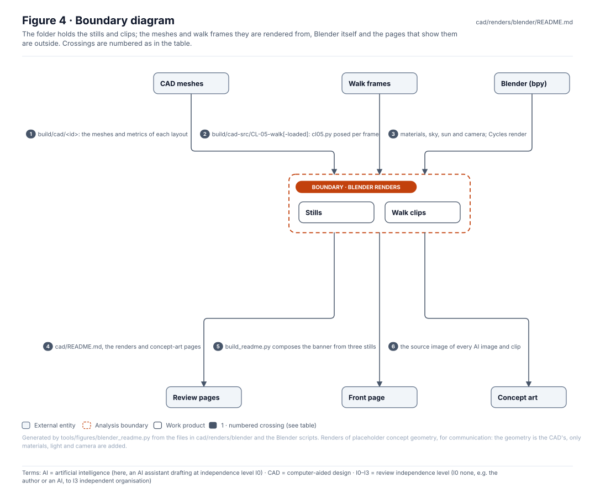
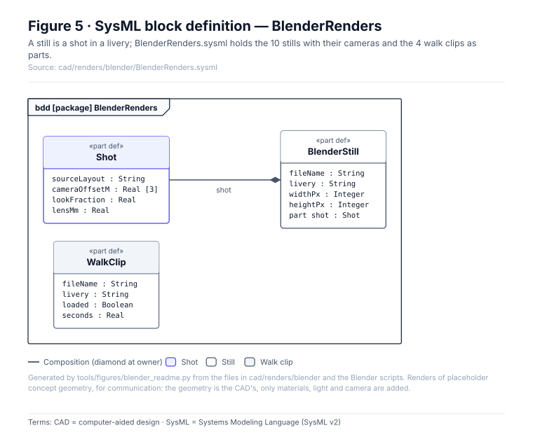
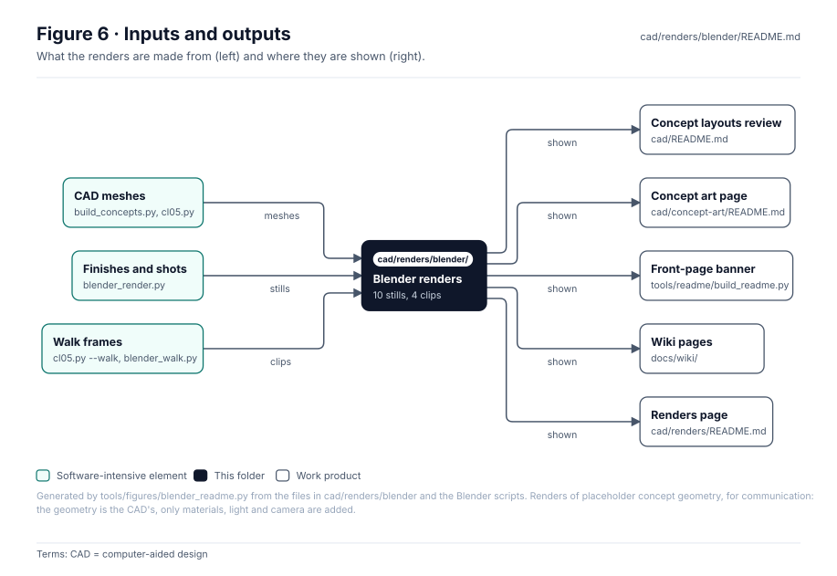

<!-- GENERATED by tools/figures/blender_readme.py from cad/renders/blender and the Blender scripts; re-render and regenerate. -->

# Blender renders of CL-05

> **Status:** 10 stills (5 shots × 2 liveries) and 4 walk clips; 0 missing, 0 shown by no page. Lit renders of the CL-05 concept geometry in plain and unarmed military livery, **for communication, not engineering**.

<!-- terms:start (generated by tools/terms/terms.py; do not edit by hand) -->

<b>Terms on this page (10)</b>: abbreviations and codes explained

| Term | Meaning |
|---|---|
| AI | artificial intelligence (here, an AI assistant drafting at independence level I0) |
| CAD | computer-aided design |
| CI | continuous integration (the automated checks GitHub runs on every change) |
| CL-nnn | concept layout (cad/params/CL-nn.yaml; CL-01 to CL-05, CL-05 the reference layout) |
| I0–I3 | review independence level (I0 none, e.g. the author or an AI, to I3 independent organisation) |
| JPEG | Joint Photographic Experts Group, the compressed image format of the renders and photographs |
| KB | kilobyte, a file size of 1,024 bytes |
| OMG | Object Management Group, publisher of SysML |
| SVG | Scalable Vector Graphics, the figure file format |
| SysML | Systems Modeling Language (SysML v2) |

All terms: [abbreviations and record codes](https://github.com/jherrodthomas/Project-Susanoo/blob/main/docs/terms.md).

<!-- terms:end -->

| Field | Value |
|---|---|
| Stills | [`blender_render.py`](../../../tools/cad/blender_render.py): Cycles, 96 samples, 1600×1000, JPEG |
| Walk clips | [`blender_walk.py`](../../../tools/cad/blender_walk.py): 16 fps, default livery ?, `--loaded` for the carry walk |
| Needs | `bpy` (Blender as a Python module); run locally by `tools/cad/make.sh`, committed, not re-rendered in CI |
| SysML | [`BlenderRenders.sysml`](BlenderRenders.sysml) (generated) |

## Purpose

Lit stills and walk clips of the CL-05 reference layout, rendered from exactly the meshes the metrics and drawing sheets use; only materials, light and camera are added. They show the machine to people who will not read a drawing, feed the front-page banner, and are the source images of the AI concept art.

## Every still and clip

| Shot | Source layout | Camera (m) · look · lens | industrial | military |
|---|---|---|---|---|
| `hero` | `CL-05` | (7.2, -5, 1.7) · 0.48 · 35 mm | [shown](CL-05-hero.jpg) | [shown](CL-05-hero-military.jpg) |
| `rear` | `CL-05` | (-7, -7.5, 2.8) · 0.45 · 35 mm | [shown](CL-05-rear.jpg) | [shown](CL-05-rear-military.jpg) |
| `kneel` | `CL-05-kneel` | (6.4, -4.2, 1.6) · 0.45 · 35 mm | [shown](CL-05-kneel.jpg) | [shown](CL-05-kneel-military.jpg) |
| `emergency` | `CL-05-emergency` | (2.2, -8, 2.4) · 0.5 · 35 mm | [shown](CL-05-emergency.jpg) | [shown](CL-05-emergency-military.jpg) |
| `carry` | `CL-05-carry` | (7.6, -4.6, 1.7) · 0.45 · 35 mm | [shown](CL-05-carry.jpg) | [shown](CL-05-carry-military.jpg) |

| Clip | Walk | Livery | Length | Size |
|---|---|---|---|---|
| [`CL-05-walk-loaded-military.gif`](CL-05-walk-loaded-military.gif) | loaded | military | 3.0 s, 48 frames | 723 KB |
| [`CL-05-walk-loaded-military.mp4`](CL-05-walk-loaded-military.mp4) | loaded | military | 9.0 s | 258 KB |
| [`CL-05-walk-military.gif`](CL-05-walk-military.gif) | unloaded | military | 3.0 s, 48 frames | 805 KB |
| [`CL-05-walk-military.mp4`](CL-05-walk-military.mp4) | unloaded | military | 9.0 s | 287 KB |

## Finishes

## Block diagram

## Boundary diagram

| # | From | To | Crossing / interaction |
|---|---|---|---|
| 1 | CAD meshes | Blender renders | build/cad/<id>: the meshes and metrics of each layout |
| 2 | Walk frames | Blender renders | build/cad-src/CL-05-walk[-loaded]: cl05.py posed per frame |
| 3 | Blender (bpy) | Blender renders | materials, sky, sun and camera; Cycles render |
| 4 | Blender renders | Review pages | cad/README.md, the renders and concept-art pages |
| 5 | Blender renders | Front page | build_readme.py composes the banner from three stills |
| 6 | Blender renders | Concept art | the source image of every AI image and clip |

**Explicitly excluded:** the meshes and walk frames (built in `build/`, not committed), the review renders ([`cad/renders/`](../README.md)) and any engineering use: light, finish and camera are presentation.

## SysML model

[`BlenderRenders.sysml`](BlenderRenders.sysml) is generated from the files and the shot table and validated with the project model by the OMG pilot in CI.

## Inputs and outputs

| Input | Source |
|---|---|
| CAD meshes and walk frames | `tools/cad/build_concepts.py`, `tools/cad/b3d/cl05.py` |
| Shots, finishes, liveries | `tools/cad/blender_render.py` |

| Output | Destination |
|---|---|
| Stills and clips | Concept layouts review (`cad/README.md`) |
| Stills and clips | Concept art page (`cad/concept-art/README.md`) |
| Stills and clips | Front-page banner (`tools/readme/build_readme.py`) |
| Stills and clips | Wiki pages (`docs/wiki/`) |
| Stills and clips | Renders page (`cad/renders/README.md`) |

## Changing a render

1. Change a shot, finish or livery in `tools/cad/blender_render.py` (or the walk in `blender_walk.py`); never edit an image here.
2. Re-render with `bpy` (`tools/cad/make.sh`, or the script's own command line) and look at every changed image; the front-page banner and concept-art pages use some of them.
3. Regenerate this page and run the full check list in [`CLAUDE.md`](../../../CLAUDE.md).

## Folder contents

| Item | Description | State |
|---|---|---|
| [`CL-05-hero.jpg`](CL-05-hero.jpg) | `hero` shot, industrial livery (102 KB) | generated by `blender_render.py` |
| [`CL-05-hero-military.jpg`](CL-05-hero-military.jpg) | `hero` shot, military livery (99 KB) | generated by `blender_render.py` |
| [`CL-05-rear.jpg`](CL-05-rear.jpg) | `rear` shot, industrial livery (88 KB) | generated by `blender_render.py` |
| [`CL-05-rear-military.jpg`](CL-05-rear-military.jpg) | `rear` shot, military livery (86 KB) | generated by `blender_render.py` |
| [`CL-05-kneel.jpg`](CL-05-kneel.jpg) | `kneel` shot, industrial livery (104 KB) | generated by `blender_render.py` |
| [`CL-05-kneel-military.jpg`](CL-05-kneel-military.jpg) | `kneel` shot, military livery (100 KB) | generated by `blender_render.py` |
| [`CL-05-emergency.jpg`](CL-05-emergency.jpg) | `emergency` shot, industrial livery (118 KB) | generated by `blender_render.py` |
| [`CL-05-emergency-military.jpg`](CL-05-emergency-military.jpg) | `emergency` shot, military livery (115 KB) | generated by `blender_render.py` |
| [`CL-05-carry.jpg`](CL-05-carry.jpg) | `carry` shot, industrial livery (96 KB) | generated by `blender_render.py` |
| [`CL-05-carry-military.jpg`](CL-05-carry-military.jpg) | `carry` shot, military livery (93 KB) | generated by `blender_render.py` |
| [`CL-05-walk-loaded-military.gif`](CL-05-walk-loaded-military.gif) | loaded walk, gif (723 KB) | generated by `blender_walk.py` |
| [`CL-05-walk-loaded-military.mp4`](CL-05-walk-loaded-military.mp4) | loaded walk, mp4 (258 KB) | generated by `blender_walk.py` |
| [`CL-05-walk-military.gif`](CL-05-walk-military.gif) | unloaded walk, gif (805 KB) | generated by `blender_walk.py` |
| [`CL-05-walk-military.mp4`](CL-05-walk-military.mp4) | unloaded walk, mp4 (287 KB) | generated by `blender_walk.py` |
| [`BlenderRenders.sysml`](BlenderRenders.sysml) | The renders as SysML | generated |
| [`figures/`](figures/) | Generated SVG figures (do not edit) | generated |
| `README.md` | This page | generated |

<!-- END GENERATED: content below this line is human-authored and preserved -->
