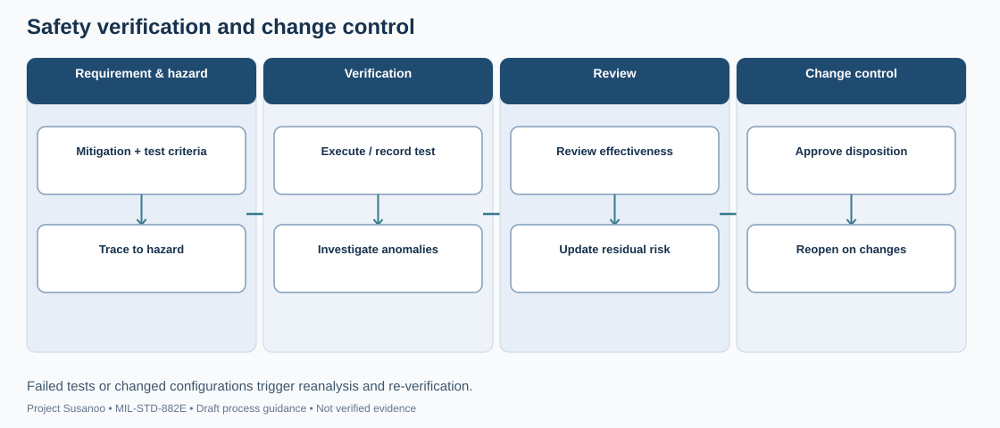
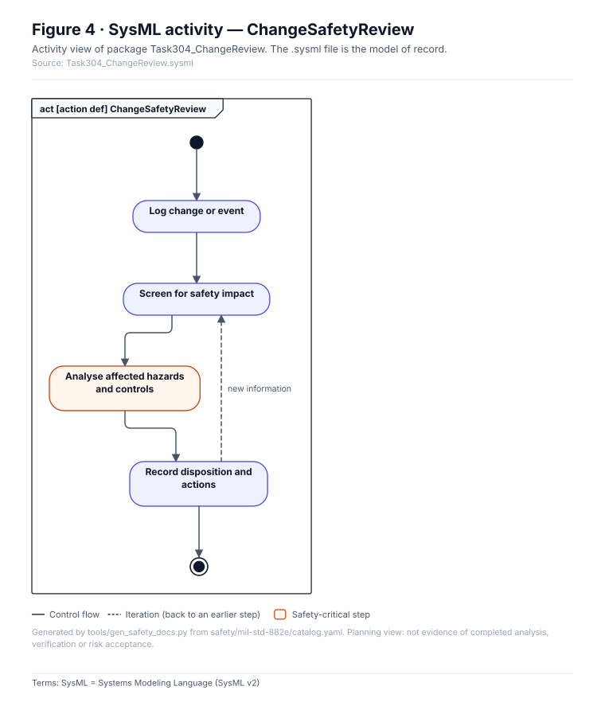

# Change requests (MIL-STD-882E 4.3.8, Task 304)

One `CR-NNN.yaml` per change (schema `pdac/schemas/change-request.schema.json`). When a change is `approved` or `implemented`, the validator (rule R10) requires every hazard it affects to carry a `reassessments` entry for it. Affected items are found through linked requirements, SSFs, mitigations (`HAZ-x:M1`) or configurations. If the reassessment outcome is `risk-increased` on a previously accepted hazard, a new acceptance dated on or after the reassessment is required.

<!-- terms:start (generated by tools/terms/terms.py; do not edit by hand) -->

<b>Terms on this page (7)</b>: abbreviations and codes explained

| Term | Meaning |
|---|---|
| DoD | US Department of Defense |
| M1, M2 … | mitigation in a hazard record (M1, M2 …), or a SysML model check rule in tools/sysml |
| MIL-STD-882E | US DoD Standard Practice for System Safety (11 May 2012, base edition) |
| R01 … | validator rule in tools/pdac (R13 = only a named human review accepts anything) |
| SSF-nnn | safety-significant software function record (safety/software/) |
| SysML | Systems Modeling Language (SysML v2) |
| US | United States |

All terms: [abbreviations and record codes](https://github.com/jherrodthomas/Project-Susanoo/blob/main/docs/terms.md).

<!-- terms:end -->

<!-- preview:start (generated by tools/previews/build_previews.py from docs/previews.yaml; do not edit by hand) -->

Verification and change process map (illustrative)

<table>
<tr><td width="33%" valign="top"> Task 304: reviewing changes, deficiencies and mishaps</td></tr>
</table>

<!-- preview:end -->

