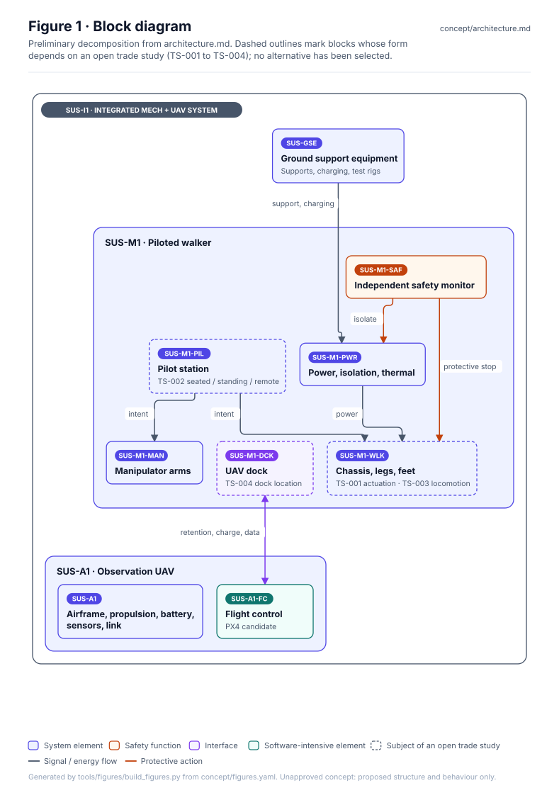
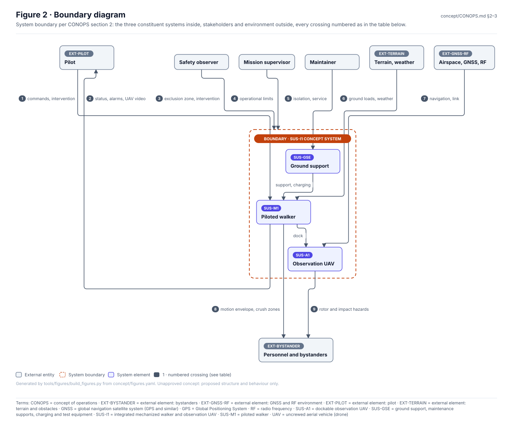
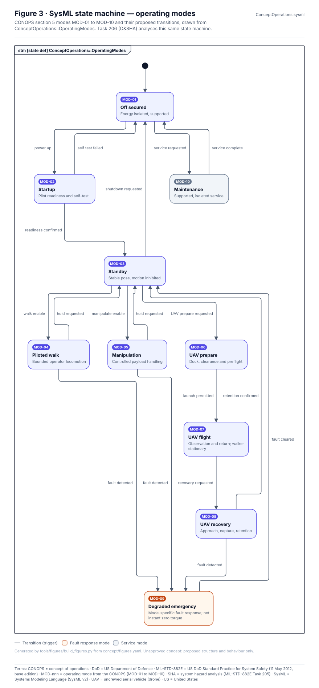
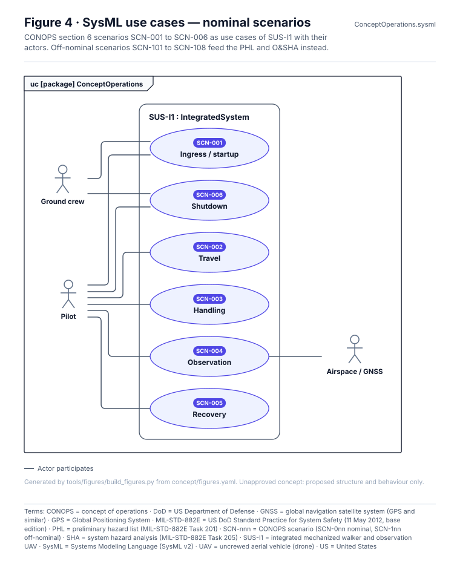
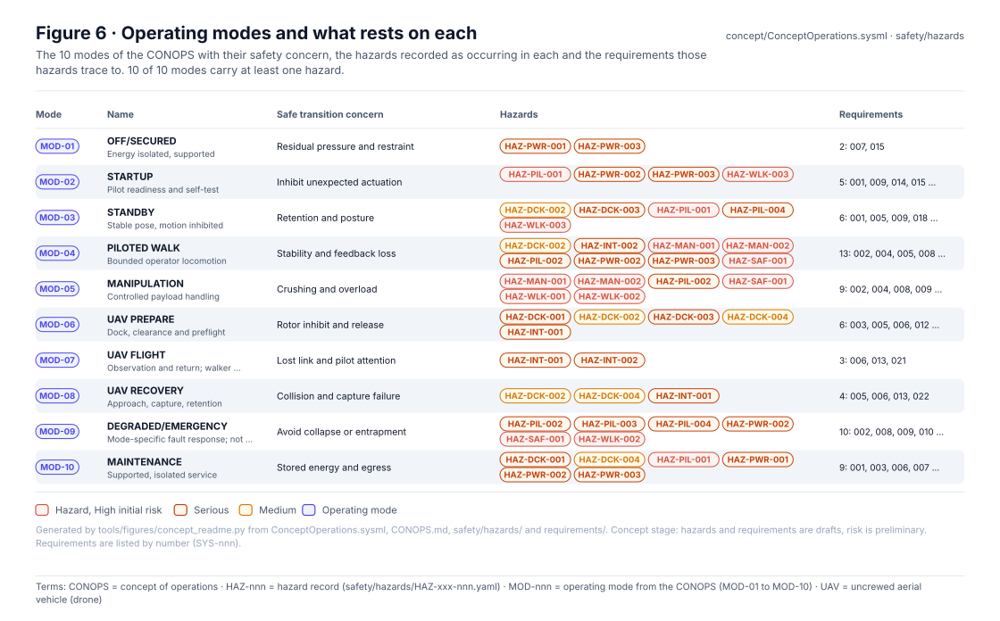
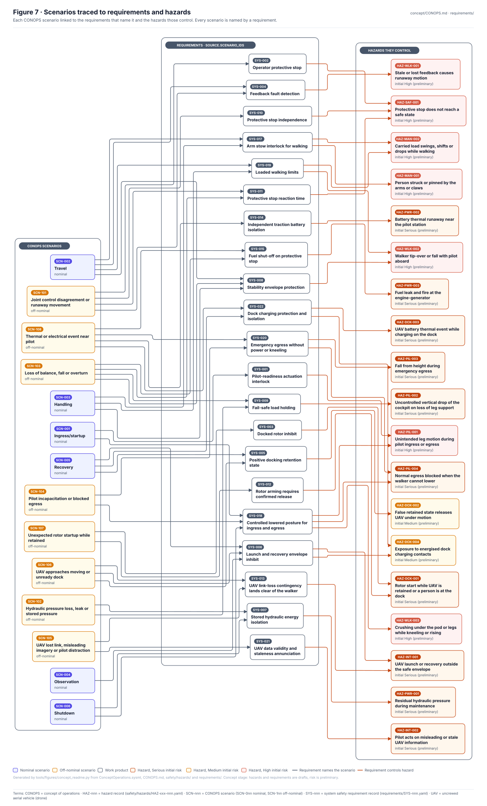
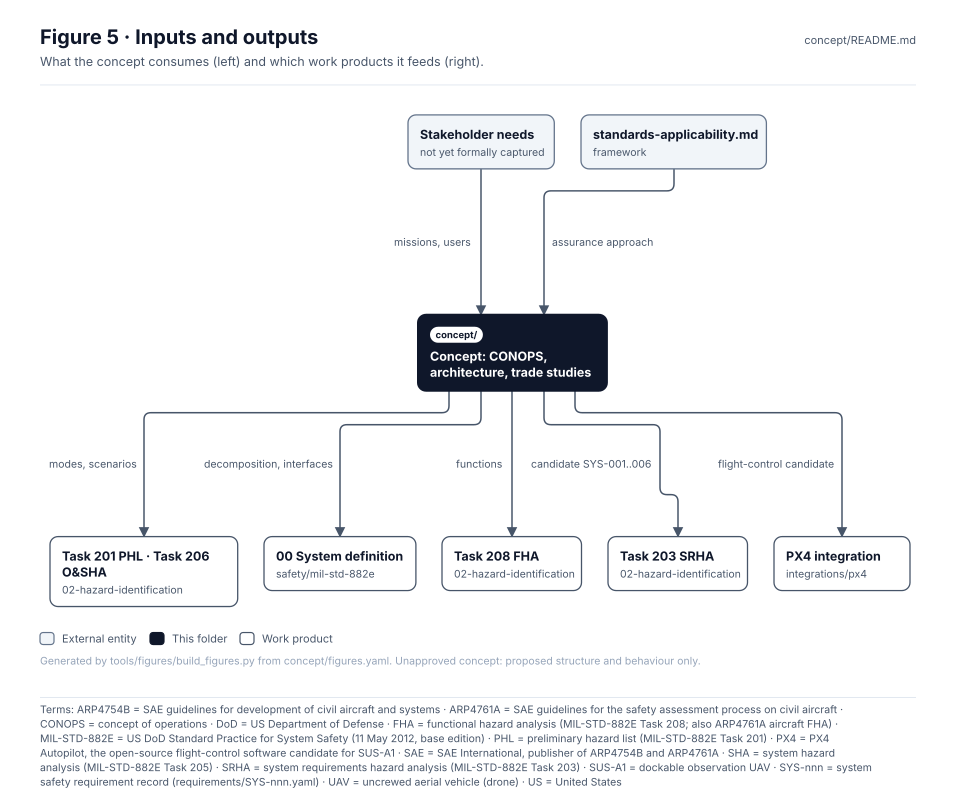

# Concept — SUS-I1 Operations, Architecture and Trade Studies

> **Status:** Unapproved concept (CONOPS rev 0.3-draft, architecture v0.2). Diagrams show proposed
> structure and behaviour only. No component, safe state, threshold or trade-study outcome has been
> selected or verified.

<!-- terms:start (generated by tools/terms/terms.py; do not edit by hand) -->

<b>Terms on this page (28)</b>: abbreviations and codes explained

| Term | Meaning |
|---|---|
| ARP4754B | SAE guidelines for development of civil aircraft and systems |
| ARP4761A | SAE guidelines for the safety assessment process on civil aircraft |
| CONOPS | concept of operations |
| DoD | US Department of Defense |
| FHA | functional hazard analysis (MIL-STD-882E Task 208; also ARP4761A aircraft FHA) |
| G0–G7 | lifecycle gate (G0 concept to G7 change and sustainment) |
| GNSS | global navigation satellite system (GPS and similar) |
| GPS | Global Positioning System |
| HAZ-nnn | hazard record (safety/hazards/HAZ-xxx-nnn.yaml) |
| MIL-STD-882E | US DoD Standard Practice for System Safety (11 May 2012, base edition) |
| MOD-nnn | operating mode from the CONOPS (MOD-01 to MOD-10) |
| PHA | preliminary hazard analysis (MIL-STD-882E Task 202) |
| PHL | preliminary hazard list (MIL-STD-882E Task 201) |
| RF | radio frequency |
| SAE | SAE International, publisher of ARP4754B and ARP4761A |
| SCN-nnn | CONOPS scenario (SCN-0nn nominal, SCN-1nn off-nominal) |
| SHA | system hazard analysis (MIL-STD-882E Task 205) |
| SRHA | system requirements hazard analysis (MIL-STD-882E Task 203) |
| SUS-A1 | dockable observation UAV |
| SUS-GSE | ground support, maintenance supports, charging and test equipment |
| SUS-I1 | integrated mechanized walker and observation UAV |
| SUS-M1 | piloted walker |
| SVG | Scalable Vector Graphics, the figure file format |
| SYS-nnn | system safety requirement record (requirements/SYS-nnn.yaml) |
| SysML | Systems Modeling Language (SysML v2) |
| TS-nnn | architecture trade study |
| UAV | uncrewed aerial vehicle (drone) |
| US | United States |

All terms: [abbreviations and record codes](https://github.com/jherrodthomas/Project-Susanoo/blob/main/docs/terms.md).

<!-- terms:end -->

| Field | Value |
|---|---|
| Lifecycle gate | G0 (Concept) feeding G1–G2 |
| Accountable role | Systems lead |
| Documentation standard | [`framework/documentation-standard.md`](../framework/documentation-standard.md) |
| Analysis baseline | [`safety/mil-std-882e/00-system-definition`](../safety/mil-std-882e/00-system-definition/README.md) |

## Purpose

Defines what Susanoo is for and how it is meant to be used, before design commitments are made:
missions, operating modes and scenarios ([CONOPS](CONOPS.md)), the preliminary decomposition and
controlled interfaces ([architecture](architecture.md)), and the open actuation, pilot, locomotion
and docking alternatives ([trade studies](trade-studies.md)). These documents are the primary inputs
to the PHL, PHA and FHA in the MIL-STD-882E tree.

## Block diagram

Preliminary decomposition from [`architecture.md`](architecture.md). Dashed outline = subject of an open
trade study (TS-xxx).

## Boundary diagram

System boundary per CONOPS section 2. Numbered crossings match the table.

| # | From | To | Crossing |
|---|---|---|---|
| 1 | Pilot | SUS-M1 | Commands, emergency intervention |
| 2 | SUS-M1 | Pilot | Status, alarms, UAV video |
| 3 | Safety observer | SUS-I1 | Exclusion zone, intervention |
| 4 | Mission supervisor | SUS-I1 | Operational limits |
| 5 | Maintainer | SUS-GSE | Isolation and service |
| 6 | Terrain, weather | SUS-M1 | Ground loads, weather |
| 7 | Airspace, GNSS, RF | SUS-A1 | Navigation, link |
| 8 | SUS-M1 | Personnel and bystanders | Motion envelope, crush zones |
| 9 | SUS-A1 | Personnel and bystanders | Rotor and impact hazards |

**Explicitly excluded:** weapons or armament, amphibious mobility, authorized human-occupied operation
(requires separate review and test authorization).

## SysML model

SysML v2 textual model: [`ConceptOperations.sysml`](ConceptOperations.sysml) — the CONOPS operating
modes as a state machine and the nominal scenarios as use cases. It imports
the project model's [`SusanooArchitecture`](../models/sysml/model/Architecture.sysml). The `.sysml`
file is the model of record; Figure 3 is drawn directly from it, so the figure cannot drift from the model.
[Task 206 (O&SHA)](../safety/mil-std-882e/02-hazard-identification/task-206-operating-and-support-hazard-analysis/README.md)
analyses the same state machine.

<!-- concept-records:start (generated by tools/figures/concept_readme.py; do not edit by hand) -->

## Modes and scenarios in the records

Figures 6 and 7 are generated from the records, so they show what the safety work currently says about each mode and scenario. A gap here is a prompt for the hazard analysis, not a finding.

| Mode | Name | Concern | Hazards | Requirements |
|---|---|---|---|---|
| MOD-01 | OFF/SECURED | Residual pressure and restraint | [HAZ-PWR-001](../safety/hazards/HAZ-PWR-001.yaml), [HAZ-PWR-003](../safety/hazards/HAZ-PWR-003.yaml) | SYS-007, SYS-015 |
| MOD-02 | STARTUP | Inhibit unexpected actuation | [HAZ-PIL-001](../safety/hazards/HAZ-PIL-001.yaml), [HAZ-PWR-002](../safety/hazards/HAZ-PWR-002.yaml), [HAZ-PWR-003](../safety/hazards/HAZ-PWR-003.yaml), [HAZ-WLK-003](../safety/hazards/HAZ-WLK-003.yaml) | SYS-001, SYS-009, SYS-014, SYS-015, SYS-018 |
| MOD-03 | STANDBY | Retention and posture | [HAZ-DCK-002](../safety/hazards/HAZ-DCK-002.yaml), [HAZ-PIL-001](../safety/hazards/HAZ-PIL-001.yaml), [HAZ-WLK-003](../safety/hazards/HAZ-WLK-003.yaml) | SYS-001, SYS-005, SYS-009, SYS-018 |
| MOD-04 | PILOTED WALK | Stability and feedback loss | [HAZ-DCK-002](../safety/hazards/HAZ-DCK-002.yaml), [HAZ-MAN-001](../safety/hazards/HAZ-MAN-001.yaml), [HAZ-MAN-002](../safety/hazards/HAZ-MAN-002.yaml), [HAZ-PIL-002](../safety/hazards/HAZ-PIL-002.yaml), [HAZ-PWR-002](../safety/hazards/HAZ-PWR-002.yaml), [HAZ-PWR-003](../safety/hazards/HAZ-PWR-003.yaml), [HAZ-SAF-001](../safety/hazards/HAZ-SAF-001.yaml), [HAZ-WLK-001](../safety/hazards/HAZ-WLK-001.yaml), [HAZ-WLK-002](../safety/hazards/HAZ-WLK-002.yaml) | SYS-002, SYS-004, SYS-005, SYS-008, SYS-009, SYS-010, SYS-011, SYS-014, SYS-015, SYS-016, SYS-017, SYS-019 |
| MOD-05 | MANIPULATION | Crushing and overload | [HAZ-MAN-001](../safety/hazards/HAZ-MAN-001.yaml), [HAZ-MAN-002](../safety/hazards/HAZ-MAN-002.yaml), [HAZ-PIL-002](../safety/hazards/HAZ-PIL-002.yaml), [HAZ-SAF-001](../safety/hazards/HAZ-SAF-001.yaml), [HAZ-WLK-001](../safety/hazards/HAZ-WLK-001.yaml), [HAZ-WLK-002](../safety/hazards/HAZ-WLK-002.yaml) | SYS-002, SYS-004, SYS-008, SYS-009, SYS-010, SYS-011, SYS-016, SYS-017, SYS-019 |
| MOD-06 | UAV PREPARE | Rotor inhibit and release | [HAZ-DCK-001](../safety/hazards/HAZ-DCK-001.yaml), [HAZ-DCK-002](../safety/hazards/HAZ-DCK-002.yaml), [HAZ-INT-001](../safety/hazards/HAZ-INT-001.yaml) | SYS-003, SYS-005, SYS-006, SYS-012, SYS-013 |
| MOD-07 | UAV FLIGHT | Lost link and pilot attention | [HAZ-INT-001](../safety/hazards/HAZ-INT-001.yaml) | SYS-006, SYS-013 |
| MOD-08 | UAV RECOVERY | Collision and capture failure | [HAZ-DCK-002](../safety/hazards/HAZ-DCK-002.yaml), [HAZ-INT-001](../safety/hazards/HAZ-INT-001.yaml) | SYS-005, SYS-006, SYS-013 |
| MOD-09 | DEGRADED/EMERGENCY | Avoid collapse or entrapment | [HAZ-PIL-002](../safety/hazards/HAZ-PIL-002.yaml), [HAZ-PIL-003](../safety/hazards/HAZ-PIL-003.yaml), [HAZ-PWR-002](../safety/hazards/HAZ-PWR-002.yaml), [HAZ-SAF-001](../safety/hazards/HAZ-SAF-001.yaml), [HAZ-WLK-002](../safety/hazards/HAZ-WLK-002.yaml) | SYS-002, SYS-008, SYS-009, SYS-010, SYS-011, SYS-014, SYS-016, SYS-019, SYS-020 |
| MOD-10 | MAINTENANCE | Stored energy and egress | [HAZ-DCK-001](../safety/hazards/HAZ-DCK-001.yaml), [HAZ-PIL-001](../safety/hazards/HAZ-PIL-001.yaml), [HAZ-PWR-001](../safety/hazards/HAZ-PWR-001.yaml), [HAZ-PWR-002](../safety/hazards/HAZ-PWR-002.yaml), [HAZ-PWR-003](../safety/hazards/HAZ-PWR-003.yaml) | SYS-001, SYS-003, SYS-007, SYS-012, SYS-014, SYS-015, SYS-018 |

| Scenario | Kind | Title | Requirements | Hazards |
|---|---|---|---|---|
| SCN-001 | nominal | Ingress/startup | [SYS-001](../requirements/SYS-001.yaml), [SYS-018](../requirements/SYS-018.yaml) | HAZ-PIL-001, HAZ-WLK-003 |
| SCN-002 | nominal | Travel | [SYS-004](../requirements/SYS-004.yaml), [SYS-008](../requirements/SYS-008.yaml), [SYS-017](../requirements/SYS-017.yaml), [SYS-019](../requirements/SYS-019.yaml) | HAZ-MAN-001, HAZ-MAN-002, HAZ-WLK-001, HAZ-WLK-002 |
| SCN-003 | nominal | Handling | [SYS-008](../requirements/SYS-008.yaml), [SYS-017](../requirements/SYS-017.yaml), [SYS-019](../requirements/SYS-019.yaml) | HAZ-MAN-001, HAZ-MAN-002, HAZ-WLK-002 |
| SCN-004 | nominal | Observation | [SYS-006](../requirements/SYS-006.yaml) | HAZ-INT-001 |
| SCN-005 | nominal | Recovery | [SYS-005](../requirements/SYS-005.yaml), [SYS-006](../requirements/SYS-006.yaml) | HAZ-DCK-002, HAZ-INT-001 |
| SCN-006 | nominal | Shutdown | [SYS-007](../requirements/SYS-007.yaml), [SYS-018](../requirements/SYS-018.yaml) | HAZ-PIL-001, HAZ-PWR-001, HAZ-WLK-003 |
| SCN-101 | off-nominal | Joint control disagreement or runaway movement | [SYS-002](../requirements/SYS-002.yaml), [SYS-004](../requirements/SYS-004.yaml), [SYS-010](../requirements/SYS-010.yaml), [SYS-011](../requirements/SYS-011.yaml) | HAZ-SAF-001, HAZ-WLK-001 |
| SCN-102 | off-nominal | Hydraulic pressure loss, leak or stored pressure | [SYS-007](../requirements/SYS-007.yaml), [SYS-009](../requirements/SYS-009.yaml) | HAZ-PIL-002, HAZ-PWR-001 |
| SCN-103 | off-nominal | Loss of balance, fall or overturn | [SYS-008](../requirements/SYS-008.yaml), [SYS-009](../requirements/SYS-009.yaml), [SYS-011](../requirements/SYS-011.yaml), [SYS-015](../requirements/SYS-015.yaml) | HAZ-PIL-002, HAZ-PWR-003, HAZ-SAF-001, HAZ-WLK-002 |
| SCN-104 | off-nominal | Pilot incapacitation or blocked egress | [SYS-018](../requirements/SYS-018.yaml), [SYS-020](../requirements/SYS-020.yaml) | HAZ-PIL-001, HAZ-PIL-003, HAZ-WLK-003 |
| SCN-105 | off-nominal | UAV lost link, misleading imagery or pilot distraction | [SYS-013](../requirements/SYS-013.yaml) | HAZ-INT-001 |
| SCN-106 | off-nominal | UAV approaches moving or unready dock | [SYS-005](../requirements/SYS-005.yaml), [SYS-006](../requirements/SYS-006.yaml), [SYS-013](../requirements/SYS-013.yaml) | HAZ-DCK-002, HAZ-INT-001 |
| SCN-107 | off-nominal | Unexpected rotor startup while retained | [SYS-003](../requirements/SYS-003.yaml), [SYS-012](../requirements/SYS-012.yaml) | HAZ-DCK-001 |
| SCN-108 | off-nominal | Thermal or electrical event near pilot | [SYS-014](../requirements/SYS-014.yaml), [SYS-015](../requirements/SYS-015.yaml), [SYS-020](../requirements/SYS-020.yaml) | HAZ-PIL-003, HAZ-PWR-002, HAZ-PWR-003 |

Regenerate with `python3 tools/figures/concept_readme.py`.

<!-- concept-records:end -->

## Inputs and outputs

| Input | Source |
|---|---|
| Missions, users, constraints | Stakeholder needs (not yet formally captured) |
| Assurance approach | [`framework/standards-applicability.md`](../framework/standards-applicability.md) |

| Output | Destination |
|---|---|
| Modes and scenarios | [Task 201 PHL](../safety/mil-std-882e/02-hazard-identification/task-201-preliminary-hazard-list/README.md), [Task 206 O&SHA](../safety/mil-std-882e/02-hazard-identification/task-206-operating-and-support-hazard-analysis/README.md) |
| Decomposition and interfaces | [00 System definition](../safety/mil-std-882e/00-system-definition/README.md) |
| System functions | [Task 208 FHA](../safety/mil-std-882e/02-hazard-identification/task-208-functional-hazard-analysis/README.md) |
| Candidate requirements SYS-001..006 | [Task 203 SRHA](../safety/mil-std-882e/02-hazard-identification/task-203-system-requirements-hazard-analysis/README.md) |
| Flight-control candidate | [`integrations/px4`](../integrations/px4/README.md) |

## Folder contents

| Item | Description | State |
|---|---|---|
| [`CONOPS.md`](CONOPS.md) | Missions, modes, scenarios, human factors, candidate requirements | present |
| [`architecture.md`](architecture.md) | Preliminary decomposition, interfaces, safety principles | present |
| [`trade-studies.md`](trade-studies.md) | TS-001..TS-004, no winners selected | present |
| [`ConceptOperations.sysml`](ConceptOperations.sysml) | SysML v2 modes and scenarios | present |
| [`figures.yaml`](figures.yaml) | Figure specs; render with `python3 tools/figures/build_figures.py` | present |
| [`figures/`](figures/) | Generated SVG figures (do not edit); `figures/records/` holds figures 6–7 from `tools/figures/concept_readme.py` | generated |
