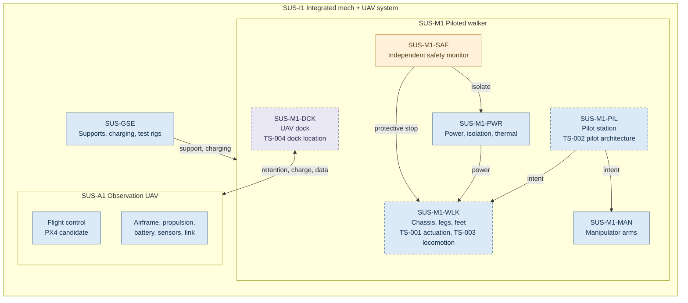
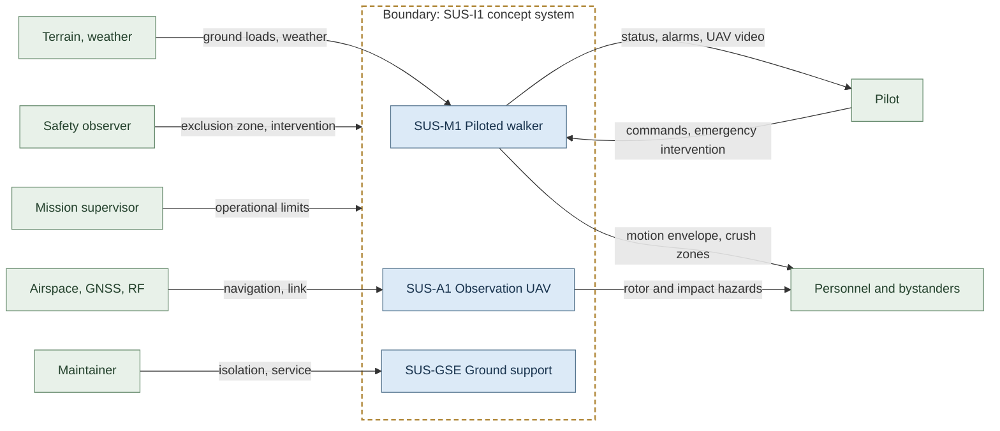
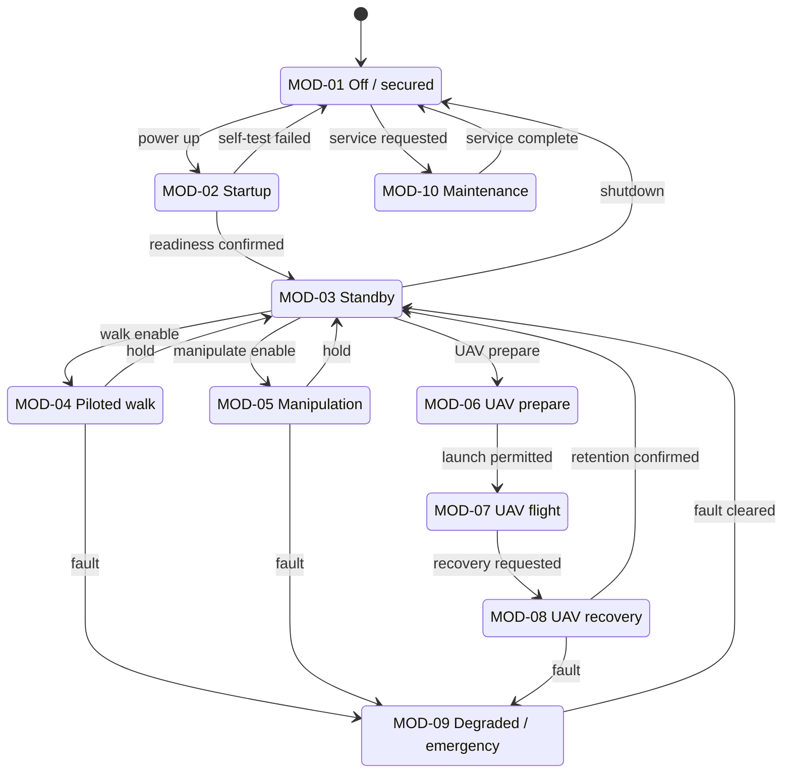
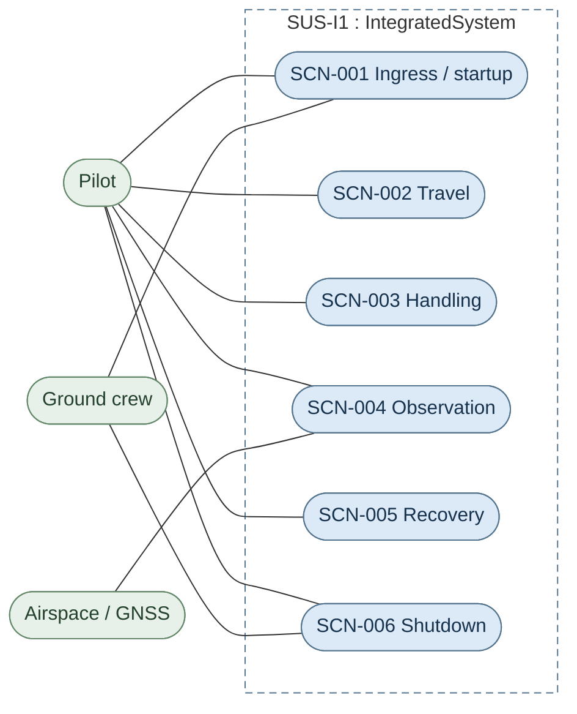
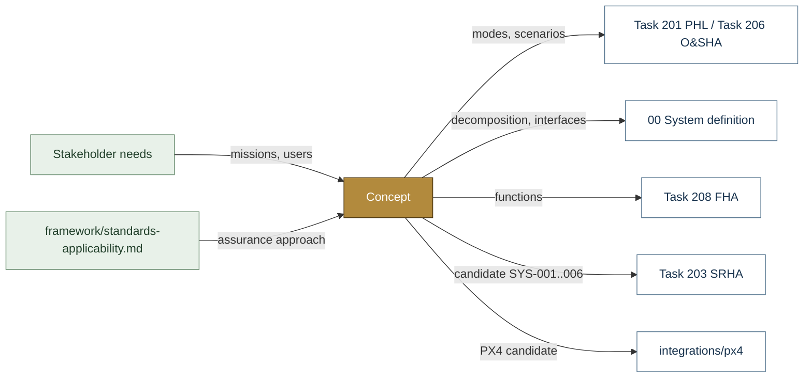

# Concept — SUS-I1 Operations, Architecture and Trade Studies

> **Status:** Unapproved concept (CONOPS rev 0.3-draft, architecture v0.2). Diagrams show proposed
> structure and behaviour only. No component, safe state, threshold or trade-study outcome has been
> selected or verified.

| Field | Value |
|---|---|
| Lifecycle gate | G0 (Concept) feeding G1–G2 |
| Accountable role | Systems lead |
| Documentation standard | [`framework/documentation-standard.md`](../framework/documentation-standard.md) |
| Analysis baseline | [`safety/mil-std-882e/00-system-definition`](../safety/mil-std-882e/00-system-definition/README.md) |

## Purpose

Defines what Susanoo is for and how it is meant to be used, before design commitments are made:
missions, operating modes and scenarios ([CONOPS](CONOPS.md)), the preliminary decomposition and
controlled interfaces ([architecture](architecture.md)), and the open actuation, pilot, locomotion
and docking alternatives ([trade studies](trade-studies.md)). These documents are the primary inputs
to the PHL, PHA and FHA in the MIL-STD-882E tree.

## Block diagram

Preliminary decomposition from [`architecture.md`](architecture.md). Amber = protective function,
purple = interface. Dashed outline = subject of an open trade study (TS-xxx).

## Boundary diagram

System boundary per CONOPS section 2. Green = external entities and stakeholders.

| From | To | Crossing |
|---|---|---|
| Pilot | SUS-M1 | Commands, emergency intervention |
| SUS-M1 | Pilot | Status, alarms, UAV video |
| Safety observer / mission supervisor | SUS-I1 | Exclusion zone, operational limits |
| Maintainer | SUS-GSE | Isolation and service |
| Terrain, weather / airspace | SUS-M1 / SUS-A1 | Loads, navigation, link |
| SUS-M1 / SUS-A1 | Personnel | Motion, crush, rotor and impact hazards |

**Explicitly excluded:** weapons or armament, amphibious mobility, authorized human-occupied operation
(requires separate review and test authorization).

## SysML model

SysML v2 textual model: [`ConceptOperations.sysml`](ConceptOperations.sysml) — the CONOPS operating
modes as a state machine and the nominal scenarios as use cases. It imports
[`SusanooSystem`](../safety/mil-std-882e/00-system-definition/sysml/SusanooSystem.sysml). The `.sysml`
file is the model of record; diagrams below are reading aids.

### State machine (stm) — operating modes MOD-01..MOD-10

### Use cases — nominal scenarios SCN-001..SCN-006

## Inputs and outputs

| Input | Source |
|---|---|
| Missions, users, constraints | Stakeholder needs (not yet formally captured) |
| Assurance approach | [`framework/standards-applicability.md`](../framework/standards-applicability.md) |

| Output | Destination |
|---|---|
| Modes and scenarios | [Task 201 PHL](../safety/mil-std-882e/02-hazard-identification/task-201-preliminary-hazard-list/README.md), [Task 206 O&SHA](../safety/mil-std-882e/02-hazard-identification/task-206-operating-and-support-hazard-analysis/README.md) |
| Decomposition and interfaces | [00 System definition](../safety/mil-std-882e/00-system-definition/README.md) |
| System functions | [Task 208 FHA](../safety/mil-std-882e/02-hazard-identification/task-208-functional-hazard-analysis/README.md) |
| Candidate requirements SYS-001..006 | [Task 203 SRHA](../safety/mil-std-882e/02-hazard-identification/task-203-system-requirements-hazard-analysis/README.md) |
| Flight-control candidate | [`integrations/px4`](../integrations/px4/README.md) |

## Folder contents

| Item | Description | State |
|---|---|---|
| [`CONOPS.md`](CONOPS.md) | Missions, modes, scenarios, human factors, candidate requirements | present |
| [`architecture.md`](architecture.md) | Preliminary decomposition, interfaces, safety principles | present |
| [`trade-studies.md`](trade-studies.md) | TS-001..TS-004, no winners selected | present |
| [`ConceptOperations.sysml`](ConceptOperations.sysml) | SysML v2 modes and scenarios | present |
