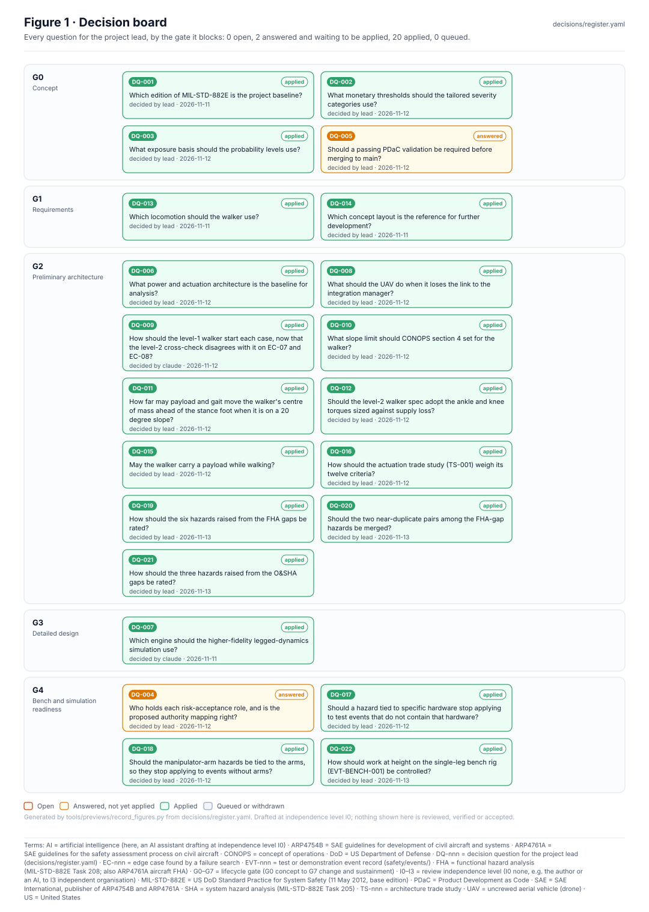

<!-- GENERATED by tools/previews/build_previews.py from docs/previews.yaml; do not edit. Edit the entry there and re-run. -->

# Decision register

Every question for the project lead, with options, a recommendation, what it blocks and how it was answered. The Decision Inbox wiki page is generated from `register.yaml`.

<!-- preview:start (generated by tools/previews/build_previews.py from docs/previews.yaml; do not edit by hand) -->

Decision board: every decision by gate and status

**Open:** [Decision Inbox (wiki page)](../docs/wiki/Decision-Inbox.md)

<!-- preview:end -->

## Folder contents

| Item | Title |
|---|---|
| [`register.yaml`](register.yaml) | Decision register: every question for the project lead (the safety authority). |
