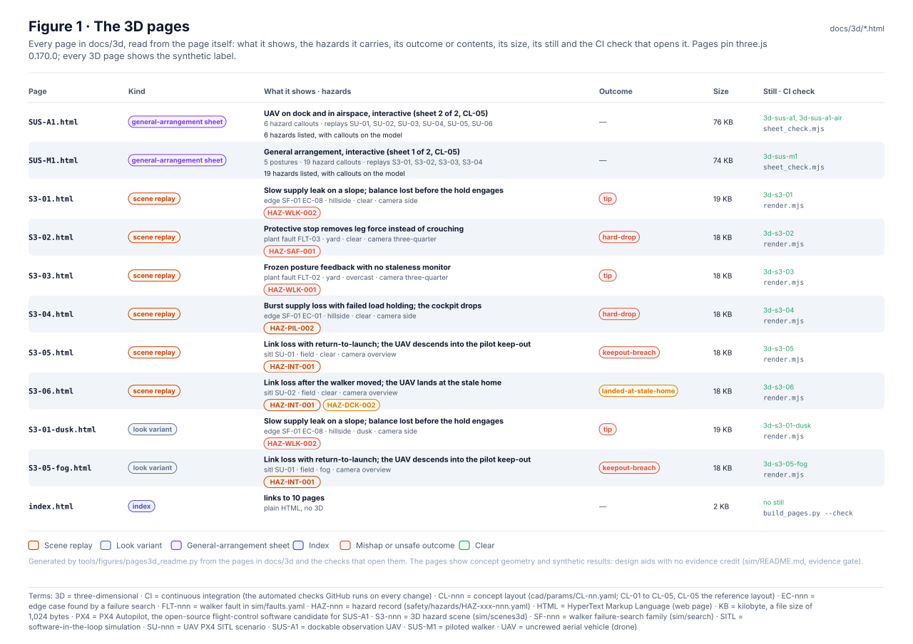
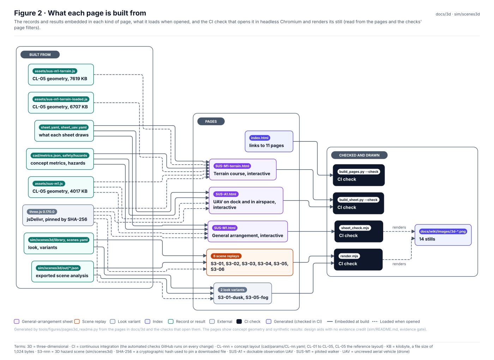
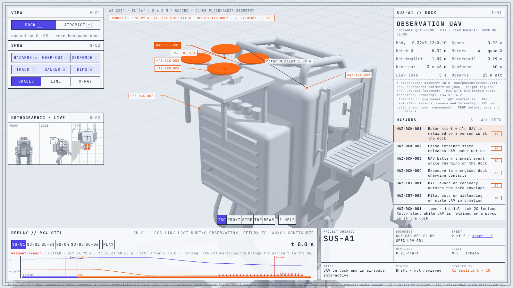
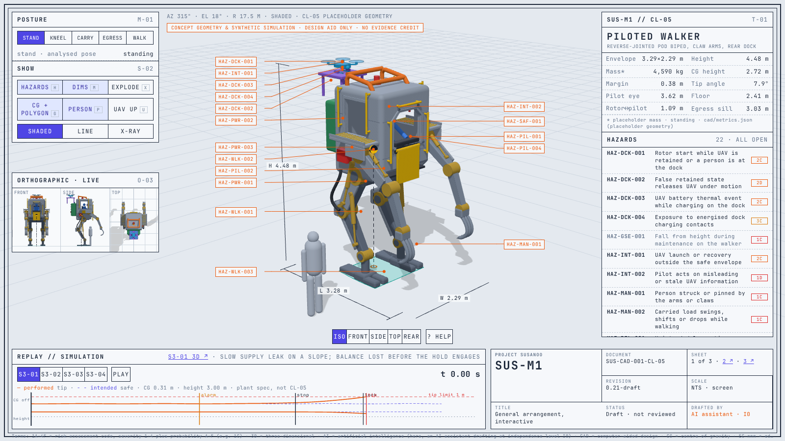
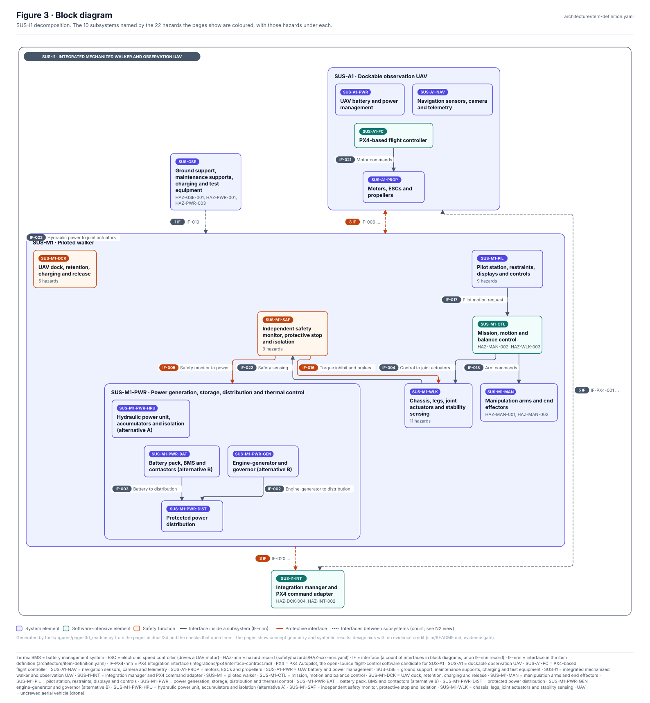
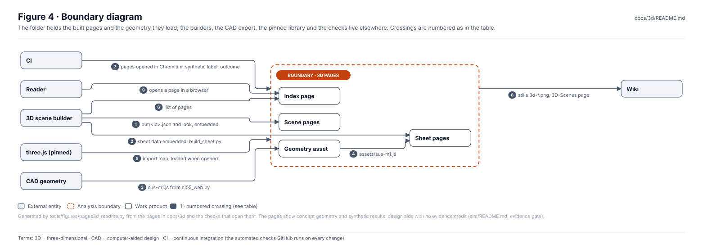
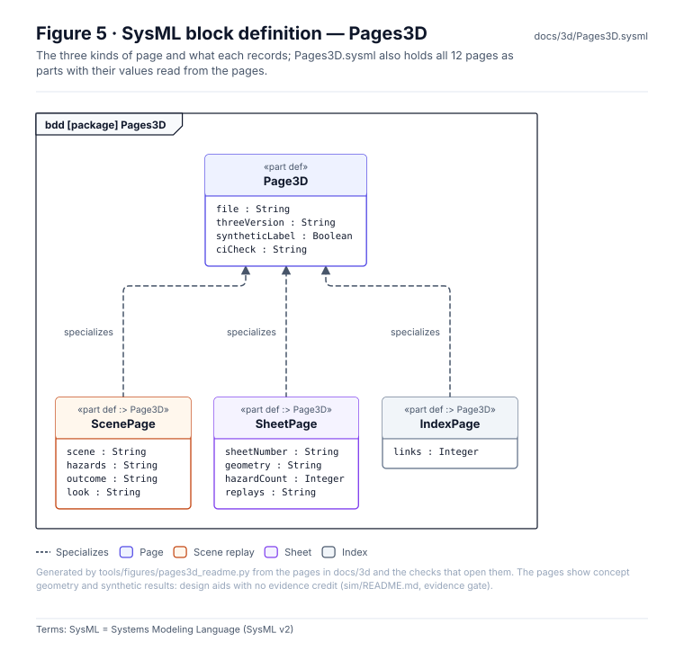
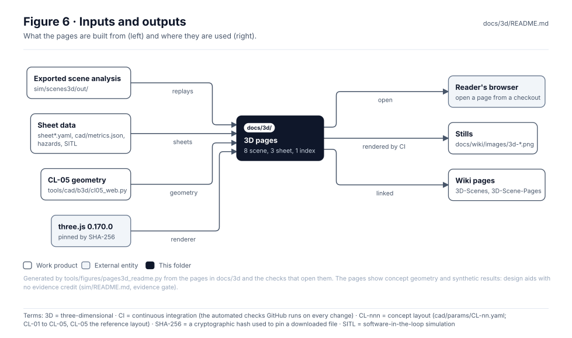

<!-- GENERATED by tools/figures/pages3d_readme.py from the pages in docs/3d; rebuild the pages (sim/scenes3d) and regenerate. -->

# 3D scene pages

> **Status:** 6 scene pages, 2 look variants, 2 general-arrangement sheets and an index, showing 22 of 22 hazards. Every 3D page carries the synthetic label. Concept geometry and synthetic results: design aids, **no evidence credit**.

<!-- terms:start (generated by tools/terms/terms.py; do not edit by hand) -->

<b>Terms on this page (18)</b>: abbreviations and codes explained

| Term | Meaning |
|---|---|
| 3D | three-dimensional |
| CAD | computer-aided design |
| CI | continuous integration (the automated checks GitHub runs on every change) |
| CL-nnn | concept layout (cad/params/CL-nn.yaml; CL-01 to CL-05, CL-05 the reference layout) |
| HAZ-nnn | hazard record (safety/hazards/HAZ-xxx-nnn.yaml) |
| HTML | HyperText Markup Language (web page) |
| KB | kilobyte, a file size of 1,024 bytes |
| OMG | Object Management Group, publisher of SysML |
| PX4 | PX4 Autopilot, the open-source flight-control software candidate for SUS-A1 |
| S3-nnn | 3D hazard scene (sim/scenes3d) |
| SHA-256 | a cryptographic hash used to pin a downloaded file |
| SITL | software-in-the-loop simulation |
| SU-nnn | UAV PX4 SITL scenario |
| SUS-A1 | dockable observation UAV |
| SUS-M1 | piloted walker |
| SVG | Scalable Vector Graphics, the figure file format |
| SysML | Systems Modeling Language (SysML v2) |
| UAV | uncrewed aerial vehicle (drone) |

All terms: [abbreviations and record codes](https://github.com/jherrodthomas/Project-Susanoo/blob/main/docs/terms.md).

<!-- terms:end -->

| Field | Value |
|---|---|
| Open | [`index.html`](index.html) from a local checkout, or a page below · [3D scenes (wiki)](../wiki/3D-Scenes.md) |
| Built by | [`sim/scenes3d`](../../sim/scenes3d/README.md): `build_pages.py` (scenes, index), `build_sheet.py` (sheets) |
| Checked by | `sim/scenes3d/render.mjs` (scene pages), `sim/scenes3d/sheet_check.mjs` (sheets), both `--check-only` in CI |
| three.js | `0.170.0` from jsDelivr, pinned by SHA-256 in [`sim/scenes3d/scenes.yaml`](../../sim/scenes3d/scenes.yaml) |
| SysML | [`Pages3D.sysml`](Pages3D.sysml) (generated) |

## Purpose

The pages a reader opens to see the simulation results and the concept geometry in 3D: each scene page replays one committed synthetic run in a chosen look, and the general-arrangement sheets show the CL-05 reference layout live, with its concept metrics, hazard callouts and replays. Every page is generated and self-contained apart from three.js and the geometry asset; nothing here is written by hand.

## Pages

| Page | Kind | Shows | Hazards | Outcome or contents | Size | Still | CI check |
|---|---|---|---|---|---|---|---|
| [`SUS-A1.html`](SUS-A1.html) | general-arrangement sheet | UAV on dock and in airspace, interactive (sheet 2 of 2, CL-05) | 6 hazards | 6 hazard callouts · replays SU-01, SU-02, SU-03, SU-04, SU-05, SU-06 | 76 KB | [`3d-sus-a1.png`](../wiki/images/3d-sus-a1.png), [`3d-sus-a1-air.png`](../wiki/images/3d-sus-a1-air.png) | `sim/scenes3d/sheet_check.mjs` |
| [`SUS-M1.html`](SUS-M1.html) | general-arrangement sheet | General arrangement, interactive (sheet 1 of 2, CL-05) | 22 hazards | 5 postures · 19 hazard callouts · replays S3-01, S3-02, S3-03, S3-04 | 75 KB | [`3d-sus-m1.png`](../wiki/images/3d-sus-m1.png) | `sim/scenes3d/sheet_check.mjs` |
| [`S3-01.html`](S3-01.html) | scene replay | Slow supply leak on a slope; balance lost before the hold engages | HAZ-WLK-002 | tip | 19 KB | [`3d-s3-01.png`](../wiki/images/3d-s3-01.png) | `sim/scenes3d/render.mjs` |
| [`S3-02.html`](S3-02.html) | scene replay | Protective stop removes leg force instead of crouching | HAZ-SAF-001 | hard-drop | 18 KB | [`3d-s3-02.png`](../wiki/images/3d-s3-02.png) | `sim/scenes3d/render.mjs` |
| [`S3-03.html`](S3-03.html) | scene replay | Frozen posture feedback with no staleness monitor | HAZ-WLK-001 | tip | 18 KB | [`3d-s3-03.png`](../wiki/images/3d-s3-03.png) | `sim/scenes3d/render.mjs` |
| [`S3-04.html`](S3-04.html) | scene replay | Burst supply loss with failed load holding; the cockpit drops | HAZ-PIL-002 | hard-drop | 18 KB | [`3d-s3-04.png`](../wiki/images/3d-s3-04.png) | `sim/scenes3d/render.mjs` |
| [`S3-05.html`](S3-05.html) | scene replay | Link loss with return-to-launch; the UAV descends into the pilot keep-out | HAZ-INT-001 | keepout-breach | 18 KB | [`3d-s3-05.png`](../wiki/images/3d-s3-05.png) | `sim/scenes3d/render.mjs` |
| [`S3-06.html`](S3-06.html) | scene replay | Link loss after the walker moved; the UAV lands at the stale home | HAZ-INT-001, HAZ-DCK-002 | landed-at-stale-home | 18 KB | [`3d-s3-06.png`](../wiki/images/3d-s3-06.png) | `sim/scenes3d/render.mjs` |
| [`S3-01-dusk.html`](S3-01-dusk.html) | look variant | Slow supply leak on a slope; balance lost before the hold engages | HAZ-WLK-002 | tip | 19 KB | [`3d-s3-01-dusk.png`](../wiki/images/3d-s3-01-dusk.png) | `sim/scenes3d/render.mjs` |
| [`S3-05-fog.html`](S3-05-fog.html) | look variant | Link loss with return-to-launch; the UAV descends into the pilot keep-out | HAZ-INT-001 | keepout-breach | 18 KB | [`3d-s3-05-fog.png`](../wiki/images/3d-s3-05-fog.png) | `sim/scenes3d/render.mjs` |
| [`index.html`](index.html) | index | links to 10 pages | — | plain HTML, no 3D | 2 KB | — | `sim/scenes3d/build_pages.py --check` |

## What each page is built from

| Page | Built by | From |
|---|---|---|
| `SUS-A1.html` | `sim/scenes3d/build_sheet.py` | sim/scenes3d/sheet_uav.yaml; figures from cad/params, cad/metrics.json, sim/uav/spec.yaml, architecture/item-definition.yaml, safety/hazards/ and the PX4 SITL results in sim/results/uav/ |
| `SUS-M1.html` | `sim/scenes3d/build_sheet.py` | sim/scenes3d/sheet.yaml; figures from cad/metrics.json, safety/hazards/ and sim/scenes3d/out/ |
| `S3-01.html` | `sim/scenes3d/build_pages.py` | sim/scenes3d/out/S3-01.json, scenes.yaml |
| `S3-02.html` | `sim/scenes3d/build_pages.py` | sim/scenes3d/out/S3-02.json, scenes.yaml |
| `S3-03.html` | `sim/scenes3d/build_pages.py` | sim/scenes3d/out/S3-03.json, scenes.yaml |
| `S3-04.html` | `sim/scenes3d/build_pages.py` | sim/scenes3d/out/S3-04.json, scenes.yaml |
| `S3-05.html` | `sim/scenes3d/build_pages.py` | sim/scenes3d/out/S3-05.json, scenes.yaml |
| `S3-06.html` | `sim/scenes3d/build_pages.py` | sim/scenes3d/out/S3-06.json, scenes.yaml |
| `S3-01-dusk.html` | `sim/scenes3d/build_pages.py` | sim/scenes3d/out/S3-01.json, scenes.yaml |
| `S3-05-fog.html` | `sim/scenes3d/build_pages.py` | sim/scenes3d/out/S3-05.json, scenes.yaml |
| `index.html` | `sim/scenes3d/build_pages.py` | scenes.yaml, the sheet pages |

| Asset | Size | Loaded by |
|---|---|---|
| [`assets/sus-m1.js`](assets/sus-m1.js) | 4017 KB | SUS-A1.html, SUS-M1.html |

## Block diagram

## Boundary diagram

| # | From | To | Crossing / interaction |
|---|---|---|---|
| 1 | 3D scene builder | Scene pages | out/<id>.json and look, embedded |
| 2 | 3D scene builder | Sheet pages | sheet data embedded; build_sheet.py |
| 3 | CAD geometry | Geometry asset | sus-m1.js from cl05_web.py |
| 4 | Geometry asset | Sheet pages | assets/sus-m1.js |
| 5 | three.js (pinned) | 3D pages | import map, loaded when opened |
| 6 | 3D scene builder | Index page | list of pages |
| 7 | CI | 3D pages | pages opened in Chromium, synthetic label, outcome |
| 8 | 3D pages | Wiki | stills 3d-*.png, 3D-Scenes page |
| 9 | Reader | Index page | opens a page in a browser |

**Explicitly excluded:** any analysis (a page only replays a committed result or shows concept metrics), design data (the geometry is a concept layout), and evidence of any kind.

## SysML model

[`Pages3D.sysml`](Pages3D.sysml) is generated from the pages and validated with the project model by the OMG pilot in CI.

## Inputs and outputs

| Input | Source |
|---|---|
| Scene analysis and looks | [`sim/scenes3d`](../../sim/scenes3d/README.md) (`out/`, `scenes.yaml`, `library/`) |
| Sheet data | `sim/scenes3d/sheet.yaml`, `sheet_uav.yaml`, [`cad/metrics.json`](../../cad/README.md), [hazard records](../../safety/README.md), [PX4 SITL results](../../sim/results/README.md) |
| CL-05 geometry | `tools/cad/b3d/cl05_web.py` → `assets/sus-m1.js` |

| Output | Destination |
|---|---|
| Pages to open | a browser, from a local checkout |
| Stills | `docs/wiki/images/3d-*.png` (rendered by the checks) |
| Wiki | [`3D-Scenes`](../wiki/3D-Scenes.md), and this page as `3D-Scene-Pages` |

## Adding or changing a page

1. Change the scene or sheet in [`sim/scenes3d`](../../sim/scenes3d/README.md), never a page here.
2. Rebuild: `python -m sim.scenes3d.export_scene && python -m sim.scenes3d.build_pages` and `python -m sim.scenes3d.build_sheet`; render the stills with `render.mjs` and `sheet_check.mjs` (see [`sim/README.md`](../../sim/README.md)).
3. Regenerate this page and run the full check list in [`CLAUDE.md`](../../CLAUDE.md).

## Folder contents

| Item | Description | State |
|---|---|---|
| [`S3-01-dusk.html`](S3-01-dusk.html) | S3-01-dusk Slow supply leak on a slope; balance lost before the hold engages | generated |
| [`S3-01.html`](S3-01.html) | S3-01 Slow supply leak on a slope; balance lost before the hold engages | generated |
| [`S3-02.html`](S3-02.html) | S3-02 Protective stop removes leg force instead of crouching | generated |
| [`S3-03.html`](S3-03.html) | S3-03 Frozen posture feedback with no staleness monitor | generated |
| [`S3-04.html`](S3-04.html) | S3-04 Burst supply loss with failed load holding; the cockpit drops | generated |
| [`S3-05-fog.html`](S3-05-fog.html) | S3-05-fog Link loss with return-to-launch; the UAV descends into the pilot keep-out | generated |
| [`S3-05.html`](S3-05.html) | S3-05 Link loss with return-to-launch; the UAV descends into the pilot keep-out | generated |
| [`S3-06.html`](S3-06.html) | S3-06 Link loss after the walker moved; the UAV lands at the stale home | generated |
| [`SUS-A1.html`](SUS-A1.html) | SUS-A1 on dock and in airspace | generated |
| [`SUS-M1.html`](SUS-M1.html) | SUS-M1 general arrangement | generated |
| [`index.html`](index.html) | Susanoo 3D scenes | generated |
| [`assets/`](assets/README.md) | Geometry loaded by the sheets | generated |
| [`Pages3D.sysml`](Pages3D.sysml) | Pages as SysML | generated |
| [`figures/`](figures/) | Generated SVG figures (do not edit) | generated |
| `README.md` | This page | generated |

<!-- END GENERATED: content below this line is human-authored and preserved -->
