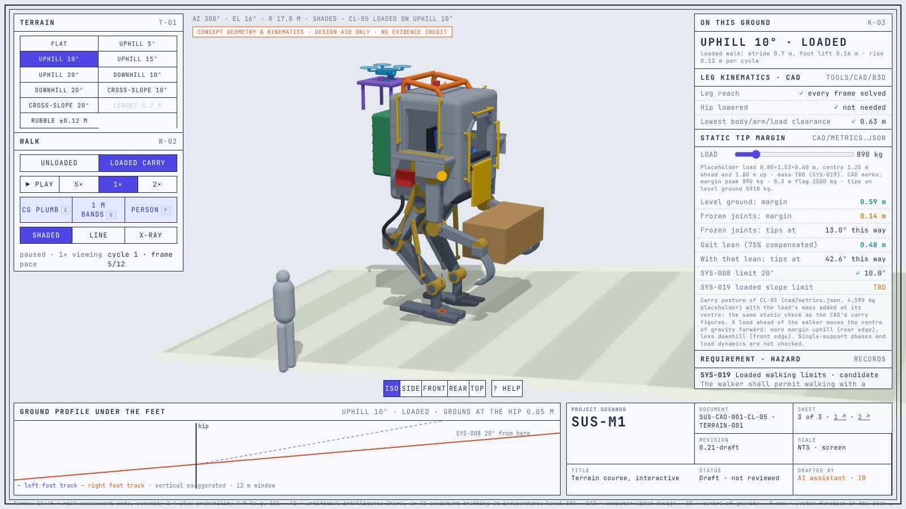

<!-- GENERATED by tools/previews/build_previews.py from docs/previews.yaml; do not edit. Edit the entry there and re-run. -->

# 3D scene pages

Interactive 3D replays of the simulation scenarios, built by `sim/scenes3d`, and the interactive general arrangement: sheet 1 `SUS-M1.html` (the CL-05 concept geometry animated through its postures and walk, with hazard callouts and the static tip check) and sheet 2 `SUS-A1.html` (the UAV on its dock, and the PX4 SITL flights replayed with the geofence and the pilot keep-out) and sheet 3 `SUS-M1-terrain.html` (the CL-05 walk posed on slopes, cross-slopes, ledges and rubble, unloaded or carrying the placeholder load, with the leg kinematics and static tip margin on each). Open a page in a browser; each still below links to its page. Concept geometry and simulation results are design aids, not verification evidence.

<!-- terms:start (generated by tools/terms/terms.py; do not edit by hand) -->

<b>Terms on this page (9)</b>: abbreviations and codes explained

| Term | Meaning |
|---|---|
| 3D | three-dimensional |
| CL-nnn | concept layout (cad/params/CL-nn.yaml; CL-01 to CL-05, CL-05 the reference layout) |
| PX4 | PX4 Autopilot, the open-source flight-control software candidate for SUS-A1 |
| S3-nnn | 3D hazard scene (sim/scenes3d) |
| SITL | software-in-the-loop simulation |
| SU-nnn | UAV PX4 SITL scenario |
| SUS-A1 | dockable observation UAV |
| SUS-M1 | piloted walker |
| UAV | uncrewed aerial vehicle (drone) |

All terms: [abbreviations and record codes](https://github.com/jherrodthomas/Project-Susanoo/blob/main/docs/terms.md).

<!-- terms:end -->

<!-- preview:start (generated by tools/previews/build_previews.py from docs/previews.yaml; do not edit by hand) -->

SUS-M1 general arrangement

<table>
<tr><td width="33%" valign="top"> SUS-A1 on the dock (sheet 2)</td><td width="33%" valign="top"> CL-05 on the terrain course, 20° uphill (sheet 3)</td><td width="33%" valign="top"> Loaded carry walk, 10° uphill (sheet 3)</td></tr>
<tr><td width="33%" valign="top"> SUS-A1 PX4 SITL replay, SU-01 (sheet 2)</td><td width="33%" valign="top"> S3-01</td><td width="33%" valign="top"> S3-01 at dusk</td></tr>
<tr><td width="33%" valign="top"> S3-02</td><td width="33%" valign="top"> S3-03</td><td width="33%" valign="top"> S3-04</td></tr>
<tr><td width="33%" valign="top"> S3-05</td><td width="33%" valign="top"> S3-05 in fog</td><td width="33%" valign="top"> S3-06</td></tr>
</table>

**Open:** [Scene index page](index.html) · [3D scenes (wiki page)](../wiki/3D-Scenes.md)

<!-- preview:end -->

## Folder contents

| Item | Title |
|---|---|
| [`assets/`](assets/) | 3D page assets |
| [`index.html`](index.html) | Susanoo 3D scenes |
| [`S3-01-dusk.html`](S3-01-dusk.html) | S3-01-dusk Slow supply leak on a slope; balance lost before the hold engages |
| [`S3-01.html`](S3-01.html) | S3-01 Slow supply leak on a slope; balance lost before the hold engages |
| [`S3-02.html`](S3-02.html) | S3-02 Protective stop removes leg force instead of crouching |
| [`S3-03.html`](S3-03.html) | S3-03 Frozen posture feedback with no staleness monitor |
| [`S3-04.html`](S3-04.html) | S3-04 Burst supply loss with failed load holding; the cockpit drops |
| [`S3-05-fog.html`](S3-05-fog.html) | S3-05-fog Link loss with return-to-launch; the UAV descends into the pilot keep-out |
| [`S3-05.html`](S3-05.html) | S3-05 Link loss with return-to-launch; the UAV descends into the pilot keep-out |
| [`S3-06.html`](S3-06.html) | S3-06 Link loss after the walker moved; the UAV lands at the stale home |
| [`SUS-A1.html`](SUS-A1.html) | SUS-A1 on dock and in airspace |
| [`SUS-M1-terrain.html`](SUS-M1-terrain.html) | SUS-M1 terrain course |
| [`SUS-M1.html`](SUS-M1.html) | SUS-M1 general arrangement |
