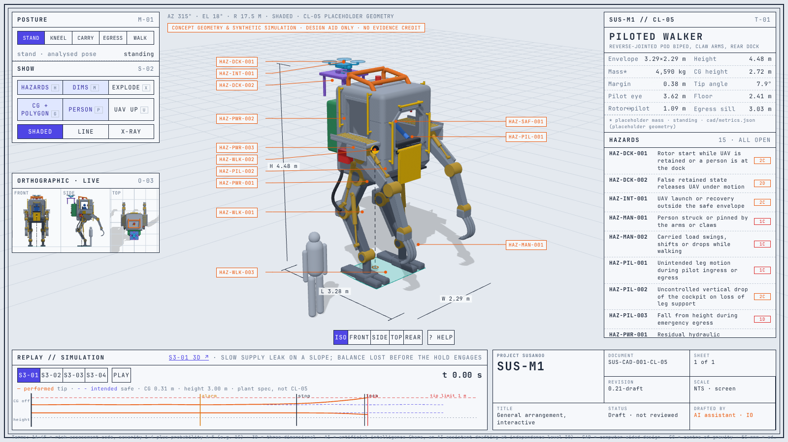

<!-- GENERATED by tools/previews/build_previews.py from docs/previews.yaml; do not edit. Edit the entry there and re-run. -->

# 3D page assets

Geometry loaded by `docs/3d/SUS-M1.html`: `sus-m1.js`, the CL-05 concept meshes and their pose clips, exported from the build123d CAD by `tools/cad/b3d/cl05_web.py`. Generated; concept geometry, not a design.

<!-- terms:start (generated by tools/terms/terms.py; do not edit by hand) -->

<b>Terms on this page (4)</b>: abbreviations and codes explained

| Term | Meaning |
|---|---|
| 3D | three-dimensional |
| CAD | computer-aided design |
| CL-nnn | concept layout (cad/params/CL-nn.yaml; CL-01 to CL-05, CL-05 the reference layout) |
| SUS-M1 | piloted walker |

All terms: [abbreviations and record codes](https://github.com/jherrodthomas/Project-Susanoo/blob/main/docs/terms.md).

<!-- terms:end -->

<!-- preview:start (generated by tools/previews/build_previews.py from docs/previews.yaml; do not edit by hand) -->

SUS-M1 general arrangement

<!-- preview:end -->

## Folder contents

| Item | Title |
|---|---|
| [`sus-m1.js`](sus-m1.js) |  |
