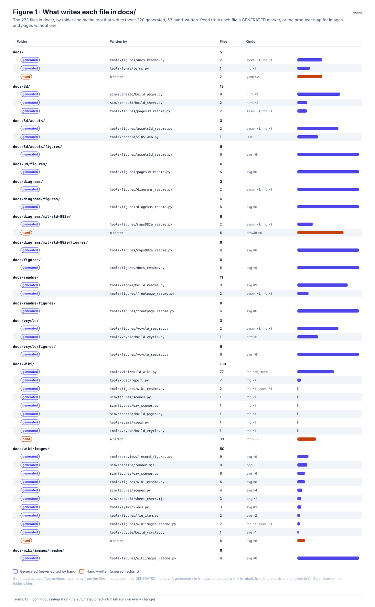
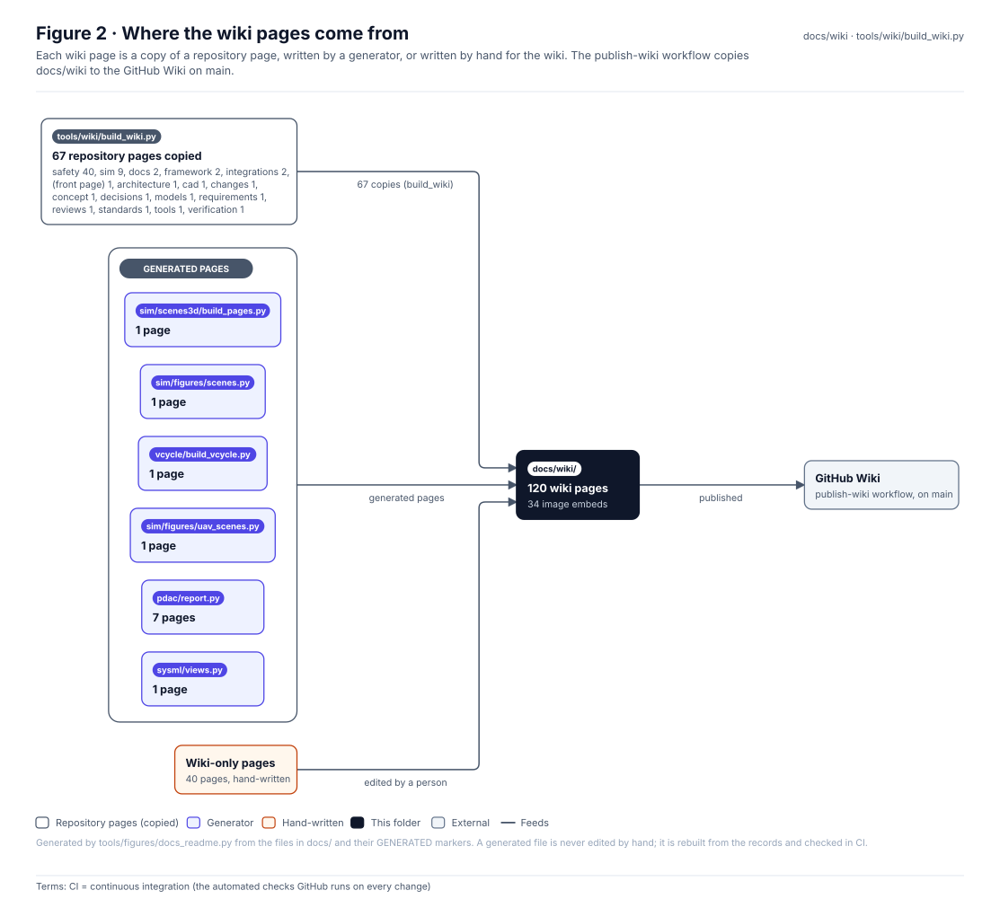
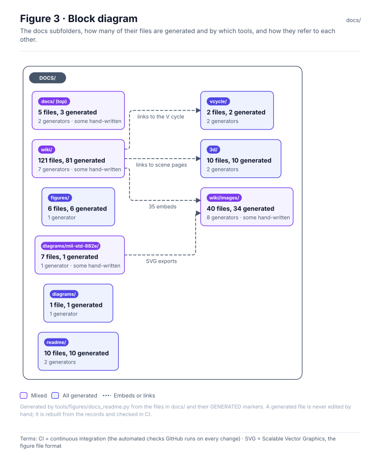
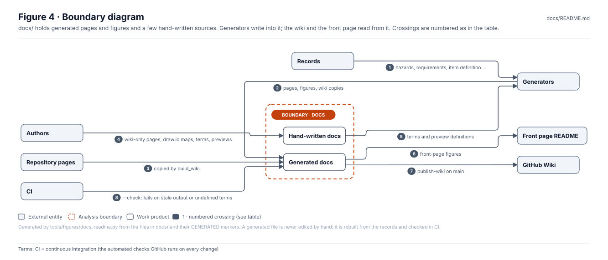
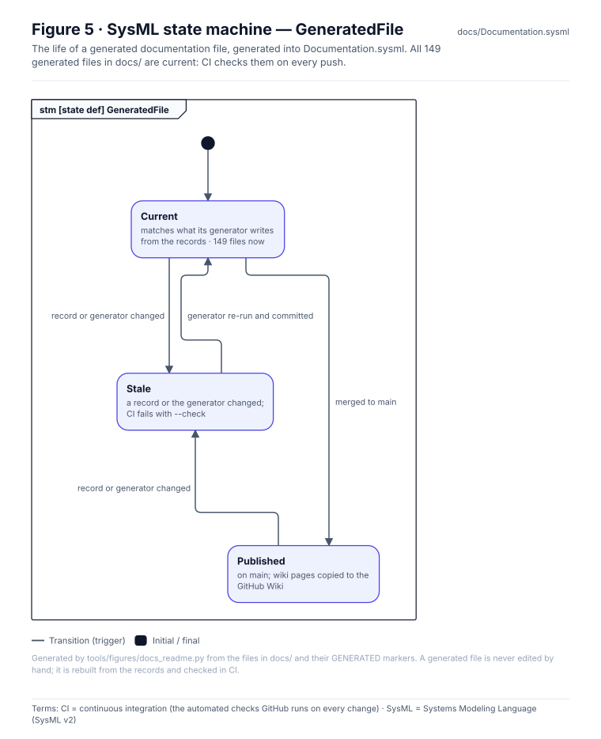
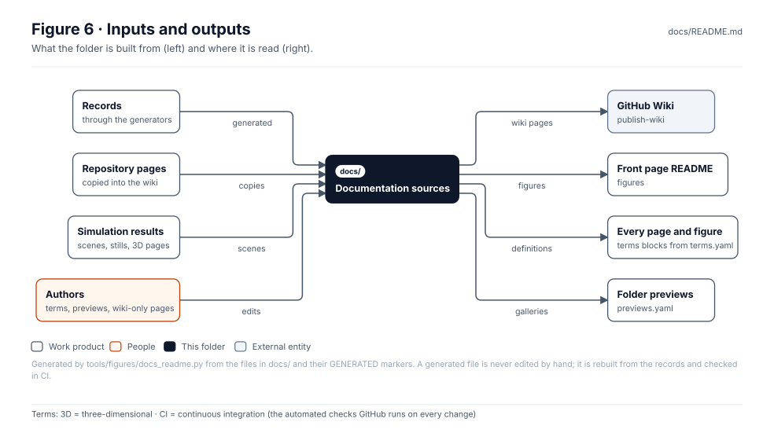

<!-- GENERATED by tools/figures/docs_readme.py from the files in docs/ and their GENERATED markers; edit those and regenerate. -->

# Documentation sources

> **Status:** 280 files, 227 generated and 53 hand-written; 132 wiki pages; 201 defined terms. Generated files are rebuilt from the records and checked in CI.

<!-- terms:start (generated by tools/terms/terms.py; do not edit by hand) -->

<b>Terms on this page (4)</b>: abbreviations and codes explained

| Term | Meaning |
|---|---|
| 3D | three-dimensional |
| CI | continuous integration (the automated checks GitHub runs on every change) |
| OMG | Object Management Group, publisher of SysML |
| SysML | Systems Modeling Language (SysML v2) |

All terms: [abbreviations and record codes](https://github.com/jherrodthomas/Project-Susanoo/blob/main/docs/terms.md).

<!-- terms:end -->

| Field | Value |
|---|---|
| Abbreviations and codes | [`terms.md`](terms.md), from [`terms.yaml`](terms.yaml) |
| Wiki source | [`wiki/`](wiki/) · [Home](wiki/Home.md) |
| Folder previews | [`previews.yaml`](previews.yaml) |
| SysML | [`Documentation.sysml`](Documentation.sysml) (generated) |

## Purpose

The documentation that is not a folder README: the one list of abbreviations and codes, the folder preview definitions, the front-page figures, the wiki source with its images, the 3D scene pages, the System V cycle page and the editable process-map sources. Almost all of it is generated; this page shows which tool writes what, and the few files a person edits.

## What writes each file

| Folder | Written by | Files |
|---|---|---|
| `docs/` | a person | 2 |
| `docs/` | `tools/figures/docs_readme.py` | 2 |
| `docs/` | `tools/terms/terms.py` | 1 |
| `docs/3d/` | `sim/scenes3d/build_pages.py` | 9 |
| `docs/3d/` | `sim/scenes3d/build_sheet.py` | 3 |
| `docs/3d/` | `tools/figures/pages3d_readme.py` | 2 |
| `docs/3d/assets/` | `tools/cad/b3d/cl05_terrain.py` | 1 |
| `docs/3d/assets/` | `tools/cad/b3d/cl05_web.py` | 1 |
| `docs/3d/assets/` | `tools/figures/assets3d_readme.py` | 2 |
| `docs/3d/assets/figures/` | `tools/figures/assets3d_readme.py` | 6 |
| `docs/3d/figures/` | `tools/figures/pages3d_readme.py` | 6 |
| `docs/diagrams/` | `tools/figures/diagrams_readme.py` | 2 |
| `docs/diagrams/figures/` | `tools/figures/diagrams_readme.py` | 6 |
| `docs/diagrams/mil-std-882e/` | a person | 6 |
| `docs/diagrams/mil-std-882e/` | `tools/figures/maps882e_readme.py` | 2 |
| `docs/diagrams/mil-std-882e/figures/` | `tools/figures/maps882e_readme.py` | 6 |
| `docs/figures/` | `tools/figures/docs_readme.py` | 6 |
| `docs/readme/` | `tools/figures/frontpage_readme.py` | 2 |
| `docs/readme/` | `tools/readme/build_readme.py` | 9 |
| `docs/readme/figures/` | `tools/figures/frontpage_readme.py` | 6 |
| `docs/vcycle/` | `tools/figures/vcycle_readme.py` | 2 |
| `docs/vcycle/` | `tools/vcycle/build_vcycle.py` | 1 |
| `docs/vcycle/figures/` | `tools/figures/vcycle_readme.py` | 6 |
| `docs/wiki/` | a person | 39 |
| `docs/wiki/` | `sim/figures/scenes.py` | 1 |
| `docs/wiki/` | `sim/figures/uav_scenes.py` | 1 |
| `docs/wiki/` | `sim/scenes3d/build_pages.py` | 1 |
| `docs/wiki/` | `tools/figures/wiki_readme.py` | 2 |
| `docs/wiki/` | `tools/pdac/report.py` | 7 |
| `docs/wiki/` | `tools/sysml/views.py` | 1 |
| `docs/wiki/` | `tools/vcycle/build_vcycle.py` | 1 |
| `docs/wiki/` | `tools/wiki/build_wiki.py` | 81 |
| `docs/wiki/images/` | a person | 6 |
| `docs/wiki/images/` | `sim/figures/scenes.py` | 4 |
| `docs/wiki/images/` | `sim/figures/uav_scenes.py` | 6 |
| `docs/wiki/images/` | `sim/scenes3d/render.mjs` | 8 |
| `docs/wiki/images/` | `sim/scenes3d/sheet_check.mjs` | 4 |
| `docs/wiki/images/` | `tools/figures/fig_item.py` | 2 |
| `docs/wiki/images/` | `tools/figures/wiki_readme.py` | 6 |
| `docs/wiki/images/` | `tools/figures/wikiimages_readme.py` | 2 |
| `docs/wiki/images/` | `tools/previews/record_figures.py` | 9 |
| `docs/wiki/images/` | `tools/sysml/views.py` | 3 |
| `docs/wiki/images/` | `tools/vcycle/build_vcycle.py` | 1 |
| `docs/wiki/images/readme/` | `tools/figures/wikiimages_readme.py` | 6 |

Hand-written files, the only ones to edit here:

- [`diagrams/mil-std-882e/analysis-dependencies.drawio`](diagrams/mil-std-882e/analysis-dependencies.drawio)
- [`diagrams/mil-std-882e/hazard-management.drawio`](diagrams/mil-std-882e/hazard-management.drawio)
- [`diagrams/mil-std-882e/responsibility-swimlanes.drawio`](diagrams/mil-std-882e/responsibility-swimlanes.drawio)
- [`diagrams/mil-std-882e/safety-lifecycle.drawio`](diagrams/mil-std-882e/safety-lifecycle.drawio)
- [`diagrams/mil-std-882e/software-safety.drawio`](diagrams/mil-std-882e/software-safety.drawio)
- [`diagrams/mil-std-882e/verification-change.drawio`](diagrams/mil-std-882e/verification-change.drawio)
- [`previews.yaml`](previews.yaml)
- [`terms.yaml`](terms.yaml)
- [`wiki/images/analysis-dependencies.svg`](wiki/images/analysis-dependencies.svg)
- [`wiki/images/hazard-management.svg`](wiki/images/hazard-management.svg)
- [`wiki/images/responsibility-swimlanes.svg`](wiki/images/responsibility-swimlanes.svg)
- [`wiki/images/safety-lifecycle.svg`](wiki/images/safety-lifecycle.svg)
- [`wiki/images/software-safety.svg`](wiki/images/software-safety.svg)
- [`wiki/images/verification-change.svg`](wiki/images/verification-change.svg)
- 39 wiki-only pages in [`wiki/`](wiki/) (pages without a GENERATED marker)

## Where the wiki pages come from

| Origin | Pages |
|---|---|
| copy of a repository page | 80 |
| hand-written | 39 |
| `tools/pdac/report.py` | 7 |
| `sim/scenes3d/build_pages.py` | 1 |
| `tools/figures/wiki_readme.py` | 1 |
| `sim/figures/scenes.py` | 1 |
| `tools/sysml/views.py` | 1 |
| `tools/vcycle/build_vcycle.py` | 1 |
| `sim/figures/uav_scenes.py` | 1 |

Copied repository pages by folder: (front page) (1), architecture (1), cad (2), changes (1), concept (1), decisions (1), docs (9), framework (2), integrations (2), models (1), requirements (1), reviews (1), safety (40), sim (13), standards (1), tools (1), verification (1).

## Block diagram

Each subfolder has its own preview page with its gallery.

## Boundary diagram

| # | From | To | Crossing / interaction |
|---|---|---|---|
| 1 | Records | Generators | hazards, requirements, item definition … |
| 2 | Generators | Generated docs | pages, figures, wiki copies |
| 3 | Repository pages | Generated docs | copied by build_wiki |
| 4 | Authors | Hand-written docs | wiki-only pages, draw.io maps, terms, previews |
| 5 | Hand-written docs | Generators | terms and preview definitions |
| 6 | Generated docs | Front page README | front-page figures |
| 7 | Generated docs | GitHub Wiki | publish-wiki on main |
| 8 | CI | Generated docs | --check: fails on stale output or undefined terms |

**Explicitly excluded:** folder READMEs (they live with their folders), records, and anything that claims review or acceptance.

## SysML model

[`Documentation.sysml`](Documentation.sysml) is generated and validated with the project model by the OMG pilot in CI.

## Inputs and outputs

| Input | Source |
|---|---|
| Records | through the generators listed above |
| Repository pages | copied by [`tools/wiki/build_wiki.py`](../tools/wiki/build_wiki.py) |
| Simulation results | [`sim/`](../sim/README.md) |
| Terms, previews, wiki-only pages, process maps | authors |

| Output | Destination |
|---|---|
| Wiki pages | GitHub Wiki (publish-wiki workflow on main) |
| Front-page figures | [front page](../README.md) |
| Term definitions | the terms block on every page and the *Terms:* line on every figure |
| Folder previews | every folder without its own documentation standard |

## Adding or changing documentation

1. A new term goes in [`terms.yaml`](terms.yaml); run `python -m tools.terms.terms`.
2. A generated file changes only through its generator and the records; the GENERATED marker names it.
3. A new wiki-only page goes in `wiki/`; a repository page reaches the wiki through `sources()` in `tools/wiki/build_wiki.py`.
4. Regenerate with `python3 tools/figures/docs_readme.py` and run the full check list in [`CLAUDE.md`](../CLAUDE.md).

## Folder contents

| Item | Description | State |
|---|---|---|
| [`3d/`](3d/) | 14 files | generated |
| [`3d/assets/`](3d/assets/) | 4 files | generated |
| [`3d/assets/figures/`](3d/assets/figures/) | 6 files | generated |
| [`3d/figures/`](3d/figures/) | 6 files | generated |
| [`diagrams/`](diagrams/) | 2 files | generated |
| [`diagrams/figures/`](diagrams/figures/) | 6 files | generated |
| [`diagrams/mil-std-882e/`](diagrams/mil-std-882e/) | 8 files | mixed |
| [`diagrams/mil-std-882e/figures/`](diagrams/mil-std-882e/figures/) | 6 files | generated |
| [`figures/`](figures/) | 6 files | generated |
| [`readme/`](readme/) | 11 files | generated |
| [`readme/figures/`](readme/figures/) | 6 files | generated |
| [`vcycle/`](vcycle/) | 3 files | generated |
| [`vcycle/figures/`](vcycle/figures/) | 6 files | generated |
| [`wiki/`](wiki/) | 134 files | mixed |
| [`wiki/images/`](wiki/images/) | 51 files | mixed |
| [`wiki/images/readme/`](wiki/images/readme/) | 6 files | generated |
| [`Documentation.sysml`](Documentation.sysml) | written by `tools/figures/docs_readme.py` | generated |
| [`previews.yaml`](previews.yaml) | hand-written source | hand-written |
| [`terms.md`](terms.md) | written by `tools/terms/terms.py` | generated |
| [`terms.yaml`](terms.yaml) | hand-written source | hand-written |
| `README.md` | This page | generated |

<!-- END GENERATED: content below this line is human-authored and preserved -->
