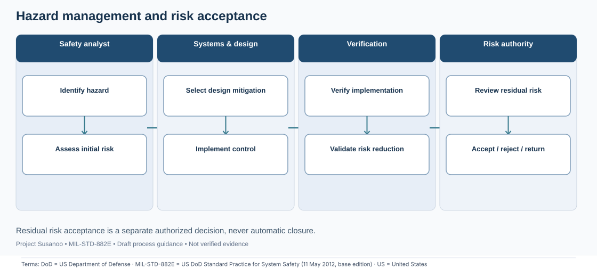
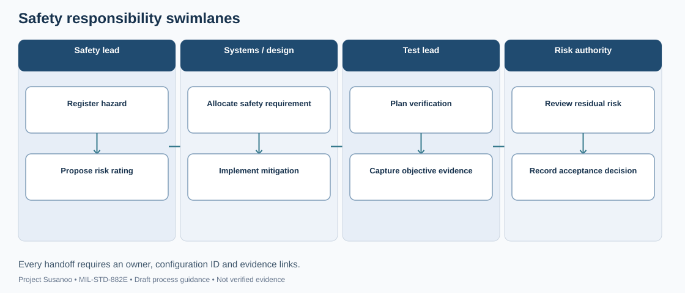
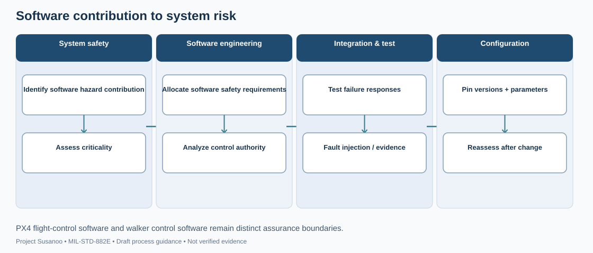
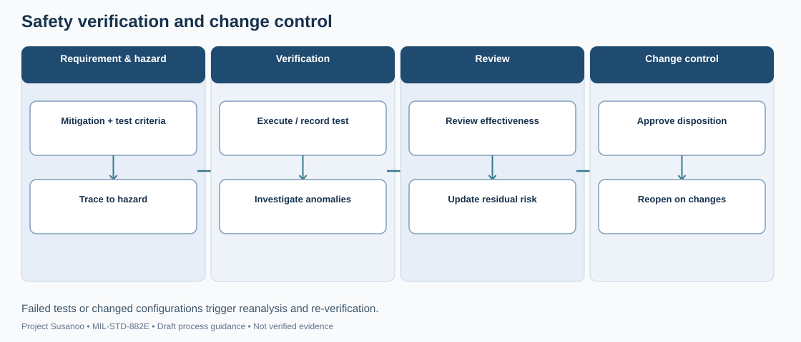

<!-- GENERATED by tools/previews/build_previews.py from docs/previews.yaml; do not edit. Edit the entry there and re-run. -->

# MIL-STD-882E process-map sources

Draw.io sources of the illustrative MIL-STD-882E process maps. Edit a `.drawio` file, export it to SVG in `docs/wiki/images/`, and the wiki page MIL-STD-882E Process Maps shows it. These maps are draft workflows, not normative flowcharts.

<!-- terms:start (generated by tools/terms/terms.py; do not edit by hand) -->

<b>Terms on this page (4)</b>: abbreviations and codes explained

| Term | Meaning |
|---|---|
| DoD | US Department of Defense |
| MIL-STD-882E | US DoD Standard Practice for System Safety (11 May 2012, base edition) |
| SVG | Scalable Vector Graphics, the figure file format |
| US | United States |

All terms: [abbreviations and record codes](https://github.com/jherrodthomas/Project-Susanoo/blob/main/docs/terms.md).

<!-- terms:end -->

<!-- preview:start (generated by tools/previews/build_previews.py from docs/previews.yaml; do not edit by hand) -->

safety-lifecycle.drawio

<table>
<tr><td width="33%" valign="top"> hazard-management.drawio</td><td width="33%" valign="top"> analysis-dependencies.drawio</td><td width="33%" valign="top"> responsibility-swimlanes.drawio</td></tr>
<tr><td width="33%" valign="top"> software-safety.drawio</td><td width="33%" valign="top"> verification-change.drawio</td></tr>
</table>

**Open:** [MIL-STD-882E Process Maps (wiki page)](../../wiki/MIL-STD-882E-Process-Maps.md)

<!-- preview:end -->

## Folder contents

| Item | Title |
|---|---|
| [`analysis-dependencies.drawio`](analysis-dependencies.drawio) |  |
| [`hazard-management.drawio`](hazard-management.drawio) |  |
| [`responsibility-swimlanes.drawio`](responsibility-swimlanes.drawio) |  |
| [`safety-lifecycle.drawio`](safety-lifecycle.drawio) |  |
| [`software-safety.drawio`](software-safety.drawio) |  |
| [`verification-change.drawio`](verification-change.drawio) |  |
