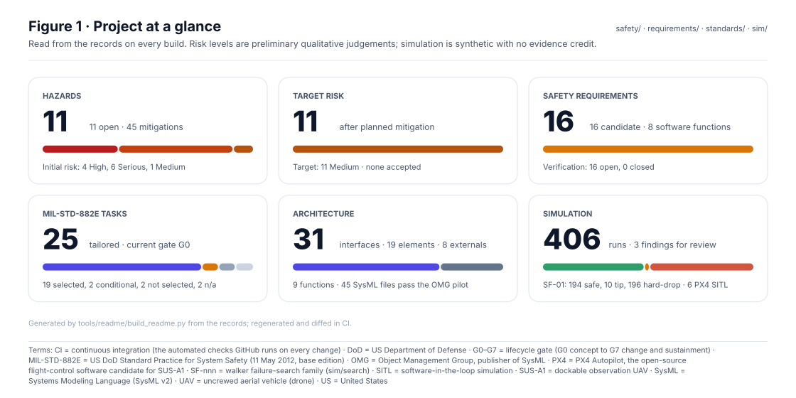

<!-- GENERATED by tools/previews/build_previews.py from docs/previews.yaml; do not edit. Edit the entry there and re-run. -->

# Front-page figures

Figures on the repository front page, built by `tools/readme/build_readme.py` from the records. The concept image is an illustration, not a design.

<!-- preview:start (generated by tools/previews/build_previews.py from docs/previews.yaml; do not edit by hand) -->

Banner

<table>
<tr><td width="33%" valign="top"> At a glance</td><td width="33%" valign="top"> Risk matrix</td><td width="33%" valign="top"> Simulation summary (synthetic)</td></tr>
<tr><td width="33%" valign="top"> Concept illustration</td></tr>
</table>

<!-- preview:end -->

## Folder contents

| Item | Title |
|---|---|
| [`at-a-glance.svg`](at-a-glance.svg) |  |
| [`banner.svg`](banner.svg) |  |
| [`concept-walker-uav.jpg`](concept-walker-uav.jpg) |  |
| [`risk-matrix.svg`](risk-matrix.svg) |  |
| [`simulation.svg`](simulation.svg) |  |
