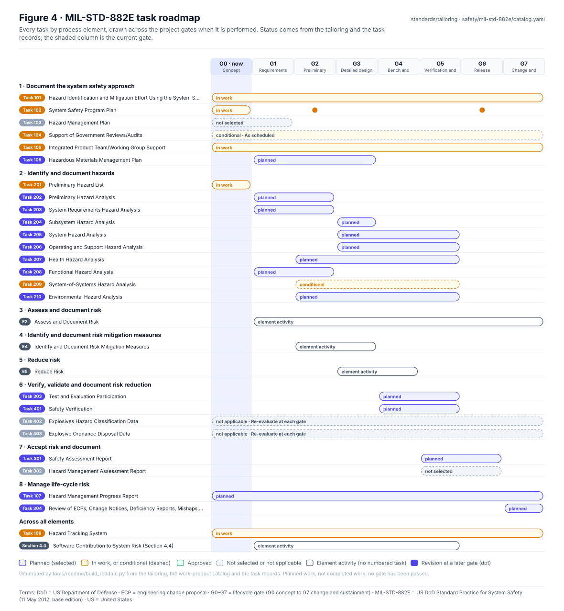
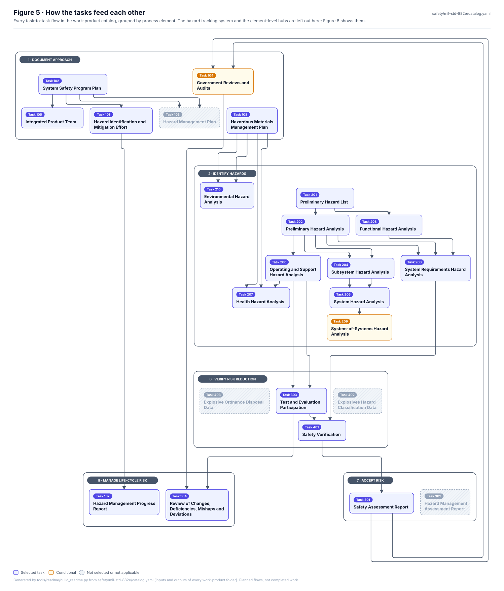
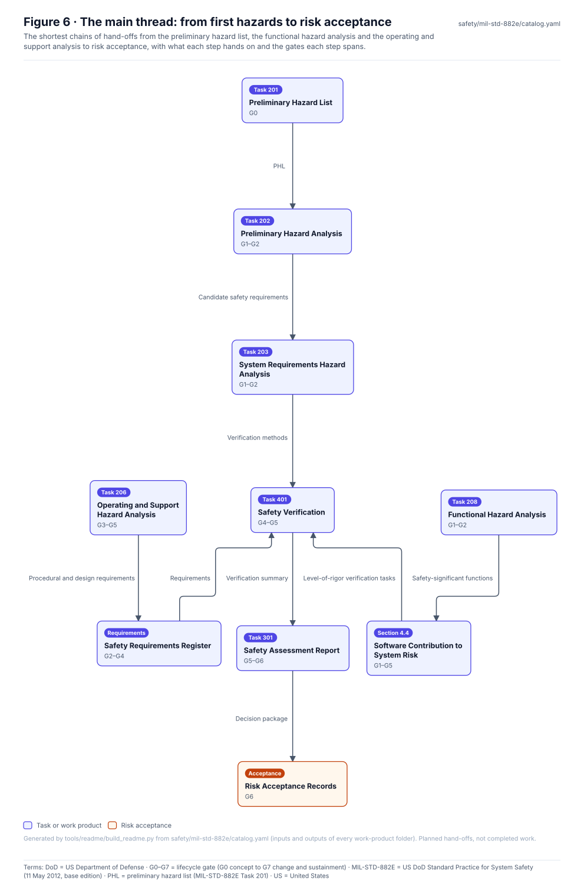
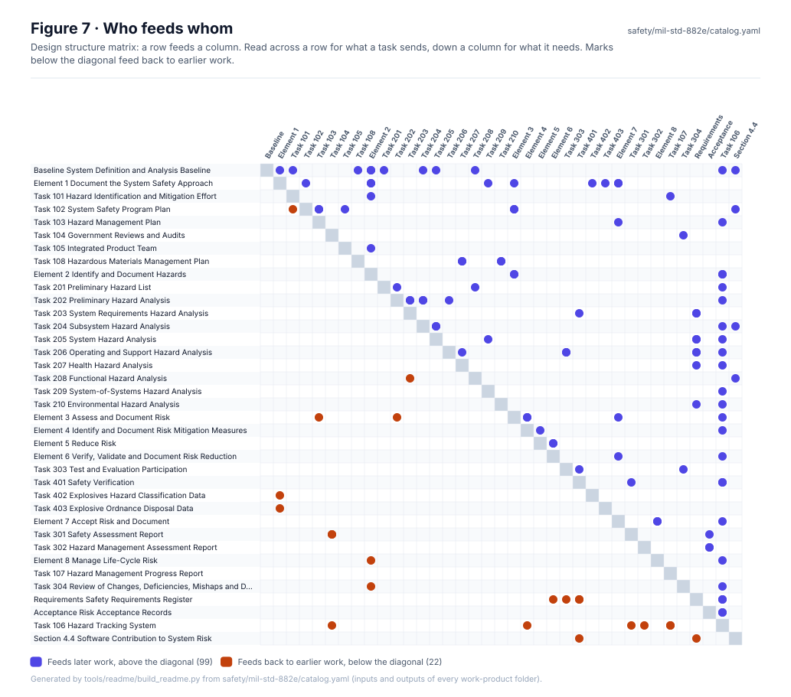
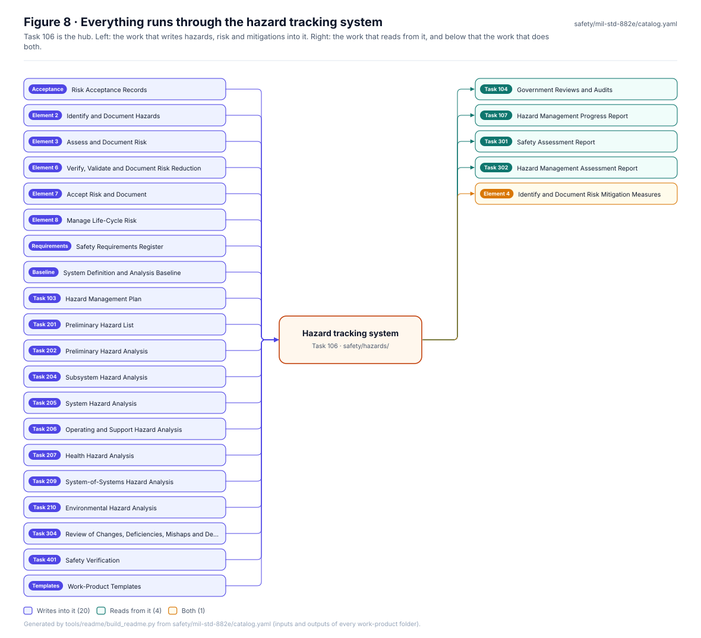

<!-- GENERATED by tools/previews/build_previews.py from docs/previews.yaml; do not edit. Edit the entry there and re-run. -->

# Front-page figures

Figures on the repository front page, built by `tools/readme/build_readme.py` from the records and the CAD renders.

<!-- terms:start (generated by tools/terms/terms.py; do not edit by hand) -->

<b>Terms on this page (4)</b>: abbreviations and codes explained

| Term | Meaning |
|---|---|
| CAD | computer-aided design |
| DoD | US Department of Defense |
| MIL-STD-882E | US DoD Standard Practice for System Safety (11 May 2012, base edition) |
| US | United States |

All terms: [abbreviations and record codes](https://github.com/jherrodthomas/Project-Susanoo/blob/main/docs/terms.md).

<!-- terms:end -->

<!-- preview:start (generated by tools/previews/build_previews.py from docs/previews.yaml; do not edit by hand) -->

Banner

<table>
<tr><td width="33%" valign="top"> At a glance</td><td width="33%" valign="top"> Risk matrix</td><td width="33%" valign="top"> Simulation summary (synthetic)</td></tr>
<tr><td width="33%" valign="top"> MIL-STD-882E task roadmap</td><td width="33%" valign="top"> How the tasks feed each other</td><td width="33%" valign="top"> The main thread to risk acceptance</td></tr>
<tr><td width="33%" valign="top"> Who feeds whom</td><td width="33%" valign="top"> The hazard tracking system as hub</td></tr>
</table>

<!-- preview:end -->

## Folder contents

| Item | Title |
|---|---|
| [`at-a-glance.svg`](at-a-glance.svg) | Figure 1 · Project at a glance |
| [`banner.svg`](banner.svg) | Project Susanoo |
| [`risk-matrix.svg`](risk-matrix.svg) | Figure 2 · Where the hazards sit on the risk matrix |
| [`roadmap.svg`](roadmap.svg) | Figure 4 · MIL-STD-882E task roadmap |
| [`simulation.svg`](simulation.svg) | Figure 3 · What the simulations found |
| [`task-flow.svg`](task-flow.svg) | Figure 5 · How the tasks feed each other |
| [`task-hub.svg`](task-hub.svg) | Figure 8 · Everything runs through the hazard tracking system |
| [`task-matrix.svg`](task-matrix.svg) | Figure 7 · Who feeds whom |
| [`task-thread.svg`](task-thread.svg) | Figure 6 · The main thread: from first hazards to risk acceptance |
