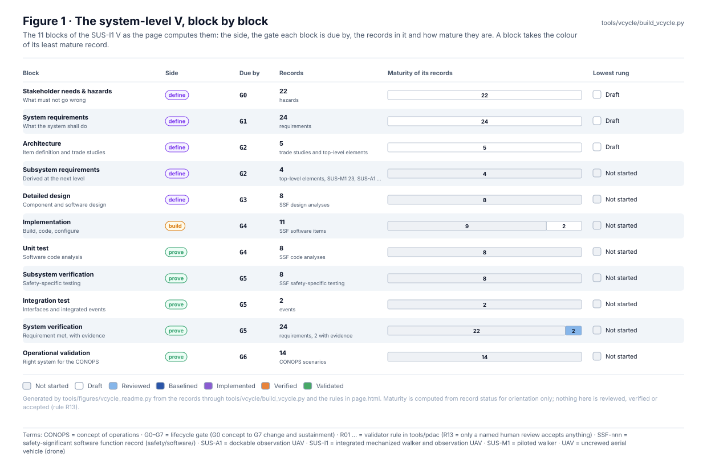
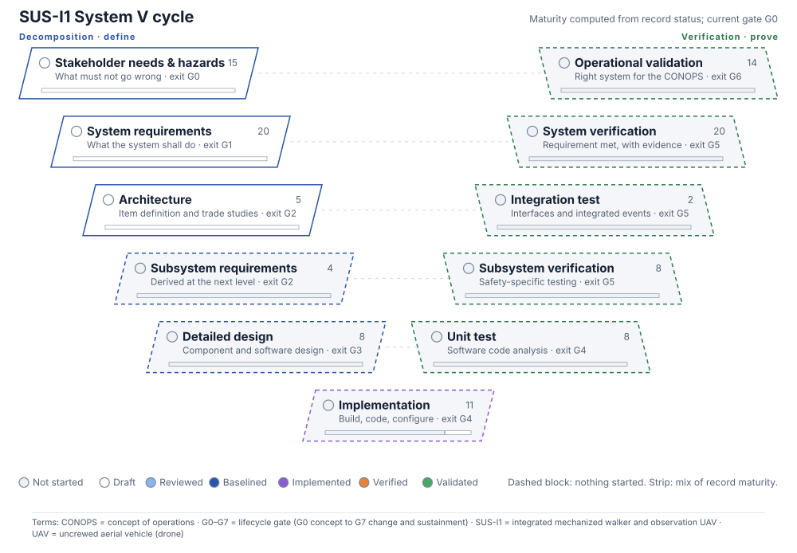
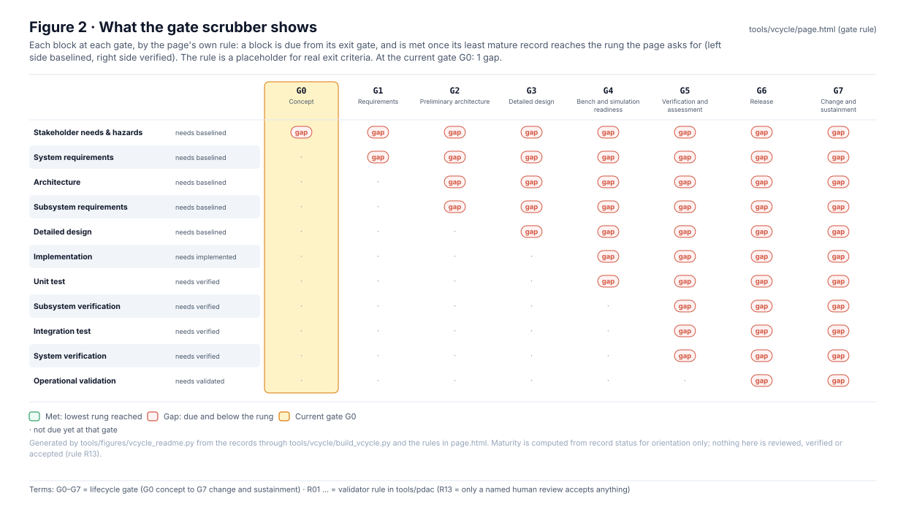
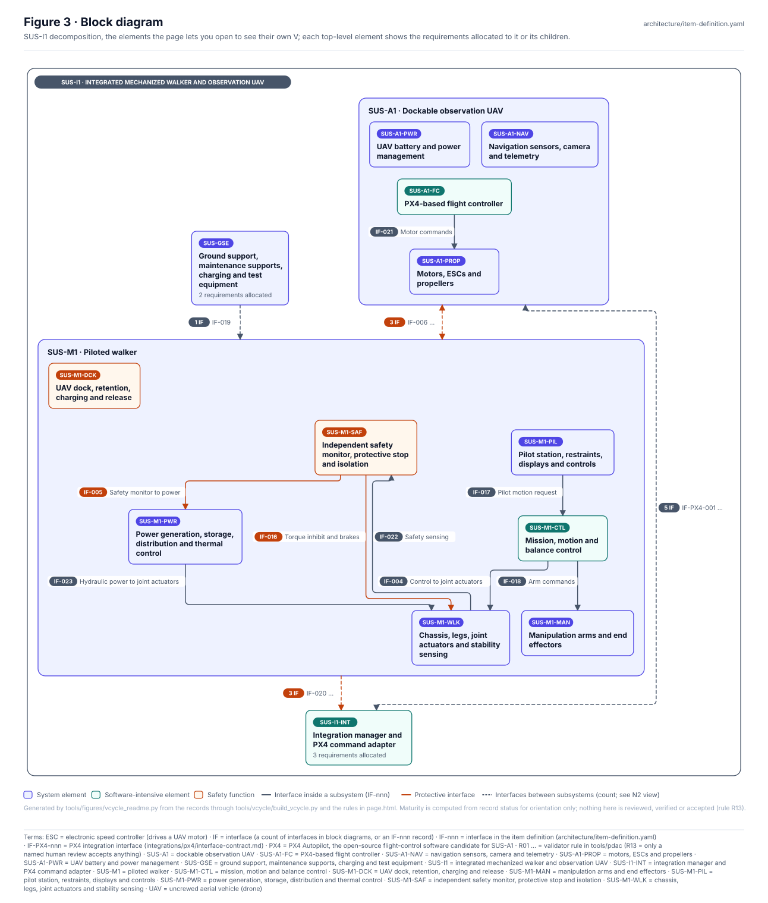
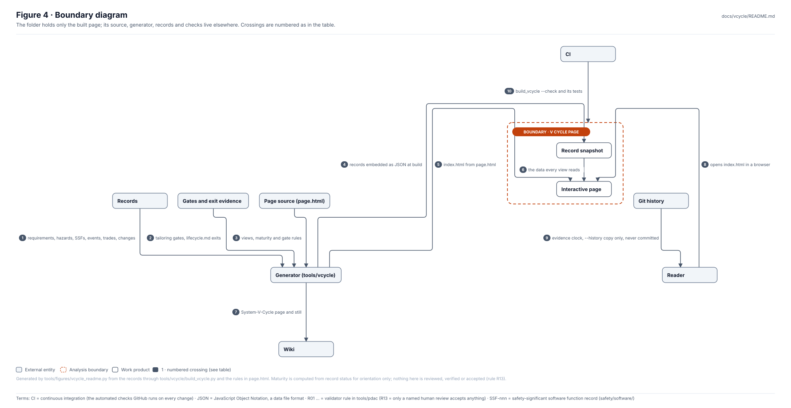
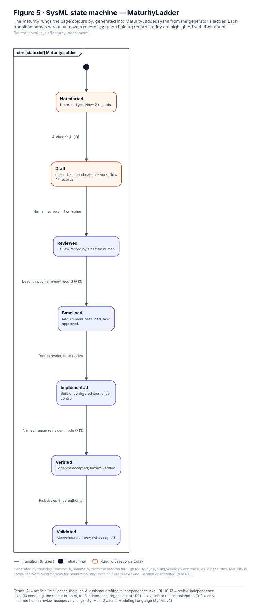
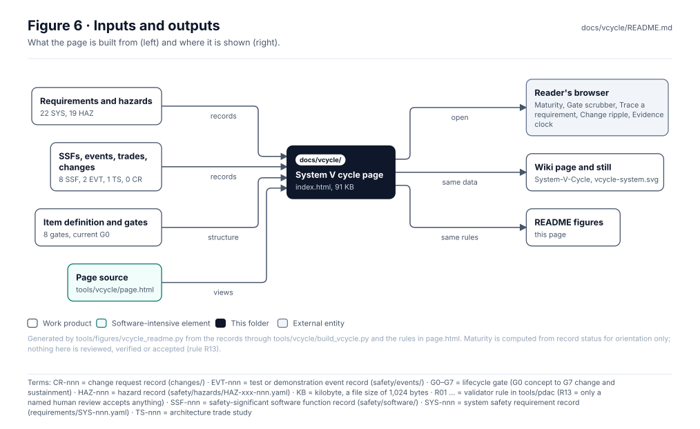

<!-- GENERATED by tools/figures/vcycle_readme.py from the records through tools/vcycle/build_vcycle.py and page.html; edit those and regenerate. -->

# System V cycle page

> **Status:** current gate G0; 22 requirements, 19 hazards and 8 SSFs on the V; 2 of 22 requirements have verification evidence. Gaps at G0: Stakeholder needs & hazards. Maturity is computed from record status for orientation only: **nothing here is reviewed, verified or accepted** (rule R13).

<!-- terms:start (generated by tools/terms/terms.py; do not edit by hand) -->

<b>Terms on this page (36)</b>: abbreviations and codes explained

| Term | Meaning |
|---|---|
| AI | artificial intelligence (here, an AI assistant drafting at independence level I0) |
| ARP4754B | SAE guidelines for development of civil aircraft and systems |
| ARP4761A | SAE guidelines for the safety assessment process on civil aircraft |
| CI | continuous integration (the automated checks GitHub runs on every change) |
| CONOPS | concept of operations |
| DoD | US Department of Defense |
| EMD | engineering and manufacturing development (acquisition phase) |
| FHA | functional hazard analysis (MIL-STD-882E Task 208; also ARP4761A aircraft FHA) |
| G0–G7 | lifecycle gate (G0 concept to G7 change and sustainment) |
| I0–I3 | review independence level (I0 none, e.g. the author or an AI, to I3 independent organisation) |
| JSON | JavaScript Object Notation, a data file format |
| MIL-STD-882E | US DoD Standard Practice for System Safety (11 May 2012, base edition) |
| MSA | materiel solution analysis (acquisition phase) |
| OMG | Object Management Group, publisher of SysML |
| OS | operations and support (acquisition phase) |
| PD | production and deployment (acquisition phase) |
| PHA | preliminary hazard analysis (MIL-STD-882E Task 202) |
| PSSA | preliminary system safety assessment (ARP4761A) |
| PX4 | PX4 Autopilot, the open-source flight-control software candidate for SUS-A1 |
| R01 … | validator rule in tools/pdac (R13 = only a named human review accepts anything) |
| SAE | SAE International, publisher of ARP4754B and ARP4761A |
| SHA | system hazard analysis (MIL-STD-882E Task 205) |
| SSA | system safety assessment (ARP4761A) |
| SSF-nnn | safety-significant software function record (safety/software/) |
| SSHA | subsystem hazard analysis (MIL-STD-882E Task 204) |
| SUS-A1 | dockable observation UAV |
| SUS-GSE | ground support, maintenance supports, charging and test equipment |
| SUS-I1 | integrated mechanized walker and observation UAV |
| SUS-I1-INT | integration manager and PX4 command adapter |
| SUS-M1 | piloted walker |
| SVG | Scalable Vector Graphics, the figure file format |
| SysML | Systems Modeling Language (SysML v2) |
| TD | technology development (acquisition phase) |
| UAV | uncrewed aerial vehicle (drone) |
| US | United States |
| V-nnn | SysML view (tools/sysml/views.py) |

All terms: [abbreviations and record codes](https://github.com/jherrodthomas/Project-Susanoo/blob/main/docs/terms.md).

<!-- terms:end -->

| Field | Value |
|---|---|
| Open | [`index.html`](index.html) from a local checkout · [System V cycle (wiki)](../wiki/System-V-Cycle.md) |
| Built by | [`tools/vcycle/build_vcycle.py`](../../tools/vcycle/README.md) from `page.html` (`--check` in CI) |
| Views | Maturity, Gate scrubber, Trace a requirement, Change ripple, Evidence clock |
| SysML | [`MaturityLadder.sysml`](MaturityLadder.sysml) (generated) |

## Purpose

One interactive page that draws the whole system on a V: the left side defines (hazards, requirements, architecture, design), the bottom builds, the right side proves (code analysis, testing, integration, verification, validation). Each block lists the records that sit in it and takes the colour of the least mature one, so a reader sees at a glance where the evidence lags. Any element opens into its own V, down to a single SSF.

## The system-level V

| Block | Side | Due by | Records | Lowest rung |
|---|---|---|---|---|
| Stakeholder needs & hazards | Define (left) | G0 | 19 hazards | Draft |
| System requirements | Define (left) | G1 | 22 requirements | Draft |
| Architecture | Define (left) | G2 | 5 trade studies and top-level elements | Draft |
| Subsystem requirements | Define (left) | G2 | 4 top-level elements, SUS-M1 21, SUS-A1 4, SUS-I1-INT 3, SUS-GSE 1 requirements allocated, none derived | Not started |
| Detailed design | Define (left) | G3 | 8 SSF design analyses | Not started |
| Implementation | Build (bottom) | G4 | 11 SSF software items | Not started |
| Unit test | Prove (right) | G4 | 8 SSF code analyses | Not started |
| Subsystem verification | Prove (right) | G5 | 8 SSF safety-specific testing | Not started |
| Integration test | Prove (right) | G5 | 2 events | Not started |
| System verification | Prove (right) | G5 | 22 requirements, 2 with evidence | Not started |
| Operational validation | Prove (right) | G6 | 14 CONOPS scenarios | Not started |

## Gate scrubber

| Block | Needs | G0 | G1 | G2 | G3 | G4 | G5 | G6 | G7 |
|---|---|---|---|---|---|---|---|---|---|
| Stakeholder needs & hazards | Baselined | **gap** | **gap** | **gap** | **gap** | **gap** | **gap** | **gap** | **gap** |
| System requirements | Baselined | · | **gap** | **gap** | **gap** | **gap** | **gap** | **gap** | **gap** |
| Architecture | Baselined | · | · | **gap** | **gap** | **gap** | **gap** | **gap** | **gap** |
| Subsystem requirements | Baselined | · | · | **gap** | **gap** | **gap** | **gap** | **gap** | **gap** |
| Detailed design | Baselined | · | · | · | **gap** | **gap** | **gap** | **gap** | **gap** |
| Implementation | Implemented | · | · | · | · | **gap** | **gap** | **gap** | **gap** |
| Unit test | Verified | · | · | · | · | **gap** | **gap** | **gap** | **gap** |
| Subsystem verification | Verified | · | · | · | · | · | **gap** | **gap** | **gap** |
| Integration test | Verified | · | · | · | · | · | **gap** | **gap** | **gap** |
| System verification | Verified | · | · | · | · | · | **gap** | **gap** | **gap** |
| Operational validation | Validated | · | · | · | · | · | · | **gap** | **gap** |

| Gate | Title | Phase | Exit evidence (framework/lifecycle.md) |
|---|---|---|---|
| G0 | Concept | MSA | Mech/UAV CONOPS, system boundary, initial hazard list, feasibility assumptions |
| G1 | Requirements | MSA | Pilot/mission needs, system requirements, interfaces, human factors requirements |
| G2 | Preliminary architecture | TD | Walker architecture, UAV FHA, PHA, actuation/pilot/dock trade studies |
| G3 | Detailed design | EMD | SSHA, UAV PSSA, design, power/stability/egress analyses |
| G4 | Bench and simulation readiness | EMD | Supported joint rigs, simulation builds, controlled integration tests |
| G5 | Verification and assessment | EMD | Test records, fault injection, SHA/O&SHA, UAV SSA and discrepancies |
| G6 | Release | PD | Configuration audit, evidence manifest, safety case, risk disposition and approvals |
| G7 | Change and sustainment | OS | Change impacts, maintenance updates, regression and new release |

## Block diagram

## Boundary diagram

| # | From | To | Crossing / interaction |
|---|---|---|---|
| 1 | Records | Generator (tools/vcycle) | requirements, hazards, SSFs, events, trades, changes |
| 2 | Gates and exit evidence | Generator (tools/vcycle) | tailoring gates, lifecycle.md exits |
| 3 | Page source (page.html) | Generator (tools/vcycle) | views, maturity and gate rules |
| 4 | Generator (tools/vcycle) | Record snapshot | records embedded as JSON at build |
| 5 | Generator (tools/vcycle) | Interactive page | index.html from page.html |
| 6 | Record snapshot | Interactive page | the data every view reads |
| 7 | Generator (tools/vcycle) | Wiki | System-V-Cycle page and still |
| 8 | Reader | Interactive page | opens index.html in a browser |
| 9 | Git history | Reader | evidence clock, --history copy only, never committed |
| 10 | CI | V cycle page | build_vcycle --check and its tests |

**Explicitly excluded:** review, verification or acceptance of anything (colours are orientation, rule R13), real gate exit criteria (the scrubber's rule is a placeholder), and the evidence clock in the committed page (it would go stale with every record commit).

## SysML model

[`MaturityLadder.sysml`](MaturityLadder.sysml) is generated from the generator's ladder and validated with the project model by the OMG pilot in CI.

| Rung | What it means | Who may move a record to it | Records now |
|---|---|---|---|
| Not started | No record yet | Anyone may open a draft | 2 |
| Draft | open, draft, candidate, in-work | Author or AI (I0) | 42 |
| Reviewed | Review record by a named human | Human reviewer, I1 or higher | 0 |
| Baselined | Requirement baselined, task approved | Lead, through a review record (R13) | 0 |
| Implemented | Built or configured item under control | Design owner, after review | 0 |
| Verified | Evidence accepted; hazard verified | Named human reviewer in role (R13) | 0 |
| Validated | Meets intended use; risk accepted | Risk acceptance authority | 0 |

## Inputs and outputs

| Input | Source |
|---|---|
| Requirements, hazards, SSFs, events | [requirements](../../requirements/README.md), [safety records](../../safety/README.md) |
| Item definition, trade studies | [architecture](../../architecture/README.md) |
| Change requests | [changes](../../changes/README.md) |
| Gates and exit evidence | `standards/tailoring/mil-std-882e.yaml`, `framework/lifecycle.md` |
| Page source | `tools/vcycle/page.html` |

| Output | Destination |
|---|---|
| Interactive page | a browser, from a local checkout |
| Wiki page and still | `docs/wiki/System-V-Cycle.md`, `docs/wiki/images/vcycle-system.svg` |
| This page | wiki copy `V-Cycle-Page` |

## Changing the page

1. Change the records, or `tools/vcycle/page.html` for the views and rules; never `index.html`.
2. Rebuild with `python -m tools.vcycle.build_vcycle` and run its tests (`python -m unittest discover -s tools/vcycle/tests -t .`).
3. Regenerate this page and run the full check list in [`CLAUDE.md`](../../CLAUDE.md). For the evidence clock, build a local copy with `--history <file.html>` and do not commit it.

## Folder contents

| Item | Description | State |
|---|---|---|
| [`index.html`](index.html) | The interactive System V cycle page | generated |
| [`MaturityLadder.sysml`](MaturityLadder.sysml) | Maturity rungs as SysML | generated |
| [`figures/`](figures/) | Generated SVG figures (do not edit) | generated |
| `README.md` | This page | generated |

<!-- END GENERATED: content below this line is human-authored and preserved -->
