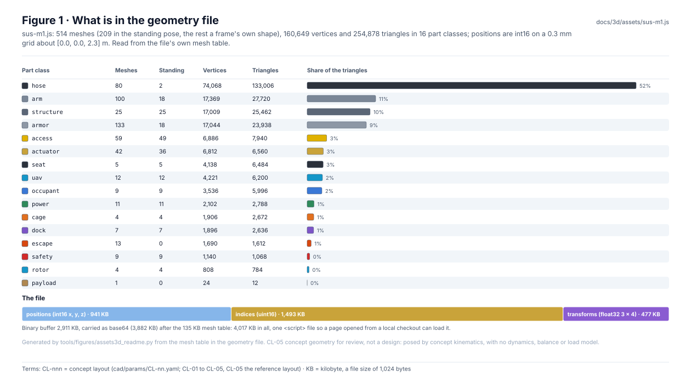
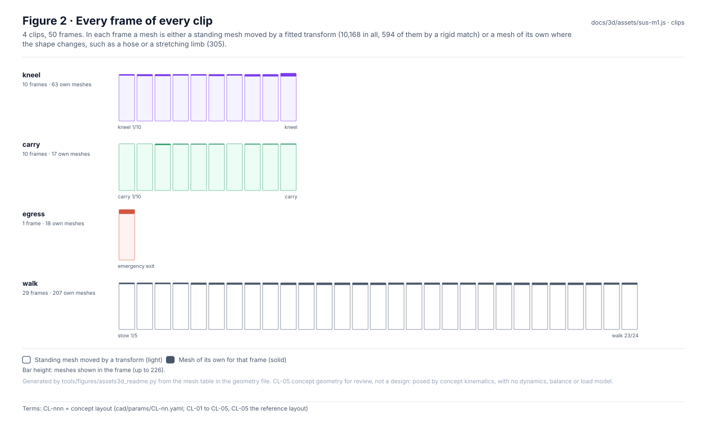
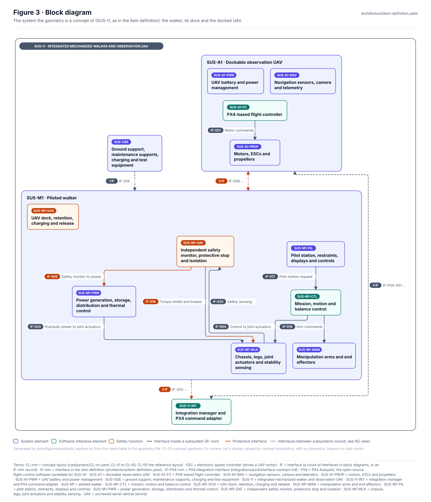
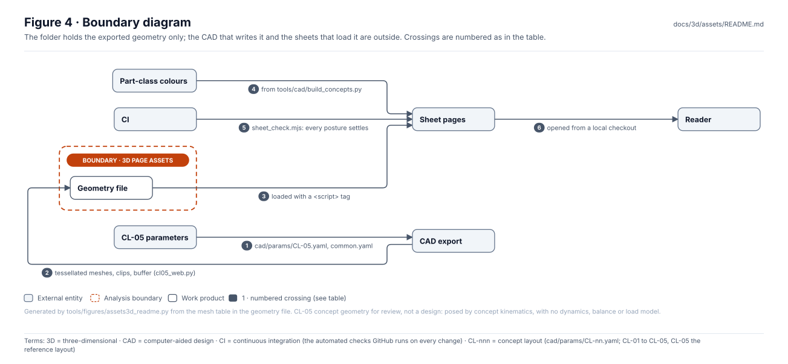
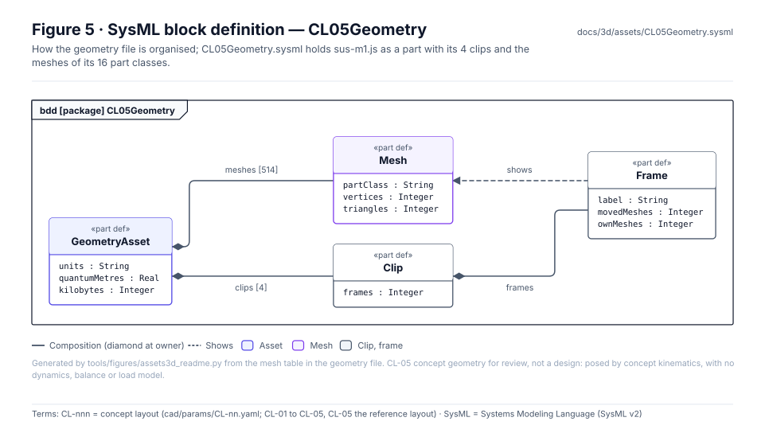
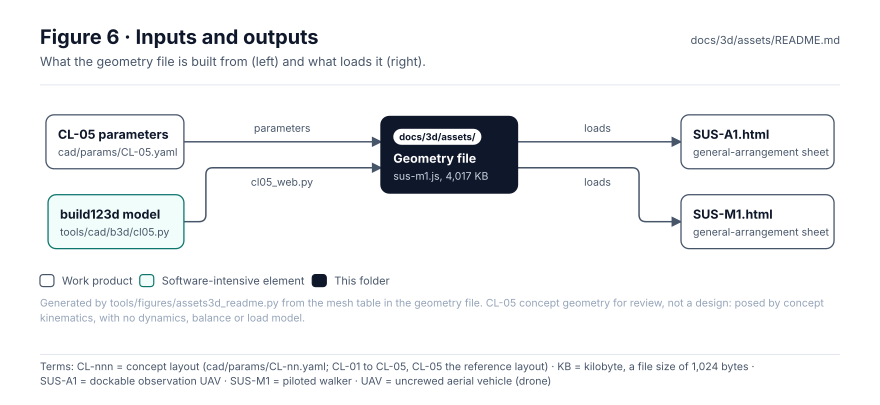

<!-- GENERATED by tools/wiki/build_wiki.py from docs/3d/assets/README.md. Do not edit here; edit the source and re-run. -->

> Published from [`docs/3d/assets/README.md`](https://github.com/jherrodthomas/Project-Susanoo/blob/main/docs/3d/assets/README.md) in the repository.

# 3D page assets

> **Status:** the CL-05 geometry, loaded by `SUS-A1.html`, `SUS-M1-terrain.html`, `SUS-M1.html`, and its terrain poses (11 terrains, 0 unsolved frames), loaded by `SUS-M1-terrain.html`. CL-05 **concept geometry for review, not a design**; the clips are concept kinematics with no dynamics, balance or load model.

<!-- terms:start (generated by tools/terms/terms.py; do not edit by hand) -->

<b>Terms on this page (9)</b>: abbreviations and codes explained

| Term | Meaning |
|---|---|
| 3D | three-dimensional |
| CAD | computer-aided design |
| CI | continuous integration (the automated checks GitHub runs on every change) |
| CL-nnn | concept layout (cad/params/CL-nn.yaml; CL-01 to CL-05, CL-05 the reference layout) |
| KB | kilobyte, a file size of 1,024 bytes |
| OMG | Object Management Group, publisher of SysML |
| SVG | Scalable Vector Graphics, the figure file format |
| SYS-nnn | system safety requirement record (requirements/SYS-nnn.yaml) |
| SysML | Systems Modeling Language (SysML v2) |

All terms: [abbreviations and record codes](https://github.com/jherrodthomas/Project-Susanoo/blob/main/docs/terms.md).

<!-- terms:end -->

| Field | Value |
|---|---|
| File | `sus-m1.js`, 4,017 KB, sets `window.SUS_M1_GEOMETRY` |
| Written by | `tools/cad/b3d/cl05_web.py` from `cad/params/CL-05.yaml` (needs build123d; the file is committed and not re-exported in CI) |
| Units | metres, z up, x forward; positions on a 0.3 mm grid about [0.0, 0.0, 2.3] m |
| Standing pose | hip 2.34 m, cockpit floor 2.41 m, pilot eye 3.62 m |
| SysML | [`CL05Geometry.sysml`](https://github.com/jherrodthomas/Project-Susanoo/blob/main/docs/3d/assets/CL05Geometry.sysml) (generated) |

## Purpose

The CL-05 reference layout as one script file the general-arrangement sheets load: every solid of the build123d model tessellated once in the standing pose, and four clips (kneel, carry, egress, walk) in which each solid is either its standing mesh moved by a fitted transform or, where its shape changes, a mesh of its own. A `<script>` file rather than a fetched one, so the sheets work from a local checkout.

## Contents

| Part class | Meshes | In the standing pose | Vertices | Triangles |
|---|---|---|---|---|
| `hose` | 80 | 2 | 74,068 | 133,006 |
| `arm` | 100 | 18 | 17,369 | 27,720 |
| `structure` | 25 | 25 | 17,009 | 25,462 |
| `armor` | 133 | 18 | 17,044 | 23,938 |
| `access` | 59 | 49 | 6,886 | 7,940 |
| `actuator` | 42 | 36 | 6,812 | 6,560 |
| `seat` | 5 | 5 | 4,138 | 6,484 |
| `uav` | 12 | 12 | 4,221 | 6,200 |
| `occupant` | 9 | 9 | 3,536 | 5,996 |
| `power` | 11 | 11 | 2,102 | 2,788 |
| `cage` | 4 | 4 | 1,906 | 2,672 |
| `dock` | 7 | 7 | 1,896 | 2,636 |
| `escape` | 13 | 0 | 1,690 | 1,612 |
| `safety` | 9 | 9 | 1,140 | 1,068 |
| `rotor` | 4 | 4 | 808 | 784 |
| `payload` | 1 | 0 | 24 | 12 |

## Clips

| Clip | Frames | First frame | Last frame | Meshes of their own |
|---|---|---|---|---|
| kneel | 10 | kneel 1/10 | kneel | 63 |
| carry | 10 | carry 1/10 | carry | 17 |
| egress | 1 | emergency exit | emergency exit | 18 |
| walk | 29 | stow 1/5 | walk 23/24 | 207 |

## Terrain poses

`sus-m1-terrain.js` (7,619 KB, `window.SUS_M1_TERRAIN`) holds the CL-05 walk cycle posed on every terrain of [`sim/scenes3d/terrain.yaml`](https://github.com/jherrodthomas/Project-Susanoo/blob/main/sim/scenes3d/terrain.yaml), 12 frames a cycle over a 1 m stride, for sheet 3. Each frame reuses the standing meshes of `sus-m1.js` by transform or adds 997 meshes of its own (439,002 triangles); each terrain carries its ground height map (0.05 m grid, 6 m wide) and the exporter's kinematic findings. Concept kinematics only: no dynamics, balance, foot slip or ground model.

| Terrain | Rise per cycle | Frames | Meshes of their own | Largest hip drop | Lowest body clearance | Unsolved frames |
|---|---|---|---|---|---|---|
| Flat | +0.000 m | 12 | 90 | 0.000 m | 0.586 m | 0 |
| Uphill 5° | +0.087 m | 12 | 90 | 0.000 m | 0.601 m | 0 |
| Uphill 10° | +0.176 m | 12 | 92 | 0.000 m | 0.617 m | 0 |
| Uphill 15° | +0.268 m | 12 | 92 | 0.000 m | 0.634 m | 0 |
| Uphill 20° (SYS-008 terrain slope limit) | +0.364 m | 12 | 90 | 0.000 m | 0.652 m | 0 |
| Downhill 10° | -0.176 m | 12 | 92 | 0.000 m | 0.555 m | 0 |
| Downhill 20° (SYS-008 terrain slope limit) | -0.364 m | 12 | 92 | 0.000 m | 0.525 m | 0 |
| Cross-slope 10° | +0.000 m | 12 | 89 | 0.000 m | 0.544 m | 0 |
| Cross-slope 20° (SYS-008 terrain slope limit, across the track) | +0.000 m | 12 | 92 | 0.000 m | 0.502 m | 0 |
| Ledges 0.2 m | +0.200 m | 12 | 91 | 0.000 m | 0.563 m | 0 |
| Rubble ±0.12 m | +0.000 m | 12 | 87 | 0.000 m | 0.435 m | 0 |

## Block diagram

## Boundary diagram

| # | From | To | Crossing / interaction |
|---|---|---|---|
| 1 | CL-05 parameters | CAD export | cad/params/CL-05.yaml, common.yaml |
| 2 | CAD export | Geometry file | tessellated meshes, clips, buffer (cl05_web.py) |
| 3 | Terrain course | Terrain poses | sim/scenes3d/terrain.yaml, posed by cl05_terrain.py |
| 4 | Geometry file | Sheet pages | loaded with a <script> tag |
| 5 | Terrain poses | Sheet pages | sheet 3 loads it beside the geometry |
| 6 | Part-class colours | Sheet pages | from tools/cad/build_concepts.py |
| 7 | CI | Sheet pages | sheet_check.mjs: every posture settles |
| 8 | Sheet pages | Reader | opened from a local checkout |

**Explicitly excluded:** any analysis (the sheets take their figures from `cad/metrics.json` and the records, not from this file), dynamics, balance and loads, and a design: CL-05 is a concept layout.

## SysML model

[`CL05Geometry.sysml`](https://github.com/jherrodthomas/Project-Susanoo/blob/main/docs/3d/assets/CL05Geometry.sysml) is generated from the file's mesh table and validated with the project model by the OMG pilot in CI.

## Inputs and outputs

| Input | Source |
|---|---|
| CL-05 parameters | [`cad/params/`](Concept-Layouts.md) |
| Model and export | `tools/cad/b3d/cl05.py`, `tools/cad/b3d/cl05_web.py` |
| Terrain course and poses | `sim/scenes3d/terrain.yaml`, `tools/cad/b3d/cl05_terrain.py` |

| Output | Destination |
|---|---|
| Geometry | [`SUS-A1.html`](https://github.com/jherrodthomas/Project-Susanoo/blob/main/docs/3d/SUS-A1.html) |
| Geometry | [`SUS-M1-terrain.html`](https://github.com/jherrodthomas/Project-Susanoo/blob/main/docs/3d/SUS-M1-terrain.html) |
| Geometry | [`SUS-M1.html`](https://github.com/jherrodthomas/Project-Susanoo/blob/main/docs/3d/SUS-M1.html) |
| Terrain poses | [`SUS-M1-terrain.html`](https://github.com/jherrodthomas/Project-Susanoo/blob/main/docs/3d/SUS-M1-terrain.html) |

## Changing the geometry

1. Change the layout in `cad/params/CL-05.yaml` (or the model in `tools/cad/b3d/cl05.py`), never the file here.
2. Re-export with `/opt/b3d/bin/python tools/cad/b3d/cl05_web.py` (and, for the terrain poses, `tools/cad/b3d/cl05_terrain.py`) and rebuild the sheets (`python -m sim.scenes3d.build_sheet`).
3. Regenerate this page and run the full check list in [`CLAUDE.md`](https://github.com/jherrodthomas/Project-Susanoo/blob/main/CLAUDE.md).

## Folder contents

| Item | Description | State |
|---|---|---|
| `sus-m1.js` | CL-05 reference layout (build123d, cad/params/CL-05.yaml): concept geometry for review, not a design. In-between frames ease posture parameters; concept kinematics only, no dynamics, balance or load model. | generated |
| `sus-m1-terrain.js` | CL-05 walk cycle posed on the terrains of sim/scenes3d/terrain.yaml (tools/cad/b3d/cl05_terrain.py): concept kinematics only, no dynamics, balance, foot slip or ground model; the pod stays level and the arms stowed. | generated |
| [`CL05Geometry.sysml`](https://github.com/jherrodthomas/Project-Susanoo/blob/main/docs/3d/assets/CL05Geometry.sysml) | The geometry file's structure as SysML | generated |
| [`figures/`](https://github.com/jherrodthomas/Project-Susanoo/tree/main/docs/3d/assets/figures) | Generated SVG figures (do not edit) | generated |
| `README.md` | This page | generated |

<!-- END GENERATED: content below this line is human-authored and preserved -->
