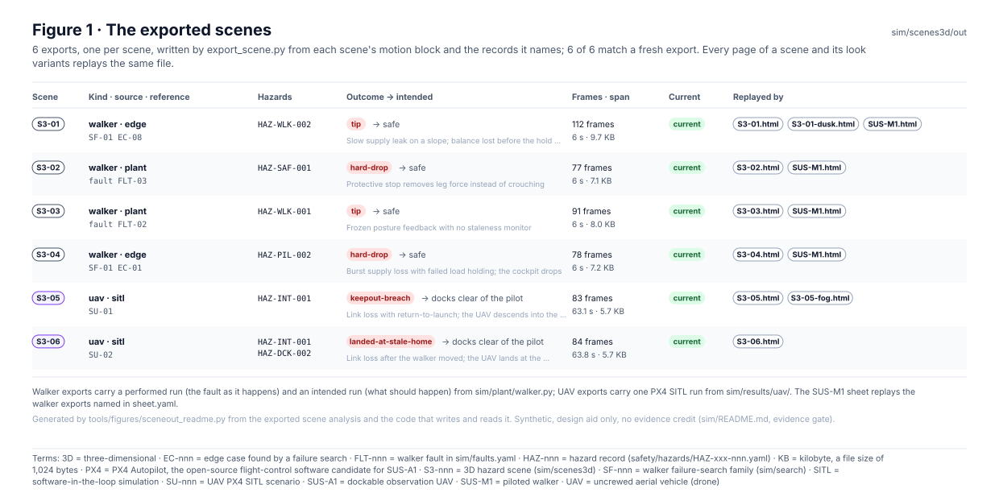
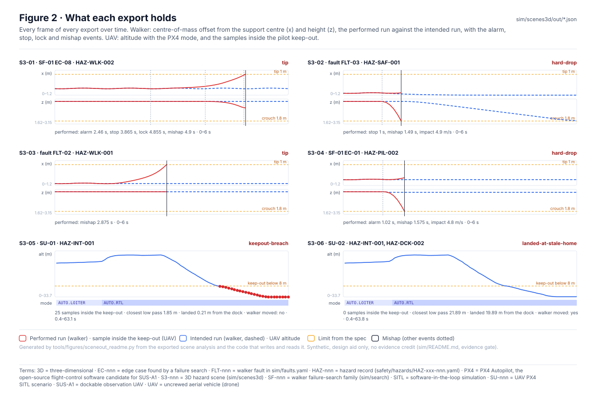
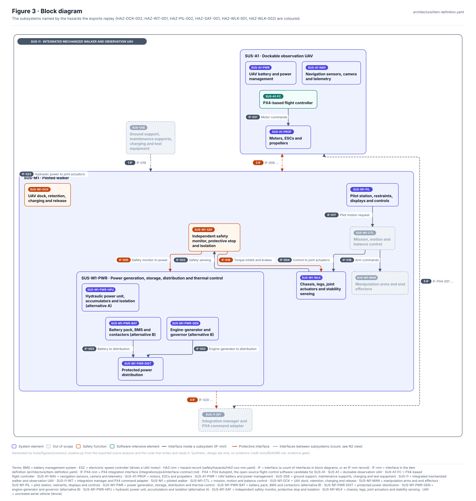
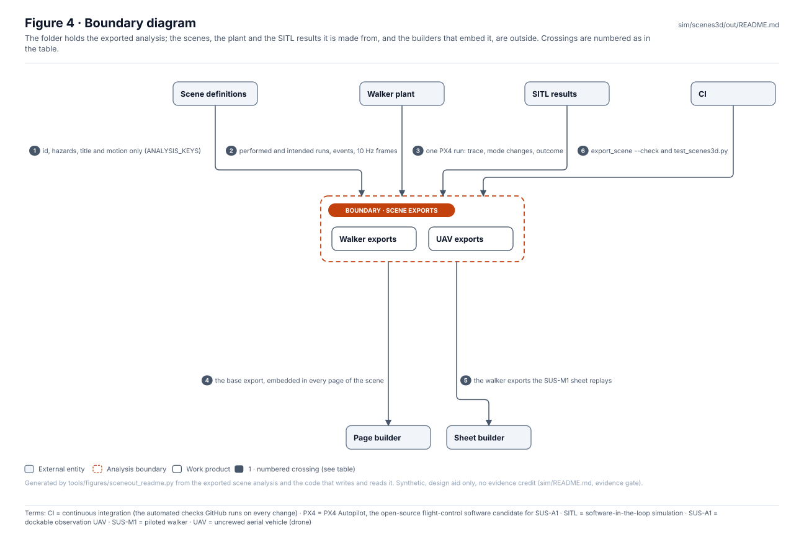
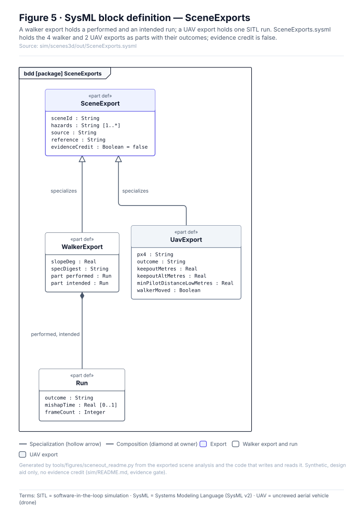
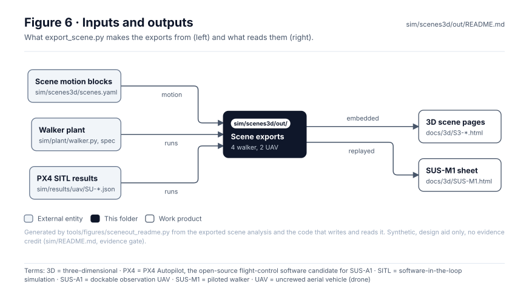

<!-- GENERATED by tools/wiki/build_wiki.py from sim/scenes3d/out/README.md. Do not edit here; edit the source and re-run. -->

> Published from [`sim/scenes3d/out/README.md`](https://github.com/jherrodthomas/Project-Susanoo/blob/main/sim/scenes3d/out/README.md) in the repository.

# Exported 3D scene data

> **Status:** 6 exports (4 walker, 2 UAV), 6 of 6 current with `export_scene.py`; 6 of 6 replay a mishap against what should happen. Exported but read by no page: uav: `landing_to_dock_m`, `px4`; walker: `intended.case`, `intended.events`. Synthetic, **no evidence credit**.

<!-- terms:start (generated by tools/terms/terms.py; do not edit by hand) -->

<b>Terms on this page (16)</b>: abbreviations and codes explained

| Term | Meaning |
|---|---|
| 3D | three-dimensional |
| CI | continuous integration (the automated checks GitHub runs on every change) |
| EC-nnn | edge case found by a failure search |
| FLT-nnn | walker fault in sim/faults.yaml |
| HAZ-nnn | hazard record (safety/hazards/HAZ-xxx-nnn.yaml) |
| JSON | JavaScript Object Notation, a data file format |
| OMG | Object Management Group, publisher of SysML |
| PX4 | PX4 Autopilot, the open-source flight-control software candidate for SUS-A1 |
| SF-nnn | walker failure-search family (sim/search) |
| SITL | software-in-the-loop simulation |
| SU-nnn | UAV PX4 SITL scenario |
| SUS-A1 | dockable observation UAV |
| SUS-M1 | piloted walker |
| SVG | Scalable Vector Graphics, the figure file format |
| SysML | Systems Modeling Language (SysML v2) |
| UAV | uncrewed aerial vehicle (drone) |

All terms: [abbreviations and record codes](https://github.com/jherrodthomas/Project-Susanoo/blob/main/docs/terms.md).

<!-- terms:end -->

| Field | Value |
|---|---|
| Written by | [`export_scene.py`](https://github.com/jherrodthomas/Project-Susanoo/blob/main/sim/scenes3d/export_scene.py) (`python -m sim.scenes3d.export_scene`) |
| Read by | [`build_pages.py`](https://github.com/jherrodthomas/Project-Susanoo/blob/main/sim/scenes3d/build_pages.py) (every page of a scene) and [`build_sheet.py`](https://github.com/jherrodthomas/Project-Susanoo/blob/main/sim/scenes3d/build_sheet.py) (the SUS-M1 sheet) |
| Checked by | `export_scene --check` and `sim/tests/test_scenes3d.py` (the look never reaches the export) |
| SysML | [`SceneExports.sysml`](https://github.com/jherrodthomas/Project-Susanoo/blob/main/sim/scenes3d/out/SceneExports.sysml) (generated) |

## Purpose

One JSON file per 3D scene: the analysis the page replays. `export_scene.py` reads only each scene's id, hazards, title and `motion` block, re-runs the walker plant for a walker scene (the performed run with the fault and the intended run without it) or copies a PX4 SITL run for a UAV scene, and downsamples to 10 Hz. It never reads the look, so a look variant replays the same file. Nothing on a page computes dynamics.

## The exports

| File | Kind · source | Reference | Hazards | Outcome → intended | Frames · span | Current | Replayed by |
|---|---|---|---|---|---|---|---|
| [`S3-01.json`](https://github.com/jherrodthomas/Project-Susanoo/blob/main/sim/scenes3d/out/S3-01.json) | walker · edge | `SF-01 EC-08` | HAZ-WLK-002 | **tip** → safe | 112 · 6 s | current | [`S3-01.html`](https://github.com/jherrodthomas/Project-Susanoo/blob/main/docs/3d/S3-01.html), [`S3-01-dusk.html`](https://github.com/jherrodthomas/Project-Susanoo/blob/main/docs/3d/S3-01-dusk.html), [`SUS-M1.html`](https://github.com/jherrodthomas/Project-Susanoo/blob/main/docs/3d/SUS-M1.html) |
| [`S3-02.json`](https://github.com/jherrodthomas/Project-Susanoo/blob/main/sim/scenes3d/out/S3-02.json) | walker · plant | `fault FLT-03` | HAZ-SAF-001 | **hard-drop** → safe | 77 · 6 s | current | [`S3-02.html`](https://github.com/jherrodthomas/Project-Susanoo/blob/main/docs/3d/S3-02.html), [`SUS-M1.html`](https://github.com/jherrodthomas/Project-Susanoo/blob/main/docs/3d/SUS-M1.html) |
| [`S3-03.json`](https://github.com/jherrodthomas/Project-Susanoo/blob/main/sim/scenes3d/out/S3-03.json) | walker · plant | `fault FLT-02` | HAZ-WLK-001 | **tip** → safe | 91 · 6 s | current | [`S3-03.html`](https://github.com/jherrodthomas/Project-Susanoo/blob/main/docs/3d/S3-03.html), [`SUS-M1.html`](https://github.com/jherrodthomas/Project-Susanoo/blob/main/docs/3d/SUS-M1.html) |
| [`S3-04.json`](https://github.com/jherrodthomas/Project-Susanoo/blob/main/sim/scenes3d/out/S3-04.json) | walker · edge | `SF-01 EC-01` | HAZ-PIL-002 | **hard-drop** → safe | 78 · 6 s | current | [`S3-04.html`](https://github.com/jherrodthomas/Project-Susanoo/blob/main/docs/3d/S3-04.html), [`SUS-M1.html`](https://github.com/jherrodthomas/Project-Susanoo/blob/main/docs/3d/SUS-M1.html) |
| [`S3-05.json`](https://github.com/jherrodthomas/Project-Susanoo/blob/main/sim/scenes3d/out/S3-05.json) | uav · sitl | `SU-01` | HAZ-INT-001 | **keepout-breach** → docks clear of the pilot | 83 · 63.1 s | current | [`S3-05.html`](https://github.com/jherrodthomas/Project-Susanoo/blob/main/docs/3d/S3-05.html), [`S3-05-fog.html`](https://github.com/jherrodthomas/Project-Susanoo/blob/main/docs/3d/S3-05-fog.html) |
| [`S3-06.json`](https://github.com/jherrodthomas/Project-Susanoo/blob/main/sim/scenes3d/out/S3-06.json) | uav · sitl | `SU-02` | HAZ-INT-001, HAZ-DCK-002 | **landed-at-stale-home** → docks clear of the pilot | 84 · 63.8 s | current | [`S3-06.html`](https://github.com/jherrodthomas/Project-Susanoo/blob/main/docs/3d/S3-06.html) |

## What each export holds

| Field | Walker | UAV | Read by |
|---|---|---|---|
| `id`, `title`, `hazards`, `source`, `reference` | yes | yes | page header |
| `about` | yes | yes | provenance (synthetic label) |
| `spec`, `spec_digest`, `slope_deg` | yes | — | page geometry; digest for provenance |
| `performed`, `intended`: case, outcome, events, frames `[t, x, z, phase, stop, hold]` | yes | — | walker replay |
| `frames` `[t, north, east, altitude, mode]`, `mode_changes`, `outcome` | — | yes | UAV replay |
| `pilot_m`, `dock_m`, `keepout_m`, `keepout_alt_m`, `geofence_m`, `observe_m` | — | yes | airspace drawing |

## Block diagram

## Boundary diagram

| # | From | To | Crossing / interaction |
|---|---|---|---|
| 1 | Scene definitions | Scene exports | id, hazards, title and motion only (ANALYSIS_KEYS) |
| 2 | Walker plant | Scene exports | performed and intended runs, events, 10 Hz frames |
| 3 | SITL results | Scene exports | one PX4 run: trace, mode changes, outcome |
| 4 | Scene exports | Page builder | the base export, embedded in every page of the scene |
| 5 | Scene exports | Sheet builder | the walker exports the SUS-M1 sheet replays |
| 6 | CI | Scene exports | export_scene --check and test_scenes3d.py |

**Explicitly excluded:** the look (environment, condition, camera; [`library/`](3D-Look-Library.md)), the pages and stills themselves ([`docs/3d/`](3D-Scene-Pages.md)), and the UAV sheet, which reads the SITL results directly.

## SysML model

[`SceneExports.sysml`](https://github.com/jherrodthomas/Project-Susanoo/blob/main/sim/scenes3d/out/SceneExports.sysml) is generated from the exports and validated with the project model by the OMG pilot in CI.

## Inputs and outputs

| Input | Source |
|---|---|
| Scene motion blocks | [`scenes.yaml`](https://github.com/jherrodthomas/Project-Susanoo/blob/main/sim/scenes3d/scenes.yaml) |
| Walker runs | [`sim/plant/walker.py`](Walker-Plant.md) with the plant spec |
| PX4 SITL runs | [`sim/results/uav/`](UAV-SITL-Results.md) |

| Output | Destination |
|---|---|
| Scene analysis | the 3D pages in [`docs/3d/`](3D-Scene-Pages.md) and the SUS-M1 sheet |

## Changing an export

1. Never edit a JSON file here: change the scene's `motion` block in [`scenes.yaml`](https://github.com/jherrodthomas/Project-Susanoo/blob/main/sim/scenes3d/scenes.yaml), the plant spec or the SITL results.
2. Run `python -m sim.scenes3d.export_scene && python -m sim.scenes3d.build_pages`, then `python -m sim.scenes3d.build_sheet`, and render the stills (see [`sim/scenes3d`](3D-Scene-Builder.md)).
3. Regenerate this page and run the full check list in [`CLAUDE.md`](https://github.com/jherrodthomas/Project-Susanoo/blob/main/CLAUDE.md).

## Folder contents

| Item | Description | State |
|---|---|---|
| [`S3-01.json`](https://github.com/jherrodthomas/Project-Susanoo/blob/main/sim/scenes3d/out/S3-01.json) | Slow supply leak on a slope; balance lost before the hold engages | generated by `export_scene.py` |
| [`S3-02.json`](https://github.com/jherrodthomas/Project-Susanoo/blob/main/sim/scenes3d/out/S3-02.json) | Protective stop removes leg force instead of crouching | generated by `export_scene.py` |
| [`S3-03.json`](https://github.com/jherrodthomas/Project-Susanoo/blob/main/sim/scenes3d/out/S3-03.json) | Frozen posture feedback with no staleness monitor | generated by `export_scene.py` |
| [`S3-04.json`](https://github.com/jherrodthomas/Project-Susanoo/blob/main/sim/scenes3d/out/S3-04.json) | Burst supply loss with failed load holding; the cockpit drops | generated by `export_scene.py` |
| [`S3-05.json`](https://github.com/jherrodthomas/Project-Susanoo/blob/main/sim/scenes3d/out/S3-05.json) | Link loss with return-to-launch; the UAV descends into the pilot keep-out | generated by `export_scene.py` |
| [`S3-06.json`](https://github.com/jherrodthomas/Project-Susanoo/blob/main/sim/scenes3d/out/S3-06.json) | Link loss after the walker moved; the UAV lands at the stale home | generated by `export_scene.py` |
| [`SceneExports.sysml`](https://github.com/jherrodthomas/Project-Susanoo/blob/main/sim/scenes3d/out/SceneExports.sysml) | The exports as SysML | generated |
| [`figures/`](https://github.com/jherrodthomas/Project-Susanoo/tree/main/sim/scenes3d/out/figures) | Generated SVG figures (do not edit) | generated |
| `README.md` | This page | generated |

<!-- END GENERATED: content below this line is human-authored and preserved -->
