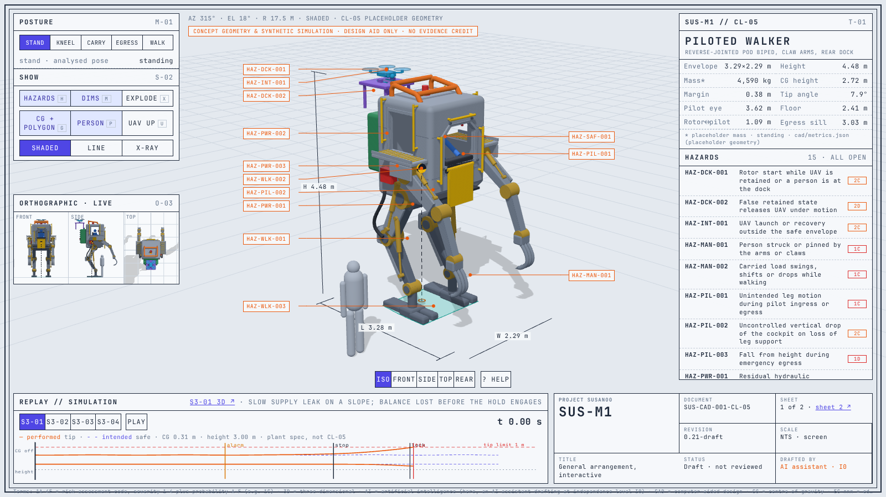
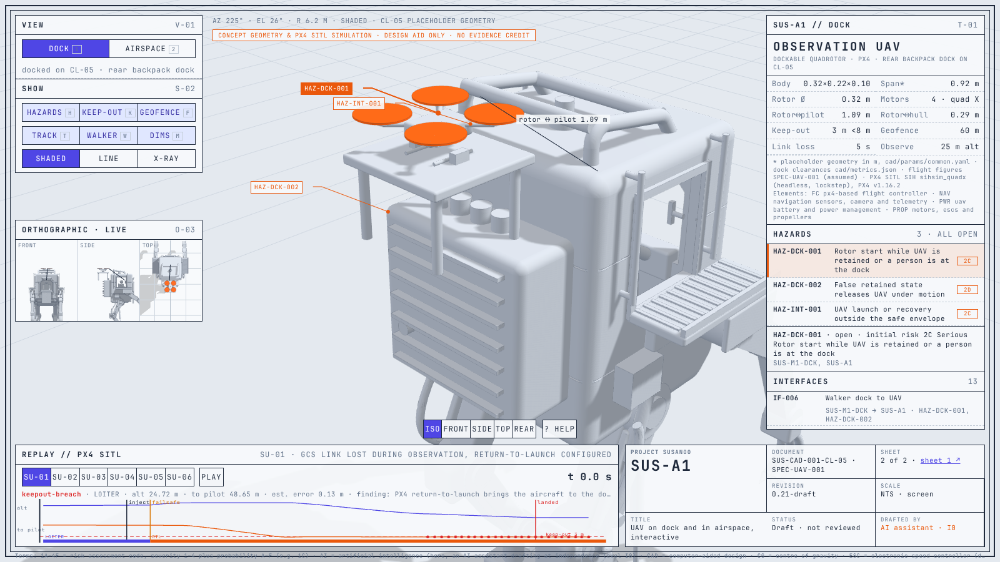
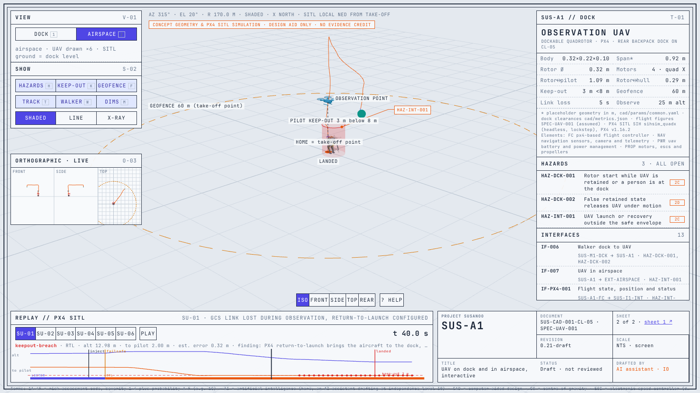
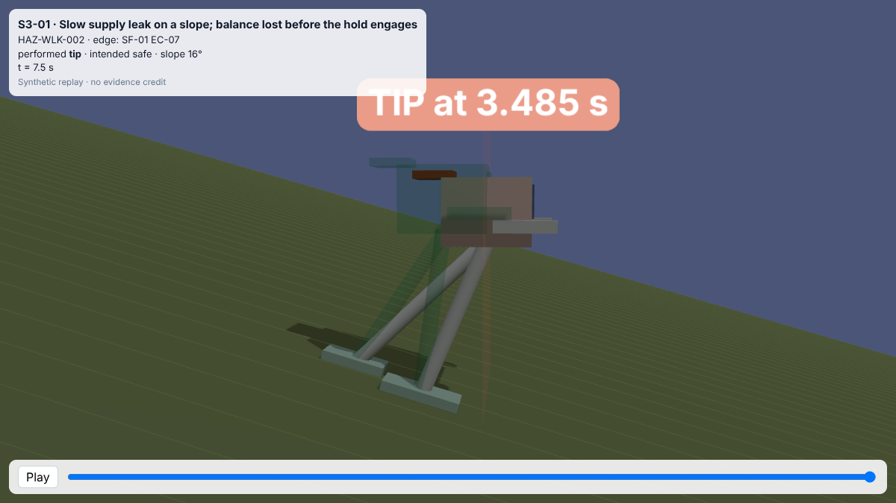
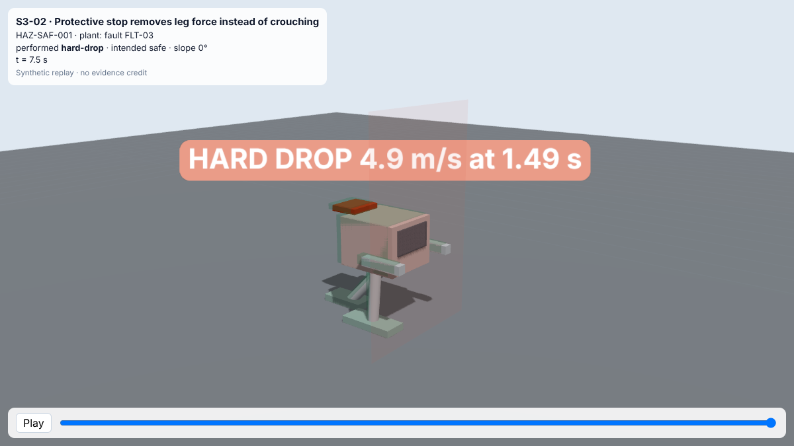
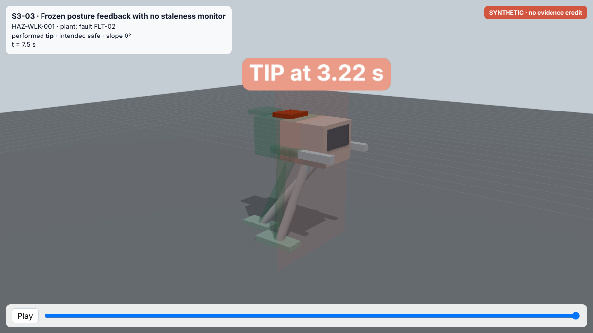
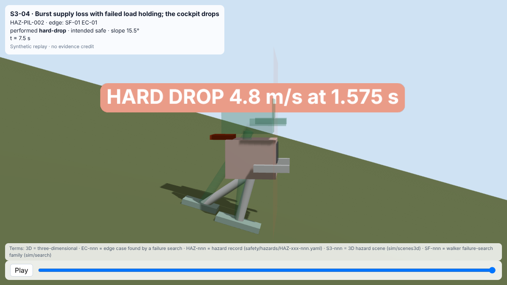
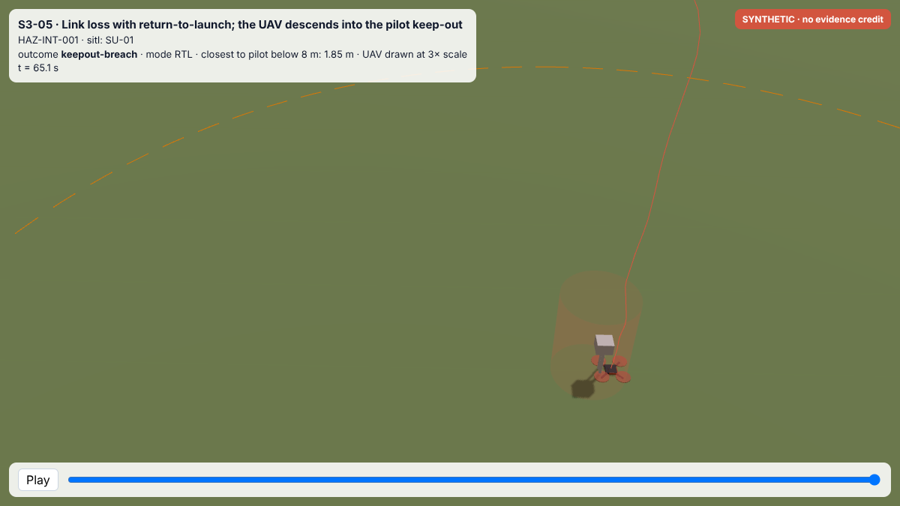
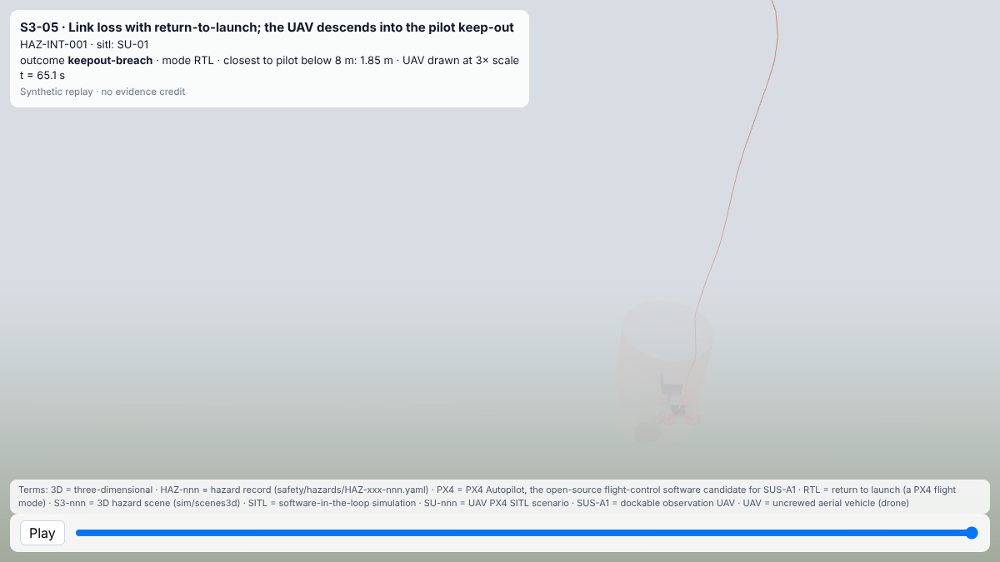
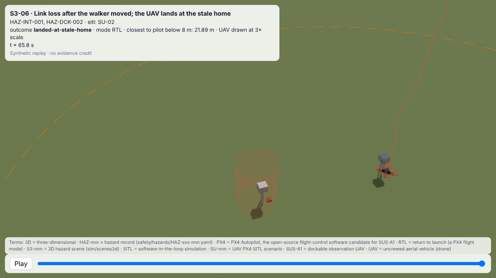

<!-- GENERATED by sim/scenes3d/build_pages.py from sim/scenes3d/scenes.yaml. Do not edit by hand. -->

# 3D Scenes

> Synthetic simulation output; design aid only, no evidence credit (sim/README.md, evidence gate).

<!-- terms:start (generated by tools/terms/terms.py; do not edit by hand) -->

<b>Terms on this page (14)</b>: abbreviations and codes explained

| Term | Meaning |
|---|---|
| 3D | three-dimensional |
| CAD | computer-aided design |
| CL-nnn | concept layout (cad/params/CL-nn.yaml; CL-01 to CL-05, CL-05 the reference layout) |
| EC-nnn | edge case found by a failure search |
| FLT-nnn | walker fault in sim/faults.yaml |
| HAZ-nnn | hazard record (safety/hazards/HAZ-xxx-nnn.yaml) |
| PX4 | PX4 Autopilot, the open-source flight-control software candidate for SUS-A1 |
| S3-nnn | 3D hazard scene (sim/scenes3d) |
| SF-nnn | walker failure-search family (sim/search) |
| SITL | software-in-the-loop simulation |
| SU-nnn | UAV PX4 SITL scenario |
| SUS-A1 | dockable observation UAV |
| SUS-M1 | piloted walker |
| UAV | uncrewed aerial vehicle (drone) |

All terms: [abbreviations and record codes](https://github.com/jherrodthomas/Project-Susanoo/blob/main/docs/terms.md).

<!-- terms:end -->

Interactive three.js scenes replaying plant, failure-search and PX4 SITL results (`sim/scenes3d`). The walker and UAV are parametric models built from the plant and UAV specs, not designs. The look (environment, lighting, camera) never changes the analysis; `sim/tests/test_scenes3d.py` checks that. To view a scene, open `docs/3d/<id>.html` from a local checkout in a browser. Pages load three.js r0.170.0 from jsDelivr.

## SUS-M1 general arrangement

`docs/3d/SUS-M1.html` (`sim/scenes3d/build_sheet.py`) shows the CL-05 reference layout as a live drawing sheet: the build123d concept geometry animated through its postures and walk cycle, the concept metrics of `cad/metrics.json`, callouts from each hazard record to the parts it concerns, a static tip-margin check on a slope, and the walker scenes below as plots. Concept geometry and kinematics only: no dynamics, balance or load model.

## SUS-A1 on dock and in airspace

`docs/3d/SUS-A1.html` is sheet 2: the quadrotor on the CL-05 rear dock with its rotor-to-pilot clearance and the dock hazards, the UAV interfaces, and an airspace view replaying the six PX4 SITL runs (`sim/results/uav/`) with the geofence and pilot keep-out of `sim/uav/spec.yaml`. The quadrotor is drawn enlarged in that view; SITL flies over flat ground at the dock's level.

## Hazard scenes

### S3-01 · Slow supply leak on a slope; balance lost before the hold engages

HAZ-WLK-002 · walker · source SF-01 EC-08 · outcome **tip** · hillside, clear

### S3-01-dusk · Slow supply leak on a slope; balance lost before the hold engages

HAZ-WLK-002 · walker · source SF-01 EC-08 · outcome **tip** · hillside, dusk

### S3-02 · Protective stop removes leg force instead of crouching

HAZ-SAF-001 · walker · source fault FLT-03 · outcome **hard-drop** · yard, clear

### S3-03 · Frozen posture feedback with no staleness monitor

HAZ-WLK-001 · walker · source fault FLT-02 · outcome **tip** · yard, overcast

### S3-04 · Burst supply loss with failed load holding; the cockpit drops

HAZ-PIL-002 · walker · source SF-01 EC-01 · outcome **hard-drop** · hillside, clear

### S3-05 · Link loss with return-to-launch; the UAV descends into the pilot keep-out

HAZ-INT-001 · uav · source SU-01 · outcome **keepout-breach** · field, clear

### S3-05-fog · Link loss with return-to-launch; the UAV descends into the pilot keep-out

HAZ-INT-001 · uav · source SU-01 · outcome **keepout-breach** · field, fog

### S3-06 · Link loss after the walker moved; the UAV lands at the stale home

HAZ-INT-001, HAZ-DCK-002 · uav · source SU-02 · outcome **landed-at-stale-home** · field, clear

## Hazards without a scene

| Hazard | Why |
|---|---|
| HAZ-PIL-001 | Ingress and egress motion is not in the plant (no pilot or structure contact model) |
| HAZ-PWR-001 | Stored-energy release during maintenance is not modelled |
| HAZ-PWR-002 | Battery thermal behaviour is not in the plant (no cell or pack thermal model) |
| HAZ-PWR-003 | Fuel system and fire are not in the plant |
| HAZ-DCK-001 | Rotor start on the dock needs a dock and rotor model; SITL starts on the ground |
| HAZ-MAN-001 | Arms and claws are not in the plant (no manipulator or person contact model); CL-05 stowed pose is CAD only (cad/README.md) |
| HAZ-MAN-002 | A carried load is not in the plant (no payload, grip or load-swing model); CL-05 carry pose is CAD only (cad/README.md) |
| HAZ-WLK-003 | Kneel and rise are not in the plant (no lowered posture or person contact model); CL-05 kneel is CAD only (cad/README.md) |
| HAZ-PIL-003 | Emergency egress through the side hatch is not in the plant (no pilot or descent model) |
