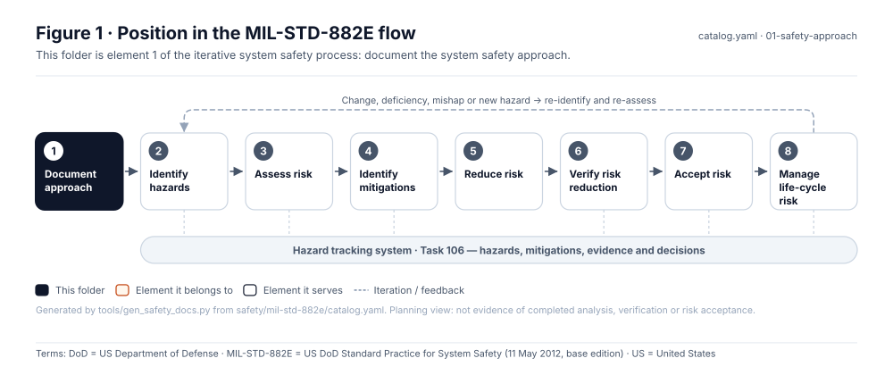
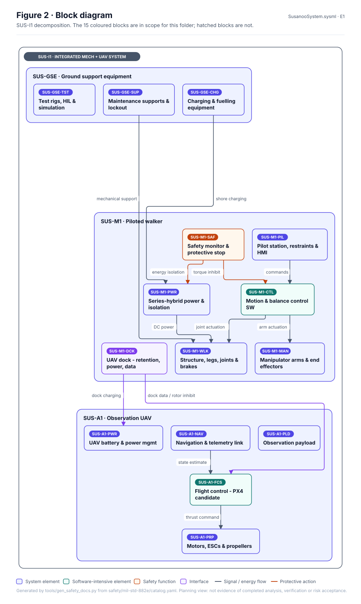
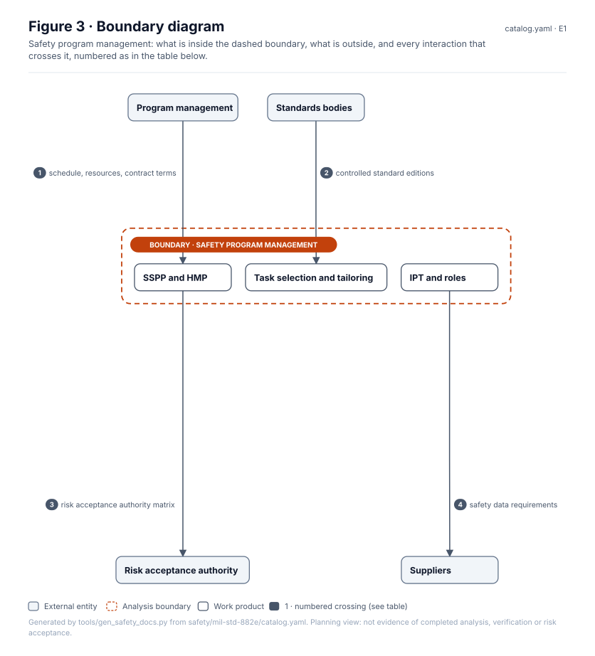
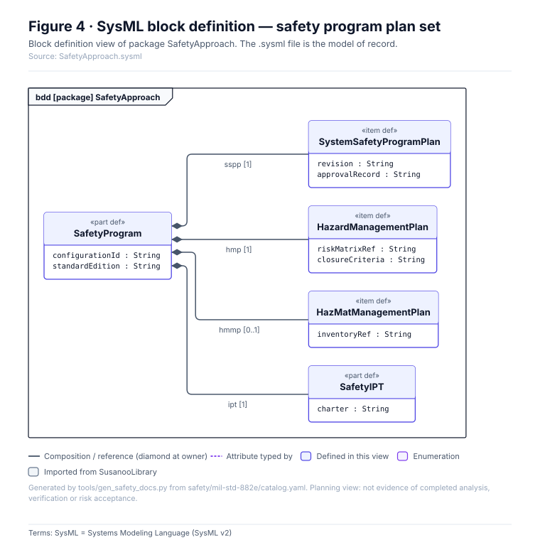
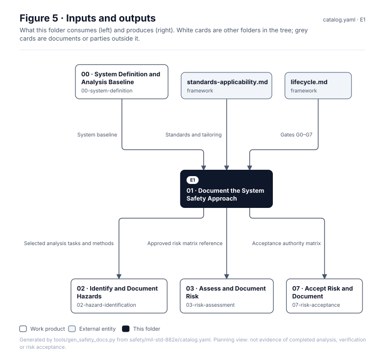

<!-- GENERATED by tools/wiki/build_wiki.py from safety/mil-std-882e/01-safety-approach/README.md. Do not edit here; edit the source and re-run. -->

> Published from [`safety/mil-std-882e/01-safety-approach/README.md`](https://github.com/jherrodthomas/Project-Susanoo/blob/main/safety/mil-std-882e/01-safety-approach/README.md) in the repository.

# 01 · Document the System Safety Approach

> **Status:** Scaffold v0.1 — structure, diagrams and model views only
>
> Planning artifact. No completed hazard analysis, verified mitigation, risk acceptance, certification or MIL-STD-882E compliance is claimed. Category names follow MIL-STD-882E; confirm definitions against the controlled standard and the approved SSPP before formal use.

<!-- terms:start (generated by tools/terms/terms.py; do not edit by hand) -->
<details><summary><b>Terms on this page (12)</b>: abbreviations and codes explained</summary>

| Term | Meaning |
|---|---|
| DoD | US Department of Defense |
| G0–G7 | lifecycle gate (G0 concept to G7 change and sustainment) |
| HMMP | hazardous materials management plan (MIL-STD-882E Task 108) |
| HMP | hazard management plan (MIL-STD-882E Task 103) |
| IPT | integrated product team |
| MIL-STD-882E | US DoD Standard Practice for System Safety (11 May 2012, base edition) |
| SSPP | system safety program plan (MIL-STD-882E Task 102) |
| SUS-I1 | integrated mechanized walker and observation UAV |
| SVG | Scalable Vector Graphics, the figure file format |
| SysML | Systems Modeling Language (SysML v2) |
| UAV | uncrewed aerial vehicle (drone) |
| US | United States |

All terms: [abbreviations and record codes](https://github.com/jherrodthomas/Project-Susanoo/blob/main/docs/terms.md).

</details>
<!-- terms:end -->

| Field | Value |
|---|---|
| MIL-STD-882E element | 1 — Document the system safety approach |
| Lifecycle gate | G0–G1, updated at each gate |
| Applicability | Selected |
| Accountable role | Safety lead |
| Parent folder | [MIL-STD-882E System Safety Work Products](882E-Work-Products.md) |

## Purpose

Plans and governs the program: how hazards will be identified, assessed, mitigated, verified,
accepted and tracked for SUS-I1, who holds which authority, and which tasks are selected.
Management tasks 101–105 and 108 live here.

## Position in the MIL-STD-882E flow



## Block diagram



Elements and interfaces: [`architecture/item-definition.yaml`](https://github.com/jherrodthomas/Project-Susanoo/blob/main/architecture/item-definition.yaml); SysML: [`Architecture.sysml`](https://github.com/jherrodthomas/Project-Susanoo/blob/main/models/sysml/model/Architecture.sysml).

## Boundary diagram



| # | From | To | Crossing / interaction | Interface (item definition) |
|---|---|---|---|---|
| 1 | Program management | SSPP and HMP | schedule, resources, contract terms | — |
| 2 | Standards bodies | Task selection and tailoring | controlled standard editions | — |
| 3 | SSPP and HMP | Risk acceptance authority | risk acceptance authority matrix | — |
| 4 | IPT and roles | Suppliers | safety data requirements | — |

## SysML model

SysML v2 textual view: [`SafetyApproach.sysml`](https://github.com/jherrodthomas/Project-Susanoo/blob/main/safety/mil-std-882e/01-safety-approach/SafetyApproach.sysml), generated from the catalog. It imports the project model in [`models/sysml/model`](https://github.com/jherrodthomas/Project-Susanoo/tree/main/models/sysml/model): `SusanooArchitecture` (elements and usage paths) and `SusanooLibrary` (882E vocabulary). The figures are drawn from the same data; the `.sysml` file is the model of record.



<details><summary>SysML v2 source</summary>

```sysml
// SafetyApproach — generated by tools/gen_safety_docs.py from safety/mil-std-882e/catalog.yaml.
// Do not edit by hand: change the catalog and regenerate.
// Status: planning view only; not evidence of completed analysis or verification.

package SafetyApproach {
    private import ScalarValues::*;
    private import SusanooLibrary::*;
    private import SusanooArchitecture::*;
    part def SafetyProgram {
        doc /* Plans and agreements that document the SUS-I1 safety approach. */
        attribute configurationId : String;
        attribute standardEdition : String;
        ref item sspp : SystemSafetyProgramPlan[1];
        ref item hmp : HazardManagementPlan[1];
        ref item hmmp : HazMatManagementPlan[0..1];
        part ipt : SafetyIPT[1];
    }
    item def SystemSafetyProgramPlan {
        attribute revision : String;
        attribute approvalRecord : String;
    }
    item def HazardManagementPlan {
        attribute riskMatrixRef : String;
        attribute closureCriteria : String;
    }
    item def HazMatManagementPlan {
        attribute inventoryRef : String;
    }
    part def SafetyIPT {
        attribute charter : String;
    }
}
```

</details>

## Inputs and outputs



| Input | Source |
|---|---|
| System baseline | [00 · System Definition and Analysis Baseline](882E-00-system-definition.md) |
| Standards and tailoring | [`framework/standards-applicability.md`](https://github.com/jherrodthomas/Project-Susanoo/blob/main/framework/standards-applicability.md) |
| Gates G0–G7 | [`framework/lifecycle.md`](https://github.com/jherrodthomas/Project-Susanoo/blob/main/framework/lifecycle.md) |

| Output | Destination |
|---|---|
| Selected analysis tasks and methods | [02 · Identify and Document Hazards](882E-02-hazard-identification.md) |
| Approved risk matrix reference | [03 · Assess and Document Risk](882E-03-risk-assessment.md) |
| Acceptance authority matrix | [07 · Accept Risk and Document](882E-07-risk-acceptance.md) |

## Folder contents

| Item | Description | State |
|---|---|---|
| [`task-101-hazard-identification-and-mitigation-effort/`](882E-task-101-hazard-identification-and-mitigation-effort.md) | Task 101 · Hazard Identification and Mitigation Effort | folder |
| [`task-102-system-safety-program-plan/`](882E-task-102-system-safety-program-plan.md) | Task 102 · System Safety Program Plan (SSPP) | folder |
| [`task-103-hazard-management-plan/`](882E-task-103-hazard-management-plan.md) | Task 103 · Hazard Management Plan (HMP) | folder |
| [`task-104-government-reviews-and-audits/`](882E-task-104-government-reviews-and-audits.md) | Task 104 · Government Reviews and Audits | folder |
| [`task-105-integrated-product-team-support/`](882E-task-105-integrated-product-team-support.md) | Task 105 · Integrated Product Team (IPT) Support | folder |
| [`task-108-hazardous-materials-management-plan/`](882E-task-108-hazardous-materials-management-plan.md) | Task 108 · Hazardous Materials Management Plan (HMMP) | folder |
| `task-applicability.yaml` | Task selection and tailoring decisions (see Wiki applicability page) | planned |
| [`figures/`](https://github.com/jherrodthomas/Project-Susanoo/tree/main/safety/mil-std-882e/01-safety-approach/figures) | Generated SVG figures (do not edit) | generated |
| [`SafetyApproach.sysml`](https://github.com/jherrodthomas/Project-Susanoo/blob/main/safety/mil-std-882e/01-safety-approach/SafetyApproach.sysml) | Generated SysML v2 view | generated |

<!-- END GENERATED: content below this line is human-authored and preserved -->

## Working content

_No analysis content yet. Add authored material below this heading._
