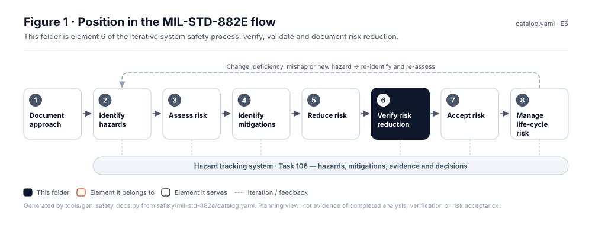
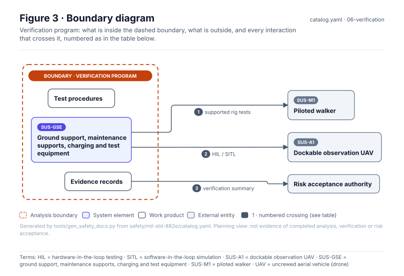
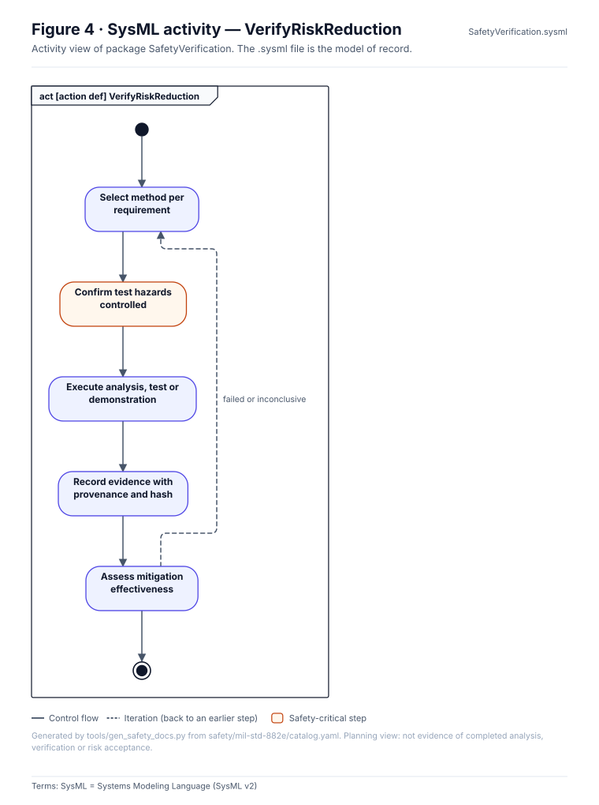
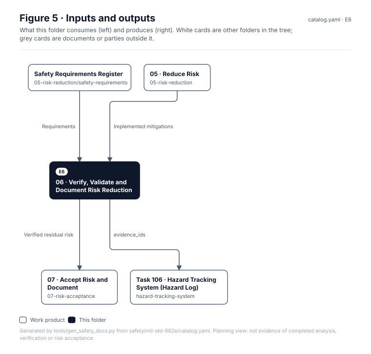

<!-- GENERATED by tools/wiki/build_wiki.py from safety/mil-std-882e/06-verification/README.md. Do not edit here; edit the source and re-run. -->

> Published from [`safety/mil-std-882e/06-verification/README.md`](https://github.com/jherrodthomas/Project-Susanoo/blob/main/safety/mil-std-882e/06-verification/README.md) in the repository.

# 06 · Verify, Validate and Document Risk Reduction

> **Status:** Scaffold v0.1 — structure, diagrams and model views only
>
> Planning artifact. No completed hazard analysis, verified mitigation, risk acceptance, certification or MIL-STD-882E compliance is claimed. Category names follow MIL-STD-882E; confirm definitions against the controlled standard and the approved SSPP before formal use.

<!-- terms:start (generated by tools/terms/terms.py; do not edit by hand) -->
<details><summary><b>Terms on this page (14)</b>: abbreviations and codes explained</summary>

| Term | Meaning |
|---|---|
| DoD | US Department of Defense |
| G0–G7 | lifecycle gate (G0 concept to G7 change and sustainment) |
| HIL | hardware-in-the-loop testing |
| IF-nnn | interface in the item definition (architecture/item-definition.yaml) |
| MIL-STD-882E | US DoD Standard Practice for System Safety (11 May 2012, base edition) |
| SITL | software-in-the-loop simulation |
| SSPP | system safety program plan (MIL-STD-882E Task 102) |
| SUS-A1 | dockable observation UAV |
| SUS-GSE | ground support, maintenance supports, charging and test equipment |
| SUS-M1 | piloted walker |
| SVG | Scalable Vector Graphics, the figure file format |
| SysML | Systems Modeling Language (SysML v2) |
| UAV | uncrewed aerial vehicle (drone) |
| US | United States |

All terms: [abbreviations and record codes](https://github.com/jherrodthomas/Project-Susanoo/blob/main/docs/terms.md).

</details>
<!-- terms:end -->

| Field | Value |
|---|---|
| MIL-STD-882E element | 6 — Verify, validate and document risk reduction |
| Lifecycle gate | G4–G5 |
| Applicability | Selected |
| Accountable role | Test lead with safety lead |
| Parent folder | [MIL-STD-882E System Safety Work Products](882E-Work-Products.md) |

## Purpose

Plans and records evidence that mitigations are implemented and effective: analysis,
inspection, demonstration, simulation and test, including fault injection. Simulated evidence
is labelled as simulated.

## Position in the MIL-STD-882E flow



## Block diagram


Elements and interfaces: [`architecture/item-definition.yaml`](https://github.com/jherrodthomas/Project-Susanoo/blob/main/architecture/item-definition.yaml); SysML: [`Architecture.sysml`](https://github.com/jherrodthomas/Project-Susanoo/blob/main/models/sysml/model/Architecture.sysml).

## Boundary diagram



| # | From | To | Crossing / interaction | Interface (item definition) |
|---|---|---|---|---|
| 1 | SUS-GSE: Ground support, maintenance supports, charging and test equipment | SUS-M1: Piloted walker | supported rig tests | IF-019 |
| 2 | SUS-GSE: Ground support, maintenance supports, charging and test equipment | SUS-A1: Dockable observation UAV | HIL / SITL | — |
| 3 | Evidence records | Risk acceptance authority | verification summary | — |

## SysML model

SysML v2 textual view: [`SafetyVerification.sysml`](https://github.com/jherrodthomas/Project-Susanoo/blob/main/safety/mil-std-882e/06-verification/SafetyVerification.sysml), generated from the catalog. It imports the project model in [`models/sysml/model`](https://github.com/jherrodthomas/Project-Susanoo/tree/main/models/sysml/model): `SusanooArchitecture` (elements and usage paths) and `SusanooLibrary` (882E vocabulary). The figures are drawn from the same data; the `.sysml` file is the model of record.



<details><summary>SysML v2 source</summary>

```sysml
// SafetyVerification — generated by tools/gen_safety_docs.py from safety/mil-std-882e/catalog.yaml.
// Do not edit by hand: change the catalog and regenerate.
// Status: planning view only; not evidence of completed analysis or verification.

package SafetyVerification {
    private import ScalarValues::*;
    private import SusanooLibrary::*;
    private import SusanooArchitecture::*;
    action def VerifyRiskReduction {
        action planVerification { doc /* Select method per requirement */ }
        action confirmTestSafety { doc /* Confirm test hazards controlled */ }
        action execute { doc /* Execute analysis, test or demonstration */ }
        action recordEvidence { doc /* Record evidence with provenance and hash */ }
        action assessEffectiveness { doc /* Assess mitigation effectiveness */ }
        first start then planVerification;
        first planVerification then confirmTestSafety;
        first confirmTestSafety then execute;
        first execute then recordEvidence;
        first recordEvidence then assessEffectiveness;
        first assessEffectiveness then done;
        // iteration: assessEffectiveness -> planVerification when failed or inconclusive (informal; merge node omitted)
    }
}
```

</details>

## Inputs and outputs



| Input | Source |
|---|---|
| Requirements | [Safety Requirements Register](882E-safety-requirements.md) |
| Implemented mitigations | [05 · Reduce Risk](882E-05-risk-reduction.md) |

| Output | Destination |
|---|---|
| Verified residual risk | [07 · Accept Risk and Document](882E-07-risk-acceptance.md) |
| evidence_ids | [Task 106 · Hazard Tracking System (Hazard Log)](882E-hazard-tracking-system.md) |

## Folder contents

| Item | Description | State |
|---|---|---|
| [`task-303-test-and-evaluation-participation/`](882E-task-303-test-and-evaluation-participation.md) | Task 303 · Test and Evaluation Participation | folder |
| [`task-401-safety-verification/`](882E-task-401-safety-verification.md) | Task 401 · Safety Verification | folder |
| [`task-402-explosives-hazard-classification-data/`](882E-task-402-explosives-hazard-classification-data.md) | Task 402 · Explosives Hazard Classification Data | folder |
| [`task-403-explosive-ordnance-disposal-data/`](882E-task-403-explosive-ordnance-disposal-data.md) | Task 403 · Explosive Ordnance Disposal Data | folder |
| [`figures/`](https://github.com/jherrodthomas/Project-Susanoo/tree/main/safety/mil-std-882e/06-verification/figures) | Generated SVG figures (do not edit) | generated |
| [`SafetyVerification.sysml`](https://github.com/jherrodthomas/Project-Susanoo/blob/main/safety/mil-std-882e/06-verification/SafetyVerification.sysml) | Generated SysML v2 view | generated |

<!-- END GENERATED: content below this line is human-authored and preserved -->

## Working content

_No analysis content yet. Add authored material below this heading._
