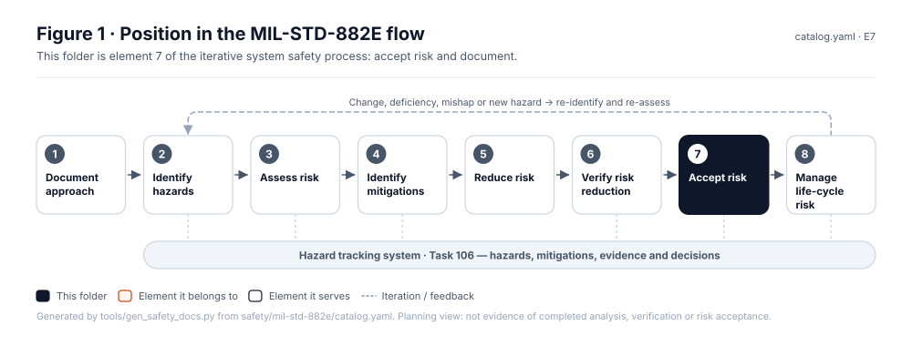
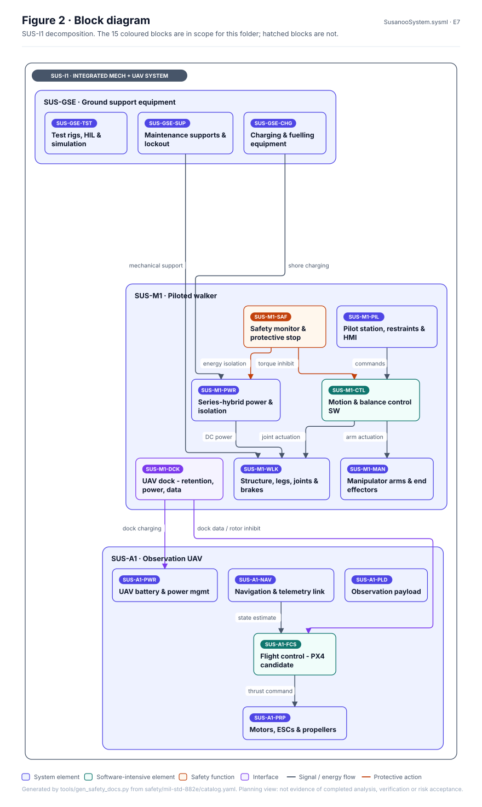
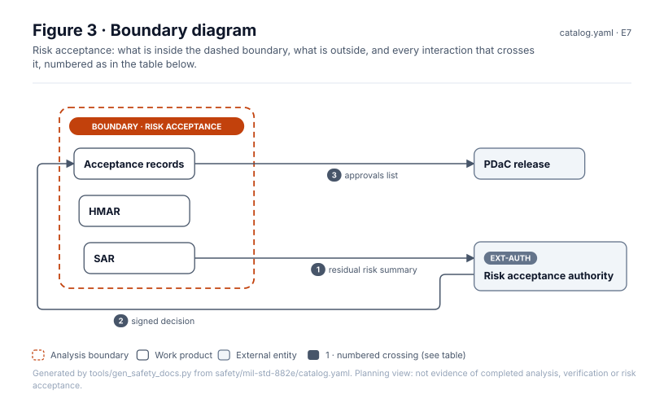
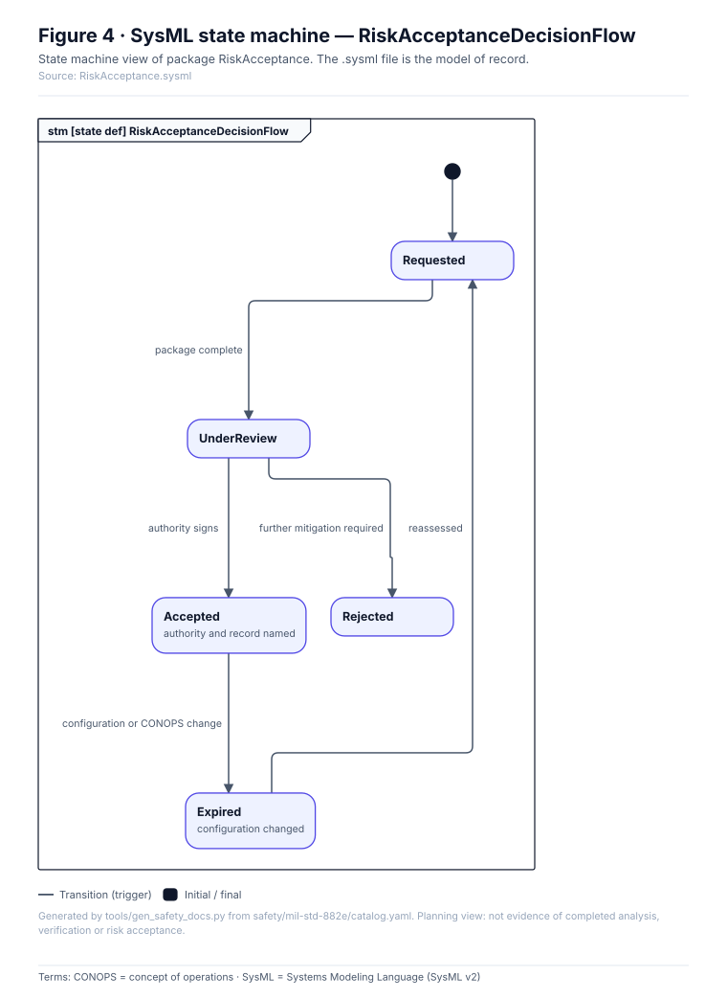
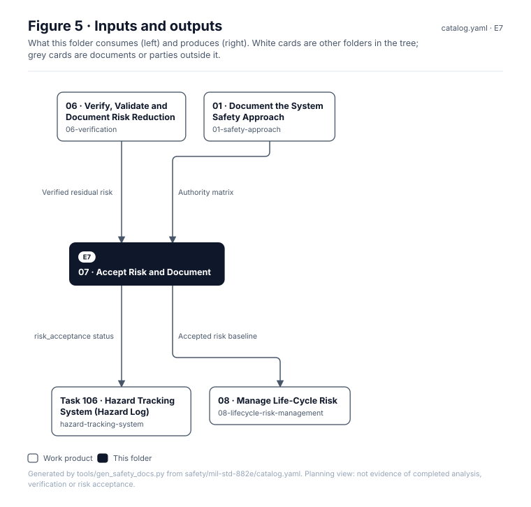

<!-- GENERATED by tools/wiki/build_wiki.py from safety/mil-std-882e/07-risk-acceptance/README.md. Do not edit here; edit the source and re-run. -->

> Published from [`safety/mil-std-882e/07-risk-acceptance/README.md`](https://github.com/jherrodthomas/Project-Susanoo/blob/main/safety/mil-std-882e/07-risk-acceptance/README.md) in the repository.

# 07 · Accept Risk and Document

> **Status:** Scaffold v0.1 — structure, diagrams and model views only
>
> Planning artifact. No completed hazard analysis, verified mitigation, risk acceptance, certification or MIL-STD-882E compliance is claimed. Category names follow MIL-STD-882E; confirm definitions against the controlled standard and the approved SSPP before formal use.

<!-- terms:start (generated by tools/terms/terms.py; do not edit by hand) -->
<details><summary><b>Terms on this page (10)</b>: abbreviations and codes explained</summary>

| Term | Meaning |
|---|---|
| DoD | US Department of Defense |
| G0–G7 | lifecycle gate (G0 concept to G7 change and sustainment) |
| HMAR | hazard management assessment report (MIL-STD-882E Task 302) |
| MIL-STD-882E | US DoD Standard Practice for System Safety (11 May 2012, base edition) |
| PDaC | Product Development as Code |
| SAR | safety assessment report (MIL-STD-882E Task 301) |
| SSPP | system safety program plan (MIL-STD-882E Task 102) |
| SVG | Scalable Vector Graphics, the figure file format |
| SysML | Systems Modeling Language (SysML v2) |
| US | United States |

All terms: [abbreviations and record codes](https://github.com/jherrodthomas/Project-Susanoo/blob/main/docs/terms.md).

</details>
<!-- terms:end -->

| Field | Value |
|---|---|
| MIL-STD-882E element | 7 — Accept risk and document |
| Lifecycle gate | G6 |
| Applicability | Selected |
| Accountable role | Risk acceptance authority (human only) |
| Parent folder | [MIL-STD-882E System Safety Work Products](882E-Work-Products.md) |

## Purpose

Holds safety assessment reports and formal residual-risk decisions. Automation may check that
evidence and links are complete; only an authorized human may accept risk. Illustrative or
simulated approvals are labelled as such.

## Position in the MIL-STD-882E flow



## Block diagram



Elements and interfaces: [`architecture/item-definition.yaml`](https://github.com/jherrodthomas/Project-Susanoo/blob/main/architecture/item-definition.yaml); SysML: [`Architecture.sysml`](https://github.com/jherrodthomas/Project-Susanoo/blob/main/models/sysml/model/Architecture.sysml).

## Boundary diagram



| # | From | To | Crossing / interaction | Interface (item definition) |
|---|---|---|---|---|
| 1 | SAR | Risk acceptance authority | residual risk summary | — |
| 2 | Risk acceptance authority | Acceptance records | signed decision | — |
| 3 | Acceptance records | PDaC release | approvals list | — |

## SysML model

SysML v2 textual view: [`RiskAcceptance.sysml`](https://github.com/jherrodthomas/Project-Susanoo/blob/main/safety/mil-std-882e/07-risk-acceptance/RiskAcceptance.sysml), generated from the catalog. It imports the project model in [`models/sysml/model`](https://github.com/jherrodthomas/Project-Susanoo/tree/main/models/sysml/model): `SusanooArchitecture` (elements and usage paths) and `SusanooLibrary` (882E vocabulary). The figures are drawn from the same data; the `.sysml` file is the model of record.



<details><summary>SysML v2 source</summary>

```sysml
// RiskAcceptance — generated by tools/gen_safety_docs.py from safety/mil-std-882e/catalog.yaml.
// Do not edit by hand: change the catalog and regenerate.
// Status: planning view only; not evidence of completed analysis or verification.

package RiskAcceptance {
    private import ScalarValues::*;
    private import SusanooLibrary::*;
    private import SusanooArchitecture::*;
    attribute def AuthoritySigns;
    attribute def ConfigurationOrConopsChange;
    attribute def FurtherMitigationRequired;
    attribute def PackageComplete;
    attribute def Reassessed;
    state def RiskAcceptanceDecisionFlow {
        entry; then Requested;
        state Requested;
        state UnderReview;
        state Accepted { doc /* authority and record named */ }
        state Rejected;
        state Expired { doc /* configuration changed */ }
        transition t1 first Requested accept PackageComplete then UnderReview;
        transition t2 first UnderReview accept AuthoritySigns then Accepted;
        transition t3 first UnderReview accept FurtherMitigationRequired then Rejected;
        transition t4 first Accepted accept ConfigurationOrConopsChange then Expired;
        transition t5 first Expired accept Reassessed then Requested;
    }
}
```

</details>

## Inputs and outputs



| Input | Source |
|---|---|
| Verified residual risk | [06 · Verify, Validate and Document Risk Reduction](882E-06-verification.md) |
| Authority matrix | [01 · Document the System Safety Approach](882E-01-safety-approach.md) |

| Output | Destination |
|---|---|
| risk_acceptance status | [Task 106 · Hazard Tracking System (Hazard Log)](882E-hazard-tracking-system.md) |
| Accepted risk baseline | [08 · Manage Life-Cycle Risk](882E-08-lifecycle-risk-management.md) |

## Folder contents

| Item | Description | State |
|---|---|---|
| [`task-301-safety-assessment-report/`](882E-task-301-safety-assessment-report.md) | Task 301 · Safety Assessment Report (SAR) | folder |
| [`task-302-hazard-management-assessment-report/`](882E-task-302-hazard-management-assessment-report.md) | Task 302 · Hazard Management Assessment Report (HMAR) | folder |
| [`acceptance-records/`](882E-acceptance-records.md) | Risk Acceptance Records | folder |
| [`figures/`](https://github.com/jherrodthomas/Project-Susanoo/tree/main/safety/mil-std-882e/07-risk-acceptance/figures) | Generated SVG figures (do not edit) | generated |
| [`RiskAcceptance.sysml`](https://github.com/jherrodthomas/Project-Susanoo/blob/main/safety/mil-std-882e/07-risk-acceptance/RiskAcceptance.sysml) | Generated SysML v2 view | generated |

<!-- END GENERATED: content below this line is human-authored and preserved -->

## Working content

_No analysis content yet. Add authored material below this heading._
