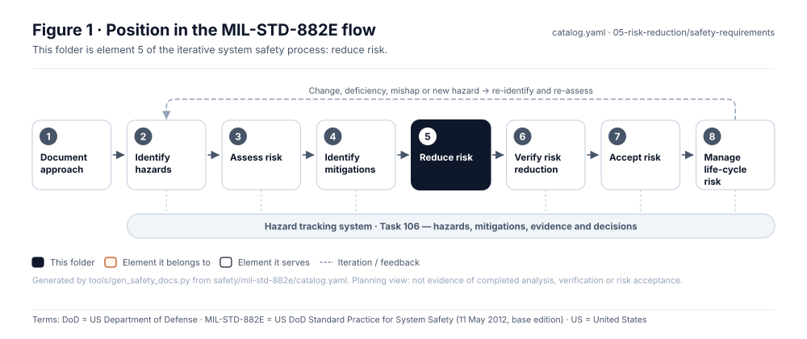
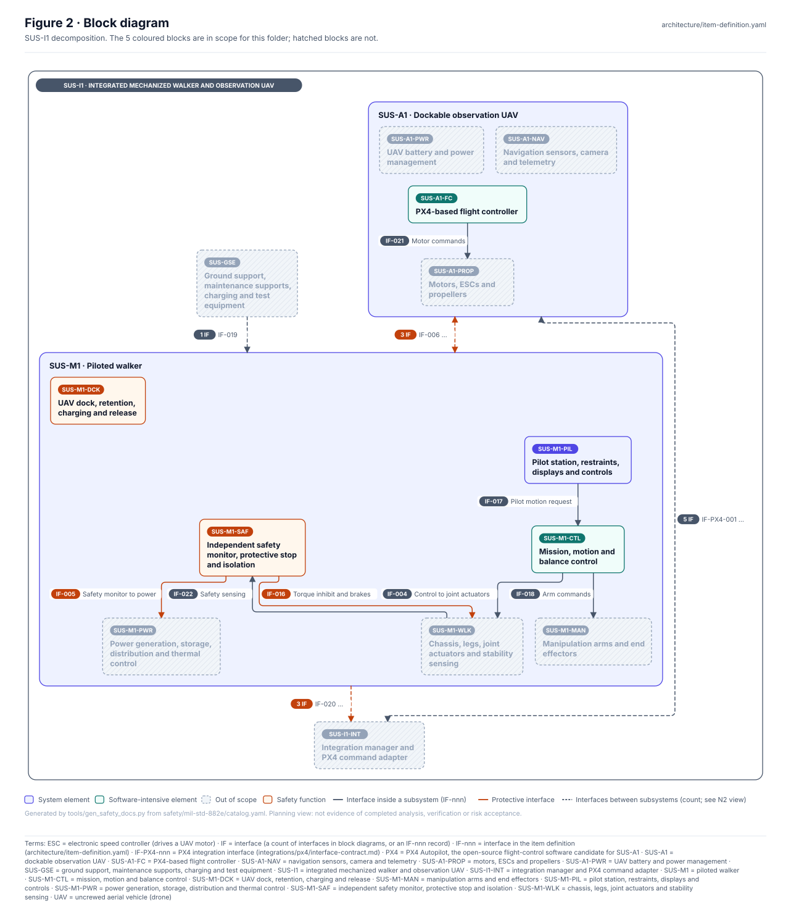
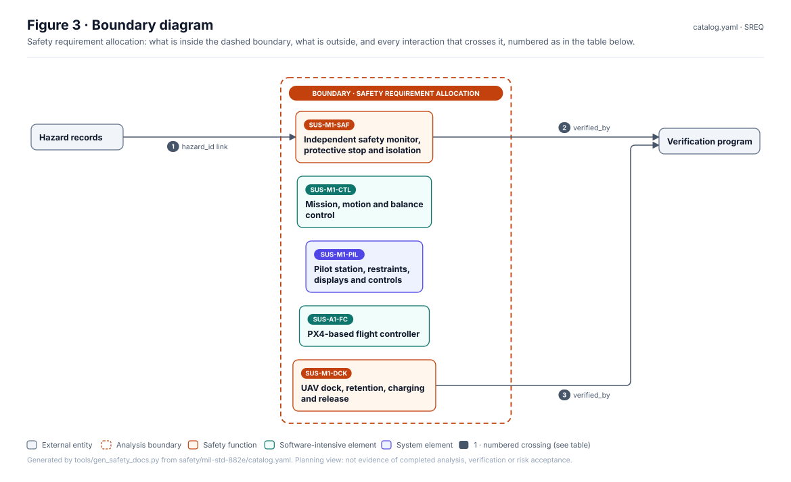
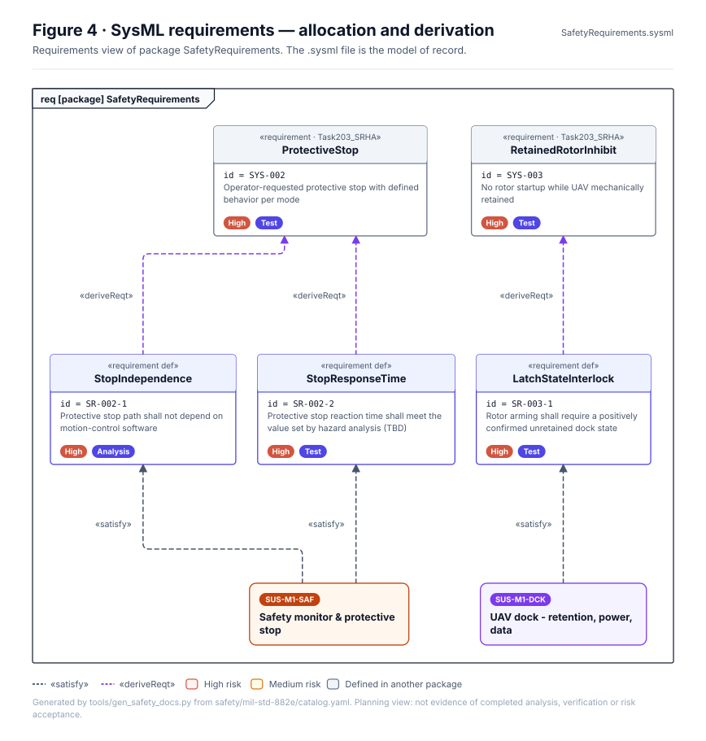
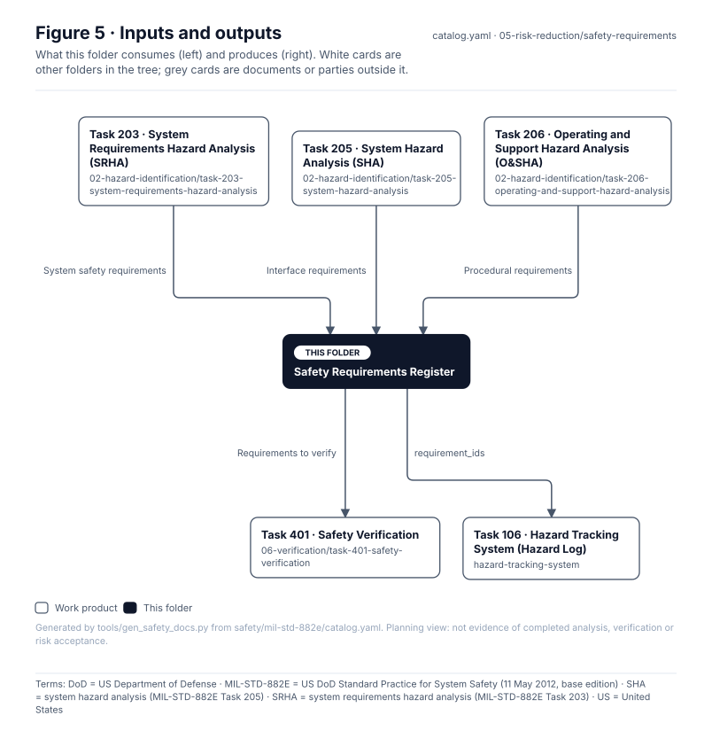

<!-- GENERATED by tools/wiki/build_wiki.py from safety/mil-std-882e/05-risk-reduction/safety-requirements/README.md. Do not edit here; edit the source and re-run. -->

> Published from [`safety/mil-std-882e/05-risk-reduction/safety-requirements/README.md`](https://github.com/jherrodthomas/Project-Susanoo/blob/main/safety/mil-std-882e/05-risk-reduction/safety-requirements/README.md) in the repository.

# Safety Requirements Register

> **Status:** Scaffold v0.1 — structure, diagrams and model views only
>
> Planning artifact. No completed hazard analysis, verified mitigation, risk acceptance, certification or MIL-STD-882E compliance is claimed. Category names follow MIL-STD-882E; confirm definitions against the controlled standard and the approved SSPP before formal use.

<!-- terms:start (generated by tools/terms/terms.py; do not edit by hand) -->
<details><summary><b>Terms on this page (15)</b>: abbreviations and codes explained</summary>

| Term | Meaning |
|---|---|
| DoD | US Department of Defense |
| EHA | environmental hazard analysis (MIL-STD-882E Task 210) |
| G0–G7 | lifecycle gate (G0 concept to G7 change and sustainment) |
| HHA | health hazard analysis (MIL-STD-882E Task 207) |
| MIL-STD-882E | US DoD Standard Practice for System Safety (11 May 2012, base edition) |
| PDaC | Product Development as Code |
| SHA | system hazard analysis (MIL-STD-882E Task 205) |
| SRHA | system requirements hazard analysis (MIL-STD-882E Task 203) |
| SSPP | system safety program plan (MIL-STD-882E Task 102) |
| SUS-M1-DCK | UAV dock, retention, charging and release |
| SUS-M1-SAF | independent safety monitor, protective stop and isolation |
| SVG | Scalable Vector Graphics, the figure file format |
| SysML | Systems Modeling Language (SysML v2) |
| UAV | uncrewed aerial vehicle (drone) |
| US | United States |

All terms: [abbreviations and record codes](https://github.com/jherrodthomas/Project-Susanoo/blob/main/docs/terms.md).

</details>
<!-- terms:end -->

| Field | Value |
|---|---|
| MIL-STD-882E element | 5 — Reduce risk |
| Lifecycle gate | G2–G4 |
| Applicability | Selected |
| Accountable role | Systems lead |
| Parent folder | [05 · Reduce Risk](882E-05-risk-reduction.md) |

## Purpose

Safety requirements derived from SRHA, SHA, O&SHA, HHA and EHA, each allocated to a system element and
assigned a verification method. The records live in [`requirements/`](https://github.com/jherrodthomas/Project-Susanoo/tree/main/requirements); derived
requirements name their parent in `derived_from`. Released requirements need a verification
disposition (traceability rule 2).

## Position in the MIL-STD-882E flow



## Block diagram



Elements and interfaces: [`architecture/item-definition.yaml`](https://github.com/jherrodthomas/Project-Susanoo/blob/main/architecture/item-definition.yaml); SysML: [`Architecture.sysml`](https://github.com/jherrodthomas/Project-Susanoo/blob/main/models/sysml/model/Architecture.sysml).

## Boundary diagram



| # | From | To | Crossing / interaction | Interface (item definition) |
|---|---|---|---|---|
| 1 | Hazard records | SUS-M1-SAF: Independent safety monitor, protective stop and isolation | hazard_id link | — |
| 2 | SUS-M1-SAF: Independent safety monitor, protective stop and isolation | Verification program | verified_by | — |
| 3 | SUS-M1-DCK: UAV dock, retention, charging and release | Verification program | verified_by | — |

## SysML model

SysML v2 textual view: [`SafetyRequirements.sysml`](https://github.com/jherrodthomas/Project-Susanoo/blob/main/safety/mil-std-882e/05-risk-reduction/safety-requirements/SafetyRequirements.sysml), generated from the catalog. It imports the project model in [`models/sysml/model`](https://github.com/jherrodthomas/Project-Susanoo/tree/main/models/sysml/model): `SusanooArchitecture` (elements and usage paths) and `SusanooLibrary` (882E vocabulary). The figures are drawn from the same data; the `.sysml` file is the model of record.



<details><summary>SysML v2 source</summary>

```sysml
// SafetyRequirements — generated by tools/gen_safety_docs.py from safety/mil-std-882e/catalog.yaml.
// Do not edit by hand: change the catalog and regenerate.
// Status: planning view only; not evidence of completed analysis or verification.

package SafetyRequirements {
    private import ScalarValues::*;
    private import SusanooLibrary::*;
    private import SusanooArchitecture::*;
    private import RequirementDerivation::*;
    private import SusanooRequirements::*;
    // Requirement records shown here are owned by models/sysml/model/Requirements.sysml (generated from requirements/); satisfy relations by Satisfaction.sysml.
    view requirementsInScope {
        expose SusanooRequirements::'SYS-002';
        expose SusanooRequirements::'SYS-010';
        expose SusanooRequirements::'SYS-011';
        expose SusanooRequirements::'SYS-003';
        expose SusanooRequirements::'SYS-012';
    }
    #derivation connection { end #original ::> SusanooRequirements::'SYS-002'; end #derive ::> SusanooRequirements::'SYS-010'; }
    #derivation connection { end #original ::> SusanooRequirements::'SYS-002'; end #derive ::> SusanooRequirements::'SYS-011'; }
    #derivation connection { end #original ::> SusanooRequirements::'SYS-003'; end #derive ::> SusanooRequirements::'SYS-012'; }
}
```

</details>

## Inputs and outputs



| Input | Source |
|---|---|
| System safety requirements | [Task 203 · System Requirements Hazard Analysis (SRHA)](882E-task-203-system-requirements-hazard-analysis.md) |
| Interface requirements | [Task 205 · System Hazard Analysis (SHA)](882E-task-205-system-hazard-analysis.md) |
| Procedural requirements | [Task 206 · Operating and Support Hazard Analysis (O&SHA)](882E-task-206-operating-and-support-hazard-analysis.md) |

| Output | Destination |
|---|---|
| Requirements to verify | [Task 401 · Safety Verification](882E-task-401-safety-verification.md) |
| requirement_ids | [Task 106 · Hazard Tracking System (Hazard Log)](882E-hazard-tracking-system.md) |

## Folder contents

| Item | Description | State |
|---|---|---|
| `safety-requirements.yaml` | Typed requirement records (PDaC Requirement objects) | planned |
| [`figures/`](https://github.com/jherrodthomas/Project-Susanoo/tree/main/safety/mil-std-882e/05-risk-reduction/safety-requirements/figures) | Generated SVG figures (do not edit) | generated |
| [`SafetyRequirements.sysml`](https://github.com/jherrodthomas/Project-Susanoo/blob/main/safety/mil-std-882e/05-risk-reduction/safety-requirements/SafetyRequirements.sysml) | Generated SysML v2 view | generated |

<!-- END GENERATED: content below this line is human-authored and preserved -->

## Working content

_No analysis content yet. Add authored material below this heading._
