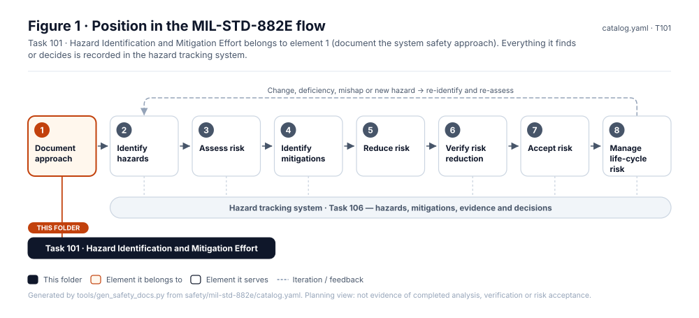
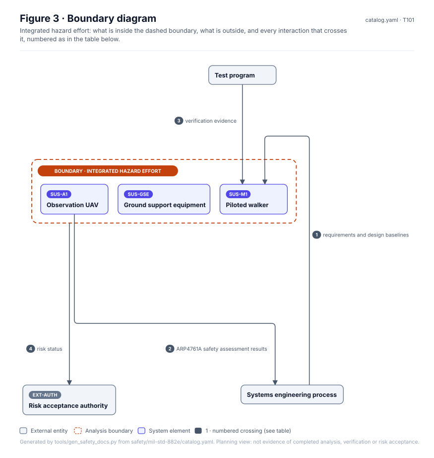
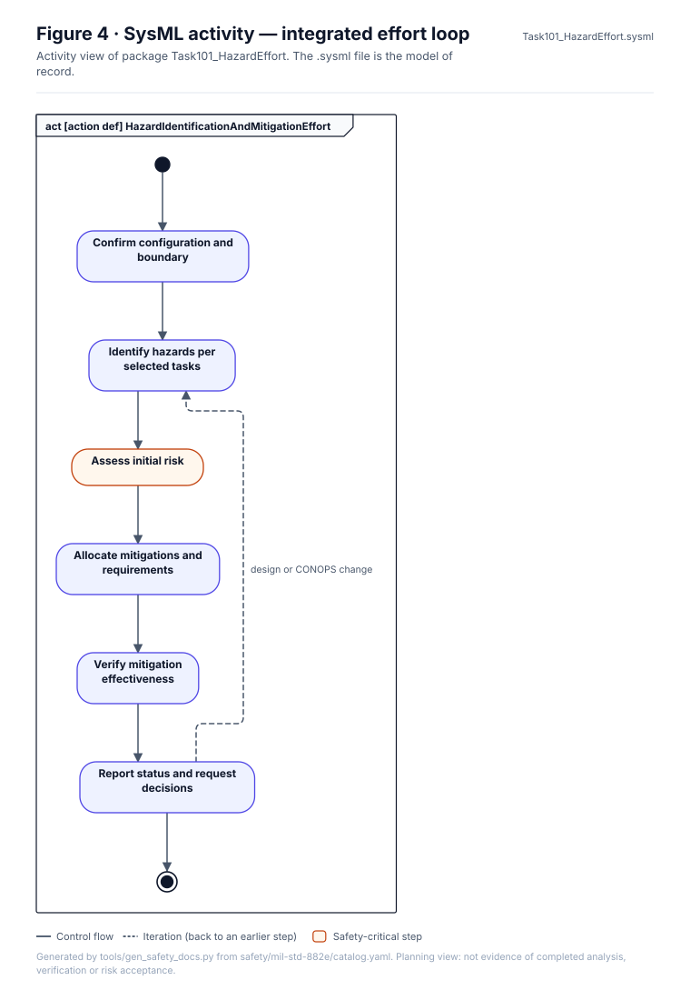
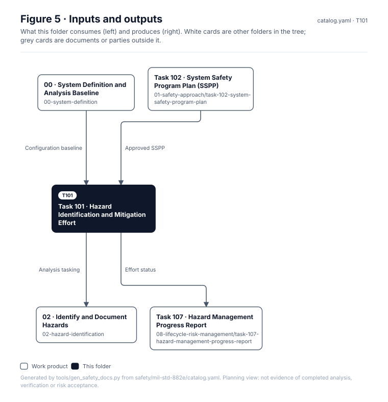

<!-- GENERATED by tools/wiki/build_wiki.py from safety/mil-std-882e/01-safety-approach/task-101-hazard-identification-and-mitigation-effort/README.md. Do not edit here; edit the source and re-run. -->

> Published from [`safety/mil-std-882e/01-safety-approach/task-101-hazard-identification-and-mitigation-effort/README.md`](https://github.com/jherrodthomas/Project-Susanoo/blob/main/safety/mil-std-882e/01-safety-approach/task-101-hazard-identification-and-mitigation-effort/README.md) in the repository.

# Task 101 · Hazard Identification and Mitigation Effort

> **Status:** Scaffold v0.1 — structure, diagrams and model views only
>
> Planning artifact. No completed hazard analysis, verified mitigation, risk acceptance, certification or MIL-STD-882E compliance is claimed. Category names follow MIL-STD-882E; confirm definitions against the controlled standard and the approved SSPP before formal use.

<!-- terms:start (generated by tools/terms/terms.py; do not edit by hand) -->
<details><summary><b>Terms on this page (13)</b>: abbreviations and codes explained</summary>

| Term | Meaning |
|---|---|
| ARP4754B | SAE guidelines for development of civil aircraft and systems |
| ARP4761A | SAE guidelines for the safety assessment process on civil aircraft |
| DoD | US Department of Defense |
| G0–G7 | lifecycle gate (G0 concept to G7 change and sustainment) |
| MIL-STD-882E | US DoD Standard Practice for System Safety (11 May 2012, base edition) |
| SAE | SAE International, publisher of ARP4754B and ARP4761A |
| SSPP | system safety program plan (MIL-STD-882E Task 102) |
| SUS-A1 | dockable observation UAV |
| SUS-M1 | piloted walker |
| SVG | Scalable Vector Graphics, the figure file format |
| SysML | Systems Modeling Language (SysML v2) |
| UAV | uncrewed aerial vehicle (drone) |
| US | United States |

All terms: [abbreviations and record codes](https://github.com/jherrodthomas/Project-Susanoo/blob/main/docs/terms.md).

</details>
<!-- terms:end -->

| Field | Value |
|---|---|
| MIL-STD-882E element | 1 — Document the system safety approach |
| Tasks | [Task 101 — Hazard Identification and Mitigation Effort](MIL-STD-882E-Task-101.md) |
| Lifecycle gate | G0 onward |
| Applicability | Selected |
| Accountable role | Safety lead |
| Parent folder | [01 · Document the System Safety Approach](882E-01-safety-approach.md) |

## Purpose

Establishes the integrated, iterative effort that runs the eight elements across SUS-M1,
SUS-A1 and their interfaces, using the systems engineering process rather than a parallel one.

## Position in the MIL-STD-882E flow



## Block diagram


Elements and interfaces: [`architecture/item-definition.yaml`](https://github.com/jherrodthomas/Project-Susanoo/blob/main/architecture/item-definition.yaml); SysML: [`Architecture.sysml`](https://github.com/jherrodthomas/Project-Susanoo/blob/main/models/sysml/model/Architecture.sysml).

## Boundary diagram



| # | From | To | Crossing / interaction | Interface (item definition) |
|---|---|---|---|---|
| 1 | Systems engineering process | SUS-M1: Piloted walker | requirements and design baselines | — |
| 2 | SUS-A1: Dockable observation UAV | Systems engineering process | ARP4761A safety assessment results | — |
| 3 | Test program | SUS-M1: Piloted walker | verification evidence | — |
| 4 | _Integrated hazard effort (boundary)_ | Risk acceptance authority | risk status | — |

## SysML model

SysML v2 textual view: [`Task101_HazardEffort.sysml`](https://github.com/jherrodthomas/Project-Susanoo/blob/main/safety/mil-std-882e/01-safety-approach/task-101-hazard-identification-and-mitigation-effort/Task101_HazardEffort.sysml), generated from the catalog. It imports the project model in [`models/sysml/model`](https://github.com/jherrodthomas/Project-Susanoo/tree/main/models/sysml/model): `SusanooArchitecture` (elements and usage paths) and `SusanooLibrary` (882E vocabulary). The figures are drawn from the same data; the `.sysml` file is the model of record.



<details><summary>SysML v2 source</summary>

```sysml
// Task101_HazardEffort — generated by tools/gen_safety_docs.py from safety/mil-std-882e/catalog.yaml.
// Do not edit by hand: change the catalog and regenerate.
// Status: planning view only; not evidence of completed analysis or verification.

package Task101_HazardEffort {
    private import ScalarValues::*;
    private import SusanooLibrary::*;
    private import SusanooArchitecture::*;
    action def HazardIdentificationAndMitigationEffort {
        action defineScope { doc /* Confirm configuration and boundary */ }
        action identify { doc /* Identify hazards per selected tasks */ }
        action assess { doc /* Assess initial risk */ }
        action mitigate { doc /* Allocate mitigations and requirements */ }
        action verifyEffectiveness { doc /* Verify mitigation effectiveness */ }
        action report { doc /* Report status and request decisions */ }
        first start then defineScope;
        first defineScope then identify;
        first identify then assess;
        first assess then mitigate;
        first mitigate then verifyEffectiveness;
        first verifyEffectiveness then report;
        first report then done;
        // iteration: report -> identify when design or CONOPS change (informal; merge node omitted)
    }
}
```

</details>

## Inputs and outputs



| Input | Source |
|---|---|
| Configuration baseline | [00 · System Definition and Analysis Baseline](882E-00-system-definition.md) |
| Approved SSPP | [Task 102 · System Safety Program Plan (SSPP)](882E-task-102-system-safety-program-plan.md) |

| Output | Destination |
|---|---|
| Analysis tasking | [02 · Identify and Document Hazards](882E-02-hazard-identification.md) |
| Effort status | [Task 107 · Hazard Management Progress Report](882E-task-107-hazard-management-progress-report.md) |

## Folder contents

| Item | Description | State |
|---|---|---|
| `effort-record.yaml` | Task record using templates/task-record.yaml | planned |
| [`figures/`](https://github.com/jherrodthomas/Project-Susanoo/tree/main/safety/mil-std-882e/01-safety-approach/task-101-hazard-identification-and-mitigation-effort/figures) | Generated SVG figures (do not edit) | generated |
| [`Task101_HazardEffort.sysml`](https://github.com/jherrodthomas/Project-Susanoo/blob/main/safety/mil-std-882e/01-safety-approach/task-101-hazard-identification-and-mitigation-effort/Task101_HazardEffort.sysml) | Generated SysML v2 view | generated |

<!-- END GENERATED: content below this line is human-authored and preserved -->

## Working content

_No analysis content yet. Add authored material below this heading._
