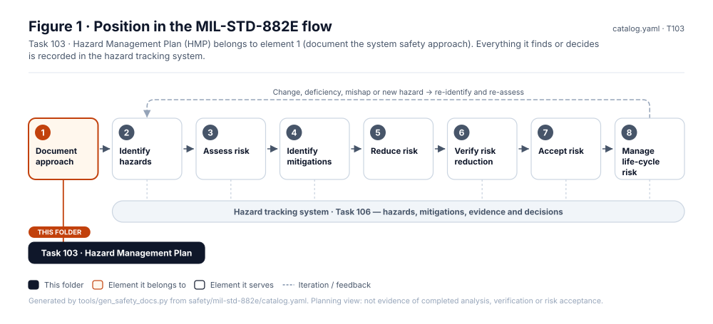
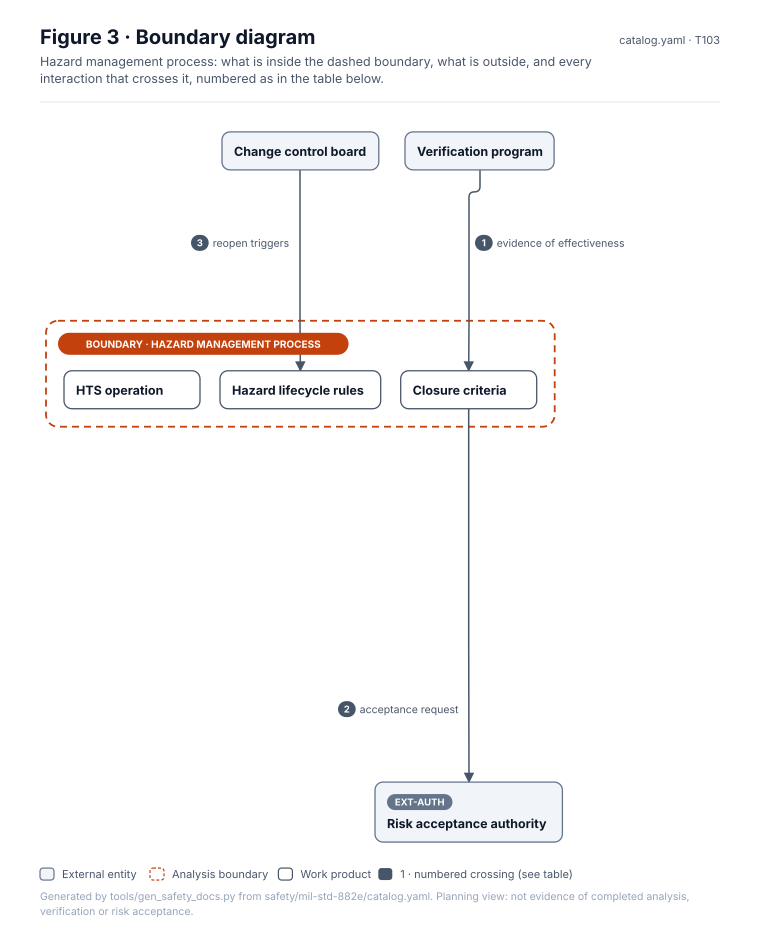
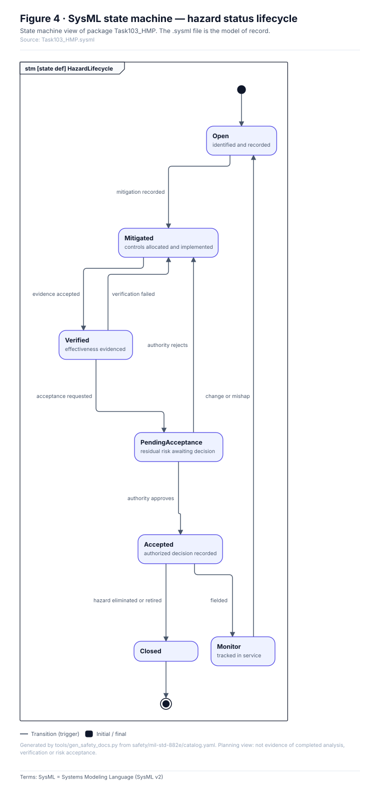
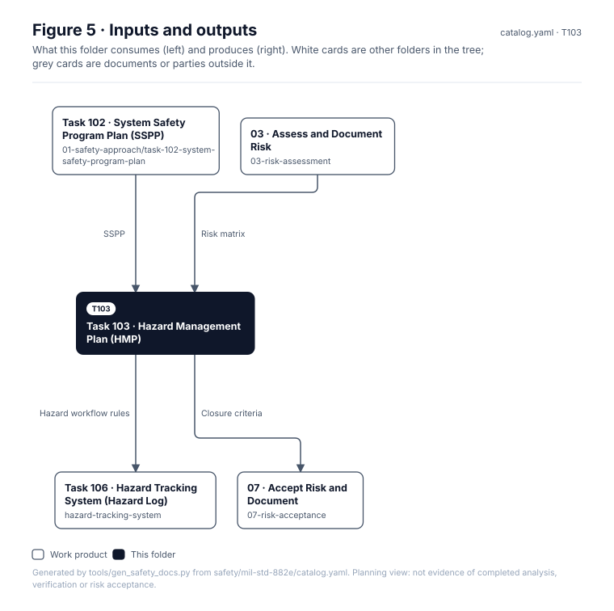

<!-- GENERATED by tools/wiki/build_wiki.py from safety/mil-std-882e/01-safety-approach/task-103-hazard-management-plan/README.md. Do not edit here; edit the source and re-run. -->

> Published from [`safety/mil-std-882e/01-safety-approach/task-103-hazard-management-plan/README.md`](https://github.com/jherrodthomas/Project-Susanoo/blob/main/safety/mil-std-882e/01-safety-approach/task-103-hazard-management-plan/README.md) in the repository.

# Task 103 · Hazard Management Plan (HMP)

> **Status:** Scaffold v0.1 — structure, diagrams and model views only
>
> Planning artifact. No completed hazard analysis, verified mitigation, risk acceptance, certification or MIL-STD-882E compliance is claimed. Category names follow MIL-STD-882E; confirm definitions against the controlled standard and the approved SSPP before formal use.

<!-- terms:start (generated by tools/terms/terms.py; do not edit by hand) -->
<details><summary><b>Terms on this page (8)</b>: abbreviations and codes explained</summary>

| Term | Meaning |
|---|---|
| DoD | US Department of Defense |
| G0–G7 | lifecycle gate (G0 concept to G7 change and sustainment) |
| HMP | hazard management plan (MIL-STD-882E Task 103) |
| MIL-STD-882E | US DoD Standard Practice for System Safety (11 May 2012, base edition) |
| SSPP | system safety program plan (MIL-STD-882E Task 102) |
| SVG | Scalable Vector Graphics, the figure file format |
| SysML | Systems Modeling Language (SysML v2) |
| US | United States |

All terms: [abbreviations and record codes](https://github.com/jherrodthomas/Project-Susanoo/blob/main/docs/terms.md).

</details>
<!-- terms:end -->

| Field | Value |
|---|---|
| MIL-STD-882E element | 1 — Document the system safety approach |
| Tasks | [Task 103 — Hazard Management Plan](MIL-STD-882E-Task-103.md) |
| Lifecycle gate | G0–G1 |
| Applicability | Not selected — the SSPP (Task 102) covers hazard management; one plan avoids divergence |
| Accountable role | Safety lead |
| Parent folder | [01 · Document the System Safety Approach](882E-01-safety-approach.md) |

## Purpose

Defines how hazards move through their lifecycle, closure criteria, who may change status,
and how the hazard tracking system is operated.

## Position in the MIL-STD-882E flow



## Block diagram


Elements and interfaces: [`architecture/item-definition.yaml`](https://github.com/jherrodthomas/Project-Susanoo/blob/main/architecture/item-definition.yaml); SysML: [`Architecture.sysml`](https://github.com/jherrodthomas/Project-Susanoo/blob/main/models/sysml/model/Architecture.sysml).

## Boundary diagram



| # | From | To | Crossing / interaction | Interface (item definition) |
|---|---|---|---|---|
| 1 | Verification program | Closure criteria | evidence of effectiveness | — |
| 2 | Closure criteria | Risk acceptance authority | acceptance request | — |
| 3 | Change control board | Hazard lifecycle rules | reopen triggers | — |

## SysML model

SysML v2 textual view: [`Task103_HMP.sysml`](https://github.com/jherrodthomas/Project-Susanoo/blob/main/safety/mil-std-882e/01-safety-approach/task-103-hazard-management-plan/Task103_HMP.sysml), generated from the catalog. It imports the project model in [`models/sysml/model`](https://github.com/jherrodthomas/Project-Susanoo/tree/main/models/sysml/model): `SusanooArchitecture` (elements and usage paths) and `SusanooLibrary` (882E vocabulary). The figures are drawn from the same data; the `.sysml` file is the model of record.



<details><summary>SysML v2 source</summary>

```sysml
// Task103_HMP — generated by tools/gen_safety_docs.py from safety/mil-std-882e/catalog.yaml.
// Do not edit by hand: change the catalog and regenerate.
// Status: planning view only; not evidence of completed analysis or verification.

package Task103_HMP {
    private import ScalarValues::*;
    private import SusanooLibrary::*;
    private import SusanooArchitecture::*;
    attribute def AcceptanceRequested;
    attribute def AuthorityApproves;
    attribute def AuthorityRejects;
    attribute def ChangeOrMishap;
    attribute def EvidenceAccepted;
    attribute def Fielded;
    attribute def HazardEliminatedOrRetired;
    attribute def MitigationRecorded;
    attribute def VerificationFailed;
    state def HazardLifecycle {
        doc /* Status transitions governed by the HMP; values follow SusanooLibrary::HazardStatus. */
        entry; then Open;
        state Open { doc /* identified and recorded */ }
        state Mitigated { doc /* controls allocated and implemented */ }
        state Verified { doc /* effectiveness evidenced */ }
        state PendingAcceptance { doc /* residual risk awaiting decision */ }
        state Accepted { doc /* authorized decision recorded */ }
        state Closed;
        state Monitor { doc /* tracked in service */ }
        transition t1 first Open accept MitigationRecorded then Mitigated;
        transition t2 first Mitigated accept EvidenceAccepted then Verified;
        transition t3 first Verified accept VerificationFailed then Mitigated;
        transition t4 first Verified accept AcceptanceRequested then PendingAcceptance;
        transition t5 first PendingAcceptance accept AuthorityApproves then Accepted;
        transition t6 first PendingAcceptance accept AuthorityRejects then Mitigated;
        transition t7 first Accepted accept Fielded then Monitor;
        transition t8 first Monitor accept ChangeOrMishap then Open;
        transition t9 first Accepted accept HazardEliminatedOrRetired then Closed;
    }
}
```

</details>

## Inputs and outputs



| Input | Source |
|---|---|
| SSPP | [Task 102 · System Safety Program Plan (SSPP)](882E-task-102-system-safety-program-plan.md) |
| Risk matrix | [03 · Assess and Document Risk](882E-03-risk-assessment.md) |

| Output | Destination |
|---|---|
| Hazard workflow rules | [Task 106 · Hazard Tracking System (Hazard Log)](882E-hazard-tracking-system.md) |
| Closure criteria | [07 · Accept Risk and Document](882E-07-risk-acceptance.md) |

## Folder contents

| Item | Description | State |
|---|---|---|
| `hmp.md` | Hazard Management Plan | planned |
| [`figures/`](https://github.com/jherrodthomas/Project-Susanoo/tree/main/safety/mil-std-882e/01-safety-approach/task-103-hazard-management-plan/figures) | Generated SVG figures (do not edit) | generated |
| [`Task103_HMP.sysml`](https://github.com/jherrodthomas/Project-Susanoo/blob/main/safety/mil-std-882e/01-safety-approach/task-103-hazard-management-plan/Task103_HMP.sysml) | Generated SysML v2 view | generated |

<!-- END GENERATED: content below this line is human-authored and preserved -->

## Working content

_No analysis content yet. Add authored material below this heading._
