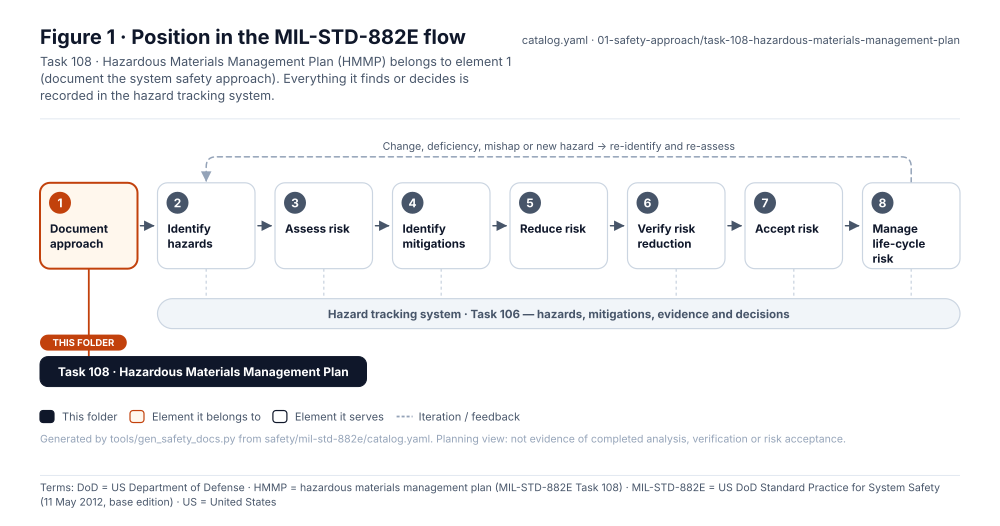
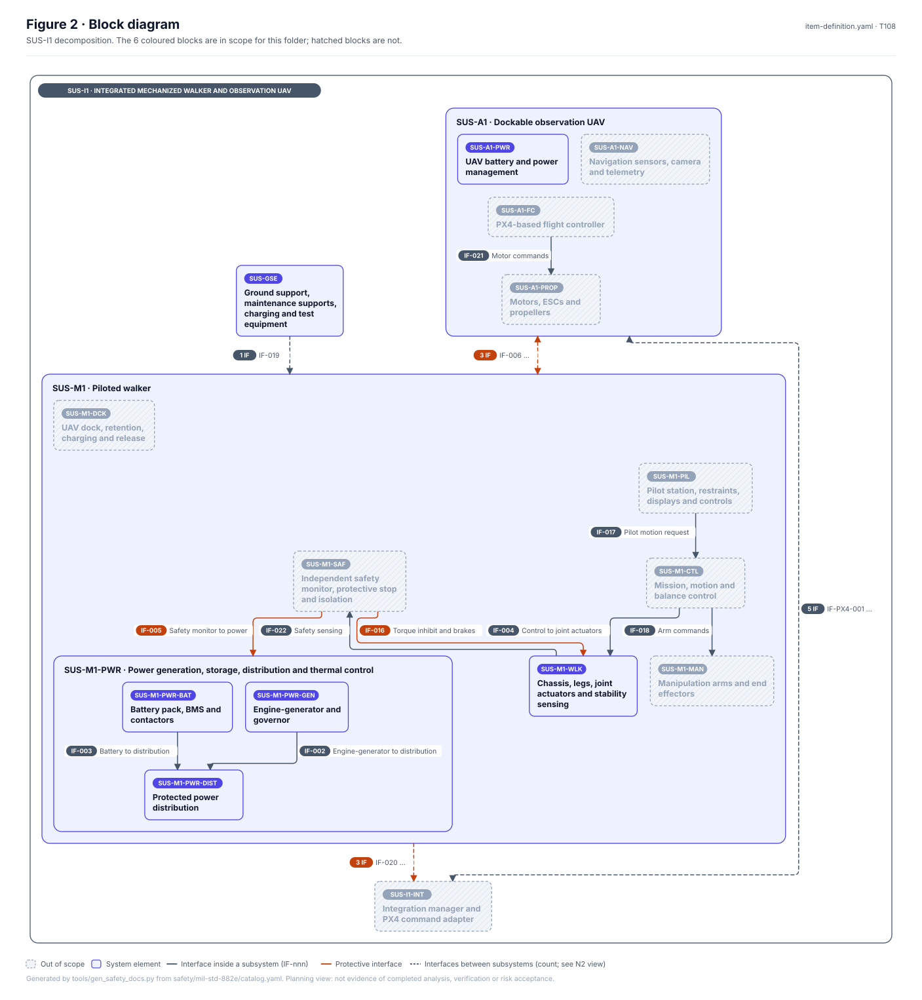
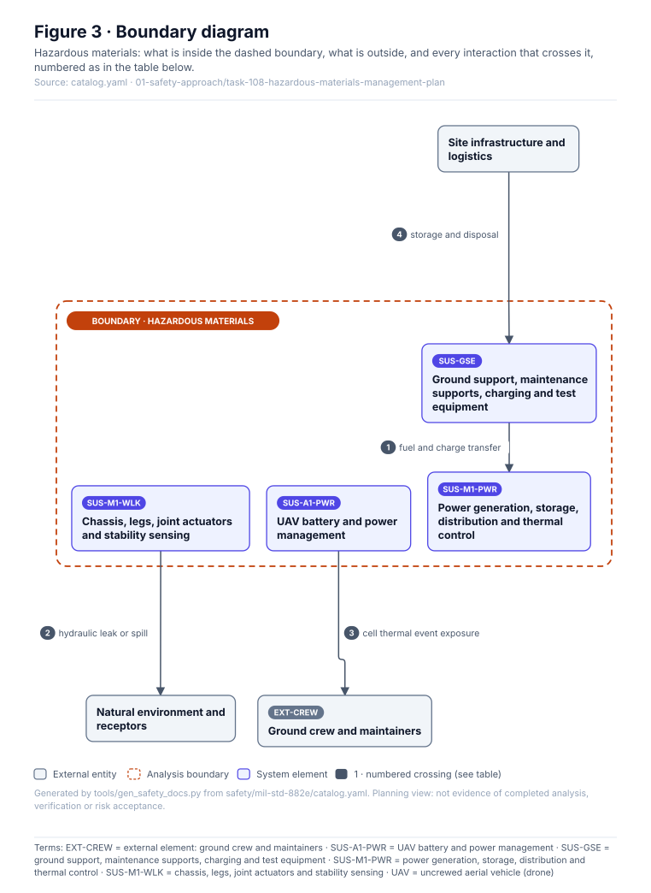
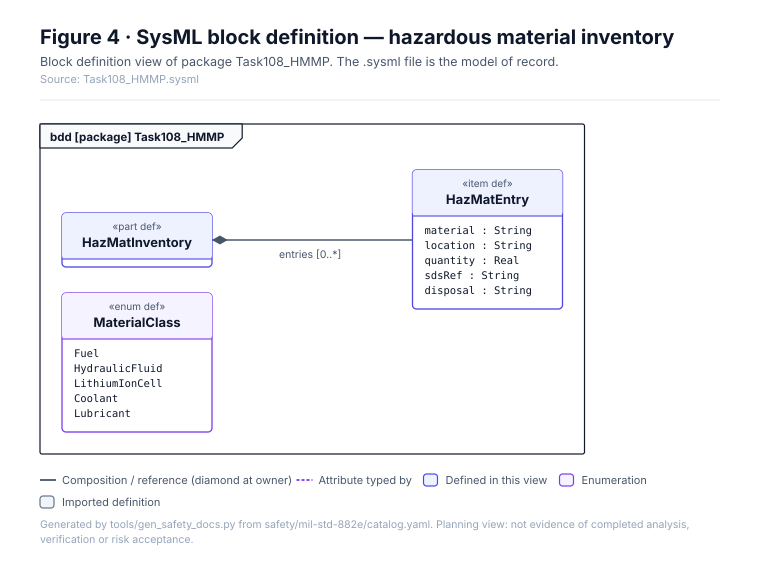
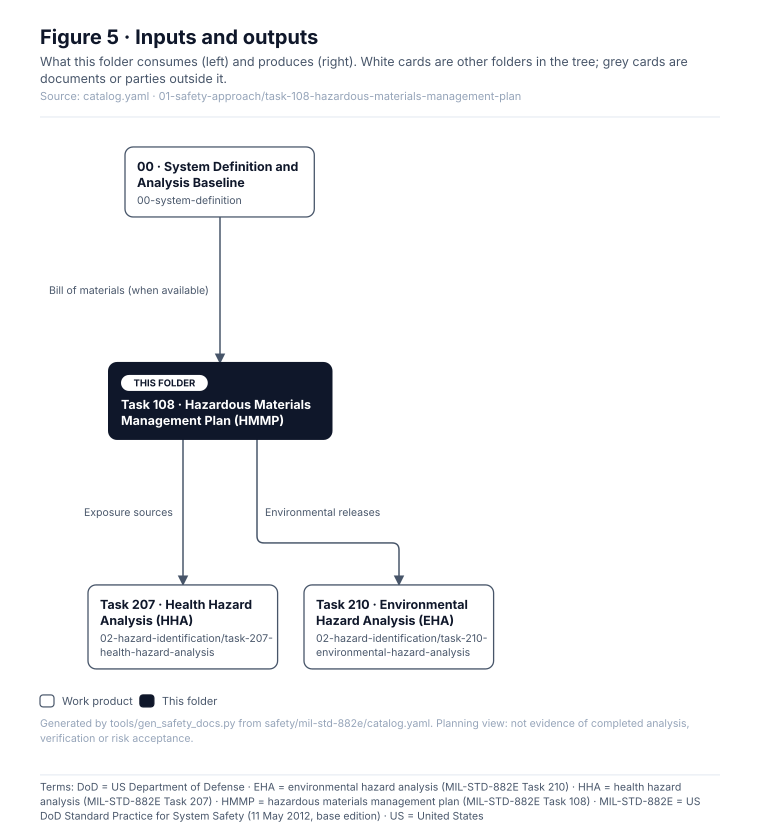

<!-- GENERATED by tools/wiki/build_wiki.py from safety/mil-std-882e/01-safety-approach/task-108-hazardous-materials-management-plan/README.md. Do not edit here; edit the source and re-run. -->

> Published from [`safety/mil-std-882e/01-safety-approach/task-108-hazardous-materials-management-plan/README.md`](https://github.com/jherrodthomas/Project-Susanoo/blob/main/safety/mil-std-882e/01-safety-approach/task-108-hazardous-materials-management-plan/README.md) in the repository.

# Task 108 · Hazardous Materials Management Plan (HMMP)

> **Status:** Scaffold v0.1 — structure, diagrams and model views only
>
> Planning artifact. No completed hazard analysis, verified mitigation, risk acceptance, certification or MIL-STD-882E compliance is claimed. Category names follow MIL-STD-882E; confirm definitions against the controlled standard and the approved SSPP before formal use.

<!-- terms:start (generated by tools/terms/terms.py; do not edit by hand) -->
<details><summary><b>Terms on this page (19)</b>: abbreviations and codes explained</summary>

| Term | Meaning |
|---|---|
| DoD | US Department of Defense |
| EHA | environmental hazard analysis (MIL-STD-882E Task 210) |
| EXT-CREW | external element: ground crew and maintainers |
| G0–G7 | lifecycle gate (G0 concept to G7 change and sustainment) |
| HHA | health hazard analysis (MIL-STD-882E Task 207) |
| HMMP | hazardous materials management plan (MIL-STD-882E Task 108) |
| HSE | health, safety and environment |
| MIL-STD-882E | US DoD Standard Practice for System Safety (11 May 2012, base edition) |
| SSPP | system safety program plan (MIL-STD-882E Task 102) |
| SUS-A1 | dockable observation UAV |
| SUS-A1-PWR | UAV battery and power management |
| SUS-GSE | ground support, maintenance supports, charging and test equipment |
| SUS-M1 | piloted walker |
| SUS-M1-PWR | power generation, storage, distribution and thermal control |
| SUS-M1-WLK | chassis, legs, joint actuators and stability sensing |
| SVG | Scalable Vector Graphics, the figure file format |
| SysML | Systems Modeling Language (SysML v2) |
| UAV | uncrewed aerial vehicle (drone) |
| US | United States |

All terms: [abbreviations and record codes](https://github.com/jherrodthomas/Project-Susanoo/blob/main/docs/terms.md).

</details>
<!-- terms:end -->

| Field | Value |
|---|---|
| MIL-STD-882E element | 1 — Document the system safety approach |
| Tasks | [Task 108 — Hazardous Materials Management Plan](MIL-STD-882E-Task-108.md) |
| Lifecycle gate | G1–G3 |
| Applicability | Selected |
| Accountable role | Environmental / HSE lead |
| Parent folder | [01 · Document the System Safety Approach](882E-01-safety-approach.md) |

## Purpose

Inventories and manages hazardous materials: engine fuel, hydraulic fluid (if electrohydraulic
actuation is chosen), lithium-ion cells in SUS-M1 and SUS-A1, coolants and lubricants.

## Position in the MIL-STD-882E flow



## Block diagram



Elements and interfaces: [`architecture/item-definition.yaml`](https://github.com/jherrodthomas/Project-Susanoo/blob/main/architecture/item-definition.yaml); SysML: [`Architecture.sysml`](https://github.com/jherrodthomas/Project-Susanoo/blob/main/models/sysml/model/Architecture.sysml).

## Boundary diagram



| # | From | To | Crossing / interaction | Interface (item definition) |
|---|---|---|---|---|
| 1 | SUS-GSE: Ground support, maintenance supports, charging and test equipment | SUS-M1-PWR: Power generation, storage, distribution and thermal control | fuel and charge transfer | — |
| 2 | SUS-M1-WLK: Chassis, legs, joint actuators and stability sensing | Natural environment and receptors | hydraulic leak or spill | — |
| 3 | SUS-A1-PWR: UAV battery and power management | EXT-CREW: Ground crew and maintainers | cell thermal event exposure | — |
| 4 | Site infrastructure and logistics | SUS-GSE: Ground support, maintenance supports, charging and test equipment | storage and disposal | — |

## SysML model

SysML v2 textual view: [`Task108_HMMP.sysml`](https://github.com/jherrodthomas/Project-Susanoo/blob/main/safety/mil-std-882e/01-safety-approach/task-108-hazardous-materials-management-plan/Task108_HMMP.sysml), generated from the catalog. It imports the project model in [`models/sysml/model`](https://github.com/jherrodthomas/Project-Susanoo/tree/main/models/sysml/model): `SusanooArchitecture` (elements and usage paths) and `SusanooLibrary` (882E vocabulary). The figures are drawn from the same data; the `.sysml` file is the model of record.



<details><summary>SysML v2 source</summary>

```sysml
// Task108_HMMP — generated by tools/gen_safety_docs.py from safety/mil-std-882e/catalog.yaml.
// Do not edit by hand: change the catalog and regenerate.
// Status: planning view only; not evidence of completed analysis or verification.

package Task108_HMMP {
    private import ScalarValues::*;
    private import SusanooLibrary::*;
    private import SusanooArchitecture::*;
    part def HazMatInventory {
        ref item entries : HazMatEntry[0..*];
    }
    item def HazMatEntry {
        attribute material : String;
        attribute location : String;
        attribute quantity : Real;
        attribute sdsRef : String;
        attribute disposal : String;
    }
    enum def MaterialClass {
        enum Fuel;
        enum HydraulicFluid;
        enum LithiumIonCell;
        enum Coolant;
        enum Lubricant;
    }
}
```

</details>

## Inputs and outputs



| Input | Source |
|---|---|
| Bill of materials (when available) | [00 · System Definition and Analysis Baseline](882E-00-system-definition.md) |

| Output | Destination |
|---|---|
| Exposure sources | [Task 207 · Health Hazard Analysis (HHA)](882E-task-207-health-hazard-analysis.md) |
| Environmental releases | [Task 210 · Environmental Hazard Analysis (EHA)](882E-task-210-environmental-hazard-analysis.md) |

## Folder contents

| Item | Description | State |
|---|---|---|
| `hazmat-inventory.csv` | Material | planned |
| [`figures/`](https://github.com/jherrodthomas/Project-Susanoo/tree/main/safety/mil-std-882e/01-safety-approach/task-108-hazardous-materials-management-plan/figures) | Generated SVG figures (do not edit) | generated |
| [`Task108_HMMP.sysml`](https://github.com/jherrodthomas/Project-Susanoo/blob/main/safety/mil-std-882e/01-safety-approach/task-108-hazardous-materials-management-plan/Task108_HMMP.sysml) | Generated SysML v2 view | generated |

<!-- END GENERATED: content below this line is human-authored and preserved -->

## Working content

_No analysis content yet. Add authored material below this heading._
