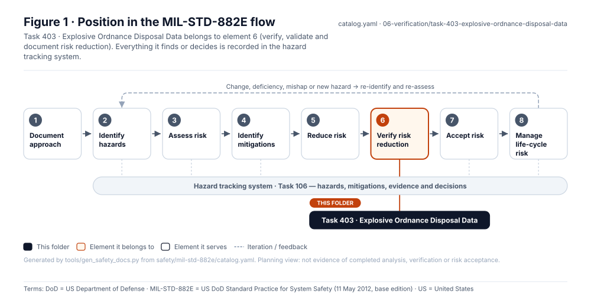
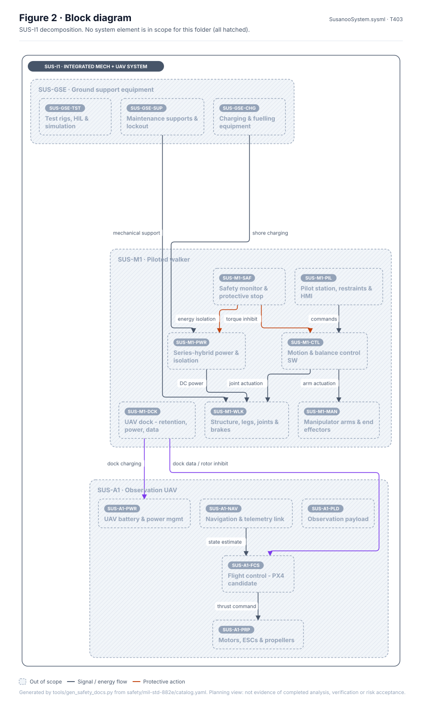
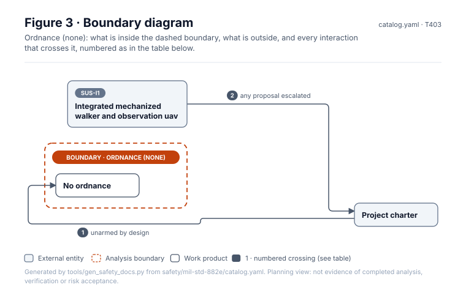
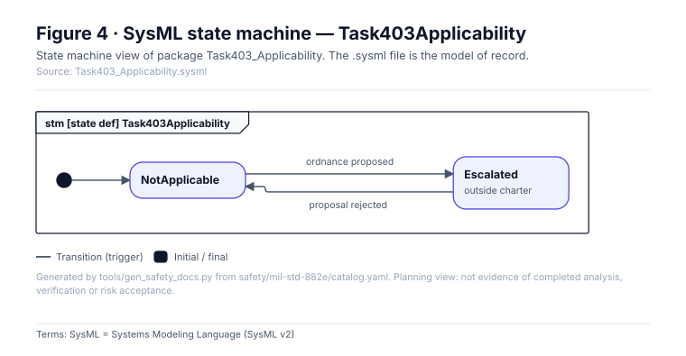
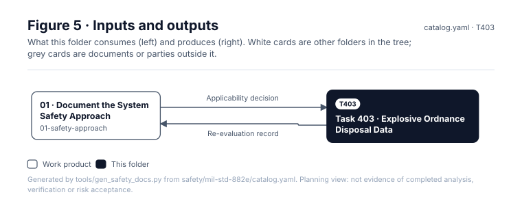

<!-- GENERATED by tools/wiki/build_wiki.py from safety/mil-std-882e/06-verification/task-403-explosive-ordnance-disposal-data/README.md. Do not edit here; edit the source and re-run. -->

> Published from [`safety/mil-std-882e/06-verification/task-403-explosive-ordnance-disposal-data/README.md`](https://github.com/jherrodthomas/Project-Susanoo/blob/main/safety/mil-std-882e/06-verification/task-403-explosive-ordnance-disposal-data/README.md) in the repository.

# Task 403 · Explosive Ordnance Disposal Data

> **Status:** Scaffold v0.1 — structure, diagrams and model views only
>
> Planning artifact. No completed hazard analysis, verified mitigation, risk acceptance, certification or MIL-STD-882E compliance is claimed. Category names follow MIL-STD-882E; confirm definitions against the controlled standard and the approved SSPP before formal use.

<!-- terms:start (generated by tools/terms/terms.py; do not edit by hand) -->
<details><summary><b>Terms on this page (8)</b>: abbreviations and codes explained</summary>

| Term | Meaning |
|---|---|
| DoD | US Department of Defense |
| MIL-STD-882E | US DoD Standard Practice for System Safety (11 May 2012, base edition) |
| SSPP | system safety program plan (MIL-STD-882E Task 102) |
| SUS-I1 | integrated mechanized walker and observation UAV |
| SVG | Scalable Vector Graphics, the figure file format |
| SysML | Systems Modeling Language (SysML v2) |
| UAV | uncrewed aerial vehicle (drone) |
| US | United States |

All terms: [abbreviations and record codes](https://github.com/jherrodthomas/Project-Susanoo/blob/main/docs/terms.md).

</details>
<!-- terms:end -->

| Field | Value |
|---|---|
| MIL-STD-882E element | 6 — Verify, validate and document risk reduction |
| Tasks | [Task 403 — Explosive Ordnance Disposal Data](MIL-STD-882E-Task-403.md) |
| Lifecycle gate | Re-evaluate at each gate |
| Applicability | Not applicable — unarmed platform, no ordnance |
| Accountable role | Safety lead |
| Parent folder | [06 · Verify, Validate and Document Risk Reduction](882E-06-verification.md) |

## Purpose

Placeholder that records the not-applicable decision. Susanoo is unarmed; any change introducing
ordnance is outside the project charter and must be escalated, not analysed here.

## Position in the MIL-STD-882E flow



## Block diagram



Elements and interfaces: [`architecture/item-definition.yaml`](https://github.com/jherrodthomas/Project-Susanoo/blob/main/architecture/item-definition.yaml); SysML: [`Architecture.sysml`](https://github.com/jherrodthomas/Project-Susanoo/blob/main/models/sysml/model/Architecture.sysml).

## Boundary diagram



| # | From | To | Crossing / interaction | Interface (item definition) |
|---|---|---|---|---|
| 1 | Project charter | No ordnance | unarmed by design | — |
| 2 | SUS-I1: Integrated mechanized walker and observation uav | Project charter | any proposal escalated | — |

## SysML model

SysML v2 textual view: [`Task403_Applicability.sysml`](https://github.com/jherrodthomas/Project-Susanoo/blob/main/safety/mil-std-882e/06-verification/task-403-explosive-ordnance-disposal-data/Task403_Applicability.sysml), generated from the catalog. It imports the project model in [`models/sysml/model`](https://github.com/jherrodthomas/Project-Susanoo/tree/main/models/sysml/model): `SusanooArchitecture` (elements and usage paths) and `SusanooLibrary` (882E vocabulary). The figures are drawn from the same data; the `.sysml` file is the model of record.



<details><summary>SysML v2 source</summary>

```sysml
// Task403_Applicability — generated by tools/gen_safety_docs.py from safety/mil-std-882e/catalog.yaml.
// Do not edit by hand: change the catalog and regenerate.
// Status: planning view only; not evidence of completed analysis or verification.

package Task403_Applicability {
    private import ScalarValues::*;
    private import SusanooLibrary::*;
    private import SusanooArchitecture::*;
    attribute def OrdnanceProposed;
    attribute def ProposalRejected;
    state def Task403Applicability {
        entry; then NotApplicable;
        state NotApplicable;
        state Escalated { doc /* outside charter */ }
        transition t1 first NotApplicable accept OrdnanceProposed then Escalated;
        transition t2 first Escalated accept ProposalRejected then NotApplicable;
    }
}
```

</details>

## Inputs and outputs



| Input | Source |
|---|---|
| Applicability decision | [01 · Document the System Safety Approach](882E-01-safety-approach.md) |

| Output | Destination |
|---|---|
| Re-evaluation record | [01 · Document the System Safety Approach](882E-01-safety-approach.md) |

## Folder contents

| Item | Description | State |
|---|---|---|
| `applicability-decision.yaml` | Not-applicable rationale | planned |
| [`figures/`](https://github.com/jherrodthomas/Project-Susanoo/tree/main/safety/mil-std-882e/06-verification/task-403-explosive-ordnance-disposal-data/figures) | Generated SVG figures (do not edit) | generated |
| [`Task403_Applicability.sysml`](https://github.com/jherrodthomas/Project-Susanoo/blob/main/safety/mil-std-882e/06-verification/task-403-explosive-ordnance-disposal-data/Task403_Applicability.sysml) | Generated SysML v2 view | generated |

<!-- END GENERATED: content below this line is human-authored and preserved -->

## Working content

_No analysis content yet. Add authored material below this heading._
