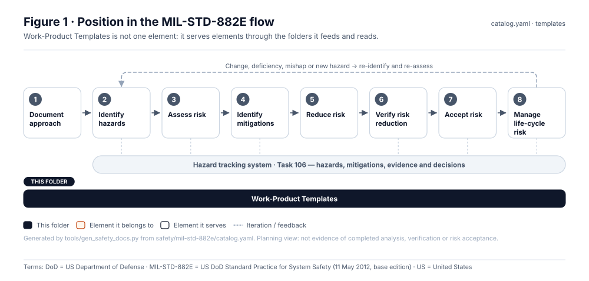
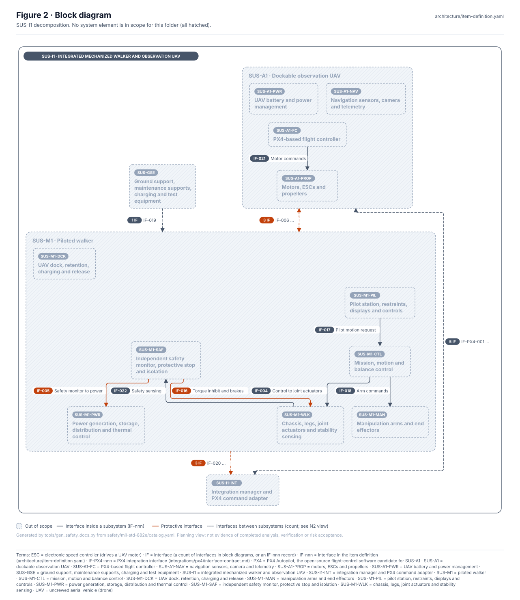
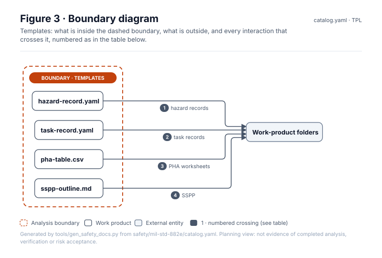
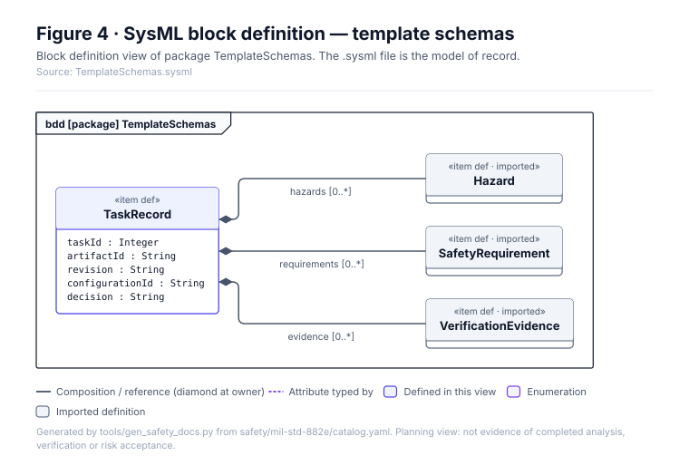
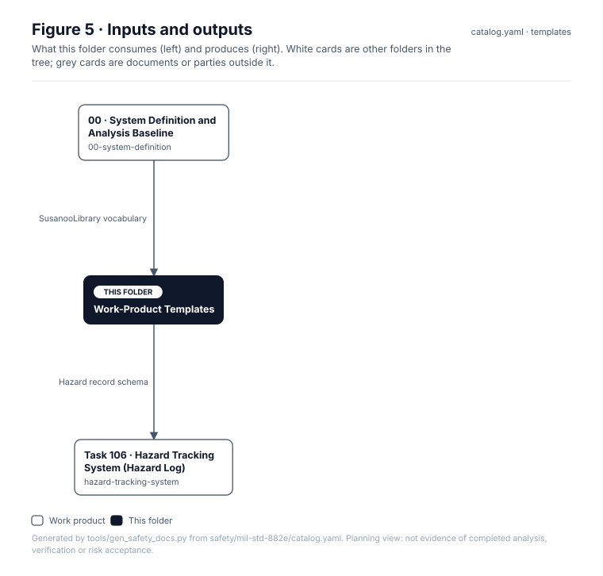

<!-- GENERATED by tools/wiki/build_wiki.py from safety/mil-std-882e/templates/README.md. Do not edit here; edit the source and re-run. -->

> Published from [`safety/mil-std-882e/templates/README.md`](https://github.com/jherrodthomas/Project-Susanoo/blob/main/safety/mil-std-882e/templates/README.md) in the repository.

# Work-Product Templates

> **Status:** Scaffold v0.1 — structure, diagrams and model views only
>
> Planning artifact. No completed hazard analysis, verified mitigation, risk acceptance, certification or MIL-STD-882E compliance is claimed. Category names follow MIL-STD-882E; confirm definitions against the controlled standard and the approved SSPP before formal use.

<!-- terms:start (generated by tools/terms/terms.py; do not edit by hand) -->
<details><summary><b>Terms on this page (7)</b>: abbreviations and codes explained</summary>

| Term | Meaning |
|---|---|
| DoD | US Department of Defense |
| MIL-STD-882E | US DoD Standard Practice for System Safety (11 May 2012, base edition) |
| PHA | preliminary hazard analysis (MIL-STD-882E Task 202) |
| SSPP | system safety program plan (MIL-STD-882E Task 102) |
| SVG | Scalable Vector Graphics, the figure file format |
| SysML | Systems Modeling Language (SysML v2) |
| US | United States |

All terms: [abbreviations and record codes](https://github.com/jherrodthomas/Project-Susanoo/blob/main/docs/terms.md).

</details>
<!-- terms:end -->

| Field | Value |
|---|---|
| Lifecycle gate | All |
| Accountable role | Safety lead |
| Parent folder | [MIL-STD-882E System Safety Work Products](882E-Work-Products.md) |

## Purpose

Record templates used across the tree. Templates mirror the `SusanooLibrary` record items so records,
models and checks share one vocabulary.

## Position in the MIL-STD-882E flow



## Block diagram



Elements and interfaces: [`architecture/item-definition.yaml`](https://github.com/jherrodthomas/Project-Susanoo/blob/main/architecture/item-definition.yaml); SysML: [`Architecture.sysml`](https://github.com/jherrodthomas/Project-Susanoo/blob/main/models/sysml/model/Architecture.sysml).

## Boundary diagram



| # | From | To | Crossing / interaction | Interface (item definition) |
|---|---|---|---|---|
| 1 | hazard-record.yaml | Work-product folders | hazard records | — |
| 2 | task-record.yaml | Work-product folders | task records | — |
| 3 | pha-table.csv | Work-product folders | PHA worksheets | — |
| 4 | sspp-outline.md | Work-product folders | SSPP | — |

## SysML model

SysML v2 textual view: [`TemplateSchemas.sysml`](https://github.com/jherrodthomas/Project-Susanoo/blob/main/safety/mil-std-882e/templates/TemplateSchemas.sysml), generated from the catalog. It imports the project model in [`models/sysml/model`](https://github.com/jherrodthomas/Project-Susanoo/tree/main/models/sysml/model): `SusanooArchitecture` (elements and usage paths) and `SusanooLibrary` (882E vocabulary). The figures are drawn from the same data; the `.sysml` file is the model of record.



<details><summary>SysML v2 source</summary>

```sysml
// TemplateSchemas — generated by tools/gen_safety_docs.py from safety/mil-std-882e/catalog.yaml.
// Do not edit by hand: change the catalog and regenerate.
// Status: planning view only; not evidence of completed analysis or verification.

package TemplateSchemas {
    private import ScalarValues::*;
    private import SusanooLibrary::*;
    private import SusanooArchitecture::*;
    item def TaskRecord {
        attribute taskId : Integer;
        attribute artifactId : String;
        attribute revision : String;
        attribute configurationId : String;
        attribute decision : String;
        ref item hazards : Hazard[0..*];
        ref item requirements : SafetyRequirement[0..*];
        ref item evidence : VerificationEvidence[0..*];
    }
}
```

</details>

## Inputs and outputs



| Input | Source |
|---|---|
| SusanooLibrary vocabulary | [00 · System Definition and Analysis Baseline](882E-00-system-definition.md) |

| Output | Destination |
|---|---|
| Hazard record schema | [Task 106 · Hazard Tracking System (Hazard Log)](882E-hazard-tracking-system.md) |

## Folder contents

| Item | Description | State |
|---|---|---|
| [`hazard-record.yaml`](https://github.com/jherrodthomas/Project-Susanoo/blob/main/safety/mil-std-882e/templates/hazard-record.yaml) | Hazard record template | present |
| [`task-record.yaml`](https://github.com/jherrodthomas/Project-Susanoo/blob/main/safety/mil-std-882e/templates/task-record.yaml) | Task record template | present |
| `pha-table.csv` | PHA worksheet columns | planned |
| [`sspp-outline.md`](https://github.com/jherrodthomas/Project-Susanoo/blob/main/safety/mil-std-882e/templates/sspp-outline.md) | SSPP outline | present |
| [`figures/`](https://github.com/jherrodthomas/Project-Susanoo/tree/main/safety/mil-std-882e/templates/figures) | Generated SVG figures (do not edit) | generated |
| [`TemplateSchemas.sysml`](https://github.com/jherrodthomas/Project-Susanoo/blob/main/safety/mil-std-882e/templates/TemplateSchemas.sysml) | Generated SysML v2 view | generated |

<!-- END GENERATED: content below this line is human-authored and preserved -->

## Working content

_No analysis content yet. Add authored material below this heading._
