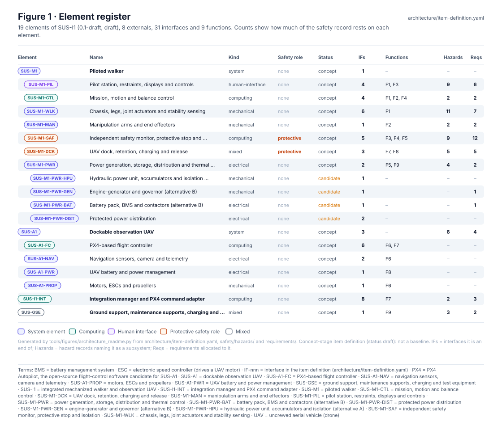
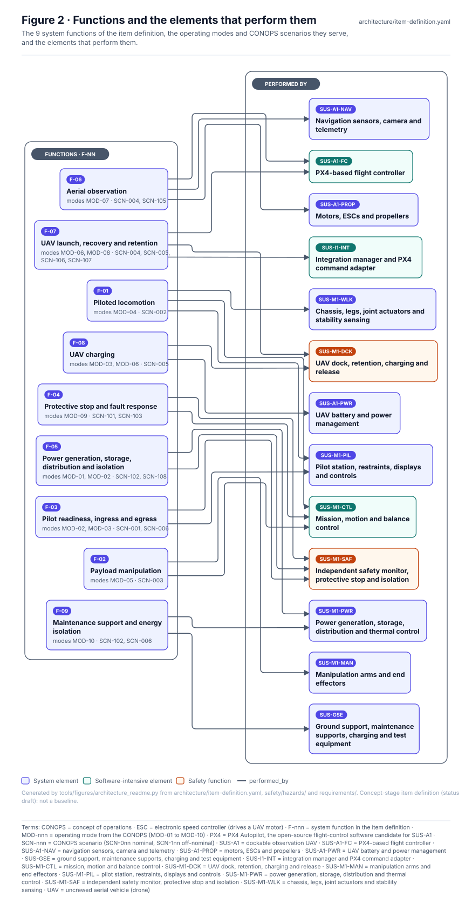
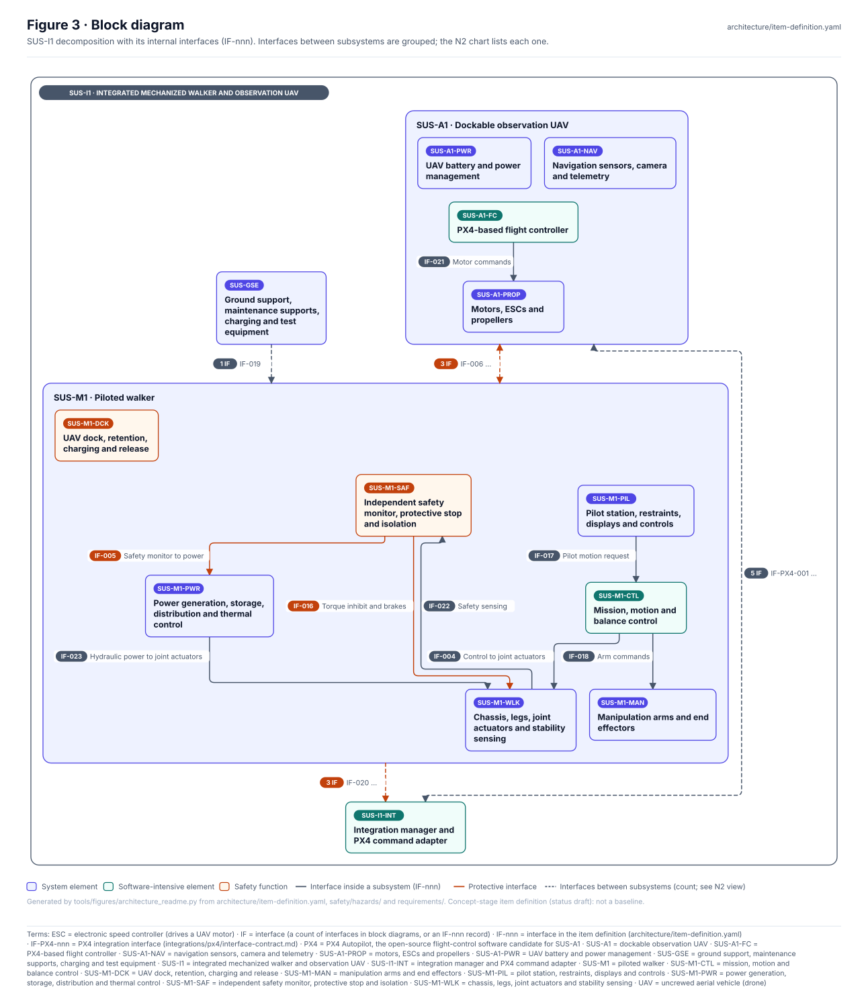
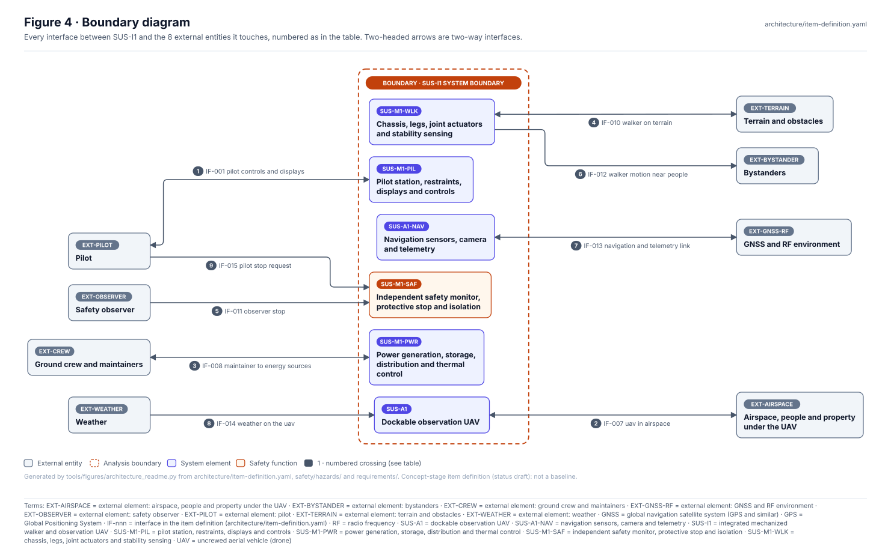
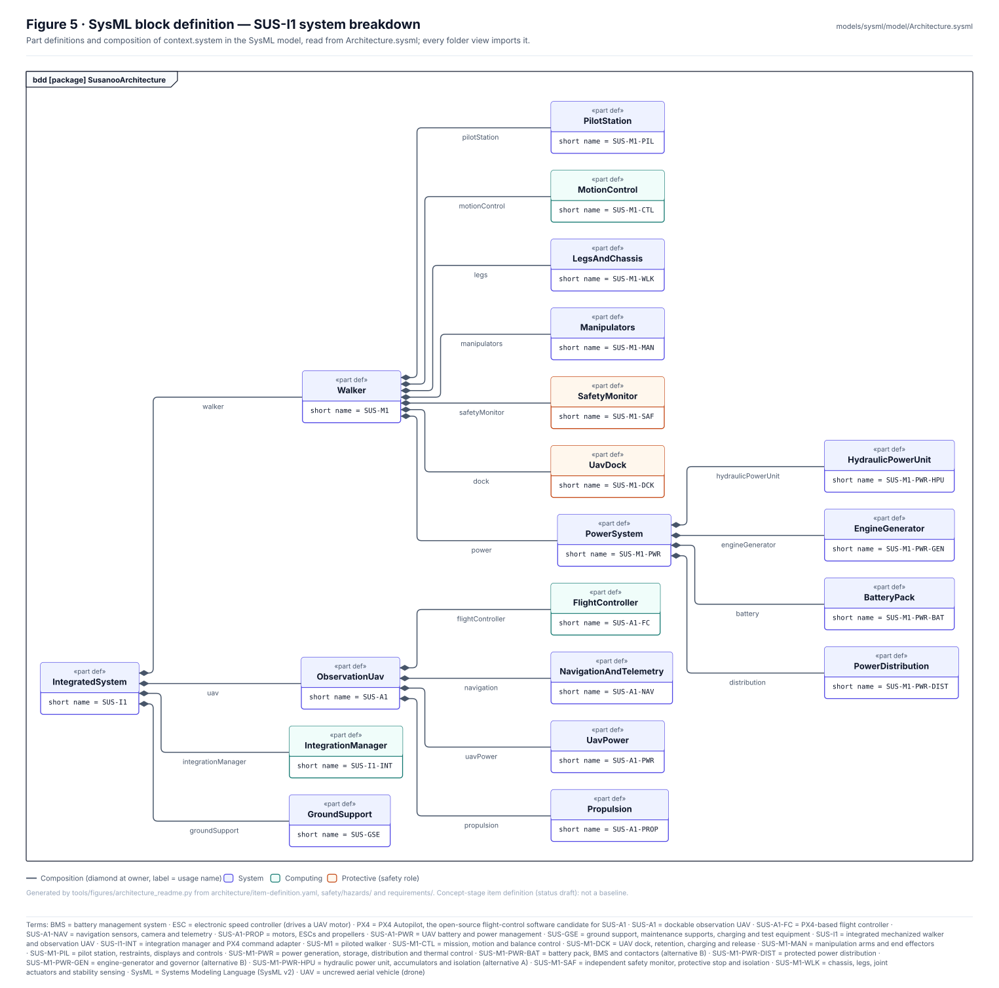
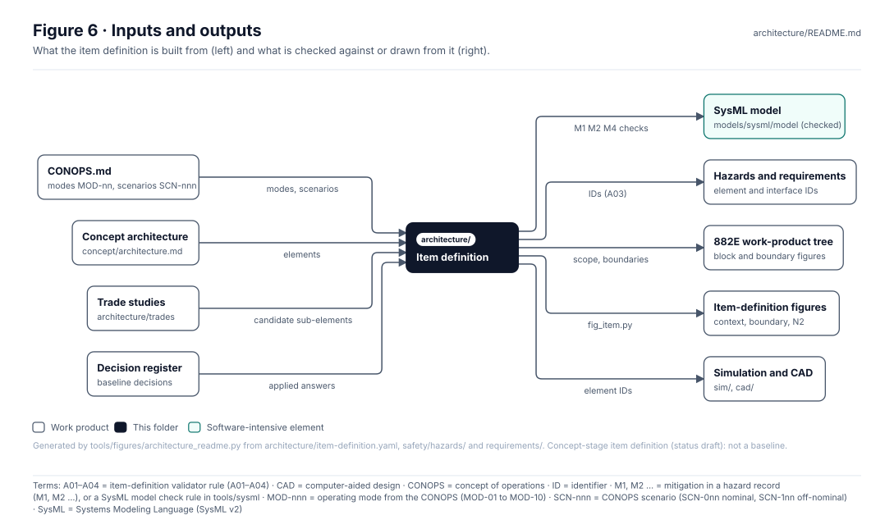

<!-- GENERATED by tools/wiki/build_wiki.py from architecture/README.md. Do not edit here; edit the source and re-run. -->

> Published from [`architecture/README.md`](https://github.com/jherrodthomas/Project-Susanoo/blob/main/architecture/README.md) in the repository.

# Architecture — SUS-I1 item definition

> **Status:** item definition 0.1-draft (draft), configuration `SUS-I1-C001`. 19 elements, 8 externals, 31 interfaces, 9 functions. 4 candidate sub-elements (SUS-M1-PWR-HPU, SUS-M1-PWR-GEN, SUS-M1-PWR-BAT, SUS-M1-PWR-DIST) await the actuation trade study. Not a baseline: approving the item definition is a human review (rule R13).

<!-- terms:start (generated by tools/terms/terms.py; do not edit by hand) -->

<b>Terms on this page (55)</b>: abbreviations and codes explained

| Term | Meaning |
|---|---|
| A01–A04 | item-definition validator rule (A01–A04) |
| BMS | battery management system |
| CAD | computer-aided design |
| CI | continuous integration (the automated checks GitHub runs on every change) |
| CoM | centre of mass |
| CONOPS | concept of operations |
| DQ-nnn | decision question for the project lead (decisions/register.yaml) |
| ESC | electronic speed controller (drives a UAV motor) |
| EXT-AIRSPACE | external element: airspace, people and property under the UAV |
| EXT-BYSTANDER | external element: bystanders |
| EXT-CREW | external element: ground crew and maintainers |
| EXT-GNSS-RF | external element: GNSS and RF environment |
| EXT-OBSERVER | external element: safety observer |
| EXT-PILOT | external element: pilot |
| EXT-TERRAIN | external element: terrain and obstacles |
| EXT-WEATHER | external element: weather |
| F-nnn | system function in the item definition |
| GNSS | global navigation satellite system (GPS and similar) |
| GPS | Global Positioning System |
| HAZ-nnn | hazard record (safety/hazards/HAZ-xxx-nnn.yaml) |
| ID | identifier |
| IF-nnn | interface in the item definition (architecture/item-definition.yaml) |
| IF-PX4-nnn | PX4 integration interface (integrations/px4/interface-contract.md) |
| MOD-nnn | operating mode from the CONOPS (MOD-01 to MOD-10) |
| OMG | Object Management Group, publisher of SysML |
| PX4 | PX4 Autopilot, the open-source flight-control software candidate for SUS-A1 |
| R01 … | validator rule in tools/pdac (R13 = only a named human review accepts anything) |
| RF | radio frequency |
| SCN-nnn | CONOPS scenario (SCN-0nn nominal, SCN-1nn off-nominal) |
| SUS-A1 | dockable observation UAV |
| SUS-A1-FC | PX4-based flight controller |
| SUS-A1-NAV | navigation sensors, camera and telemetry |
| SUS-A1-PROP | motors, ESCs and propellers |
| SUS-A1-PWR | UAV battery and power management |
| SUS-GSE | ground support, maintenance supports, charging and test equipment |
| SUS-I1 | integrated mechanized walker and observation UAV |
| SUS-I1-C001 | configuration 001 of SUS-I1, the baseline every record applies to |
| SUS-I1-INT | integration manager and PX4 command adapter |
| SUS-M1 | piloted walker |
| SUS-M1-CTL | mission, motion and balance control |
| SUS-M1-DCK | UAV dock, retention, charging and release |
| SUS-M1-MAN | manipulation arms and end effectors |
| SUS-M1-PIL | pilot station, restraints, displays and controls |
| SUS-M1-PWR | power generation, storage, distribution and thermal control |
| SUS-M1-PWR-BAT | battery pack, BMS and contactors (alternative B) |
| SUS-M1-PWR-DIST | protected power distribution |
| SUS-M1-PWR-GEN | engine-generator and governor (alternative B) |
| SUS-M1-PWR-HPU | hydraulic power unit, accumulators and isolation (alternative A) |
| SUS-M1-SAF | independent safety monitor, protective stop and isolation |
| SUS-M1-WLK | chassis, legs, joint actuators and stability sensing |
| SVG | Scalable Vector Graphics, the figure file format |
| SYS-nnn | system safety requirement record (requirements/SYS-nnn.yaml) |
| SysML | Systems Modeling Language (SysML v2) |
| TBD | to be determined |
| UAV | uncrewed aerial vehicle (drone) |

All terms: [abbreviations and record codes](https://github.com/jherrodthomas/Project-Susanoo/blob/main/docs/terms.md).

<!-- terms:end -->

| Field | Value |
|---|---|
| Record | [`item-definition.yaml`](https://github.com/jherrodthomas/Project-Susanoo/blob/main/architecture/item-definition.yaml) (schema `susanoo/item-definition/v0.1`) |
| Scope | Human-piloted unarmed walker (SUS-M1), dockable unarmed observation UAV (SUS-A1), their integration manager and docking interface, and ground support equipment. Simulation-first concept; no hardware selected. |
| Protective elements | SUS-M1-SAF, SUS-M1-DCK |
| SysML model | [`Architecture.sysml`](https://github.com/jherrodthomas/Project-Susanoo/blob/main/models/sysml/model/Architecture.sysml) (checked against this record by `python -m tools.sysml.check`) |
| Rules | A01–A04 (item definition valid, interfaces and links resolve) — `python -m tools.pdac.validate` |

## Purpose

The item definition of SUS-I1 is the single source for every element, external entity, interface and system function. Hazards, requirements, SysML parts, the 882E work-product figures, the simulation and the CAD all use its IDs, and the validator checks that they resolve. `layout.yaml` holds the hand-placed box positions for the item-definition figures drawn by `python -m tools.figures.fig_item`.

## Element register

| Element | Name | Kind | Safety role | Status | Hazards | Requirements |
|---|---|---|---|---|---|---|
| `SUS-M1` | Piloted walker | system | none | concept | — | — |
| &nbsp;&nbsp;&nbsp;&nbsp;`SUS-M1-PIL` | Pilot station, restraints, displays and controls | human-interface | none | concept | [HAZ-INT-002](https://github.com/jherrodthomas/Project-Susanoo/blob/main/safety/hazards/HAZ-INT-002.yaml), [HAZ-PIL-001](https://github.com/jherrodthomas/Project-Susanoo/blob/main/safety/hazards/HAZ-PIL-001.yaml), [HAZ-PIL-002](https://github.com/jherrodthomas/Project-Susanoo/blob/main/safety/hazards/HAZ-PIL-002.yaml), [HAZ-PIL-003](https://github.com/jherrodthomas/Project-Susanoo/blob/main/safety/hazards/HAZ-PIL-003.yaml), [HAZ-PIL-004](https://github.com/jherrodthomas/Project-Susanoo/blob/main/safety/hazards/HAZ-PIL-004.yaml), [HAZ-PIL-005](https://github.com/jherrodthomas/Project-Susanoo/blob/main/safety/hazards/HAZ-PIL-005.yaml), [HAZ-PIL-006](https://github.com/jherrodthomas/Project-Susanoo/blob/main/safety/hazards/HAZ-PIL-006.yaml), [HAZ-PWR-002](https://github.com/jherrodthomas/Project-Susanoo/blob/main/safety/hazards/HAZ-PWR-002.yaml), [HAZ-WLK-002](https://github.com/jherrodthomas/Project-Susanoo/blob/main/safety/hazards/HAZ-WLK-002.yaml) | [SYS-001](https://github.com/jherrodthomas/Project-Susanoo/blob/main/requirements/SYS-001.yaml), [SYS-008](https://github.com/jherrodthomas/Project-Susanoo/blob/main/requirements/SYS-008.yaml), [SYS-018](https://github.com/jherrodthomas/Project-Susanoo/blob/main/requirements/SYS-018.yaml), [SYS-020](https://github.com/jherrodthomas/Project-Susanoo/blob/main/requirements/SYS-020.yaml), [SYS-021](https://github.com/jherrodthomas/Project-Susanoo/blob/main/requirements/SYS-021.yaml), [SYS-024](https://github.com/jherrodthomas/Project-Susanoo/blob/main/requirements/SYS-024.yaml) |
| &nbsp;&nbsp;&nbsp;&nbsp;`SUS-M1-CTL` | Mission, motion and balance control | computing | none | concept | [HAZ-MAN-002](https://github.com/jherrodthomas/Project-Susanoo/blob/main/safety/hazards/HAZ-MAN-002.yaml), [HAZ-WLK-003](https://github.com/jherrodthomas/Project-Susanoo/blob/main/safety/hazards/HAZ-WLK-003.yaml) | [SYS-017](https://github.com/jherrodthomas/Project-Susanoo/blob/main/requirements/SYS-017.yaml), [SYS-019](https://github.com/jherrodthomas/Project-Susanoo/blob/main/requirements/SYS-019.yaml) |
| &nbsp;&nbsp;&nbsp;&nbsp;`SUS-M1-WLK` | Chassis, legs, joint actuators and stability sensing | mechanical | none | concept | [HAZ-GSE-001](https://github.com/jherrodthomas/Project-Susanoo/blob/main/safety/hazards/HAZ-GSE-001.yaml), [HAZ-MAN-001](https://github.com/jherrodthomas/Project-Susanoo/blob/main/safety/hazards/HAZ-MAN-001.yaml), [HAZ-MAN-002](https://github.com/jherrodthomas/Project-Susanoo/blob/main/safety/hazards/HAZ-MAN-002.yaml), [HAZ-PIL-001](https://github.com/jherrodthomas/Project-Susanoo/blob/main/safety/hazards/HAZ-PIL-001.yaml), [HAZ-PIL-002](https://github.com/jherrodthomas/Project-Susanoo/blob/main/safety/hazards/HAZ-PIL-002.yaml), [HAZ-PIL-004](https://github.com/jherrodthomas/Project-Susanoo/blob/main/safety/hazards/HAZ-PIL-004.yaml), [HAZ-PIL-005](https://github.com/jherrodthomas/Project-Susanoo/blob/main/safety/hazards/HAZ-PIL-005.yaml), [HAZ-SAF-001](https://github.com/jherrodthomas/Project-Susanoo/blob/main/safety/hazards/HAZ-SAF-001.yaml), [HAZ-WLK-001](https://github.com/jherrodthomas/Project-Susanoo/blob/main/safety/hazards/HAZ-WLK-001.yaml), [HAZ-WLK-002](https://github.com/jherrodthomas/Project-Susanoo/blob/main/safety/hazards/HAZ-WLK-002.yaml), [HAZ-WLK-003](https://github.com/jherrodthomas/Project-Susanoo/blob/main/safety/hazards/HAZ-WLK-003.yaml) | [SYS-004](https://github.com/jherrodthomas/Project-Susanoo/blob/main/requirements/SYS-004.yaml), [SYS-008](https://github.com/jherrodthomas/Project-Susanoo/blob/main/requirements/SYS-008.yaml), [SYS-009](https://github.com/jherrodthomas/Project-Susanoo/blob/main/requirements/SYS-009.yaml), [SYS-016](https://github.com/jherrodthomas/Project-Susanoo/blob/main/requirements/SYS-016.yaml), [SYS-018](https://github.com/jherrodthomas/Project-Susanoo/blob/main/requirements/SYS-018.yaml), [SYS-019](https://github.com/jherrodthomas/Project-Susanoo/blob/main/requirements/SYS-019.yaml), [SYS-023](https://github.com/jherrodthomas/Project-Susanoo/blob/main/requirements/SYS-023.yaml) |
| &nbsp;&nbsp;&nbsp;&nbsp;`SUS-M1-MAN` | Manipulation arms and end effectors | mechanical | none | concept | [HAZ-MAN-001](https://github.com/jherrodthomas/Project-Susanoo/blob/main/safety/hazards/HAZ-MAN-001.yaml), [HAZ-MAN-002](https://github.com/jherrodthomas/Project-Susanoo/blob/main/safety/hazards/HAZ-MAN-002.yaml) | [SYS-017](https://github.com/jherrodthomas/Project-Susanoo/blob/main/requirements/SYS-017.yaml), [SYS-019](https://github.com/jherrodthomas/Project-Susanoo/blob/main/requirements/SYS-019.yaml) |
| &nbsp;&nbsp;&nbsp;&nbsp;`SUS-M1-SAF` | Independent safety monitor, protective stop and isolation | computing | protective | concept | [HAZ-MAN-001](https://github.com/jherrodthomas/Project-Susanoo/blob/main/safety/hazards/HAZ-MAN-001.yaml), [HAZ-MAN-002](https://github.com/jherrodthomas/Project-Susanoo/blob/main/safety/hazards/HAZ-MAN-002.yaml), [HAZ-PIL-001](https://github.com/jherrodthomas/Project-Susanoo/blob/main/safety/hazards/HAZ-PIL-001.yaml), [HAZ-PIL-003](https://github.com/jherrodthomas/Project-Susanoo/blob/main/safety/hazards/HAZ-PIL-003.yaml), [HAZ-PIL-004](https://github.com/jherrodthomas/Project-Susanoo/blob/main/safety/hazards/HAZ-PIL-004.yaml), [HAZ-PIL-006](https://github.com/jherrodthomas/Project-Susanoo/blob/main/safety/hazards/HAZ-PIL-006.yaml), [HAZ-SAF-001](https://github.com/jherrodthomas/Project-Susanoo/blob/main/safety/hazards/HAZ-SAF-001.yaml), [HAZ-WLK-001](https://github.com/jherrodthomas/Project-Susanoo/blob/main/safety/hazards/HAZ-WLK-001.yaml), [HAZ-WLK-003](https://github.com/jherrodthomas/Project-Susanoo/blob/main/safety/hazards/HAZ-WLK-003.yaml) | [SYS-001](https://github.com/jherrodthomas/Project-Susanoo/blob/main/requirements/SYS-001.yaml), [SYS-002](https://github.com/jherrodthomas/Project-Susanoo/blob/main/requirements/SYS-002.yaml), [SYS-004](https://github.com/jherrodthomas/Project-Susanoo/blob/main/requirements/SYS-004.yaml), [SYS-010](https://github.com/jherrodthomas/Project-Susanoo/blob/main/requirements/SYS-010.yaml), [SYS-011](https://github.com/jherrodthomas/Project-Susanoo/blob/main/requirements/SYS-011.yaml), [SYS-014](https://github.com/jherrodthomas/Project-Susanoo/blob/main/requirements/SYS-014.yaml), [SYS-015](https://github.com/jherrodthomas/Project-Susanoo/blob/main/requirements/SYS-015.yaml), [SYS-017](https://github.com/jherrodthomas/Project-Susanoo/blob/main/requirements/SYS-017.yaml), [SYS-018](https://github.com/jherrodthomas/Project-Susanoo/blob/main/requirements/SYS-018.yaml), [SYS-019](https://github.com/jherrodthomas/Project-Susanoo/blob/main/requirements/SYS-019.yaml), [SYS-020](https://github.com/jherrodthomas/Project-Susanoo/blob/main/requirements/SYS-020.yaml), [SYS-024](https://github.com/jherrodthomas/Project-Susanoo/blob/main/requirements/SYS-024.yaml) |
| &nbsp;&nbsp;&nbsp;&nbsp;`SUS-M1-DCK` | UAV dock, retention, charging and release | mixed | protective | concept | [HAZ-DCK-001](https://github.com/jherrodthomas/Project-Susanoo/blob/main/safety/hazards/HAZ-DCK-001.yaml), [HAZ-DCK-002](https://github.com/jherrodthomas/Project-Susanoo/blob/main/safety/hazards/HAZ-DCK-002.yaml), [HAZ-DCK-003](https://github.com/jherrodthomas/Project-Susanoo/blob/main/safety/hazards/HAZ-DCK-003.yaml), [HAZ-DCK-004](https://github.com/jherrodthomas/Project-Susanoo/blob/main/safety/hazards/HAZ-DCK-004.yaml), [HAZ-INT-001](https://github.com/jherrodthomas/Project-Susanoo/blob/main/safety/hazards/HAZ-INT-001.yaml) | [SYS-003](https://github.com/jherrodthomas/Project-Susanoo/blob/main/requirements/SYS-003.yaml), [SYS-005](https://github.com/jherrodthomas/Project-Susanoo/blob/main/requirements/SYS-005.yaml), [SYS-006](https://github.com/jherrodthomas/Project-Susanoo/blob/main/requirements/SYS-006.yaml), [SYS-012](https://github.com/jherrodthomas/Project-Susanoo/blob/main/requirements/SYS-012.yaml), [SYS-022](https://github.com/jherrodthomas/Project-Susanoo/blob/main/requirements/SYS-022.yaml) |
| &nbsp;&nbsp;&nbsp;&nbsp;`SUS-M1-PWR` | Power generation, storage, distribution and thermal control | electrical | none | concept | [HAZ-PIL-002](https://github.com/jherrodthomas/Project-Susanoo/blob/main/safety/hazards/HAZ-PIL-002.yaml), [HAZ-PWR-001](https://github.com/jherrodthomas/Project-Susanoo/blob/main/safety/hazards/HAZ-PWR-001.yaml), [HAZ-PWR-002](https://github.com/jherrodthomas/Project-Susanoo/blob/main/safety/hazards/HAZ-PWR-002.yaml), [HAZ-PWR-003](https://github.com/jherrodthomas/Project-Susanoo/blob/main/safety/hazards/HAZ-PWR-003.yaml) | [SYS-007](https://github.com/jherrodthomas/Project-Susanoo/blob/main/requirements/SYS-007.yaml), [SYS-009](https://github.com/jherrodthomas/Project-Susanoo/blob/main/requirements/SYS-009.yaml) |
| &nbsp;&nbsp;&nbsp;&nbsp;&nbsp;&nbsp;&nbsp;&nbsp;`SUS-M1-PWR-HPU` | Hydraulic power unit, accumulators and isolation (alternative A) | mechanical | none | candidate | — | — |
| &nbsp;&nbsp;&nbsp;&nbsp;&nbsp;&nbsp;&nbsp;&nbsp;`SUS-M1-PWR-GEN` | Engine-generator and governor (alternative B) | mechanical | none | candidate | — | [SYS-015](https://github.com/jherrodthomas/Project-Susanoo/blob/main/requirements/SYS-015.yaml) |
| &nbsp;&nbsp;&nbsp;&nbsp;&nbsp;&nbsp;&nbsp;&nbsp;`SUS-M1-PWR-BAT` | Battery pack, BMS and contactors (alternative B) | electrical | none | candidate | — | [SYS-014](https://github.com/jherrodthomas/Project-Susanoo/blob/main/requirements/SYS-014.yaml) |
| &nbsp;&nbsp;&nbsp;&nbsp;&nbsp;&nbsp;&nbsp;&nbsp;`SUS-M1-PWR-DIST` | Protected power distribution | electrical | none | candidate | — | — |
| `SUS-A1` | Dockable observation UAV | system | none | concept | [HAZ-DCK-001](https://github.com/jherrodthomas/Project-Susanoo/blob/main/safety/hazards/HAZ-DCK-001.yaml), [HAZ-DCK-002](https://github.com/jherrodthomas/Project-Susanoo/blob/main/safety/hazards/HAZ-DCK-002.yaml), [HAZ-DCK-003](https://github.com/jherrodthomas/Project-Susanoo/blob/main/safety/hazards/HAZ-DCK-003.yaml), [HAZ-DCK-004](https://github.com/jherrodthomas/Project-Susanoo/blob/main/safety/hazards/HAZ-DCK-004.yaml), [HAZ-INT-001](https://github.com/jherrodthomas/Project-Susanoo/blob/main/safety/hazards/HAZ-INT-001.yaml), [HAZ-INT-002](https://github.com/jherrodthomas/Project-Susanoo/blob/main/safety/hazards/HAZ-INT-002.yaml) | [SYS-003](https://github.com/jherrodthomas/Project-Susanoo/blob/main/requirements/SYS-003.yaml), [SYS-006](https://github.com/jherrodthomas/Project-Susanoo/blob/main/requirements/SYS-006.yaml), [SYS-013](https://github.com/jherrodthomas/Project-Susanoo/blob/main/requirements/SYS-013.yaml), [SYS-022](https://github.com/jherrodthomas/Project-Susanoo/blob/main/requirements/SYS-022.yaml) |
| &nbsp;&nbsp;&nbsp;&nbsp;`SUS-A1-FC` | PX4-based flight controller | computing | none | concept | — | — |
| &nbsp;&nbsp;&nbsp;&nbsp;`SUS-A1-NAV` | Navigation sensors, camera and telemetry | electrical | none | concept | — | — |
| &nbsp;&nbsp;&nbsp;&nbsp;`SUS-A1-PWR` | UAV battery and power management | electrical | none | concept | — | — |
| &nbsp;&nbsp;&nbsp;&nbsp;`SUS-A1-PROP` | Motors, ESCs and propellers | mechanical | none | concept | — | — |
| `SUS-I1-INT` | Integration manager and PX4 command adapter | computing | none | concept | [HAZ-DCK-004](https://github.com/jherrodthomas/Project-Susanoo/blob/main/safety/hazards/HAZ-DCK-004.yaml), [HAZ-INT-002](https://github.com/jherrodthomas/Project-Susanoo/blob/main/safety/hazards/HAZ-INT-002.yaml) | [SYS-012](https://github.com/jherrodthomas/Project-Susanoo/blob/main/requirements/SYS-012.yaml), [SYS-013](https://github.com/jherrodthomas/Project-Susanoo/blob/main/requirements/SYS-013.yaml), [SYS-021](https://github.com/jherrodthomas/Project-Susanoo/blob/main/requirements/SYS-021.yaml) |
| `SUS-GSE` | Ground support, maintenance supports, charging and test equipment | mixed | none | concept | [HAZ-GSE-001](https://github.com/jherrodthomas/Project-Susanoo/blob/main/safety/hazards/HAZ-GSE-001.yaml), [HAZ-PWR-001](https://github.com/jherrodthomas/Project-Susanoo/blob/main/safety/hazards/HAZ-PWR-001.yaml), [HAZ-PWR-003](https://github.com/jherrodthomas/Project-Susanoo/blob/main/safety/hazards/HAZ-PWR-003.yaml) | [SYS-007](https://github.com/jherrodthomas/Project-Susanoo/blob/main/requirements/SYS-007.yaml), [SYS-023](https://github.com/jherrodthomas/Project-Susanoo/blob/main/requirements/SYS-023.yaml) |

| External | Name | Assumption |
|---|---|---|
| `EXT-PILOT` | Pilot | Trained, restrained pilot; may become incapacitated (SCN-104) |
| `EXT-OBSERVER` | Safety observer | Holds an independent stop and enforces the exclusion zone |
| `EXT-CREW` | Ground crew and maintainers | Follow isolation procedures; may not |
| `EXT-BYSTANDER` | Bystanders | Kept outside the exclusion zone by procedure only |
| `EXT-TERRAIN` | Terrain and obstacles | Slope limit 20 degrees with CoM offset at most 0.12 m (CONOPS 4, DQ-010, DQ-011); payload and ground limits TBD |
| `EXT-AIRSPACE` | Airspace, people and property under the UAV | Operations inside a defined, unpopulated volume |
| `EXT-GNSS-RF` | GNSS and RF environment | Signals may be degraded, lost or spoofed |
| `EXT-WEATHER` | Weather | Wind and precipitation limits TBD |

## Functions

| Function | Name | Performed by | Modes | Scenarios |
|---|---|---|---|---|
| F-01 | Piloted locomotion | SUS-M1-CTL, SUS-M1-WLK, SUS-M1-PIL | MOD-04 | SCN-002 |
| F-02 | Payload manipulation | SUS-M1-MAN, SUS-M1-CTL | MOD-05 | SCN-003 |
| F-03 | Pilot readiness, ingress and egress | SUS-M1-PIL, SUS-M1-SAF | MOD-02, MOD-03 | SCN-001, SCN-006 |
| F-04 | Protective stop and fault response | SUS-M1-SAF, SUS-M1-CTL | MOD-09 | SCN-101, SCN-103 |
| F-05 | Power generation, storage, distribution and isolation | SUS-M1-PWR, SUS-M1-SAF | MOD-01, MOD-02 | SCN-102, SCN-108 |
| F-06 | Aerial observation | SUS-A1-FC, SUS-A1-NAV, SUS-A1-PROP | MOD-07 | SCN-004, SCN-105 |
| F-07 | UAV launch, recovery and retention | SUS-M1-DCK, SUS-I1-INT, SUS-A1-FC | MOD-06, MOD-08 | SCN-004, SCN-005, SCN-106, SCN-107 |
| F-08 | UAV charging | SUS-M1-DCK, SUS-A1-PWR | MOD-03, MOD-06 | SCN-005 |
| F-09 | Maintenance support and energy isolation | SUS-GSE, SUS-M1-PWR | MOD-10 | SCN-102, SCN-006 |

## Block diagram

More views of the same record: [context](images/sus-i1-context.svg), [hand-placed boundary](images/sus-i1-boundary.svg), [N2 interface chart](images/sysml-v08-n2.svg) and the [item-definition wiki page](SUS-I1-Item-Definition.md).

## Boundary diagram

| # | Interface | From | To | Direction | Exchange | Hazards |
|---|---|---|---|---|---|---|
| 1 | IF-001 Pilot controls and displays | `EXT-PILOT` | `SUS-M1-PIL` | bi | commands, state, warnings | [HAZ-PIL-001](https://github.com/jherrodthomas/Project-Susanoo/blob/main/safety/hazards/HAZ-PIL-001.yaml) |
| 2 | IF-007 UAV in airspace | `SUS-A1` | `EXT-AIRSPACE` | bi | flight, exposure of people and property | [HAZ-INT-001](https://github.com/jherrodthomas/Project-Susanoo/blob/main/safety/hazards/HAZ-INT-001.yaml) |
| 3 | IF-008 Maintainer to energy sources | `EXT-CREW` | `SUS-M1-PWR` | bi | lockout, isolation, inspection, service | [HAZ-PWR-001](https://github.com/jherrodthomas/Project-Susanoo/blob/main/safety/hazards/HAZ-PWR-001.yaml) |
| 4 | IF-010 Walker on terrain | `SUS-M1-WLK` | `EXT-TERRAIN` | bi | contact loads, terrain sensing | [HAZ-WLK-002](https://github.com/jherrodthomas/Project-Susanoo/blob/main/safety/hazards/HAZ-WLK-002.yaml) |
| 5 | IF-011 Observer stop | `EXT-OBSERVER` | `SUS-M1-SAF` | uni | independent stop request | [HAZ-SAF-001](https://github.com/jherrodthomas/Project-Susanoo/blob/main/safety/hazards/HAZ-SAF-001.yaml) |
| 6 | IF-012 Walker motion near people | `SUS-M1-WLK` | `EXT-BYSTANDER` | uni | moving structure, exclusion zone | [HAZ-WLK-002](https://github.com/jherrodthomas/Project-Susanoo/blob/main/safety/hazards/HAZ-WLK-002.yaml), [HAZ-SAF-001](https://github.com/jherrodthomas/Project-Susanoo/blob/main/safety/hazards/HAZ-SAF-001.yaml) |
| 7 | IF-013 Navigation and telemetry link | `SUS-A1-NAV` | `EXT-GNSS-RF` | bi | GNSS, telemetry, RF link | [HAZ-INT-001](https://github.com/jherrodthomas/Project-Susanoo/blob/main/safety/hazards/HAZ-INT-001.yaml) |
| 8 | IF-014 Weather on the UAV | `EXT-WEATHER` | `SUS-A1` | uni | wind, precipitation, temperature | [HAZ-INT-001](https://github.com/jherrodthomas/Project-Susanoo/blob/main/safety/hazards/HAZ-INT-001.yaml) |
| 9 | IF-015 Pilot stop request | `EXT-PILOT` | `SUS-M1-SAF` | uni | protective stop request | [HAZ-SAF-001](https://github.com/jherrodthomas/Project-Susanoo/blob/main/safety/hazards/HAZ-SAF-001.yaml) |

**Explicitly excluded:** the 22 internal interfaces (Figure 3 and the N2 chart), detailed design, and anything outside the stated scope.

All interfaces

| Interface | Name | From | To | Kind | Exchange | Hazards |
|---|---|---|---|---|---|---|
| IF-001 | Pilot controls and displays | `EXT-PILOT` | `SUS-M1-PIL` | human, data | commands, state, warnings | HAZ-PIL-001 |
| IF-002 | Engine-generator to distribution | `SUS-M1-PWR-GEN` | `SUS-M1-PWR-DIST` | energy | electric power, voltage, thermal state | HAZ-PWR-003 |
| IF-003 | Battery to distribution | `SUS-M1-PWR-BAT` | `SUS-M1-PWR-DIST` | energy, data | bidirectional power, BMS state | HAZ-PWR-002 |
| IF-004 | Control to joint actuators | `SUS-M1-CTL` | `SUS-M1-WLK` | data, energy | torque or pressure commands, joint feedback | HAZ-WLK-001, HAZ-WLK-002, HAZ-PIL-002 |
| IF-005 | Safety monitor to power | `SUS-M1-SAF` | `SUS-M1-PWR` | data, energy | inhibit, isolation | HAZ-SAF-001, HAZ-PIL-002 |
| IF-006 | Walker dock to UAV | `SUS-M1-DCK` | `SUS-A1` | mechanical, energy, data | retention, charging, data, release | HAZ-DCK-001, HAZ-DCK-002 |
| IF-007 | UAV in airspace | `SUS-A1` | `EXT-AIRSPACE` | environment | flight, exposure of people and property | HAZ-INT-001 |
| IF-008 | Maintainer to energy sources | `EXT-CREW` | `SUS-M1-PWR` | human, energy | lockout, isolation, inspection, service | HAZ-PWR-001 |
| IF-PX4-001 | Flight state, position and status | `SUS-A1-FC` | `SUS-I1-INT` | data | flight state, position, status; freshness and source validity | HAZ-INT-001 |
| IF-PX4-002 | UAV health and arming state | `SUS-A1-FC` | `SUS-I1-INT` | data | health, arming state; disagreement handling | HAZ-DCK-001 |
| IF-PX4-003 | Dock occupied and retained | `SUS-M1-DCK` | `SUS-I1-INT` | data | occupied/retained state with independent plausibility | HAZ-DCK-002 |
| IF-PX4-004 | Walker posture and stationary state | `SUS-M1-CTL` | `SUS-I1-INT` | data | posture, stationary flag for the launch/recovery envelope | HAZ-INT-001 |
| IF-PX4-005 | Launch permit and revoke | `SUS-I1-INT` | `SUS-A1-FC` | data | explicit, fail-closed launch authorization | HAZ-INT-001 |
| IF-PX4-006 | Recovery and abort intent | `SUS-I1-INT` | `SUS-A1-FC` | data | recovery request, abort; contingency on lost link | HAZ-INT-001 |
| IF-PX4-007 | UAV video and mission cues | `SUS-A1-NAV` | `SUS-M1-PIL` | data | video, mission cues; latency, distraction | — |
| IF-PX4-008 | Fault and contingency notification | `SUS-I1-INT` | `SUS-A1-FC` | data | time-stamped, prioritised fault notifications | HAZ-INT-001 |
| IF-PX4-009 | Power and charging handshake | `SUS-M1-DCK` | `SUS-A1-PWR` | energy, data | charging handshake, rotor inhibit, energy isolation | HAZ-DCK-001 |
| IF-010 | Walker on terrain | `SUS-M1-WLK` | `EXT-TERRAIN` | mechanical, environment | contact loads, terrain sensing | HAZ-WLK-002 |
| IF-011 | Observer stop | `EXT-OBSERVER` | `SUS-M1-SAF` | human, data | independent stop request | HAZ-SAF-001 |
| IF-012 | Walker motion near people | `SUS-M1-WLK` | `EXT-BYSTANDER` | mechanical, environment | moving structure, exclusion zone | HAZ-WLK-002, HAZ-SAF-001 |
| IF-013 | Navigation and telemetry link | `SUS-A1-NAV` | `EXT-GNSS-RF` | data, environment | GNSS, telemetry, RF link | HAZ-INT-001 |
| IF-014 | Weather on the UAV | `EXT-WEATHER` | `SUS-A1` | environment | wind, precipitation, temperature | HAZ-INT-001 |
| IF-015 | Pilot stop request | `EXT-PILOT` | `SUS-M1-SAF` | human, data | protective stop request | HAZ-SAF-001 |
| IF-016 | Torque inhibit and brakes | `SUS-M1-SAF` | `SUS-M1-WLK` | data, energy | torque inhibit, brakes, load holding | HAZ-SAF-001, HAZ-WLK-001 |
| IF-017 | Pilot motion request | `SUS-M1-PIL` | `SUS-M1-CTL` | data | requested motion, mode | HAZ-PIL-001 |
| IF-018 | Arm commands | `SUS-M1-CTL` | `SUS-M1-MAN` | data, energy | arm commands, load feedback | — |
| IF-019 | Ground support to walker | `SUS-GSE` | `SUS-M1` | mechanical, energy | maintenance supports, external charging, test connections | HAZ-PWR-001 |
| IF-020 | Launch and recovery authorization | `SUS-M1-PIL` | `SUS-I1-INT` | human, data | operator launch/recovery request and authorization, status | HAZ-INT-001 |
| IF-021 | Motor commands | `SUS-A1-FC` | `SUS-A1-PROP` | data, energy | motor commands | HAZ-DCK-001 |
| IF-022 | Safety sensing | `SUS-M1-WLK` | `SUS-M1-SAF` | data | posture, joint and pressure sensing for the monitor | HAZ-WLK-001 |
| IF-023 | Hydraulic power to joint actuators | `SUS-M1-PWR-HPU` | `SUS-M1-WLK` | energy | pressurised fluid supply and return | HAZ-PWR-001 |

## SysML model

Model of record: [`Architecture.sysml`](https://github.com/jherrodthomas/Project-Susanoo/blob/main/models/sysml/model/Architecture.sysml) in the project model [`models/sysml/model`](https://github.com/jherrodthomas/Project-Susanoo/tree/main/models/sysml/model), checked against this record (`python -m tools.sysml.check`) and validated by the OMG pilot in CI.

## Inputs and outputs

| Input | Source |
|---|---|
| Modes and scenarios | [`concept/CONOPS.md`](https://github.com/jherrodthomas/Project-Susanoo/blob/main/concept/CONOPS.md) |
| Concept architecture | [`concept/architecture.md`](https://github.com/jherrodthomas/Project-Susanoo/blob/main/concept/architecture.md) |
| Candidate sub-elements | [`trades/`](https://github.com/jherrodthomas/Project-Susanoo/tree/main/architecture/trades) |
| Applied decisions | [Decision register](Decision-Register.md) |

| Output | Destination |
|---|---|
| Part definitions (checked) | [`Architecture.sysml`](https://github.com/jherrodthomas/Project-Susanoo/blob/main/models/sysml/model/Architecture.sysml) |
| Element and interface IDs | [hazards](https://github.com/jherrodthomas/Project-Susanoo/tree/main/safety/hazards), [requirements](Requirements-Register.md) |
| Scope and boundaries | [882E work products](882E-Work-Products.md) |
| Item-definition figures | [wiki page](SUS-I1-Item-Definition.md) |

## Folder contents

| Item | Description | State |
|---|---|---|
| [`item-definition.yaml`](https://github.com/jherrodthomas/Project-Susanoo/blob/main/architecture/item-definition.yaml) | The SUS-I1 item definition | present |
| [`layout.yaml`](https://github.com/jherrodthomas/Project-Susanoo/blob/main/architecture/layout.yaml) | Box positions for the item-definition figures (`tools/figures/fig_item.py`) | present |
| [`trades/`](https://github.com/jherrodthomas/Project-Susanoo/blob/main/architecture/trades/README.md) | Architecture trade studies | folder |
| [`figures/`](https://github.com/jherrodthomas/Project-Susanoo/tree/main/architecture/figures) | Generated SVG figures (do not edit) | generated |
| `README.md` | This page, generated above the END marker | generated |

## Changing the item definition

1. Edit `item-definition.yaml`; a new element needs a parent, kind, safety role and status, and a new interface needs both ends, a direction and the hazards it carries.
2. Update `layout.yaml` and `models/sysml/model/Architecture.sysml` to match; the checks fail until they do.
3. Regenerate (`python -m tools.figures.fig_item`, `python3 tools/figures/architecture_readme.py`, `python3 tools/gen_safety_docs.py`) and run the full check list in [`CLAUDE.md`](https://github.com/jherrodthomas/Project-Susanoo/blob/main/CLAUDE.md).
4. An architecture baseline is a lead decision; approving the item definition is a human review.

<!-- END GENERATED: content below this line is human-authored and preserved -->
