<!-- GENERATED by tools/wiki/build_wiki.py from cad/concept-art/README.md. Do not edit here; edit the source and re-run. -->

> Published from [`cad/concept-art/README.md`](https://github.com/jherrodthomas/Project-Susanoo/blob/main/cad/concept-art/README.md) in the repository.

# CL-05 concept art (AI-generated)

> **AI concept art, not engineering.** Every image on this page was generated by an image model from one of the project's own Blender renders of the CL-05 reference layout. They are for communication and alignment only. Where an image differs from the CAD (the [model](https://github.com/jherrodthomas/Project-Susanoo/blob/main/cad/params/CL-05.yaml), [metrics](https://github.com/jherrodthomas/Project-Susanoo/blob/main/cad/metrics.json), [drawing sheets](Drawing-Sheets.md) and [renders](Blender-Renders.md)), the CAD is the design and the image is artistic licence. No dimension, clearance or safety property may be read from these images.

<!-- terms:start (generated by tools/terms/terms.py; do not edit by hand) -->

<b>Terms on this page (17)</b>: abbreviations and codes explained

| Term | Meaning |
|---|---|
| AI | artificial intelligence (here, an AI assistant drafting at independence level I0) |
| CAD | computer-aided design |
| CC | Creative Commons; CC BY 4.0 is the Creative Commons Attribution 4.0 licence used for the documentation |
| CI | continuous integration (the automated checks GitHub runs on every change) |
| CL-nnn | concept layout (cad/params/CL-nn.yaml; CL-01 to CL-05, CL-05 the reference layout) |
| CONOPS | concept of operations |
| DQ-nnn | decision question for the project lead (decisions/register.yaml) |
| FLUX | FLUX, a family of image and video generation models (used through Higgsfield for concept art) |
| HAZ-nnn | hazard record (safety/hazards/HAZ-xxx-nnn.yaml) |
| I0–I3 | review independence level (I0 none, e.g. the author or an AI, to I3 independent organisation) |
| M1, M2 … | mitigation in a hazard record (M1, M2 …), or a SysML model check rule in tools/sysml |
| MCP | Model Context Protocol, how the AI assistant connects to external tools |
| OMG | Object Management Group, publisher of SysML |
| SVG | Scalable Vector Graphics, the figure file format |
| SysML | Systems Modeling Language (SysML v2) |
| TBD | to be determined |
| URL | uniform resource locator (a web address) |

All terms: [abbreviations and record codes](https://github.com/jherrodthomas/Project-Susanoo/blob/main/docs/terms.md).

<!-- terms:end -->

| Field | Value |
|---|---|
| Tool | Higgsfield, model `gpt_image_2_6`, image-to-image, quality high, 2K, 16:9, via the Higgsfield MCP connector |
| Generated | 2026-11-11 and 2026-11-12, by Claude (AI assistant) at the project lead's request; not reviewed |
| Source renders | [`renders/blender/`](Blender-Renders.md), imported by URL from this repository's branch |
| Prompt constraints | Keep the machine's geometry and parts unchanged; unarmed civilian machine (no weapons, military insignia or camouflage); no text or logos |
| Rights | Higgsfield's help center states it claims no ownership of outputs and does not restrict commercial use. Higgsfield's terms prohibit using outputs to train AI models. Purely AI-generated images may not be protected by copyright in some jurisdictions; to the extent rights exist, the files are offered under [CC BY 4.0](../../LICENSE-docs) like the rest of the documentation |

## Images

| Image | Source render, job | What differs from the CAD |
|---|---|---|
| 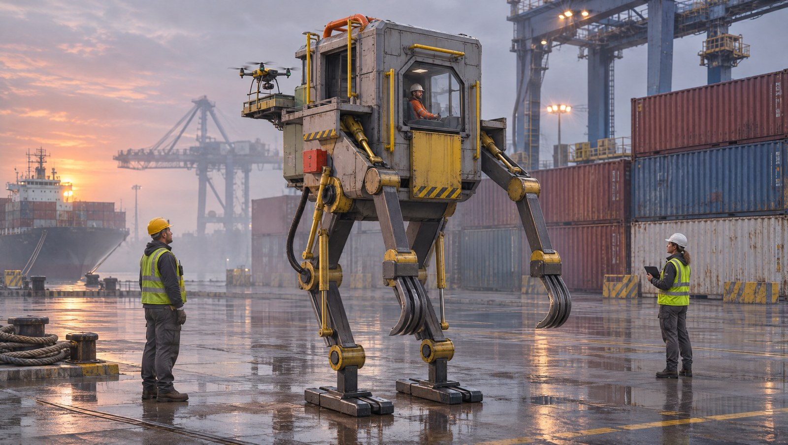 **Container port, dawn** | `CL-05-hero.jpg`, job `04756f8e` | Drone shown on a side platform at shoulder height instead of the raised rear dock; feet drawn as flat skids |
| 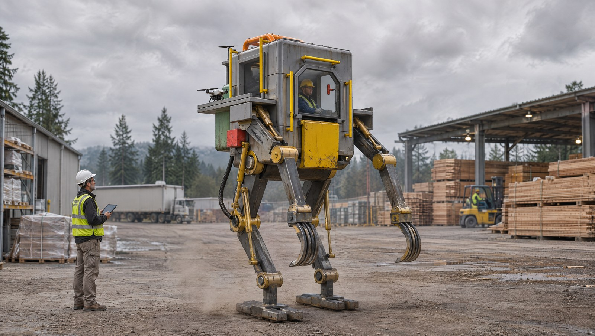 **Lumber yard, overcast** | `CL-05-hero.jpg`, job `18b97885` | Same drone placement as above |
| 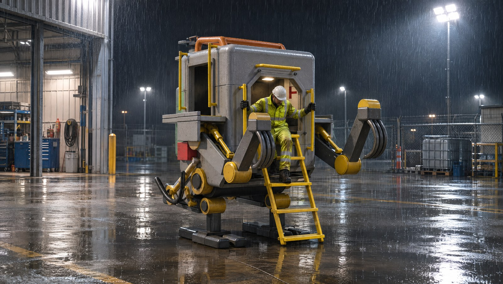 **Kneel for egress, night rain** | `CL-05-kneel.jpg`, job `aaf0cb10` | Close to the CAD |
| 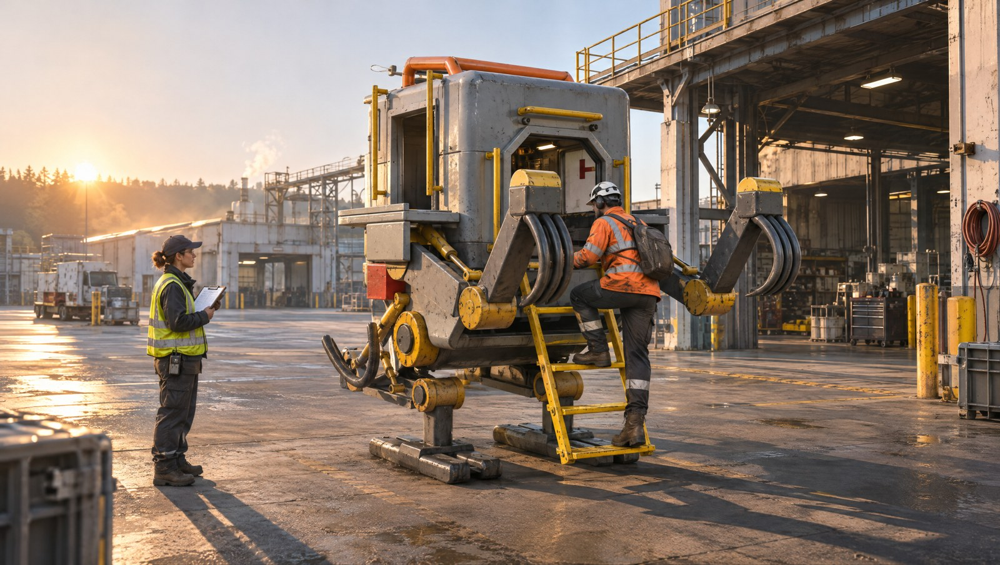 **Kneel for ingress, morning** | `CL-05-kneel.jpg`, job `f27db76a` | Stowed claws drawn closer to the opening than the CAD places them |
| 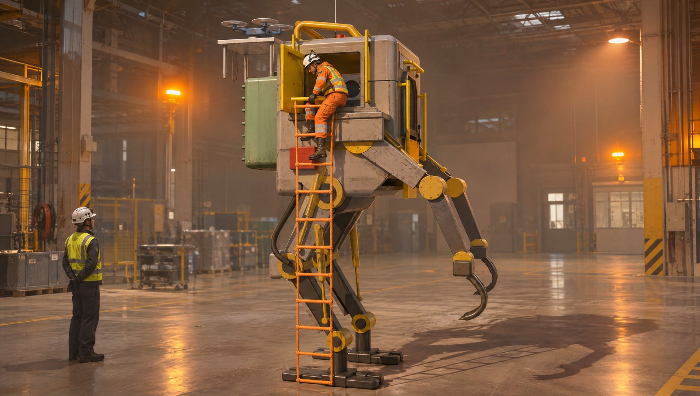 **Emergency exit drill, warehouse** | `CL-05-emergency.jpg`, job `3ec32fc5` | The rope ladder hangs flat against the hull over the safety box and leg instead of from the swing-out davit 0.60 m out: the snag the davit exists to avoid |
| 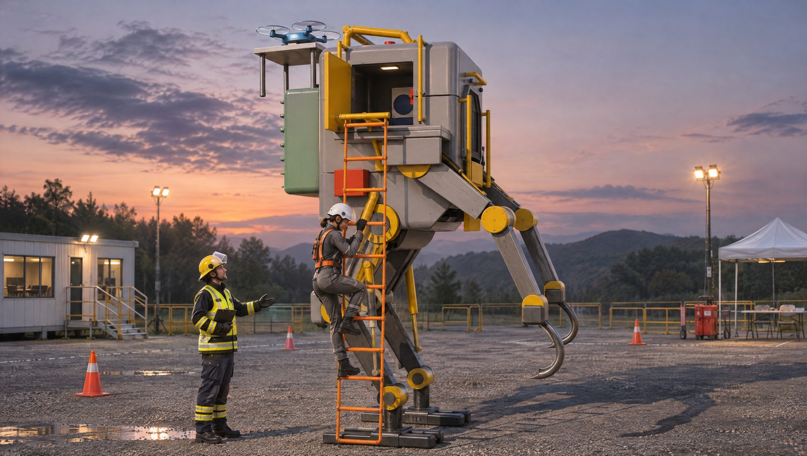 **Emergency egress training, dusk** | `CL-05-emergency.jpg`, job `ec01b505` | The pilot wears a fall-arrest harness: a candidate control for the fall-from-height hazard of emergency egress, suggested by the image, to be evaluated, not evidence |

## Kneel clip (image-to-video)

<video src="https://github.com/jherrodthomas/Project-Susanoo/blob/main/cad/concept-art/CL-05-kneel-clip.mp4" controls width="100%"></video>

[`CL-05-kneel-clip.mp4`](https://github.com/jherrodthomas/Project-Susanoo/blob/main/cad/concept-art/CL-05-kneel-clip.mp4) · 8 s, with generated sound · FLUX 3 Video via Higgsfield, start frame `CL-05-hero.jpg`, end frame `CL-05-kneel.jpg`, job `8413db6a` (re-encoded to 720p for the repository). A parallel MiniMax H3 attempt failed on the provider's side.

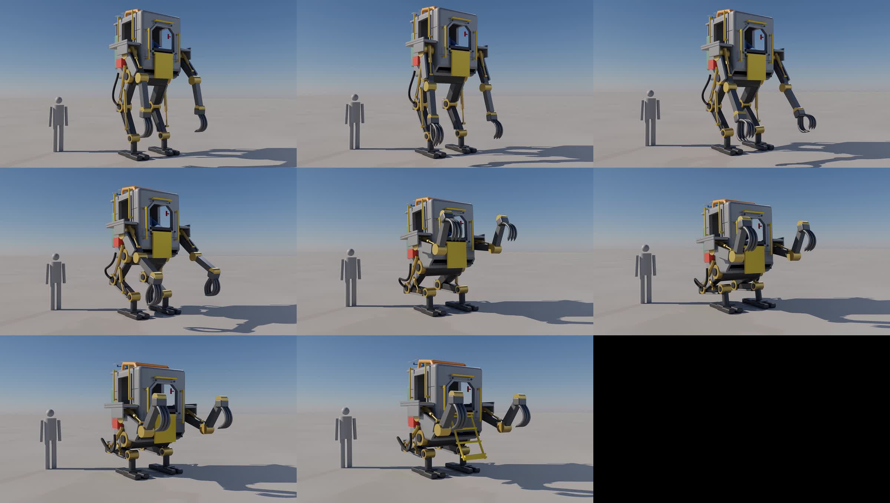

What differs from the CAD: in seconds 2 to 4 the legs briefly morph (the knees read as forward-bending) and the walker shifts instead of keeping both feet planted; the camera drifts slightly. The clip communicates the idea of the kneel; it is not a kinematic study, which belongs to the walking-stability and kneel simulation work.

## Military settings (unarmed)

The same machine in the military livery of [`renders/blender/`](Blender-Renders.md) (`--livery military`: olive drab, coyote tan, dark bronze hydraulics, safety markings muted but kept), shown in military logistics, engineering and relief roles. **The project scope is unarmed** ([CLAUDE.md](https://github.com/jherrodthomas/Project-Susanoo/blob/main/CLAUDE.md), [CONOPS](https://github.com/jherrodthomas/Project-Susanoo/blob/main/concept/CONOPS.md) §1): every prompt excluded weapons, turrets, missiles and ammunition, and real-world national insignia, flags and unit markings; all four images were checked against that. An armed variant would be a scope change for the project lead to decide formally, not an art choice.

| Image | Source render, job | What differs from the CAD, and notes |
|---|---|---|
| 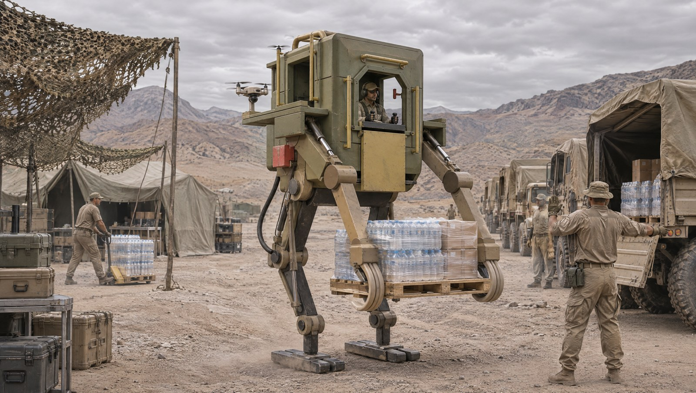 **Forward logistics base** | `CL-05-hero-military.jpg`, job `f82bd302` | Carries a pallet in its claws while walking: allowed only under the loaded-walking conditions the lead set (2026-11-12: carry pose, secured load, mass and speed limits all TBD; the CAD has no carry pose yet); drone on a side platform instead of the rear dock |
| 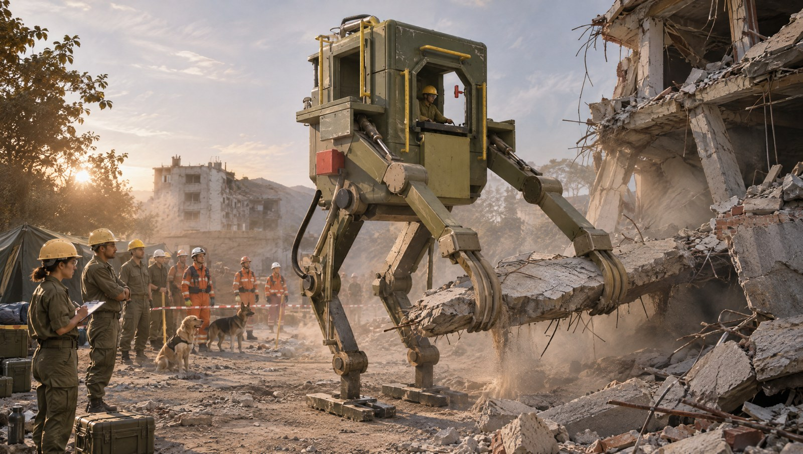 **Disaster engineering** | `CL-05-hero-military.jpg`, job `11068be0` | Rescue crew shown inside the arm's reach: the arms' strike and pinch zone. A scene to prevent, not a procedure |
| 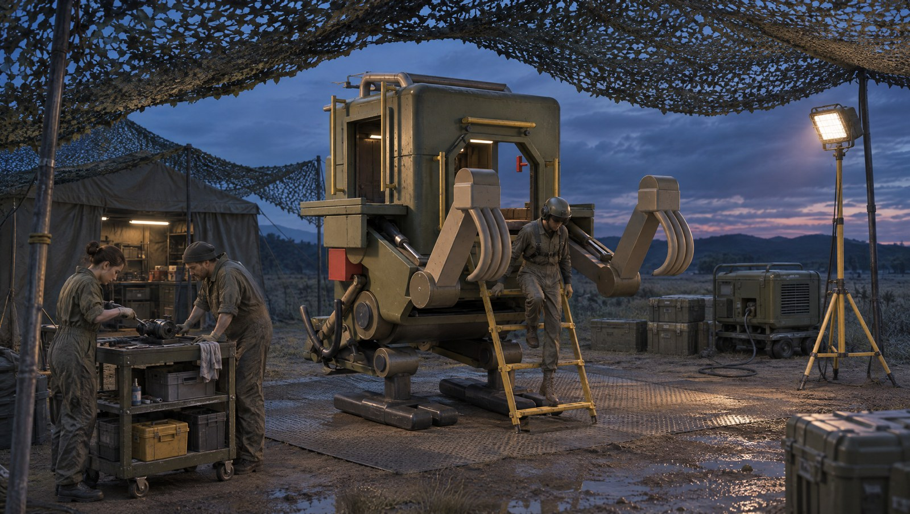 **Field maintenance, dusk** | `CL-05-kneel-military.jpg`, job `79b790c8` | Close to the CAD |
| 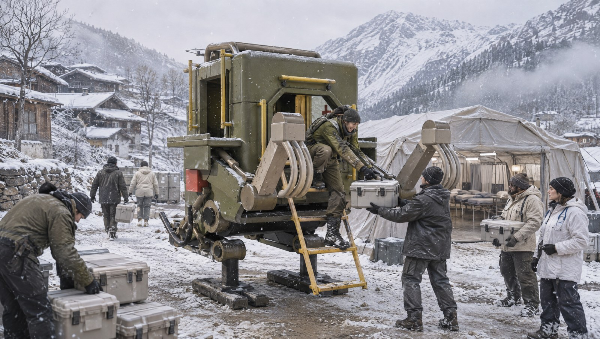 **Winter disaster relief** | `CL-05-kneel-military.jpg`, job `c0cf31bc` | The red internal release handle reads as a small red cross. The Red Cross emblem is legally protected; the design should keep that handle unmistakably a handle |

### Walk clip, military livery (image-to-video)

<video src="https://github.com/jherrodthomas/Project-Susanoo/blob/main/cad/concept-art/CL-05-military-walk-clip.mp4" controls width="100%"></video>

[`CL-05-military-walk-clip.mp4`](https://github.com/jherrodthomas/Project-Susanoo/blob/main/cad/concept-art/CL-05-military-walk-clip.mp4) · 8 s, with generated sound · FLUX 3 Video via Higgsfield, start frame `CL-05-hero-military.jpg`, job `71699eae` (re-encoded to 720p). Unarmed; no insignia.

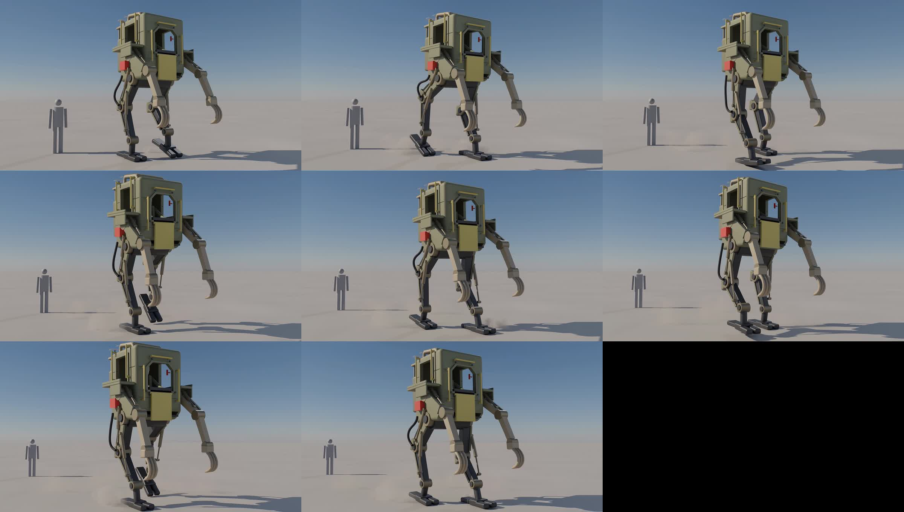

What differs from the CAD: in several frames the knees bend forward like a human's instead of backward, so the model has lost the reverse-jointed legs; the lower legs are simplified. The clip shows a plausible pace (about four steps in 8 s) and a level pod, but it says nothing about the real gait: walking dynamics, step length and foot clearance belong to the walking-stability simulation work.

## Ideas worth carrying back to the design

- A fall-arrest harness and anchor point for emergency descent from the side hatch.
- Hazard striping on the lower front panel and step edges, as the images add on their own.

<!-- concept-art-records:start (generated by tools/figures/art_readme.py; do not edit by hand) -->

## Purpose

> **Status:** 10 images (2 close to the CAD) and 2 clips, every source render still in `cad/renders/blender/`; 1 of 2 ideas carried by a record. AI-made, **not engineering and not evidence**.

The folder holds AI concept art made from the project's own renders, to show what the machine is for and to surface ideas early. The page above is hand-written; this section is generated from it and the records, so the register, the source renders and the ideas stay in step.

## Every image and clip

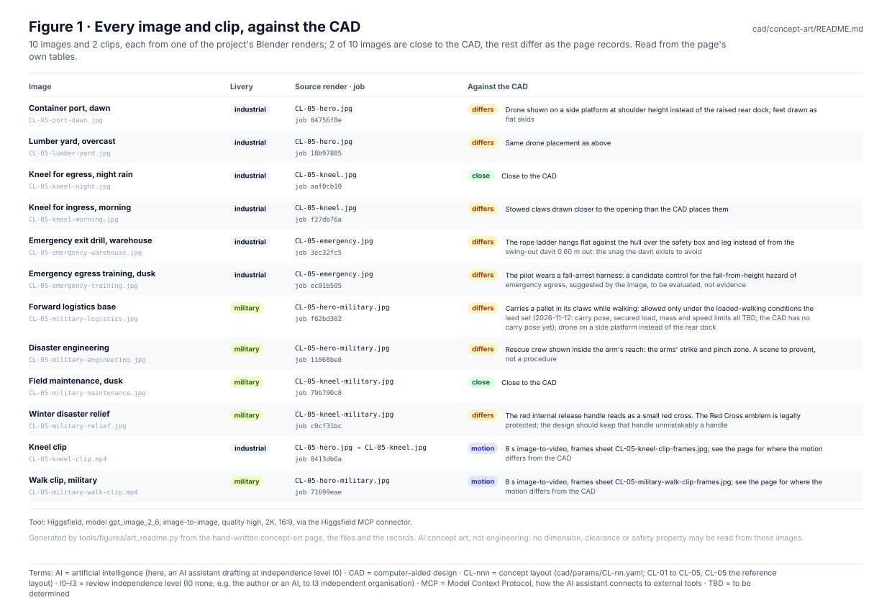

| Image | Livery | Source render | Against the CAD |
|---|---|---|---|
| Container port, dawn | industrial | `CL-05-hero.jpg` | differs |
| Lumber yard, overcast | industrial | `CL-05-hero.jpg` | differs |
| Kneel for egress, night rain | industrial | `CL-05-kneel.jpg` | close |
| Kneel for ingress, morning | industrial | `CL-05-kneel.jpg` | differs |
| Emergency exit drill, warehouse | industrial | `CL-05-emergency.jpg` | differs |
| Emergency egress training, dusk | industrial | `CL-05-emergency.jpg` | differs |
| Forward logistics base | military | `CL-05-hero-military.jpg` | differs |
| Disaster engineering | military | `CL-05-hero-military.jpg` | differs |
| Field maintenance, dusk | military | `CL-05-kneel-military.jpg` | close |
| Winter disaster relief | military | `CL-05-kneel-military.jpg` | differs |
| `CL-05-kneel-clip.mp4` (8 s) | industrial | `CL-05-hero.jpg` → `CL-05-kneel.jpg` | motion; see above |
| `CL-05-military-walk-clip.mp4` (8 s) | military | `CL-05-hero-military.jpg` | motion; see above |

## From render to image to record

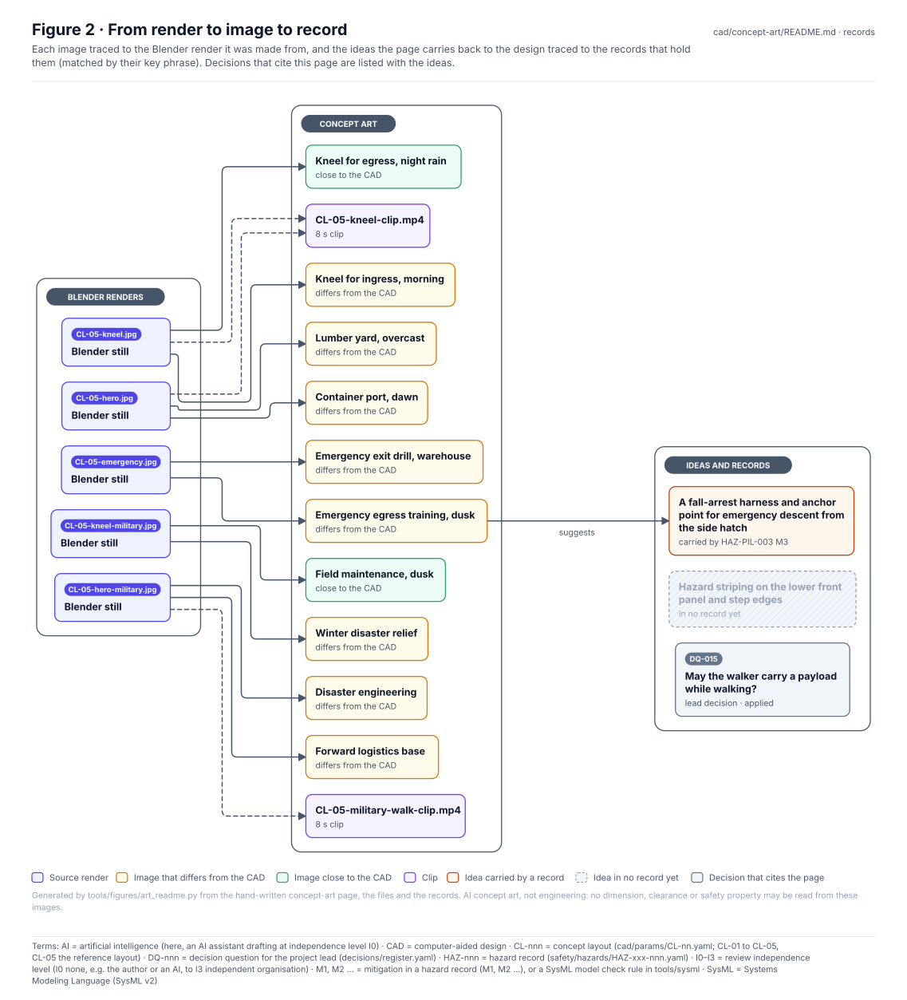

| Idea | Carried by |
|---|---|
| A fall-arrest harness and anchor point for emergency descent from the side hatch. | HAZ-PIL-003 M3 |
| Hazard striping on the lower front panel and step edges, as the images add on their own. | **no record yet** |

Decisions that cite this page: DQ-015 (May the walker carry a payload while walking?).

## Block diagram

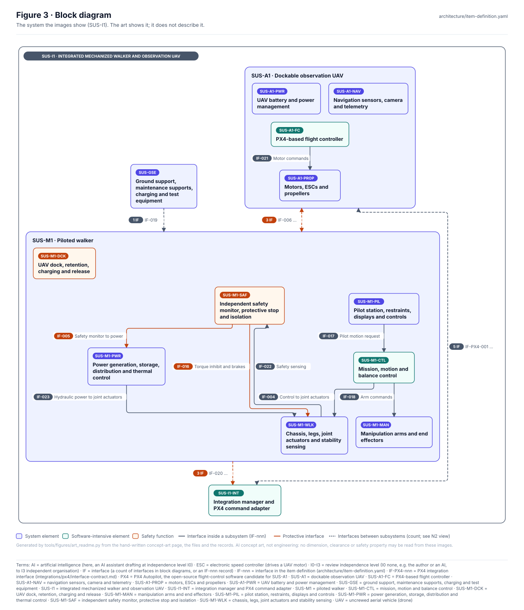

## Boundary diagram

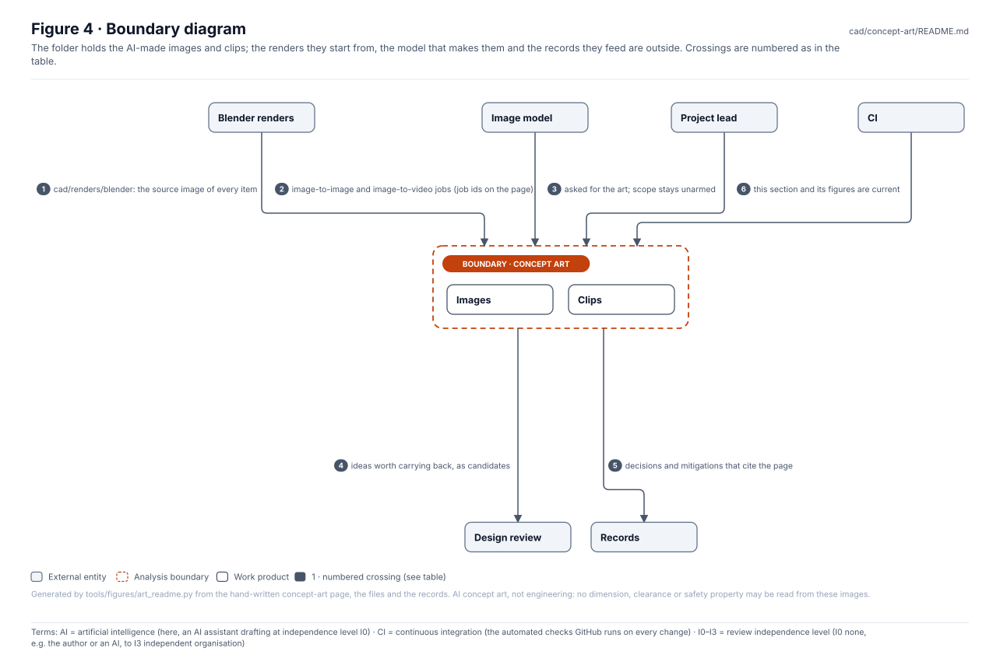

| # | From | To | Crossing / interaction |
|---|---|---|---|
| 1 | Blender renders | Concept art | cad/renders/blender: the source image of every item |
| 2 | Image model | Concept art | image-to-image and image-to-video jobs (job ids on the page) |
| 3 | Project lead | Concept art | asked for the art; scope stays unarmed |
| 4 | Concept art | Design review | ideas worth carrying back, as candidates |
| 5 | Concept art | Records | decisions and mitigations that cite the page |
| 6 | CI | Concept art | this section and its figures are current |

**Explicitly excluded:** any dimension, clearance or safety property (the CAD is the design), and any armed variant (a scope change for the lead).

## SysML model

[`ConceptArt.sysml`](https://github.com/jherrodthomas/Project-Susanoo/blob/main/cad/concept-art/ConceptArt.sysml) is generated from the page and validated with the project model by the OMG pilot in CI.

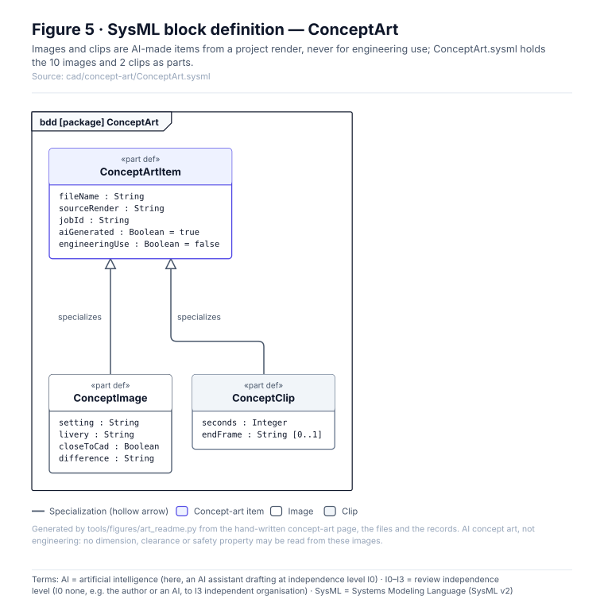

## Inputs and outputs

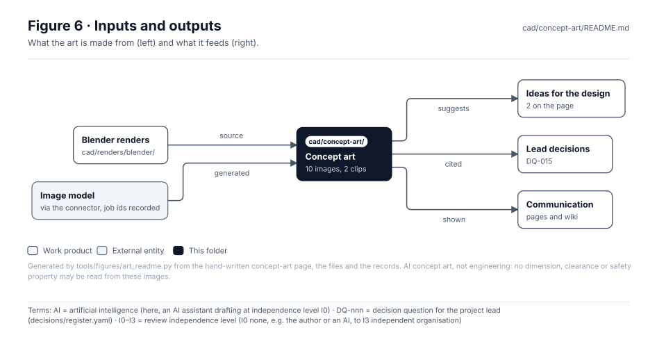

| Input | Source |
|---|---|
| Source renders | [`renders/blender/`](Concept-Renders.md) |
| Image model | Higgsfield, model `gpt_image_2_6`, image-to-image, quality high, 2K, 16:9, via the Higgsfield MCP connector |

| Output | Destination |
|---|---|
| Ideas | the design review in [`cad/README.md`](Concept-Layouts.md), as candidates |
| Citations | DQ-015 in the [decision register](Decision-Register.md) |

## Adding an image

1. Make it from a committed render in `cad/renders/blender/`, keep the machine unarmed and unchanged, and record the job id.
2. Add a row to the right table above: the image, its setting in bold, the source render and job, and how it differs from the CAD (or *Close to the CAD*).
3. Regenerate this section and run the full check list in [`CLAUDE.md`](https://github.com/jherrodthomas/Project-Susanoo/blob/main/CLAUDE.md).

## Folder contents

| Item | Description | State |
|---|---|---|
| [`CL-05-emergency-training.jpg`](../../cad/concept-art/CL-05-emergency-training.jpg) | Emergency egress training, dusk | AI-made |
| [`CL-05-emergency-warehouse.jpg`](../../cad/concept-art/CL-05-emergency-warehouse.jpg) | Emergency exit drill, warehouse | AI-made |
| [`CL-05-kneel-clip-frames.jpg`](../../cad/concept-art/CL-05-kneel-clip-frames.jpg) | frames of a clip | AI-made |
| [`CL-05-kneel-clip.mp4`](https://github.com/jherrodthomas/Project-Susanoo/blob/main/cad/concept-art/CL-05-kneel-clip.mp4) | 8 s clip | AI-made |
| [`CL-05-kneel-morning.jpg`](../../cad/concept-art/CL-05-kneel-morning.jpg) | Kneel for ingress, morning | AI-made |
| [`CL-05-kneel-night.jpg`](../../cad/concept-art/CL-05-kneel-night.jpg) | Kneel for egress, night rain | AI-made |
| [`CL-05-lumber-yard.jpg`](../../cad/concept-art/CL-05-lumber-yard.jpg) | Lumber yard, overcast | AI-made |
| [`CL-05-military-engineering.jpg`](../../cad/concept-art/CL-05-military-engineering.jpg) | Disaster engineering | AI-made |
| [`CL-05-military-logistics.jpg`](../../cad/concept-art/CL-05-military-logistics.jpg) | Forward logistics base | AI-made |
| [`CL-05-military-maintenance.jpg`](../../cad/concept-art/CL-05-military-maintenance.jpg) | Field maintenance, dusk | AI-made |
| [`CL-05-military-relief.jpg`](../../cad/concept-art/CL-05-military-relief.jpg) | Winter disaster relief | AI-made |
| [`CL-05-military-walk-clip-frames.jpg`](../../cad/concept-art/CL-05-military-walk-clip-frames.jpg) | frames of a clip | AI-made |
| [`CL-05-military-walk-clip.mp4`](https://github.com/jherrodthomas/Project-Susanoo/blob/main/cad/concept-art/CL-05-military-walk-clip.mp4) | 8 s clip | AI-made |
| [`CL-05-port-dawn.jpg`](../../cad/concept-art/CL-05-port-dawn.jpg) | Container port, dawn | AI-made |
| [`ConceptArt.sysml`](https://github.com/jherrodthomas/Project-Susanoo/blob/main/cad/concept-art/ConceptArt.sysml) | The art as SysML | generated |
| [`figures/`](https://github.com/jherrodthomas/Project-Susanoo/tree/main/cad/concept-art/figures) | Generated SVG figures for this section (do not edit) | generated |
| `README.md` | Hand-written page; this section generated | hand + generated |

<!-- concept-art-records:end -->
