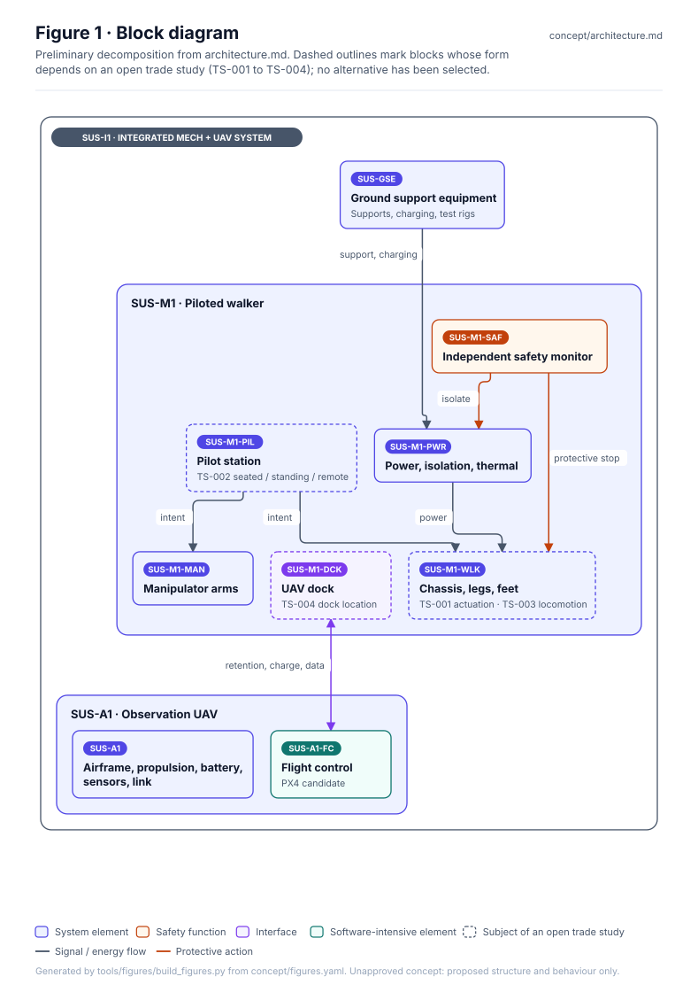
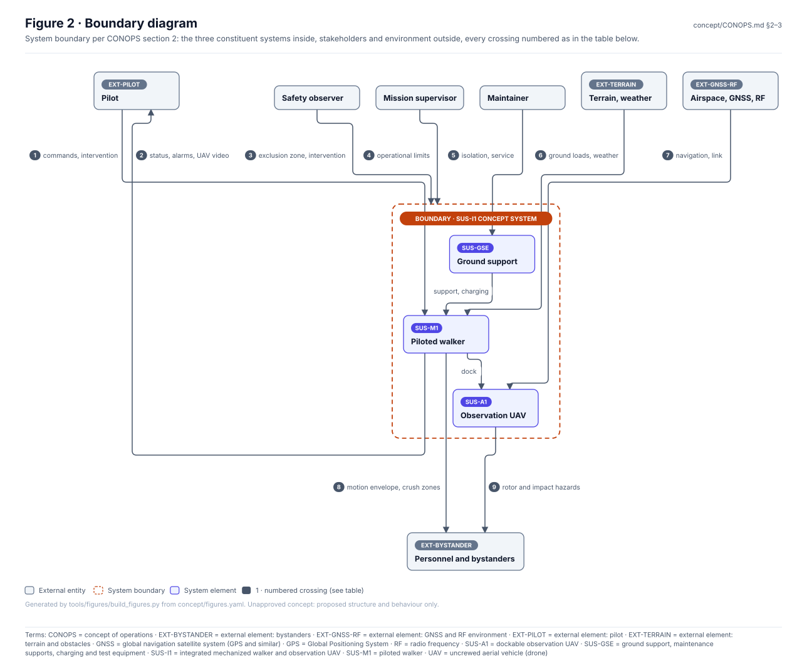
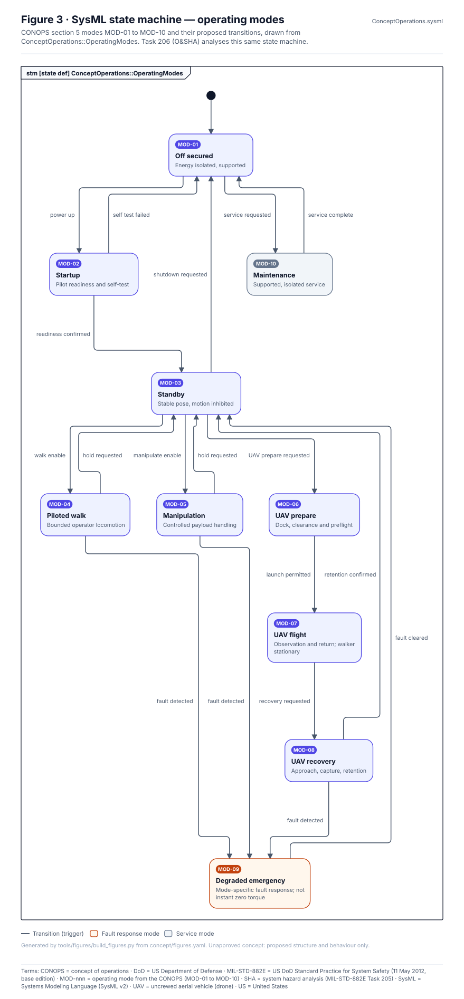
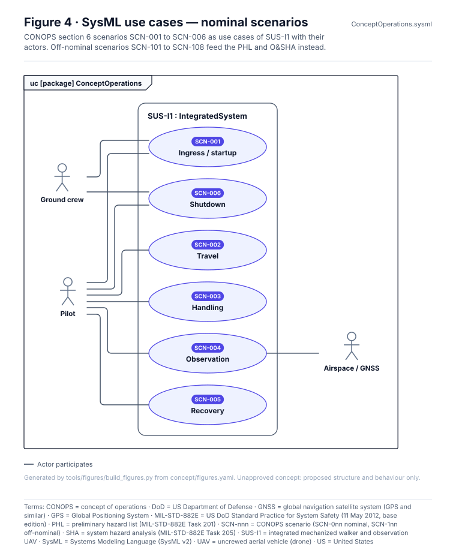
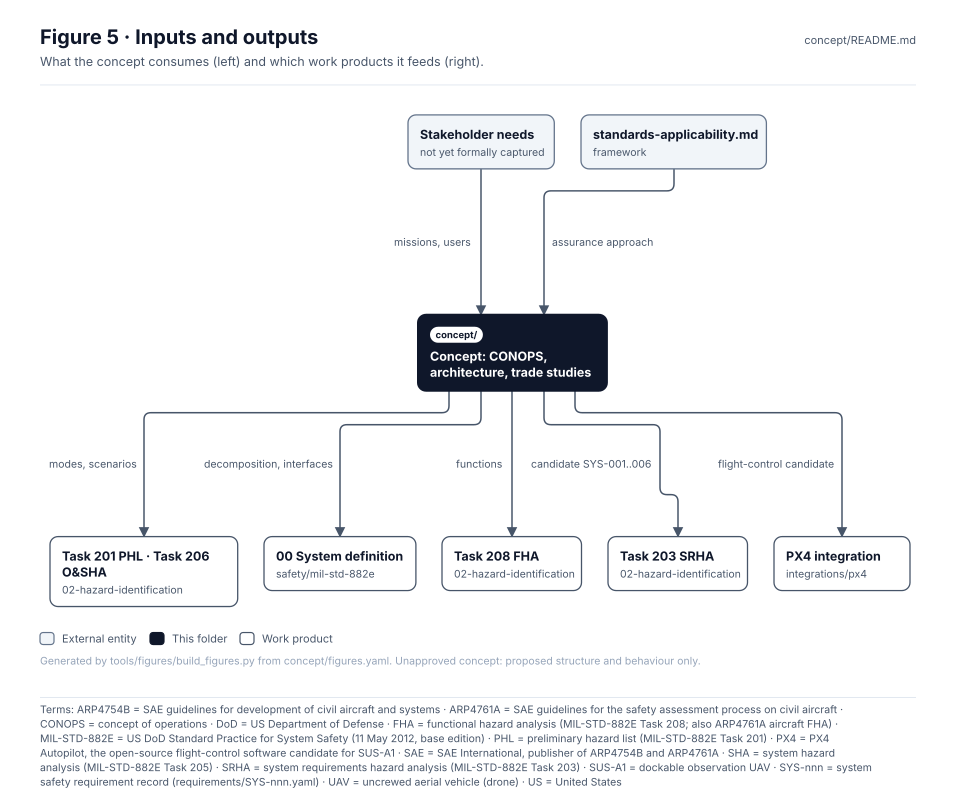

<!-- GENERATED by tools/wiki/build_wiki.py from concept/README.md. Do not edit here; edit the source and re-run. -->

> Published from [`concept/README.md`](https://github.com/jherrodthomas/Project-Susanoo/blob/main/concept/README.md) in the repository.

# Concept — SUS-I1 Operations, Architecture and Trade Studies

> **Status:** Unapproved concept (CONOPS rev 0.3-draft, architecture v0.2). Diagrams show proposed
> structure and behaviour only. No component, safe state, threshold or trade-study outcome has been
> selected or verified.

<!-- terms:start (generated by tools/terms/terms.py; do not edit by hand) -->

<b>Terms on this page (25)</b>: abbreviations and codes explained

| Term | Meaning |
|---|---|
| ARP4754B | SAE guidelines for development of civil aircraft and systems |
| ARP4761A | SAE guidelines for the safety assessment process on civil aircraft |
| CONOPS | concept of operations |
| DoD | US Department of Defense |
| FHA | functional hazard analysis (MIL-STD-882E Task 208; also ARP4761A aircraft FHA) |
| G0–G7 | lifecycle gate (G0 concept to G7 change and sustainment) |
| GNSS | global navigation satellite system (GPS and similar) |
| GPS | Global Positioning System |
| MIL-STD-882E | US DoD Standard Practice for System Safety (11 May 2012, base edition) |
| PHA | preliminary hazard analysis (MIL-STD-882E Task 202) |
| PHL | preliminary hazard list (MIL-STD-882E Task 201) |
| RF | radio frequency |
| SAE | SAE International, publisher of ARP4754B and ARP4761A |
| SHA | system hazard analysis (MIL-STD-882E Task 205) |
| SRHA | system requirements hazard analysis (MIL-STD-882E Task 203) |
| SUS-A1 | dockable observation UAV |
| SUS-GSE | ground support, maintenance supports, charging and test equipment |
| SUS-I1 | integrated mechanized walker and observation UAV |
| SUS-M1 | piloted walker |
| SVG | Scalable Vector Graphics, the figure file format |
| SYS-nnn | system safety requirement record (requirements/SYS-nnn.yaml) |
| SysML | Systems Modeling Language (SysML v2) |
| TS-nnn | architecture trade study |
| UAV | uncrewed aerial vehicle (drone) |
| US | United States |

All terms: [abbreviations and record codes](https://github.com/jherrodthomas/Project-Susanoo/blob/main/docs/terms.md).

<!-- terms:end -->

| Field | Value |
|---|---|
| Lifecycle gate | G0 (Concept) feeding G1–G2 |
| Accountable role | Systems lead |
| Documentation standard | [`framework/documentation-standard.md`](Documentation-Standard.md) |
| Analysis baseline | [`safety/mil-std-882e/00-system-definition`](882E-00-system-definition.md) |

## Purpose

Defines what Susanoo is for and how it is meant to be used, before design commitments are made:
missions, operating modes and scenarios ([CONOPS](https://github.com/jherrodthomas/Project-Susanoo/blob/main/concept/CONOPS.md)), the preliminary decomposition and
controlled interfaces ([architecture](https://github.com/jherrodthomas/Project-Susanoo/blob/main/concept/architecture.md)), and the open actuation, pilot, locomotion
and docking alternatives ([trade studies](https://github.com/jherrodthomas/Project-Susanoo/blob/main/concept/trade-studies.md)). These documents are the primary inputs
to the PHL, PHA and FHA in the MIL-STD-882E tree.

## Block diagram

Preliminary decomposition from [`architecture.md`](https://github.com/jherrodthomas/Project-Susanoo/blob/main/concept/architecture.md). Dashed outline = subject of an open
trade study (TS-xxx).

## Boundary diagram

System boundary per CONOPS section 2. Numbered crossings match the table.

| # | From | To | Crossing |
|---|---|---|---|
| 1 | Pilot | SUS-M1 | Commands, emergency intervention |
| 2 | SUS-M1 | Pilot | Status, alarms, UAV video |
| 3 | Safety observer | SUS-I1 | Exclusion zone, intervention |
| 4 | Mission supervisor | SUS-I1 | Operational limits |
| 5 | Maintainer | SUS-GSE | Isolation and service |
| 6 | Terrain, weather | SUS-M1 | Ground loads, weather |
| 7 | Airspace, GNSS, RF | SUS-A1 | Navigation, link |
| 8 | SUS-M1 | Personnel and bystanders | Motion envelope, crush zones |
| 9 | SUS-A1 | Personnel and bystanders | Rotor and impact hazards |

**Explicitly excluded:** weapons or armament, amphibious mobility, authorized human-occupied operation
(requires separate review and test authorization).

## SysML model

SysML v2 textual model: [`ConceptOperations.sysml`](https://github.com/jherrodthomas/Project-Susanoo/blob/main/concept/ConceptOperations.sysml) — the CONOPS operating
modes as a state machine and the nominal scenarios as use cases. It imports
the project model's [`SusanooArchitecture`](https://github.com/jherrodthomas/Project-Susanoo/blob/main/models/sysml/model/Architecture.sysml). The `.sysml`
file is the model of record; Figure 3 is drawn directly from it, so the figure cannot drift from the model.
[Task 206 (O&SHA)](882E-task-206-operating-and-support-hazard-analysis.md)
analyses the same state machine.

## Inputs and outputs

| Input | Source |
|---|---|
| Missions, users, constraints | Stakeholder needs (not yet formally captured) |
| Assurance approach | [`framework/standards-applicability.md`](https://github.com/jherrodthomas/Project-Susanoo/blob/main/framework/standards-applicability.md) |

| Output | Destination |
|---|---|
| Modes and scenarios | [Task 201 PHL](882E-task-201-preliminary-hazard-list.md), [Task 206 O&SHA](882E-task-206-operating-and-support-hazard-analysis.md) |
| Decomposition and interfaces | [00 System definition](882E-00-system-definition.md) |
| System functions | [Task 208 FHA](882E-task-208-functional-hazard-analysis.md) |
| Candidate requirements SYS-001..006 | [Task 203 SRHA](882E-task-203-system-requirements-hazard-analysis.md) |
| Flight-control candidate | [`integrations/px4`](PX4-Integration-Model.md) |

## Folder contents

| Item | Description | State |
|---|---|---|
| [`CONOPS.md`](https://github.com/jherrodthomas/Project-Susanoo/blob/main/concept/CONOPS.md) | Missions, modes, scenarios, human factors, candidate requirements | present |
| [`architecture.md`](https://github.com/jherrodthomas/Project-Susanoo/blob/main/concept/architecture.md) | Preliminary decomposition, interfaces, safety principles | present |
| [`trade-studies.md`](https://github.com/jherrodthomas/Project-Susanoo/blob/main/concept/trade-studies.md) | TS-001..TS-004, no winners selected | present |
| [`ConceptOperations.sysml`](https://github.com/jherrodthomas/Project-Susanoo/blob/main/concept/ConceptOperations.sysml) | SysML v2 modes and scenarios | present |
| [`figures.yaml`](https://github.com/jherrodthomas/Project-Susanoo/blob/main/concept/figures.yaml) | Figure specs; render with `python3 tools/figures/build_figures.py` | present |
| [`figures/`](https://github.com/jherrodthomas/Project-Susanoo/tree/main/concept/figures) | Generated SVG figures (do not edit) | generated |
