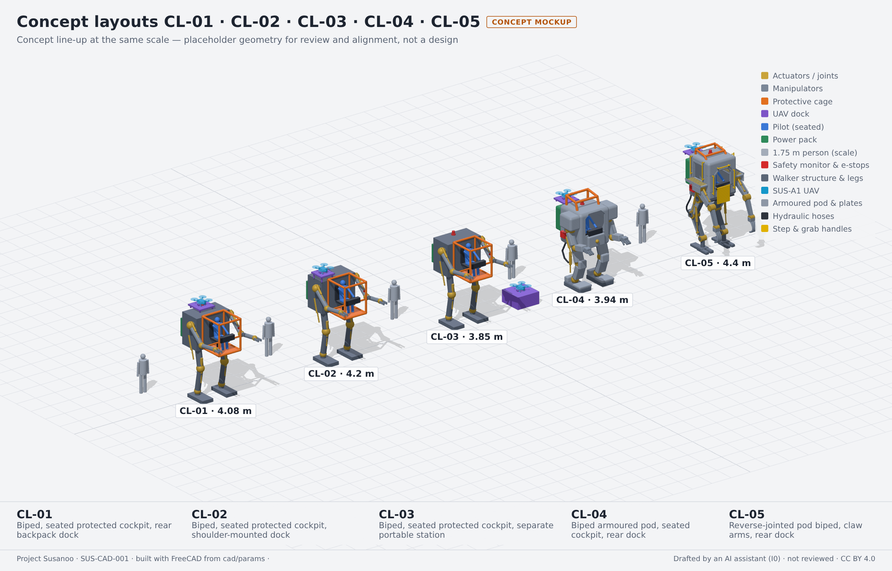
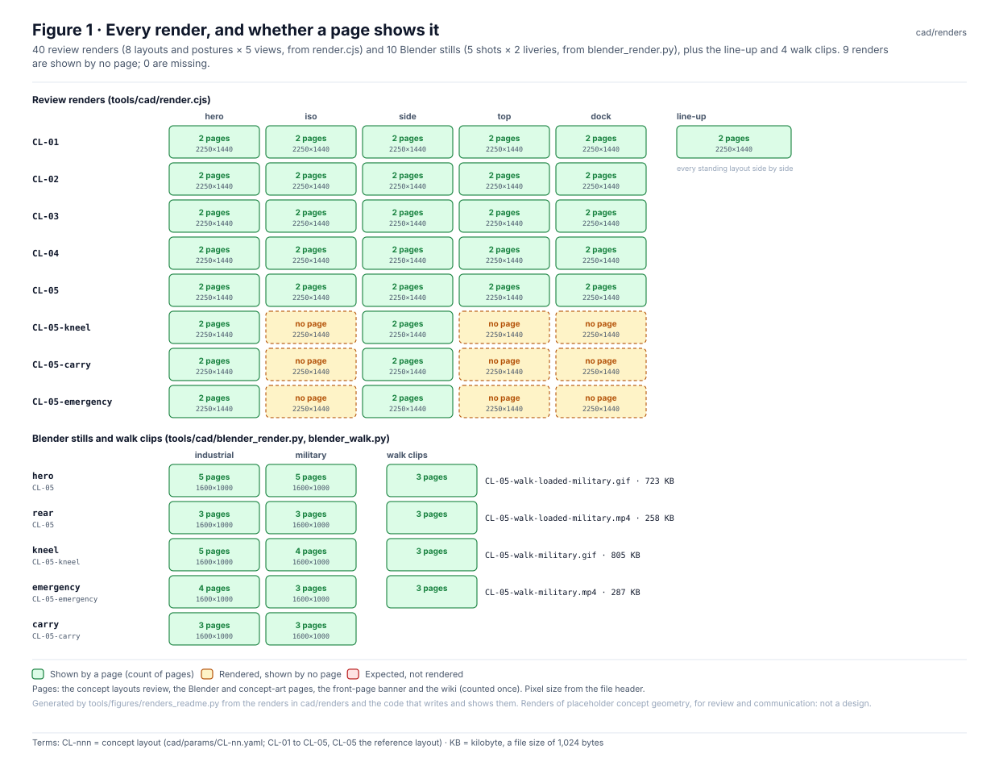
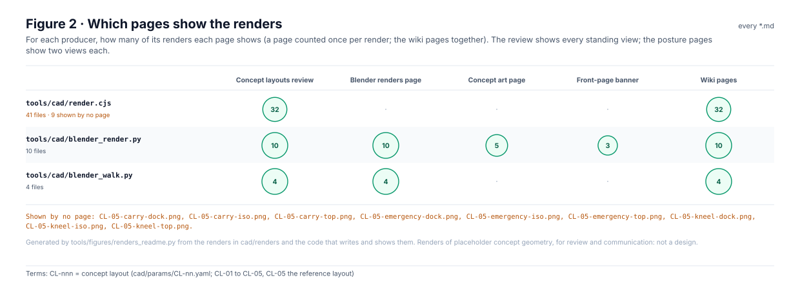
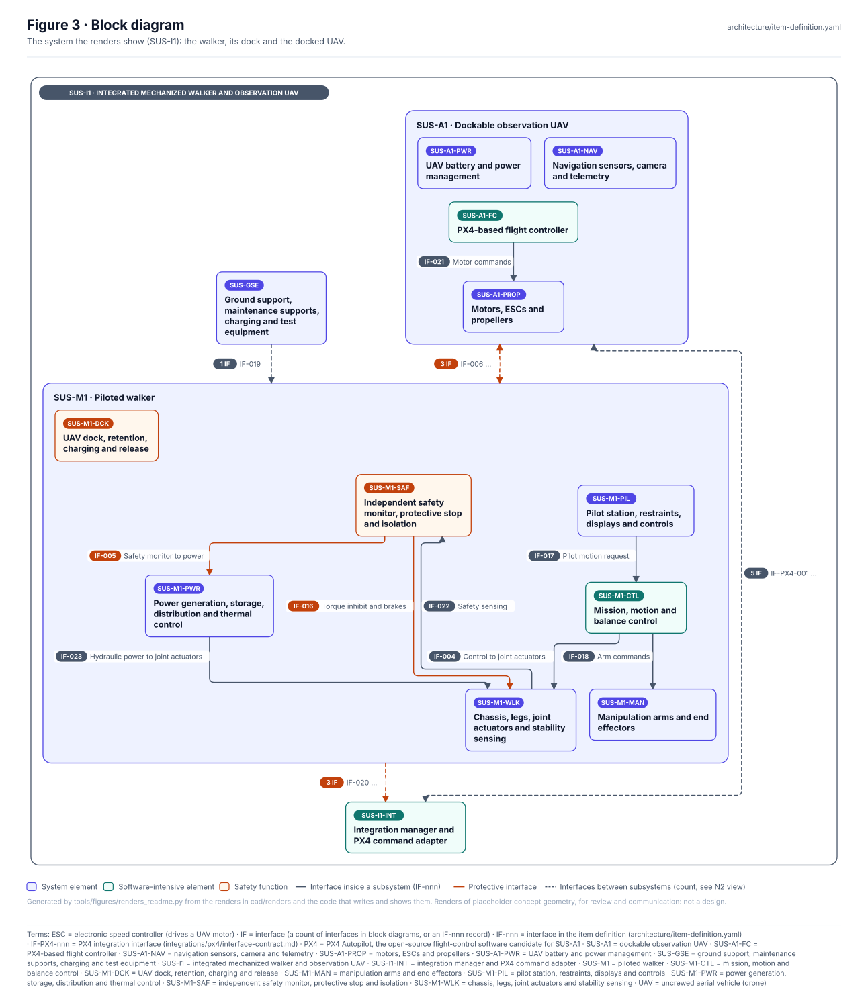
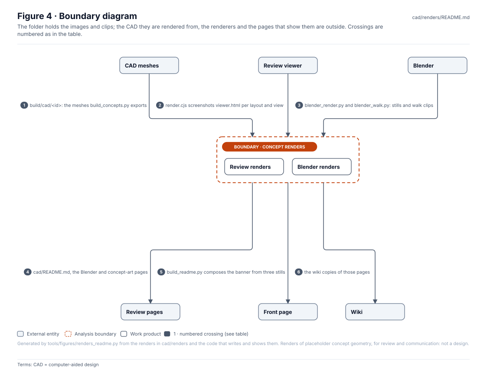
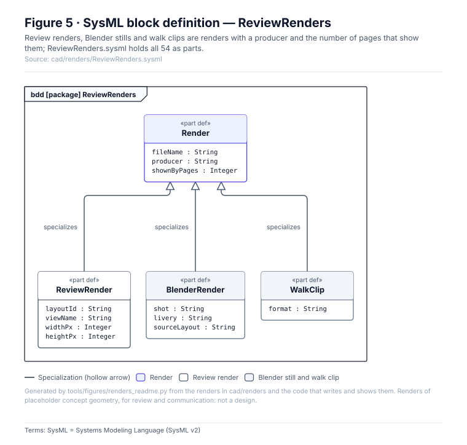
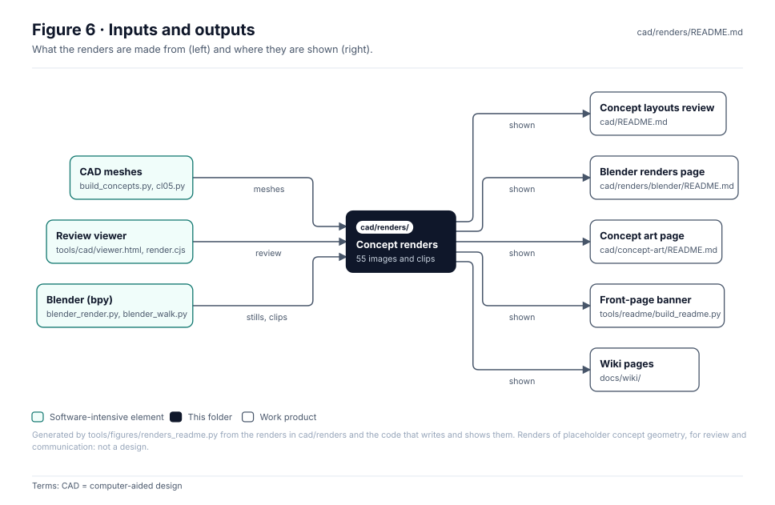

<!-- GENERATED by tools/wiki/build_wiki.py from cad/renders/README.md. Do not edit here; edit the source and re-run. -->

> Published from [`cad/renders/README.md`](https://github.com/jherrodthomas/Project-Susanoo/blob/main/cad/renders/README.md) in the repository.

# Concept layout renders

> **Status:** 40 review renders, the line-up, 10 Blender stills and 4 walk clips; 0 missing; **9 shown by no page** (the dock, iso, top views of the CL-05 postures). Renders of placeholder concept geometry for review and communication, **not a design**.

<!-- terms:start (generated by tools/terms/terms.py; do not edit by hand) -->

<b>Terms on this page (10)</b>: abbreviations and codes explained

| Term | Meaning |
|---|---|
| AI | artificial intelligence (here, an AI assistant drafting at independence level I0) |
| CAD | computer-aided design |
| CI | continuous integration (the automated checks GitHub runs on every change) |
| CL-nnn | concept layout (cad/params/CL-nn.yaml; CL-01 to CL-05, CL-05 the reference layout) |
| FreeCAD | open-source parametric CAD program used for the concept layouts |
| I0–I3 | review independence level (I0 none, e.g. the author or an AI, to I3 independent organisation) |
| KB | kilobyte, a file size of 1,024 bytes |
| OMG | Object Management Group, publisher of SysML |
| SVG | Scalable Vector Graphics, the figure file format |
| SysML | Systems Modeling Language (SysML v2) |

All terms: [abbreviations and record codes](https://github.com/jherrodthomas/Project-Susanoo/blob/main/docs/terms.md).

<!-- terms:end -->

| Field | Value |
|---|---|
| Review renders | [`render.cjs`](https://github.com/jherrodthomas/Project-Susanoo/blob/main/tools/cad/render.cjs) screenshots `tools/cad/viewer.html` per layout and view |
| Blender | [`blender_render.py`](https://github.com/jherrodthomas/Project-Susanoo/blob/main/tools/cad/blender_render.py) (stills), [`blender_walk.py`](https://github.com/jherrodthomas/Project-Susanoo/blob/main/tools/cad/blender_walk.py) (walk clips), optional: needs `bpy` |
| Run by | `tools/cad/make.sh` (locally; renders are committed, not re-rendered in CI) |
| Subfolder | [`blender/`](https://github.com/jherrodthomas/Project-Susanoo/blob/main/cad/renders/blender/README.md) keeps its own gallery |
| SysML | [`ReviewRenders.sysml`](https://github.com/jherrodthomas/Project-Susanoo/blob/main/cad/renders/ReviewRenders.sysml) (generated) |

## Purpose

The images the concept layouts are reviewed by: every layout and CL-05 posture from the same five views, so they compare directly, the line-up of all layouts, and lit Blender stills and walk clips of CL-05 for communication. Every render is drawn from the same meshes as the metrics and the drawing sheets.

## Every render

| Layout · posture | hero | iso | side | top | dock |
|---|---|---|---|---|---|
| `CL-01` | [shown](../../cad/renders/CL-01-hero.png) | [shown](../../cad/renders/CL-01-iso.png) | [shown](../../cad/renders/CL-01-side.png) | [shown](../../cad/renders/CL-01-top.png) | [shown](../../cad/renders/CL-01-dock.png) |
| `CL-02` | [shown](../../cad/renders/CL-02-hero.png) | [shown](../../cad/renders/CL-02-iso.png) | [shown](../../cad/renders/CL-02-side.png) | [shown](../../cad/renders/CL-02-top.png) | [shown](../../cad/renders/CL-02-dock.png) |
| `CL-03` | [shown](../../cad/renders/CL-03-hero.png) | [shown](../../cad/renders/CL-03-iso.png) | [shown](../../cad/renders/CL-03-side.png) | [shown](../../cad/renders/CL-03-top.png) | [shown](../../cad/renders/CL-03-dock.png) |
| `CL-04` | [shown](../../cad/renders/CL-04-hero.png) | [shown](../../cad/renders/CL-04-iso.png) | [shown](../../cad/renders/CL-04-side.png) | [shown](../../cad/renders/CL-04-top.png) | [shown](../../cad/renders/CL-04-dock.png) |
| `CL-05` | [shown](../../cad/renders/CL-05-hero.png) | [shown](../../cad/renders/CL-05-iso.png) | [shown](../../cad/renders/CL-05-side.png) | [shown](../../cad/renders/CL-05-top.png) | [shown](../../cad/renders/CL-05-dock.png) |
| `CL-05-kneel` | [shown](../../cad/renders/CL-05-kneel-hero.png) | [**no page**](../../cad/renders/CL-05-kneel-iso.png) | [shown](../../cad/renders/CL-05-kneel-side.png) | [**no page**](../../cad/renders/CL-05-kneel-top.png) | [**no page**](../../cad/renders/CL-05-kneel-dock.png) |
| `CL-05-carry` | [shown](../../cad/renders/CL-05-carry-hero.png) | [**no page**](../../cad/renders/CL-05-carry-iso.png) | [shown](../../cad/renders/CL-05-carry-side.png) | [**no page**](../../cad/renders/CL-05-carry-top.png) | [**no page**](../../cad/renders/CL-05-carry-dock.png) |
| `CL-05-emergency` | [shown](../../cad/renders/CL-05-emergency-hero.png) | [**no page**](../../cad/renders/CL-05-emergency-iso.png) | [shown](../../cad/renders/CL-05-emergency-side.png) | [**no page**](../../cad/renders/CL-05-emergency-top.png) | [**no page**](../../cad/renders/CL-05-emergency-dock.png) |

| Blender shot | industrial | military |
|---|---|---|
| `hero` (CL-05) | [shown](../../cad/renders/blender/CL-05-hero.jpg) | [shown](../../cad/renders/blender/CL-05-hero-military.jpg) |
| `rear` (CL-05) | [shown](../../cad/renders/blender/CL-05-rear.jpg) | [shown](../../cad/renders/blender/CL-05-rear-military.jpg) |
| `kneel` (CL-05-kneel) | [shown](../../cad/renders/blender/CL-05-kneel.jpg) | [shown](../../cad/renders/blender/CL-05-kneel-military.jpg) |
| `emergency` (CL-05-emergency) | [shown](../../cad/renders/blender/CL-05-emergency.jpg) | [shown](../../cad/renders/blender/CL-05-emergency-military.jpg) |
| `carry` (CL-05-carry) | [shown](../../cad/renders/blender/CL-05-carry.jpg) | [shown](../../cad/renders/blender/CL-05-carry-military.jpg) |

Walk clips: [`CL-05-walk-loaded-military.gif`](../../cad/renders/blender/CL-05-walk-loaded-military.gif) (723 KB), [`CL-05-walk-loaded-military.mp4`](https://github.com/jherrodthomas/Project-Susanoo/blob/main/cad/renders/blender/CL-05-walk-loaded-military.mp4) (258 KB), [`CL-05-walk-military.gif`](../../cad/renders/blender/CL-05-walk-military.gif) (805 KB), [`CL-05-walk-military.mp4`](https://github.com/jherrodthomas/Project-Susanoo/blob/main/cad/renders/blender/CL-05-walk-military.mp4) (287 KB).

## Where they are shown

## Block diagram

## Boundary diagram

| # | From | To | Crossing / interaction |
|---|---|---|---|
| 1 | CAD meshes | Concept renders | build/cad/<id>: the meshes build_concepts.py exports |
| 2 | Review viewer | Concept renders | render.cjs screenshots viewer.html per layout and view |
| 3 | Blender | Concept renders | blender_render.py and blender_walk.py: stills and walk clips |
| 4 | Concept renders | Review pages | cad/README.md, the Blender and concept-art pages |
| 5 | Concept renders | Front page | build_readme.py composes the banner from three stills |
| 6 | Concept renders | Wiki | the wiki copies of those pages |

**Explicitly excluded:** the meshes and metrics (built in `build/cad/`, not committed), the drawing sheets ([`drawings/`](Drawing-Sheets.md)) and the AI concept art made from the Blender stills ([`concept-art/`](Concept-Art.md)).

## SysML model

[`ReviewRenders.sysml`](https://github.com/jherrodthomas/Project-Susanoo/blob/main/cad/renders/ReviewRenders.sysml) is generated from the renders and validated with the project model by the OMG pilot in CI.

## Inputs and outputs

| Input | Source |
|---|---|
| CAD meshes | `tools/cad/build_concepts.py` and `tools/cad/b3d/cl05.py` (from [`cad/params/`](Layout-Parameters.md)) |
| Renderers | `tools/cad/render.cjs` with `viewer.html`; `blender_render.py`, `blender_walk.py` |

| Output | Destination |
|---|---|
| Renders | Concept layouts review (`cad/README.md`) |
| Renders | Blender renders page (`cad/renders/blender/README.md`) |
| Renders | Concept art page (`cad/concept-art/README.md`) |
| Renders | Front-page banner (`tools/readme/build_readme.py`) |
| Renders | Wiki pages (`docs/wiki/`) |

## Changing a render

1. Never edit an image here: change the layout ([`cad/params/`](Layout-Parameters.md)), the viewer or the Blender scene.
2. Re-render with `tools/cad/make.sh` (FreeCAD, Chromium and, for the Blender stills, `bpy`) and look at every changed image.
3. Regenerate this page and run the full check list in [`CLAUDE.md`](https://github.com/jherrodthomas/Project-Susanoo/blob/main/CLAUDE.md).

## Folder contents

| Item | Description | State |
|---|---|---|
| `CL-nn[-posture]-<view>.png` | 40 review renders (hero, iso, side, top, dock) | generated by `render.cjs` |
| [`lineup.png`](../../cad/renders/lineup.png) | Every standing layout side by side | generated by `render.cjs` |
| [`blender/`](https://github.com/jherrodthomas/Project-Susanoo/blob/main/cad/renders/blender/README.md) | Blender stills and walk clips of CL-05 | generated by `blender_render.py`, `blender_walk.py` |
| [`ReviewRenders.sysml`](https://github.com/jherrodthomas/Project-Susanoo/blob/main/cad/renders/ReviewRenders.sysml) | The renders as SysML | generated |
| [`figures/`](https://github.com/jherrodthomas/Project-Susanoo/tree/main/cad/renders/figures) | Generated SVG figures (do not edit) | generated |
| `README.md` | This page | generated |

<!-- END GENERATED: content below this line is human-authored and preserved -->
