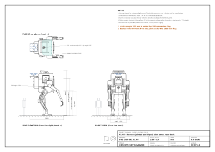
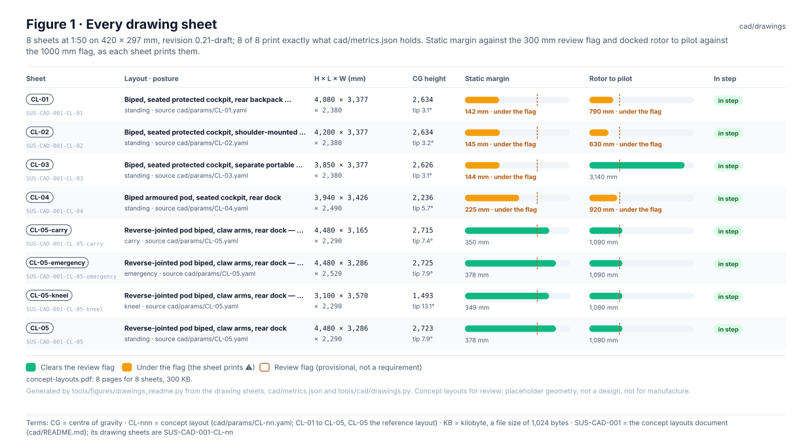
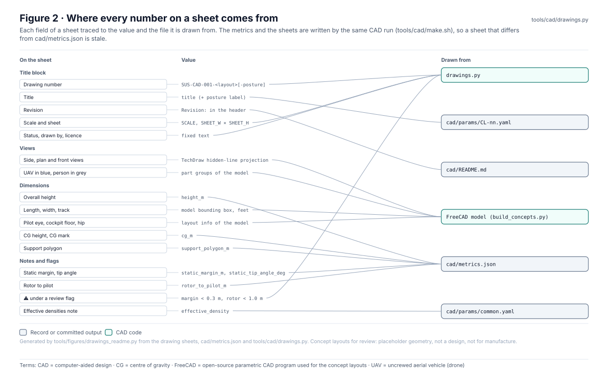
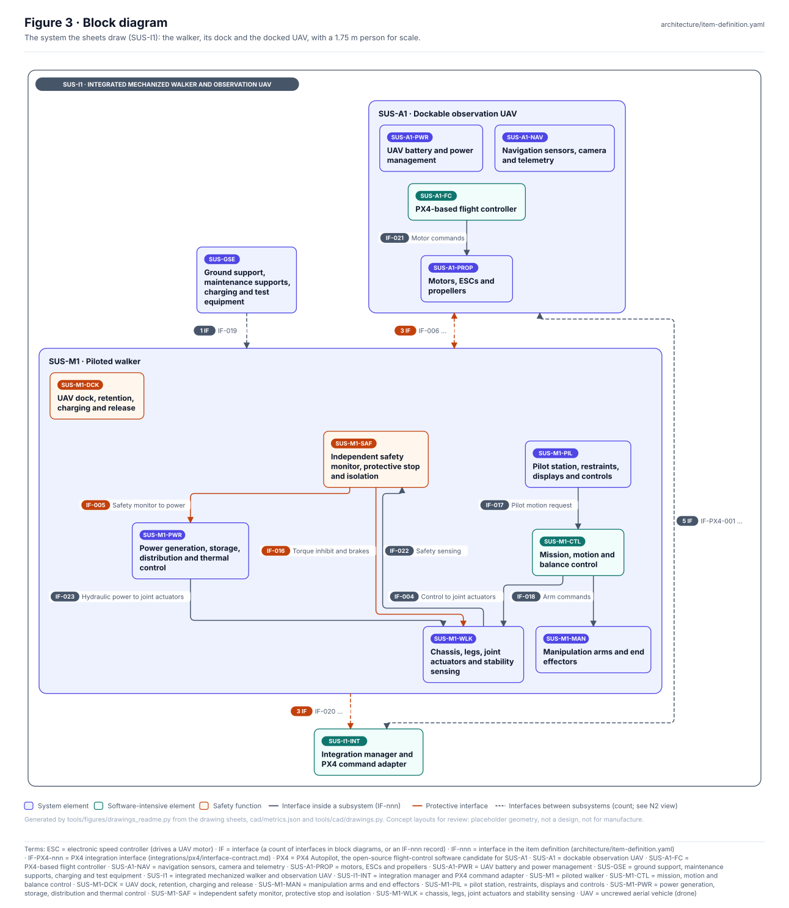
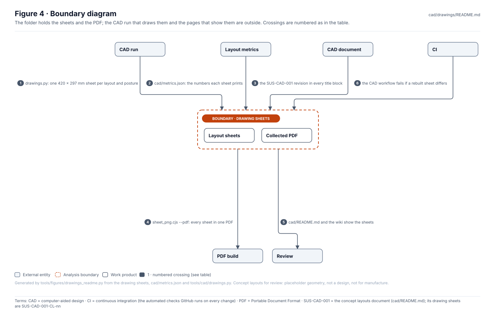
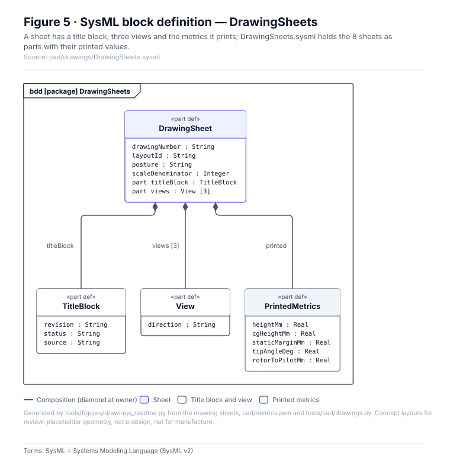
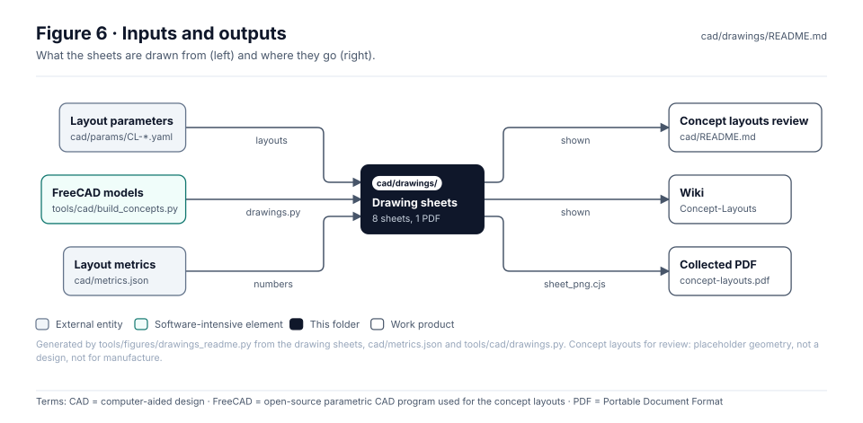

<!-- GENERATED by tools/wiki/build_wiki.py from cad/drawings/README.md. Do not edit here; edit the source and re-run. -->

> Published from [`cad/drawings/README.md`](https://github.com/jherrodthomas/Project-Susanoo/blob/main/cad/drawings/README.md) in the repository.

# Concept layout drawing sheets

> **Status:** 8 sheets at revision 0.21-draft, 8 of 8 in step with `cad/metrics.json`; 4 print a review-flag warning (CL-01, CL-02, CL-03, CL-04). `concept-layouts.pdf` holds 8 pages. Concept layouts, **not a design, not for manufacture**; every sheet reads *CONCEPT, NOT REVIEWED*.

<!-- terms:start (generated by tools/terms/terms.py; do not edit by hand) -->

<b>Terms on this page (11)</b>: abbreviations and codes explained

| Term | Meaning |
|---|---|
| CAD | computer-aided design |
| CG | centre of gravity |
| CI | continuous integration (the automated checks GitHub runs on every change) |
| CL-nnn | concept layout (cad/params/CL-nn.yaml; CL-01 to CL-05, CL-05 the reference layout) |
| FreeCAD | open-source parametric CAD program used for the concept layouts |
| KB | kilobyte, a file size of 1,024 bytes |
| OMG | Object Management Group, publisher of SysML |
| PDF | Portable Document Format |
| SUS-CAD-001 | the concept layouts document (cad/README.md); its drawing sheets are SUS-CAD-001-CL-nn |
| SVG | Scalable Vector Graphics, the figure file format |
| SysML | Systems Modeling Language (SysML v2) |

All terms: [abbreviations and record codes](https://github.com/jherrodthomas/Project-Susanoo/blob/main/docs/terms.md).

<!-- terms:end -->

| Field | Value |
|---|---|
| Drawn by | [`tools/cad/drawings.py`](https://github.com/jherrodthomas/Project-Susanoo/blob/main/tools/cad/drawings.py) (FreeCAD TechDraw), run by `tools/cad/make.sh` and the CAD workflow |
| Sheet | 420 × 297 mm, 1:50, third-angle, millimetres |
| PDF | [`concept-layouts.pdf`](https://github.com/jherrodthomas/Project-Susanoo/blob/main/cad/drawings/concept-layouts.pdf), built by `tools/cad/sheet_png.cjs --pdf` |
| Document | [SUS-CAD-001 concept layouts](Concept-Layouts.md) |
| SysML | [`DrawingSheets.sysml`](https://github.com/jherrodthomas/Project-Susanoo/blob/main/cad/drawings/DrawingSheets.sysml) (generated) |

## Purpose

One dimensioned sheet per concept layout and per CL-05 posture: side elevation, plan and front view at one scale so the layouts compare directly, with the overall size, the pilot eye, cockpit floor and hip heights, the centre of gravity, the support polygon with its static margin and tip angle, and the docked rotor's distance to the pilot. A sheet that falls under a provisional review flag says so in amber.

## The sheets

| Sheet | Drawing | Posture | H × L × W (mm) | CG height | Static margin | Rotor to pilot | Warnings | Against metrics.json |
|---|---|---|---|---|---|---|---|---|
| [`CL-01.svg`](../../cad/drawings/CL-01.svg) | `SUS-CAD-001-CL-01` | standing | 4,080 × 3,377 × 2,380 | 2,634 | 142 | 790 | 2 | in step |
| [`CL-02.svg`](../../cad/drawings/CL-02.svg) | `SUS-CAD-001-CL-02` | standing | 4,200 × 3,377 × 2,380 | 2,634 | 145 | 630 | 2 | in step |
| [`CL-03.svg`](../../cad/drawings/CL-03.svg) | `SUS-CAD-001-CL-03` | standing | 3,850 × 3,377 × 2,380 | 2,626 | 144 | 3,140 | 1 | in step |
| [`CL-04.svg`](../../cad/drawings/CL-04.svg) | `SUS-CAD-001-CL-04` | standing | 3,940 × 3,426 × 2,490 | 2,236 | 225 | 920 | 2 | in step |
| [`CL-05-carry.svg`](../../cad/drawings/CL-05-carry.svg) | `SUS-CAD-001-CL-05-carry` | carry | 4,480 × 3,165 × 2,290 | 2,715 | 350 | 1,090 | 0 | in step |
| [`CL-05-emergency.svg`](../../cad/drawings/CL-05-emergency.svg) | `SUS-CAD-001-CL-05-emergency` | emergency | 4,480 × 3,286 × 2,520 | 2,725 | 378 | 1,090 | 0 | in step |
| [`CL-05-kneel.svg`](../../cad/drawings/CL-05-kneel.svg) | `SUS-CAD-001-CL-05-kneel` | kneel | 3,100 × 3,570 × 2,290 | 1,493 | 349 | 1,090 | 0 | in step |
| [`CL-05.svg`](../../cad/drawings/CL-05.svg) | `SUS-CAD-001-CL-05` | standing | 4,480 × 3,286 × 2,290 | 2,723 | 378 | 1,090 | 0 | in step |

## Where the numbers come from

## Block diagram

## Boundary diagram

| # | From | To | Crossing / interaction |
|---|---|---|---|
| 1 | CAD run | Drawing sheets | drawings.py: one 420 × 297 mm sheet per layout and posture |
| 2 | Layout metrics | Drawing sheets | cad/metrics.json: the numbers each sheet prints |
| 3 | CAD document | Drawing sheets | the SUS-CAD-001 revision in every title block |
| 4 | Drawing sheets | PDF build | sheet_png.cjs --pdf: every sheet in one PDF |
| 5 | Drawing sheets | Review | cad/README.md and the wiki show the sheets |
| 6 | CI | Drawing sheets | the CAD workflow fails if a rebuilt sheet differs |

**Explicitly excluded:** the models and renders ([`cad/`](Concept-Layouts.md)), the review flags themselves (provisional, set in the review) and any design data: no sheet is for manufacture.

## SysML model

[`DrawingSheets.sysml`](https://github.com/jherrodthomas/Project-Susanoo/blob/main/cad/drawings/DrawingSheets.sysml) is generated from the sheets and validated with the project model by the OMG pilot in CI.

## Inputs and outputs

| Input | Source |
|---|---|
| Layout parameters | [`cad/params/`](Layout-Parameters.md) |
| FreeCAD models and metrics | `tools/cad/build_concepts.py`, [`cad/metrics.json`](https://github.com/jherrodthomas/Project-Susanoo/blob/main/cad/metrics.json) |
| Revision | the SUS-CAD-001 header in [`cad/README.md`](Concept-Layouts.md) |

| Output | Destination |
|---|---|
| Sheets | [`cad/README.md`](Concept-Layouts.md), the Concept-Layouts wiki page |
| PDF | [`concept-layouts.pdf`](https://github.com/jherrodthomas/Project-Susanoo/blob/main/cad/drawings/concept-layouts.pdf) |

## Changing a sheet

1. Never edit a sheet here: change the layout in [`cad/params/`](Layout-Parameters.md) or the drawing code in `tools/cad/drawings.py`.
2. Rebuild with `tools/cad/make.sh` (FreeCAD; writes the metrics, the sheets and the PDF together) and review the sheets.
3. Regenerate this page and run the full check list in [`CLAUDE.md`](https://github.com/jherrodthomas/Project-Susanoo/blob/main/CLAUDE.md).

## Folder contents

| Item | Description | State |
|---|---|---|
| [`CL-01.svg`](../../cad/drawings/CL-01.svg) | Biped, seated protected cockpit, rear backpack dock (77 KB) | generated by `drawings.py` |
| [`CL-02.svg`](../../cad/drawings/CL-02.svg) | Biped, seated protected cockpit, shoulder-mounted dock (77 KB) | generated by `drawings.py` |
| [`CL-03.svg`](../../cad/drawings/CL-03.svg) | Biped, seated protected cockpit, separate portable station (78 KB) | generated by `drawings.py` |
| [`CL-04.svg`](../../cad/drawings/CL-04.svg) | Biped armoured pod, seated cockpit, rear dock (88 KB) | generated by `drawings.py` |
| [`CL-05-carry.svg`](../../cad/drawings/CL-05-carry.svg) | Reverse-jointed pod biped, claw arms, rear dock — CARRYING A LOAD (158 KB) | generated by `drawings.py` |
| [`CL-05-emergency.svg`](../../cad/drawings/CL-05-emergency.svg) | Reverse-jointed pod biped, claw arms, rear dock — EMERGENCY EXIT (180 KB) | generated by `drawings.py` |
| [`CL-05-kneel.svg`](../../cad/drawings/CL-05-kneel.svg) | Reverse-jointed pod biped, claw arms, rear dock — KNEELING FOR EGRESS (168 KB) | generated by `drawings.py` |
| [`CL-05.svg`](../../cad/drawings/CL-05.svg) | Reverse-jointed pod biped, claw arms, rear dock (165 KB) | generated by `drawings.py` |
| [`concept-layouts.pdf`](https://github.com/jherrodthomas/Project-Susanoo/blob/main/cad/drawings/concept-layouts.pdf) | Every sheet in one PDF (300 KB) | generated by `sheet_png.cjs` |
| [`DrawingSheets.sysml`](https://github.com/jherrodthomas/Project-Susanoo/blob/main/cad/drawings/DrawingSheets.sysml) | The sheets as SysML | generated |
| [`figures/`](https://github.com/jherrodthomas/Project-Susanoo/tree/main/cad/drawings/figures) | Generated SVG figures (do not edit) | generated |
| `README.md` | This page | generated |

<!-- END GENERATED: content below this line is human-authored and preserved -->
