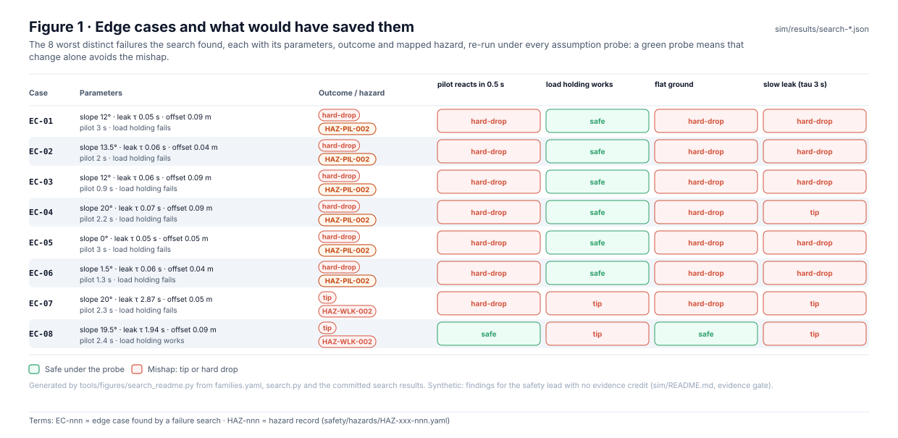
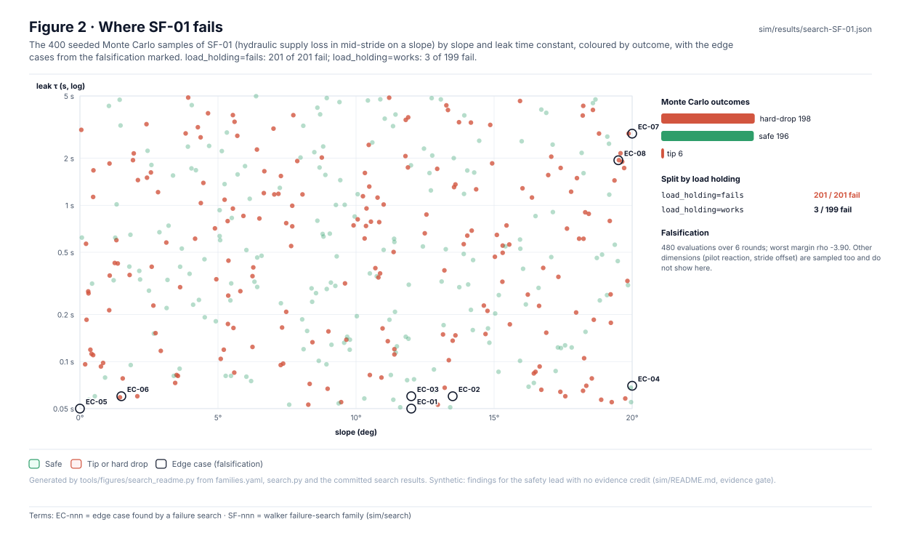
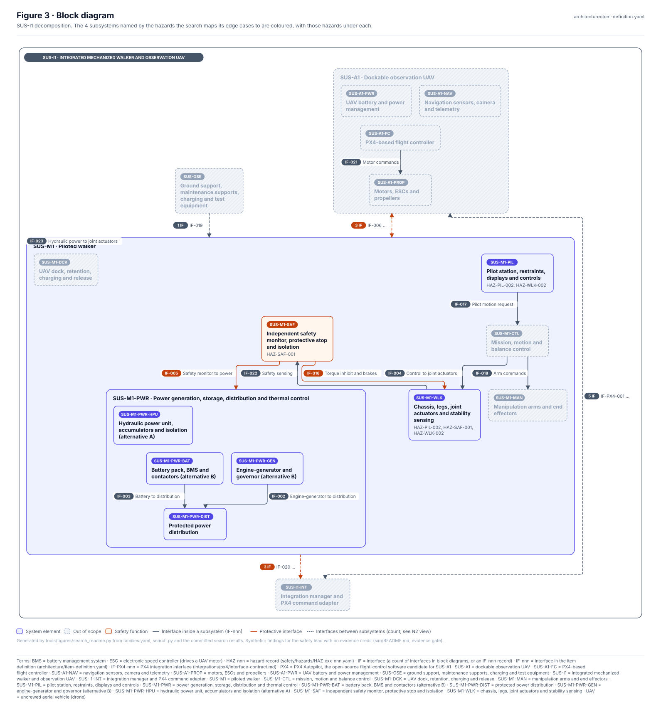
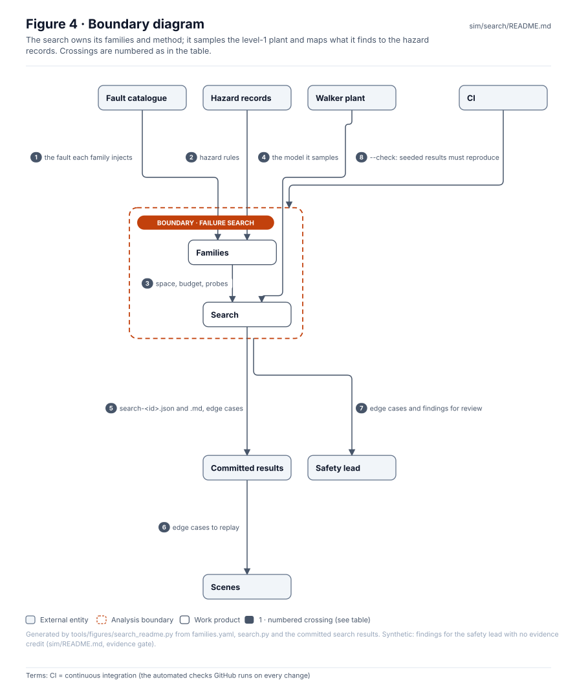
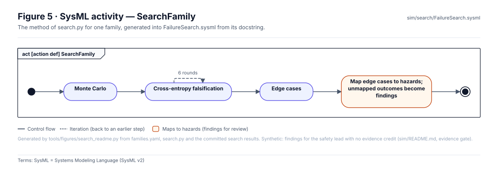
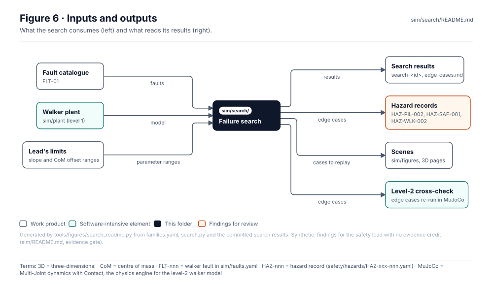

<!-- GENERATED by tools/wiki/build_wiki.py from sim/search/README.md. Do not edit here; edit the source and re-run. -->

> Published from [`sim/search/README.md`](https://github.com/jherrodthomas/Project-Susanoo/blob/main/sim/search/README.md) in the repository.

# Failure search

> **Status:** 1 family, 8 edge cases (6 HAZ-PIL-002, 2 HAZ-WLK-002), 0 new findings. Synthetic, **no evidence credit**: the search finds where to look; it verifies nothing.

<!-- terms:start (generated by tools/terms/terms.py; do not edit by hand) -->

<b>Terms on this page (11)</b>: abbreviations and codes explained

| Term | Meaning |
|---|---|
| 3D | three-dimensional |
| CI | continuous integration (the automated checks GitHub runs on every change) |
| CoM | centre of mass |
| DQ-nnn | decision question for the project lead (decisions/register.yaml) |
| EC-nnn | edge case found by a failure search |
| FLT-nnn | walker fault in sim/faults.yaml |
| HAZ-nnn | hazard record (safety/hazards/HAZ-xxx-nnn.yaml) |
| OMG | Object Management Group, publisher of SysML |
| SF-nnn | walker failure-search family (sim/search) |
| SVG | Scalable Vector Graphics, the figure file format |
| SysML | Systems Modeling Language (SysML v2) |

All terms: [abbreviations and record codes](https://github.com/jherrodthomas/Project-Susanoo/blob/main/docs/terms.md).

<!-- terms:end -->

| Field | Value |
|---|---|
| Run | `python -m sim.search.search` ([`search.py`](https://github.com/jherrodthomas/Project-Susanoo/blob/main/sim/search/search.py)); `--check` in CI |
| Families | [`families.yaml`](https://github.com/jherrodthomas/Project-Susanoo/blob/main/sim/search/families.yaml) |
| Results | [`search-SF-01.md`](https://github.com/jherrodthomas/Project-Susanoo/blob/main/sim/results/search-SF-01.md), [`edge-cases.md`](https://github.com/jherrodthomas/Project-Susanoo/blob/main/sim/results/edge-cases.md) |
| SysML | [`FailureSearch.sysml`](https://github.com/jherrodthomas/Project-Susanoo/blob/main/sim/search/FailureSearch.sysml) (generated) |

## Purpose

Searches the level-1 walker plant for the failures the fault catalogue's fixed cases miss. A family is data: the fault, the parameter space, the budget, the rules that map an outcome to a hazard and the assumption probes. The search maps where failures happen with seeded Monte Carlo, then drives towards the worst cases by cross-entropy falsification, and re-runs each edge case under every probe. An outcome no hazard covers becomes a finding for the safety lead.

## Edge cases

| Case | Parameters | Outcome | Hazard | pilot reacts in 0.5 s | load holding works | flat ground | slow leak (tau 3 s) |
|---|---|---|---|---|---|---|---|
| EC-01 | load_holding fails, pilot_reaction_s 2.1, slope_deg 15.5, stride_offset_m 0.08, tau_leak_s 0.05 | hard-drop | HAZ-PIL-002 | hard-drop | safe | hard-drop | hard-drop |
| EC-02 | load_holding fails, pilot_reaction_s 0.6, slope_deg 16, stride_offset_m 0.01, tau_leak_s 0.06 | hard-drop | HAZ-PIL-002 | hard-drop | safe | hard-drop | hard-drop |
| EC-03 | load_holding fails, pilot_reaction_s 0.9, slope_deg 8.5, stride_offset_m 0.1, tau_leak_s 0.05 | hard-drop | HAZ-PIL-002 | hard-drop | safe | hard-drop | hard-drop |
| EC-04 | load_holding fails, pilot_reaction_s 1.8, slope_deg 12, stride_offset_m 0.02, tau_leak_s 0.06 | hard-drop | HAZ-PIL-002 | hard-drop | safe | hard-drop | hard-drop |
| EC-05 | load_holding fails, pilot_reaction_s 3, slope_deg 0, stride_offset_m 0.05, tau_leak_s 0.05 | hard-drop | HAZ-PIL-002 | hard-drop | safe | hard-drop | hard-drop |
| EC-06 | load_holding fails, pilot_reaction_s 1.3, slope_deg 1.5, stride_offset_m 0.04, tau_leak_s 0.06 | hard-drop | HAZ-PIL-002 | hard-drop | safe | hard-drop | hard-drop |
| EC-07 | load_holding fails, pilot_reaction_s 2.3, slope_deg 18, stride_offset_m 0.1, tau_leak_s 1.49 | tip | HAZ-WLK-002 | hard-drop | tip | hard-drop | tip |
| EC-08 | load_holding works, pilot_reaction_s 1.4, slope_deg 16.5, stride_offset_m 0.1, tau_leak_s 4.09 | tip | HAZ-WLK-002 | safe | tip | safe | safe |

New findings: none; every edge case maps to an existing hazard.

## Where failures happen

| Family | Fault | Space | Monte Carlo | Falsification | Rules |
|---|---|---|---|---|---|
| SF-01 Hydraulic supply loss in mid-stride on a slope | FLT-01 | slope_deg uniform 0–20; tau_leak_s loguniform 0.05–5.0; pilot_reaction_s uniform 0.5–3.0; stride_offset_m uniform 0.0–0.12; load_holding choice works/fails | 400 samples, seed 11: hard-drop 196, safe 194, tip 10 | 6 × 80, seed 12 | {'nofault_outcome': 'tip'} → new finding; {'outcome': 'tip'} → HAZ-WLK-002; {'outcome': 'hard-drop', 'stop_active': True} → HAZ-SAF-001; {'outcome': 'hard-drop'} → HAZ-PIL-002 |

## Block diagram

## Boundary diagram

| # | From | To | Crossing / interaction |
|---|---|---|---|
| 1 | Fault catalogue | Families | the fault each family injects |
| 2 | Hazard records | Families | hazard rules |
| 3 | Families | Search | space, budget, probes |
| 4 | Walker plant | Search | the model it samples |
| 5 | Search | Committed results | search-<id>.json and .md, edge cases |
| 6 | Committed results | Scenes | edge cases to replay |
| 7 | Failure search | Safety lead | edge cases and findings for review |
| 8 | CI | Failure search | --check: seeded results must reproduce |

**Explicitly excluded:** the plant model itself (`sim/plant`), level-2 dynamics (`sim/mujoco`), and any claim that a region the search did not sample is safe.

## SysML model

[`FailureSearch.sysml`](https://github.com/jherrodthomas/Project-Susanoo/blob/main/sim/search/FailureSearch.sysml) is generated from the method in `search.py` and validated with the project model by the OMG pilot in CI.

| Step | What it does |
|---|---|
| 1. Monte Carlo | n uniform samples of the parameter space -> where failures happen and how often (unbiased). |
| 2. Cross-entropy falsification | rounds of sampling from a Gaussian (continuous) / categorical (choice) proposal refitted to the lowest-robustness elite -> the worst cases. |
| 3. Edge cases | the worst distinct failures. Each is re-run (a) with parameters rounded as a scene would write them, (b) without the fault (is it the fault or the terrain?), (c) under each assumption probe, then mapped to a hazard by the family's rules. An outcome no rule maps to a hazard becomes a finding; so does a mapped hazard whose record lists no causal factor for the fault. |

## Inputs and outputs

| Input | Source |
|---|---|
| Faults | [`sim/faults.yaml`](https://github.com/jherrodthomas/Project-Susanoo/blob/main/sim/faults.yaml) |
| Walker plant | [`sim/plant/`](Walker-Plant.md) |
| Parameter ranges | [Decision register](Decision-Register.md) (slope DQ-010, CoM offset DQ-011) |

| Output | Destination |
|---|---|
| Search results and edge cases | [`sim/results/`](Simulation-Results.md) |
| Edge cases on hazards (HAZ-PIL-002, HAZ-SAF-001, HAZ-WLK-002) | [Safety records](Safety-Records.md), for the safety lead |
| Cases to replay | scenes and 3D pages, level-2 cross-check |

## Folder contents

| Item | Description | State |
|---|---|---|
| [`families.yaml`](https://github.com/jherrodthomas/Project-Susanoo/blob/main/sim/search/families.yaml) | Search families | hand-written |
| [`search.py`](https://github.com/jherrodthomas/Project-Susanoo/blob/main/sim/search/search.py) | Monte Carlo, falsification, edge cases and mapping | code |
| [`FailureSearch.sysml`](https://github.com/jherrodthomas/Project-Susanoo/blob/main/sim/search/FailureSearch.sysml) | The method as a SysML activity | generated |
| [`figures/`](https://github.com/jherrodthomas/Project-Susanoo/tree/main/sim/search/figures) | Generated SVG figures (do not edit) | generated |
| `README.md` | This page | generated |

<!-- END GENERATED: content below this line is human-authored and preserved -->
