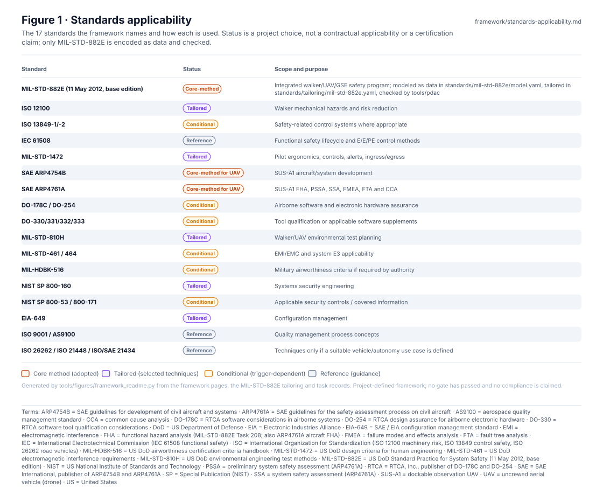
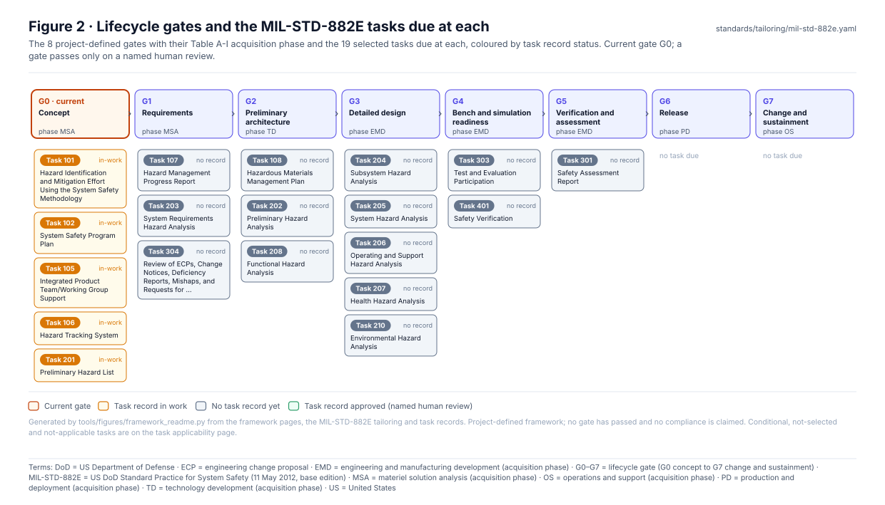
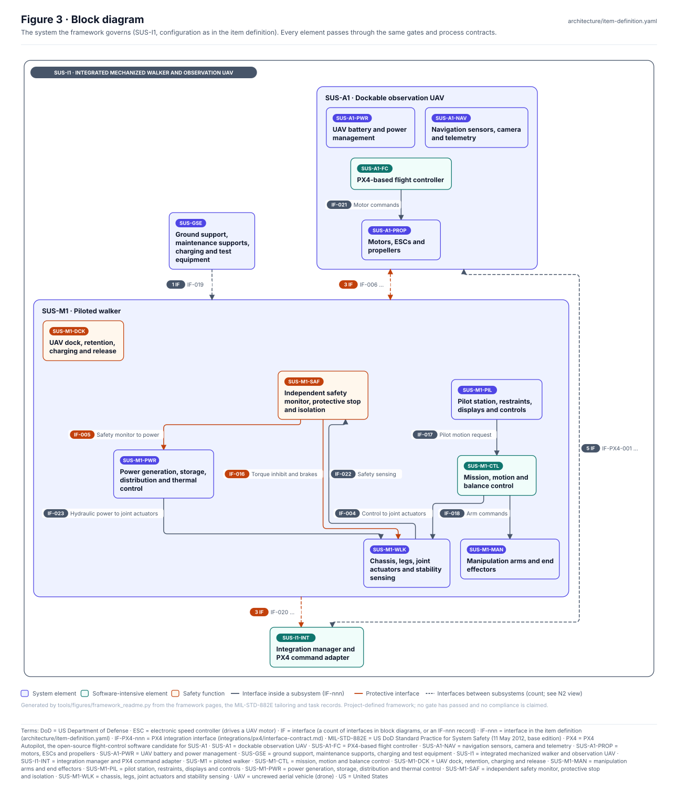
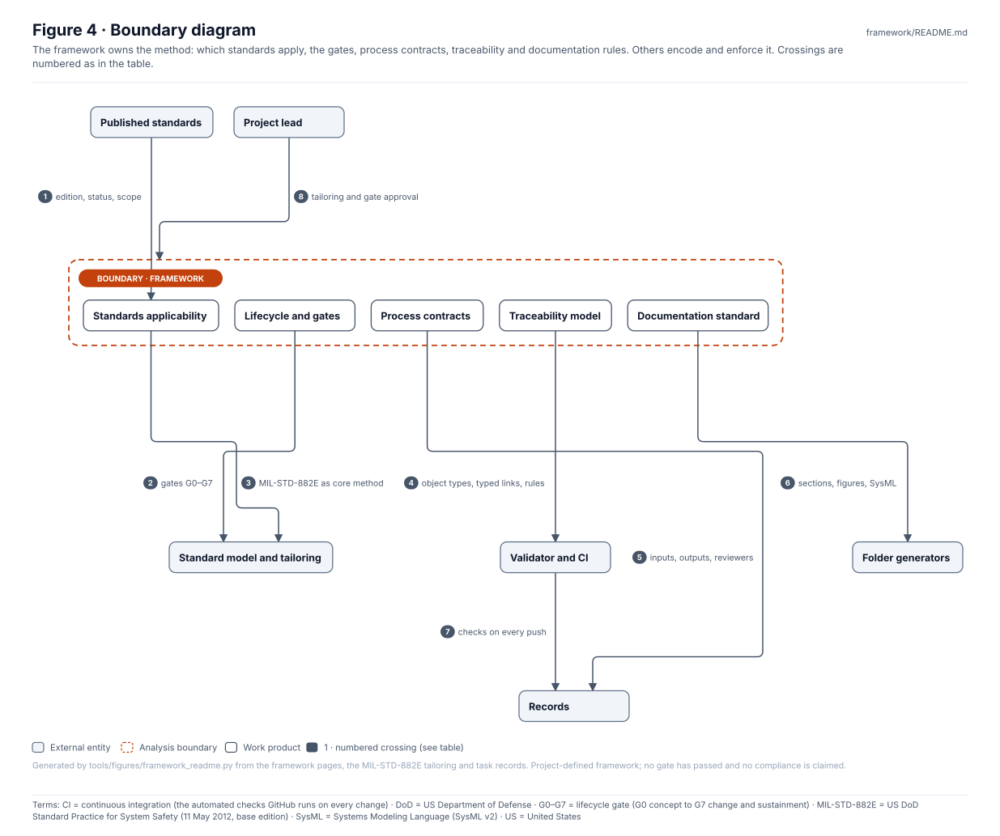
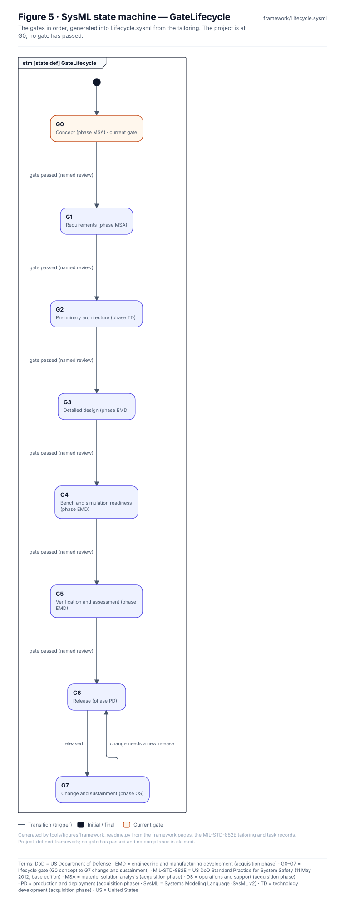
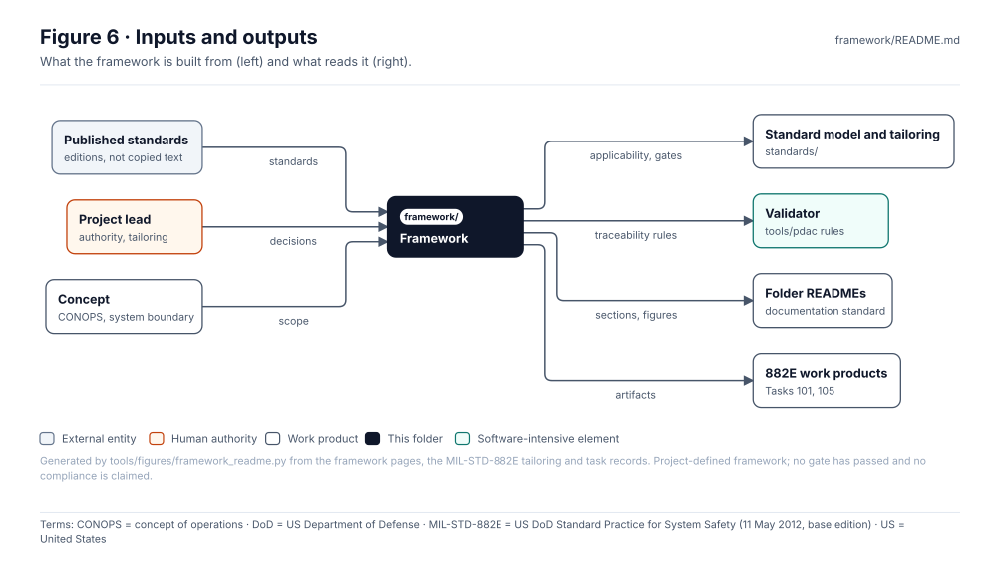

<!-- GENERATED by tools/wiki/build_wiki.py from framework/README.md. Do not edit here; edit the source and re-run. -->

> Published from [`framework/README.md`](https://github.com/jherrodthomas/Project-Susanoo/blob/main/framework/README.md) in the repository.

# Susanoo Integrated Standards & Lifecycle Framework v0.2

> **Status:** 17 standards named (1 Core-method, 5 Tailored, 6 Conditional, 3 Reference, 2 Core-method for UAV); 8 project-defined gates, current gate **G0** with 5 tasks not yet approved. Project-defined and simulated authority: no compliance is claimed.

<!-- terms:start (generated by tools/terms/terms.py; do not edit by hand) -->

<b>Terms on this page (36)</b>: abbreviations and codes explained

| Term | Meaning |
|---|---|
| ARP4754B | SAE guidelines for development of civil aircraft and systems |
| ARP4761A | SAE guidelines for the safety assessment process on civil aircraft |
| AS9100 | aerospace quality management standard |
| CI | continuous integration (the automated checks GitHub runs on every change) |
| CONOPS | concept of operations |
| DO-178C | RTCA software considerations in airborne systems |
| DO-254 | RTCA design assurance for airborne electronic hardware |
| DO-330 | RTCA software tool qualification considerations |
| DoD | US Department of Defense |
| EIA | Electronic Industries Alliance |
| EIA-649 | SAE / EIA configuration management standard |
| EMD | engineering and manufacturing development (acquisition phase) |
| G0–G7 | lifecycle gate (G0 concept to G7 change and sustainment) |
| IEC | International Electrotechnical Commission (IEC 61508 functional safety) |
| ISO | International Organization for Standardization (ISO 12100 machinery risk, ISO 13849 control safety, ISO 26262 road vehicles) |
| MIL-HDBK-516 | US DoD airworthiness certification criteria handbook |
| MIL-STD-1472 | US DoD design criteria for human engineering |
| MIL-STD-461 | US DoD electromagnetic interference requirements |
| MIL-STD-810H | US DoD environmental engineering test methods |
| MIL-STD-882E | US DoD Standard Practice for System Safety (11 May 2012, base edition) |
| MSA | materiel solution analysis (acquisition phase) |
| NIST | US National Institute of Standards and Technology |
| OMG | Object Management Group, publisher of SysML |
| OS | operations and support (acquisition phase) |
| PD | production and deployment (acquisition phase) |
| PDaC | Product Development as Code |
| RTCA | RTCA, Inc., publisher of DO-178C and DO-254 |
| SAE | SAE International, publisher of ARP4754B and ARP4761A |
| SP | Special Publication (NIST) |
| SUS-A1 | dockable observation UAV |
| SUS-M1 | piloted walker |
| SVG | Scalable Vector Graphics, the figure file format |
| SysML | Systems Modeling Language (SysML v2) |
| TD | technology development (acquisition phase) |
| UAV | uncrewed aerial vehicle (drone) |
| US | United States |

All terms: [abbreviations and record codes](https://github.com/jherrodthomas/Project-Susanoo/blob/main/docs/terms.md).

<!-- terms:end -->

| Field | Value |
|---|---|
| Scope | SUS-M1 human-piloted mechanized walker and SUS-A1 unarmed observation UAV |
| Current gate | G0 · Concept (phase MSA) · [Gate readiness](Gate-Readiness.md) |
| Tailoring | [`standards/tailoring/mil-std-882e.yaml`](https://github.com/jherrodthomas/Project-Susanoo/blob/main/standards/tailoring/mil-std-882e.yaml) |
| SysML | [`Lifecycle.sysml`](https://github.com/jherrodthomas/Project-Susanoo/blob/main/framework/Lifecycle.sysml) (generated) |

## Purpose

The method the project works by: which standards it uses and how, the lifecycle gates, the process contracts, the traceability model and the documentation standard. The pages here say what is intended; [`standards/`](Standards-and-Tailoring.md) encodes MIL-STD-882E and its tailoring as data, and [`tools/pdac`](https://github.com/jherrodthomas/Project-Susanoo/blob/main/tools/pdac/README.md) enforces them on the records.

## Standards applicability

| Status | Standards |
|---|---|
| Core-method | MIL-STD-882E (11 May 2012, base edition) |
| Tailored | ISO 12100, MIL-STD-1472, MIL-STD-810H, NIST SP 800-160, EIA-649 |
| Conditional | ISO 13849-1/-2, DO-178C / DO-254, DO-330/331/332/333, MIL-STD-461 / 464, MIL-HDBK-516, NIST SP 800-53 / 800-171 |
| Reference | IEC 61508, ISO 9001 / AS9100, ISO 26262 / ISO 21448 / ISO/SAE 21434 |
| Core-method for UAV | SAE ARP4754B, SAE ARP4761A |

Full table with scope: [standards applicability](https://github.com/jherrodthomas/Project-Susanoo/blob/main/framework/standards-applicability.md).

## Lifecycle gates

| Gate | Title | Phase | MIL-STD-882E tasks due | Not yet approved |
|---|---|---|---|---|
| G0 (current) | Concept | MSA | 101, 102, 105, 106, 201 | 101 (in-work), 102 (in-work), 105 (in-work), 106 (in-work), 201 (in-work) |
| G1 | Requirements | MSA | 107, 203, 304 | 107 (no record), 203 (no record), 304 (no record) |
| G2 | Preliminary architecture | TD | 108, 202, 208 | 108 (no record), 202 (no record), 208 (no record) |
| G3 | Detailed design | EMD | 204, 205, 206, 207, 210 | 204 (no record), 205 (no record), 206 (no record), 207 (no record), 210 (no record) |
| G4 | Bench and simulation readiness | EMD | 303, 401 | 303 (no record), 401 (no record) |
| G5 | Verification and assessment | EMD | 301 | 301 (no record) |
| G6 | Release | PD | — | — |
| G7 | Change and sustainment | OS | — | — |

Exit evidence per gate: [lifecycle](https://github.com/jherrodthomas/Project-Susanoo/blob/main/framework/lifecycle.md). A simulation gate is not permission for human-occupied operation.

## Block diagram

Elements and interfaces: [`architecture/item-definition.yaml`](https://github.com/jherrodthomas/Project-Susanoo/blob/main/architecture/item-definition.yaml).

## Boundary diagram

| # | From | To | Crossing / interaction |
|---|---|---|---|
| 1 | Published standards | Standards applicability | edition, status, scope |
| 2 | Lifecycle and gates | Standard model and tailoring | gates G0–G7 |
| 3 | Standards applicability | Standard model and tailoring | MIL-STD-882E as core method |
| 4 | Traceability model | Validator and CI | object types, typed links, rules |
| 5 | Process contracts | Records | inputs, outputs, reviewers |
| 6 | Documentation standard | Folder generators | sections, figures, SysML |
| 7 | Validator and CI | Records | checks on every push |
| 8 | Project lead | Framework | tailoring and gate approval |

**Explicitly excluded:** copyrighted standards text, compliance or certification claims, and acceptance of risk by automation.

## SysML model

[`Lifecycle.sysml`](https://github.com/jherrodthomas/Project-Susanoo/blob/main/framework/Lifecycle.sysml) is generated from the tailoring gates and validated with the project model by the OMG pilot in CI. The documentation standard's own figure is built from [`figures.yaml`](https://github.com/jherrodthomas/Project-Susanoo/blob/main/framework/figures.yaml).

## Inputs and outputs

| Input | Source |
|---|---|
| Standards, by edition | published standards (text not copied) |
| Authority and tailoring decisions | [Decision register](Decision-Register.md) |
| CONOPS and system boundary | [Concept](Concept-Model.md) |

| Output | Destination |
|---|---|
| Applicability and gates | [Standards and tailoring](Standards-and-Tailoring.md) |
| Traceability rules | [`tools/pdac`](https://github.com/jherrodthomas/Project-Susanoo/blob/main/tools/pdac/README.md) |
| README sections, figures, SysML | every folder README ([documentation standard](Documentation-Standard.md)) |
| Task artifacts (Tasks 101, 105) | [882E work products](882E-Work-Products.md) |

## Folder contents

| Item | Description | State |
|---|---|---|
| [`standards-applicability.md`](https://github.com/jherrodthomas/Project-Susanoo/blob/main/framework/standards-applicability.md) | Standards applicability — SUS-M1/SUS-A1 v0.2 | hand-written |
| [`lifecycle.md`](https://github.com/jherrodthomas/Project-Susanoo/blob/main/framework/lifecycle.md) | Integrated lifecycle and gates — SUS-M1/SUS-A1 · Task 101 artifact | hand-written |
| [`process-contracts.md`](https://github.com/jherrodthomas/Project-Susanoo/blob/main/framework/process-contracts.md) | Process contracts — v0.2 · Task 105 artifact | hand-written |
| [`traceability.md`](https://github.com/jherrodthomas/Project-Susanoo/blob/main/framework/traceability.md) | PDaC as Product Development as Code | hand-written |
| [`documentation-standard.md`](Documentation-Standard.md) | Documentation Standard — Folder READMEs, Figures and SysML Models | hand-written |
| [`execution-plan.md`](https://github.com/jherrodthomas/Project-Susanoo/blob/main/framework/execution-plan.md) | Execution roadmap — SUS-M1/SUS-A1 | hand-written |
| [`882e-conformance-review.md`](https://github.com/jherrodthomas/Project-Susanoo/blob/main/framework/882e-conformance-review.md) | Framework review against MIL-STD-882E, with build ideas | hand-written |
| [`liondriver-port-plan.md`](https://github.com/jherrodthomas/Project-Susanoo/blob/main/framework/liondriver-port-plan.md) | Porting LionDriver's modeling, diagram and simulation approach to Susanoo | hand-written |
| [`Lifecycle.sysml`](https://github.com/jherrodthomas/Project-Susanoo/blob/main/framework/Lifecycle.sysml) | Lifecycle gates as a SysML state machine | generated |
| [`figures.yaml`](https://github.com/jherrodthomas/Project-Susanoo/blob/main/framework/figures.yaml) | Figure spec for the documentation standard | hand-written |
| [`figures/`](https://github.com/jherrodthomas/Project-Susanoo/tree/main/framework/figures) | Generated SVG figures; `readme/` holds this page's (do not edit) | generated |
| `README.md` | This page: generated above the END marker, hand-written below | generated + hand |

<!-- END GENERATED: content below this line is human-authored and preserved -->

**PDaC = Product Development as Code**: typed, versioned product objects, executable rules, controlled changes, evidence and releases. A digital thread is an outcome, not its definition.

## Assurance structure
1. MIL-STD-882E: integrated system safety planning, hazard tracking, mitigation and risk disposition.
2. Machinery and controls: tailored ISO 12100, ISO 13849 and IEC 61508 methods, subject to applicability.
3. Human factors: MIL-STD-1472 techniques for pilot interface, ergonomics, maintainability and egress.
4. Aircraft subsystem: SAE ARP4754B development and ARP4761A aircraft safety assessment methods for SUS-A1 and its interfaces.
5. Airborne software/hardware: conditional DO-178C/DO-254, based on chosen assurance objectives.
6. Security, configuration, quality, manufacturing and verification.
7. PDaC governs product/variant/configuration/release and links evidence across domains.

## Governing principles
- No standards compliance claim without edition, tailoring, clause-level mapping and reviewed evidence.
- MIL-STD-882E risk assessment and ARP4761A aircraft failure-condition classification remain distinct.
- Automation may check evidence and links; only an authorized human may accept residual risk.
- Draft analyses, simulated tests and illustrative approvals must be explicitly identified.
- Copyrighted standards text must not be copied into this repository.

## Standard as code
MIL-STD-882E (11 May 2012, base edition) is encoded as data ([model](https://github.com/jherrodthomas/Project-Susanoo/blob/main/standards/mil-std-882e/model.yaml)), tailored per project ([tailoring](https://github.com/jherrodthomas/Project-Susanoo/blob/main/standards/tailoring/mil-std-882e.yaml)) and enforced on the safety records by [`tools/pdac`](https://github.com/jherrodthomas/Project-Susanoo/blob/main/tools/pdac/README.md) in CI. Generated views: [hazard tracking log](Hazard-Tracking-Log.md), [conformance matrix](MIL-STD-882E-Conformance.md), [task applicability](MIL-STD-882E-Applicability.md), [gate readiness](Gate-Readiness.md). Review and build rationale: [882E conformance review](https://github.com/jherrodthomas/Project-Susanoo/blob/main/framework/882e-conformance-review.md).

See [applicability](https://github.com/jherrodthomas/Project-Susanoo/blob/main/framework/standards-applicability.md), [lifecycle](https://github.com/jherrodthomas/Project-Susanoo/blob/main/framework/lifecycle.md), [process contracts](https://github.com/jherrodthomas/Project-Susanoo/blob/main/framework/process-contracts.md), [traceability](https://github.com/jherrodthomas/Project-Susanoo/blob/main/framework/traceability.md), [execution plan](https://github.com/jherrodthomas/Project-Susanoo/blob/main/framework/execution-plan.md) and [documentation standard](Documentation-Standard.md).
