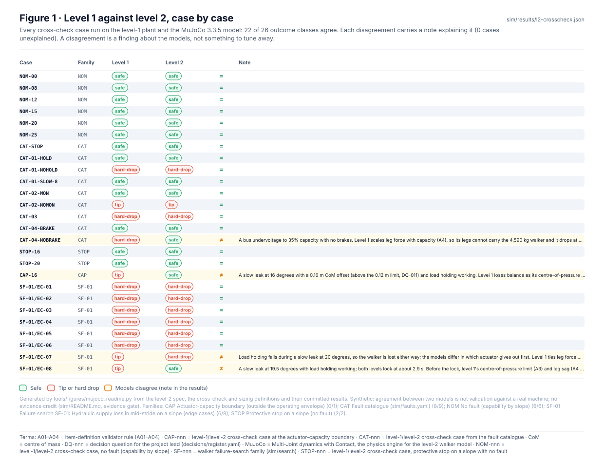
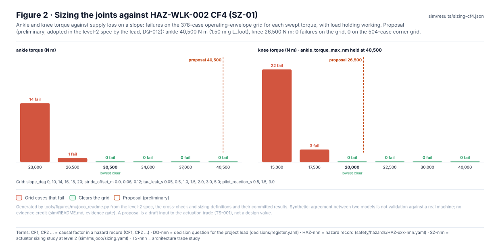
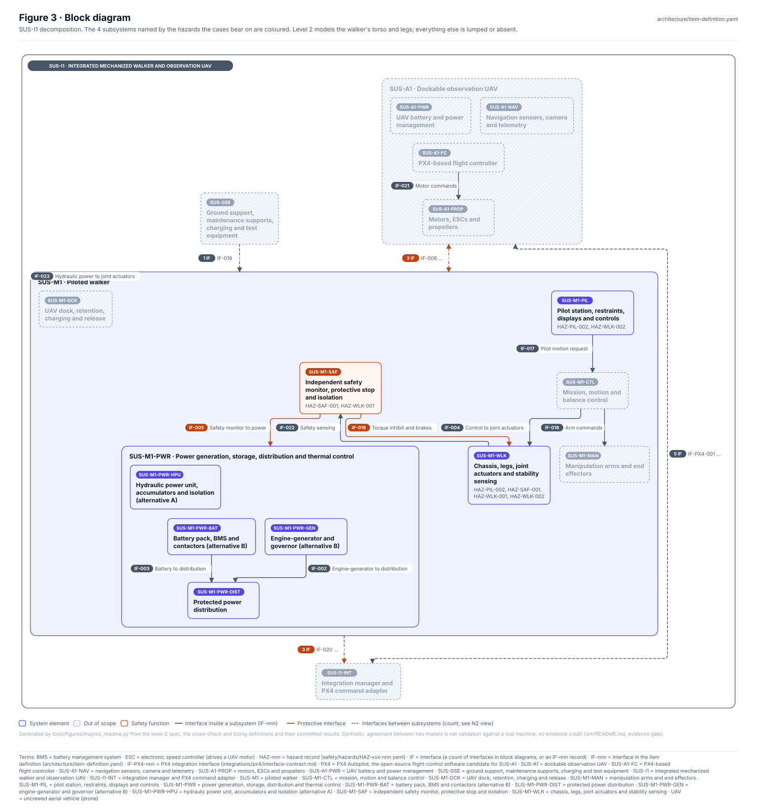
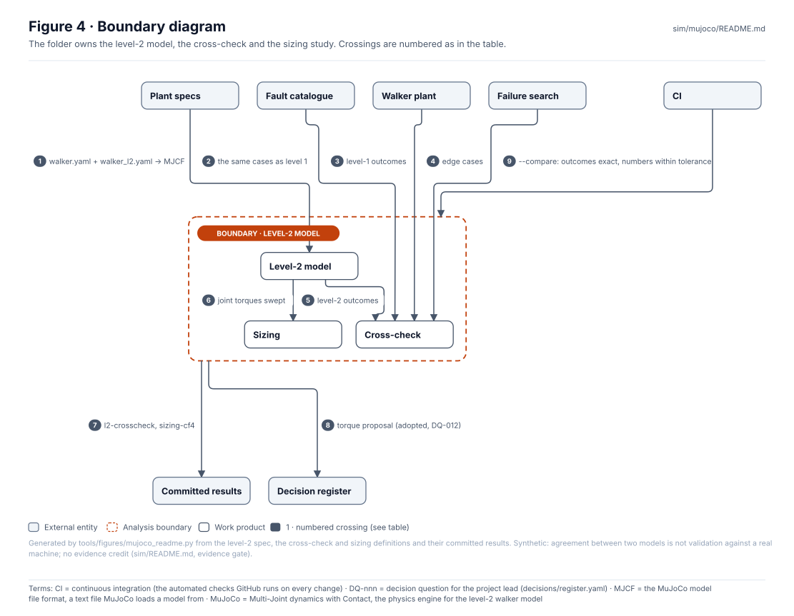
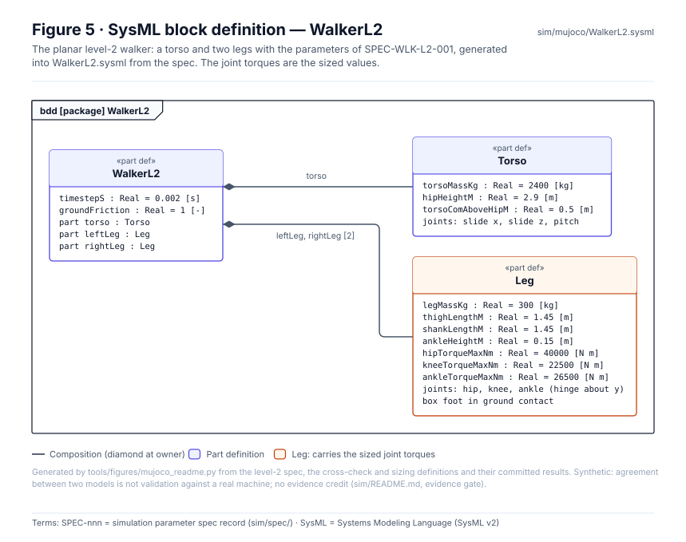
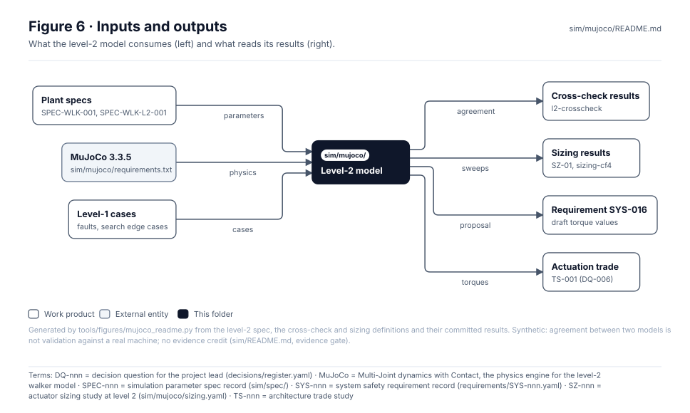

<!-- GENERATED by tools/wiki/build_wiki.py from sim/mujoco/README.md. Do not edit here; edit the source and re-run. -->

> Published from [`sim/mujoco/README.md`](https://github.com/jherrodthomas/Project-Susanoo/blob/main/sim/mujoco/README.md) in the repository.

# Level-2 multibody simulation (MuJoCo)

> **Status:** MuJoCo 3.3.5; 22 of 26 cross-check outcomes agree with level 1, every disagreement explained; SZ-01 proposes ankle 40,500 N m and knee 26,500 N m (preliminary). Synthetic, **no evidence credit**.

<!-- terms:start (generated by tools/terms/terms.py; do not edit by hand) -->

<b>Terms on this page (21)</b>: abbreviations and codes explained

| Term | Meaning |
|---|---|
| A01–A04 | item-definition validator rule (A01–A04) |
| CAD | computer-aided design |
| CAP-nnn | level-1/level-2 cross-check case at the actuator-capacity boundary |
| CAT-nnn | level-1/level-2 cross-check case from the fault catalogue |
| CF1, CF2 … | causal factor in a hazard record (CF1, CF2 …) |
| CI | continuous integration (the automated checks GitHub runs on every change) |
| CL-nnn | concept layout (cad/params/CL-nn.yaml; CL-01 to CL-05, CL-05 the reference layout) |
| CoM | centre of mass |
| DQ-nnn | decision question for the project lead (decisions/register.yaml) |
| HAZ-nnn | hazard record (safety/hazards/HAZ-xxx-nnn.yaml) |
| MJCF | the MuJoCo model file format, a text file MuJoCo loads a model from |
| MuJoCo | Multi-Joint dynamics with Contact, the physics engine for the level-2 walker model |
| OMG | Object Management Group, publisher of SysML |
| SF-nnn | walker failure-search family (sim/search) |
| SPEC-nnn | simulation parameter spec record (sim/spec/) |
| SVG | Scalable Vector Graphics, the figure file format |
| SYS-nnn | system safety requirement record (requirements/SYS-nnn.yaml) |
| SysML | Systems Modeling Language (SysML v2) |
| SZ-nnn | actuator sizing study at level 2 (sim/mujoco/sizing.yaml) |
| TS-nnn | architecture trade study |
| UAV | uncrewed aerial vehicle (drone) |

All terms: [abbreviations and record codes](https://github.com/jherrodthomas/Project-Susanoo/blob/main/docs/terms.md).

<!-- terms:end -->

| Field | Value |
|---|---|
| Spec | [`sim/spec/walker_l2.yaml`](https://github.com/jherrodthomas/Project-Susanoo/blob/main/sim/spec/walker_l2.yaml) (SPEC-WLK-L2-001 0.1-draft) on top of [`walker.yaml`](https://github.com/jherrodthomas/Project-Susanoo/blob/main/sim/spec/walker.yaml) |
| Run | `python -m sim.mujoco.crosscheck`, `python -m sim.mujoco.sizing` (about 4 minutes); `--compare` in CI |
| Results | [`l2-crosscheck.md`](https://github.com/jherrodthomas/Project-Susanoo/blob/main/sim/results/l2-crosscheck.md), [`sizing-cf4.md`](https://github.com/jherrodthomas/Project-Susanoo/blob/main/sim/results/sizing-cf4.md) |
| SysML | [`WalkerL2.sysml`](https://github.com/jherrodthomas/Project-Susanoo/blob/main/sim/mujoco/WalkerL2.sysml) (generated) |

## Purpose

A planar two-legged walker in MuJoCo, built from the same specs as the level-1 plant, so the assumptions level 1 makes can be tested against physics. It runs the same cases with the same outcome definitions and reports where the two models disagree, and it sizes the joint torques the level-1 plant cannot represent.

What is physics here and an assumption at level 1 (from [`l2.py`](https://github.com/jherrodthomas/Project-Susanoo/blob/main/sim/mujoco/l2.py)):

- the centre of pressure is limited by the foot's contact with the ground, not by an assumed +/- L * c;
- leg support, balance and torso pitch come from joint torques limited by actuator capacity;
- load holding locks the joints mechanically (a solver-enforced joint constraint at the current angle);
- the protective stop really steps the swing foot to the ground, towards the horizontal capture point, before crouching.

Unchanged from level 1, so outcomes are comparable: the case dictionary, the faults and capacity curve, alarm, pilot reaction, monitor and lock logic, and the outcome definitions (tip beyond tip_offset from the support centre; hard drop when the CoM reaches crouch height faster than safe_drop_speed). Contact after a mishap is not analysed; the run stops at the first mishap, as in level 1. Deterministic for a given MuJoCo version.

## Cross-check

| Case | Level 1 | Level 2 | Note |
|---|---|---|---|
| CAT-04-NOBRAKE | hard-drop | safe | A bus undervoltage to 35% capacity with no brakes. Level 1 scales leg force with capacity (A4), so its legs cannot carry the 4,590 kg walker and it drops at 2.6 s. Level 2's nearly straight legs carry it and, with the torques adopted in DQ-024 (ankle 40.5, knee 26.5 kN m), it holds through the protective stop; with the earlier 26.5 and 22.5 kN m it tipped at 5.8 s, and with only the ankle re-sized it dropped at 5.6 s. A4 is pessimistic for straight-legged stance. |
| CAP-16 | tip | safe | A slow leak at 16 degrees with a 0.16 m CoM offset (above the 0.12 m limit, DQ-011) and load holding working. Level 1 loses balance as its centre-of-pressure limit (L cos(slope) x capacity, A3) shrinks and its legs sink (A4), and tips after the hold engages. Level 2 holds it with the ankle at 26 kN m or more and tips at 20 kN m and below: the actuator-capacity boundary lies below the adopted ankle torque (40.5 kN m, DQ-024; sim/results/sizing-cf4.md). |
| SF-01/EC-07 | tip | hard-drop | Load holding fails during a slow leak at 20 degrees, so the walker is lost either way; the models differ in which actuator gives out first. Level 1 ties leg force and centre-of-pressure authority to the same capacity (A3, A4) and tips. Level 2 tips with ankle 20 and knee 60 kN m, holds through the run with ankle 26.5 and knee 60 kN m, and drops the cockpit at 2.7 m/s with the adopted torques (ankle 40.5, knee 26.5 kN m, DQ-024): weaker knees turn the tip into a drop (HAZ-PIL-002). |
| SF-01/EC-08 | tip | safe | A slow leak at 19.5 degrees with load holding working; both levels lock at about 2.9 s. Before the lock, level 1's centre-of-pressure limit (A3) and leg sag (A4, 0.12 m) let its CoM drift to the foot edge, so the locked body tips (A5) at 3.6 s. Level 2 keeps its CoM 0.32 m ahead of the foot until the lock and holds, with the ankle at any torque from 15 kN m up: here level 1's assumptions, not the actuators, decide. |

The 22 agreeing cases are listed in [`l2-crosscheck.md`](https://github.com/jherrodthomas/Project-Susanoo/blob/main/sim/results/l2-crosscheck.md).

## Actuator sizing

| Sweep | Value | Failures on the grid |
|---|---|---|
| ankle | 23,000 N m | 14 |
| ankle | 26,500 N m | 1 |
| ankle | 30,500 N m | 0 |
| ankle | 34,000 N m | 0 |
| ankle | 37,000 N m | 0 |
| ankle | 40,500 N m | 0 |
| knee | 15,000 N m | 21 |
| knee | 17,500 N m | 0 |
| knee | 20,000 N m | 0 |
| knee | 22,500 N m | 0 |
| knee | 30,000 N m | 0 |
| knee | 40,000 N m | 0 |

Proposal rationale: Preliminary. Ankle 1.5 m g L_foot at full supply (0.6 m g L_foot at the 0.4 load-holding threshold), a third above the lowest value that clears the grid; knee 1.5 times the lowest value that clears it with that ankle. Joint torque is taken to fall in proportion to supply (level-2 assumption, as A4 at level 1).

## Block diagram

## Boundary diagram

| # | From | To | Crossing / interaction |
|---|---|---|---|
| 1 | Plant specs | Level-2 model | walker.yaml + walker_l2.yaml → MJCF |
| 2 | Fault catalogue | Cross-check | the same cases as level 1 |
| 3 | Walker plant | Cross-check | level-1 outcomes |
| 4 | Failure search | Cross-check | edge cases |
| 5 | Level-2 model | Cross-check | level-2 outcomes |
| 6 | Level-2 model | Sizing | joint torques swept |
| 7 | Level-2 model | Committed results | l2-crosscheck, sizing-cf4 |
| 8 | Level-2 model | Decision register | torque proposal (adopted, DQ-012) |
| 9 | CI | Level-2 model | --compare: outcomes exact, numbers within tolerance |

**Explicitly excluded:** lateral dynamics, contact after a mishap, the UAV, and any claim that agreement with level 1 validates either model against a real machine.

## SysML model

[`WalkerL2.sysml`](https://github.com/jherrodthomas/Project-Susanoo/blob/main/sim/mujoco/WalkerL2.sysml) is generated from the level-2 spec and validated with the project model by the OMG pilot in CI. The MuJoCo model itself is generated by [`model.py`](https://github.com/jherrodthomas/Project-Susanoo/blob/main/sim/mujoco/model.py) and never hand-edited.

| Parameter | Value | Unit | Status | Source |
|---|---|---|---|---|
| `torso_mass_kg` | 3672 | kg | derived | 80% of mass_kg above the hips (assumed split; the CAD gives no mass per part), DQ-023 |
| `leg_mass_kg` | 459 | kg | derived | 10% of mass_kg per leg (thigh + shank + foot, split 50/40/10), DQ-023 |
| `hip_height_m` | 2.34 | m | derived | Reference layout CL-05 (cad/metrics.json, hip_height_m), decision DQ-023; placeholder geometry, not a design |
| `thigh_length_m` | 1.107 | m | derived | Hip to knee: puts the hip at hip_height_m in the stance pose (knee bent 0.3 rad), DQ-023 |
| `shank_length_m` | 1.107 | m | derived | Knee to ankle: as thigh_length_m, DQ-023 |
| `ankle_height_m` | 0.15 | m | assumed | Ankle joint above the sole |
| `torso_com_above_hip_m` | 0.745 | m | derived | Puts the whole-body CoM at com_height_m (CL-05, cad/metrics.json) with the masses above, DQ-023 |
| `knee_torque_max_nm` | 26500 | N m | derived | Knee actuator peak torque at full supply, re-sized against HAZ-WLK-002 CF4 for the 4,590 kg reference layout (SZ-01, sim/results/sizing-cf4.md; SYS-016); adopted by lead decision DQ-024 |
| `hip_torque_max_nm` | 40000 | N m | assumed | Hip actuator peak torque at full supply |
| `ankle_torque_max_nm` | 40500 | N m | derived | Ankle actuator peak torque at full supply, 1.5 m g L_foot, re-sized against HAZ-WLK-002 CF4 for the 4,590 kg reference layout (SZ-01, sim/results/sizing-cf4.md; SYS-016); adopted by lead decision DQ-024 |
| `timestep_s` | 0.002 | s | assumed | MuJoCo integration step (implicitfast) |
| `ground_friction` | 1.0 | - | assumed | Foot-ground friction coefficient on firm ground |

## Inputs and outputs

| Input | Source |
|---|---|
| Plant specs | [`sim/spec/`](Plant-Specs.md) |
| Cases | [`crosscheck.yaml`](https://github.com/jherrodthomas/Project-Susanoo/blob/main/sim/mujoco/crosscheck.yaml), [`sim/faults.yaml`](https://github.com/jherrodthomas/Project-Susanoo/blob/main/sim/faults.yaml), search edge cases |
| MuJoCo | [`requirements.txt`](https://github.com/jherrodthomas/Project-Susanoo/blob/main/sim/mujoco/requirements.txt) |

| Output | Destination |
|---|---|
| Cross-check and sizing results | [`sim/results/`](Simulation-Results.md) |
| Draft torque values | [Requirement register](Requirements-Register.md) (SYS-016), actuation trade TS-001 |

## Folder contents

| Item | Description | State |
|---|---|---|
| [`model.py`](https://github.com/jherrodthomas/Project-Susanoo/blob/main/sim/mujoco/model.py) | Builds the MuJoCo model (MJCF) from the specs | code |
| [`l2.py`](https://github.com/jherrodthomas/Project-Susanoo/blob/main/sim/mujoco/l2.py) | Runs a case on the level-2 model | code |
| [`crosscheck.py`](https://github.com/jherrodthomas/Project-Susanoo/blob/main/sim/mujoco/crosscheck.py), [`crosscheck.yaml`](https://github.com/jherrodthomas/Project-Susanoo/blob/main/sim/mujoco/crosscheck.yaml) | Level 1 against level 2 | code, hand-written |
| [`sizing.py`](https://github.com/jherrodthomas/Project-Susanoo/blob/main/sim/mujoco/sizing.py), [`sizing.yaml`](https://github.com/jherrodthomas/Project-Susanoo/blob/main/sim/mujoco/sizing.yaml) | Joint torque sizing (SZ-01) | code, hand-written |
| [`requirements.txt`](https://github.com/jherrodthomas/Project-Susanoo/blob/main/sim/mujoco/requirements.txt) | Pinned MuJoCo | hand-written |
| [`WalkerL2.sysml`](https://github.com/jherrodthomas/Project-Susanoo/blob/main/sim/mujoco/WalkerL2.sysml) | The level-2 walker as SysML | generated |
| [`figures/`](https://github.com/jherrodthomas/Project-Susanoo/tree/main/sim/mujoco/figures) | Generated SVG figures (do not edit) | generated |
| `README.md` | This page | generated |

<!-- END GENERATED: content below this line is human-authored and preserved -->
