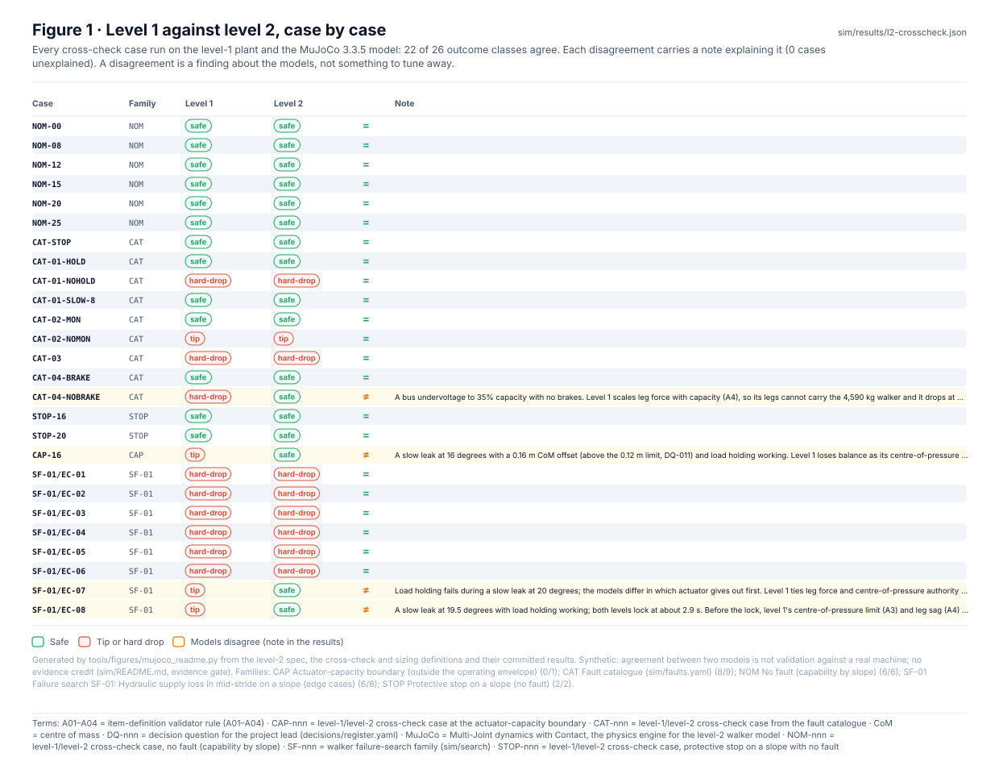
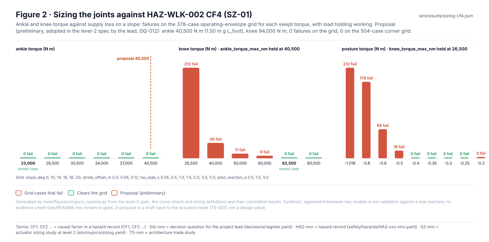
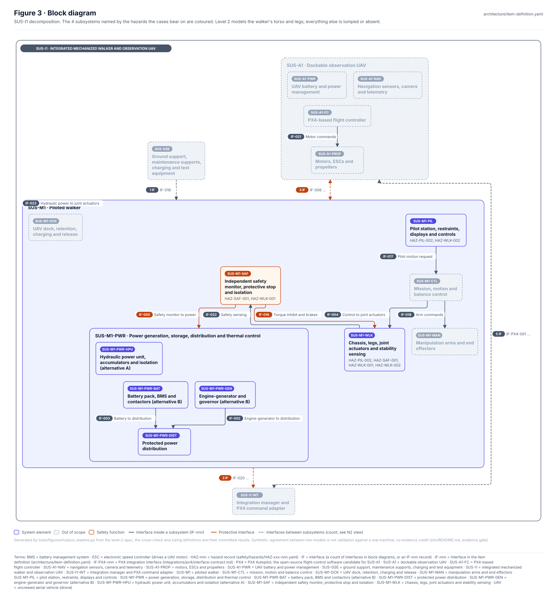
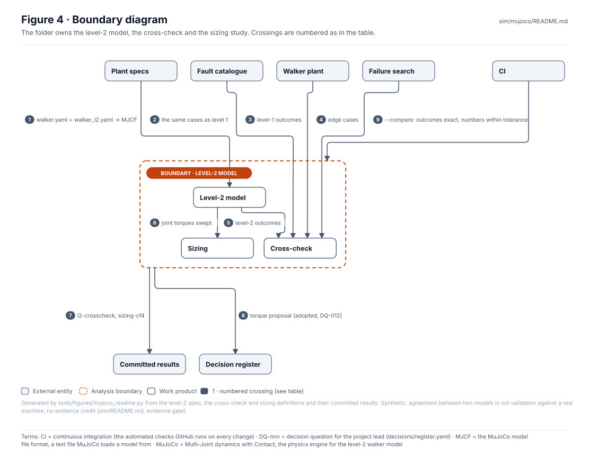
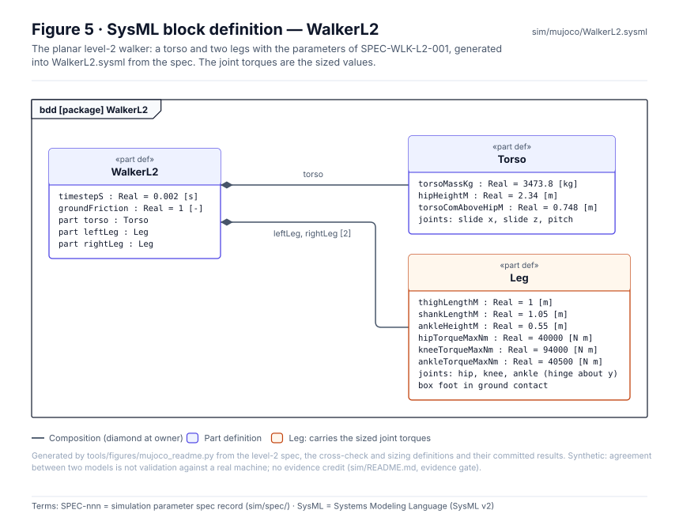
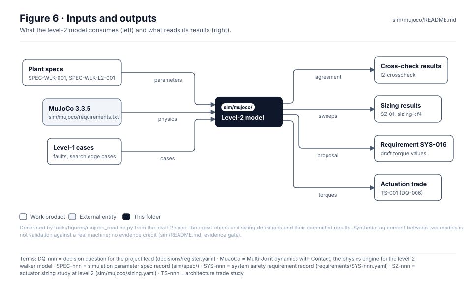

<!-- GENERATED by tools/wiki/build_wiki.py from sim/mujoco/README.md. Do not edit here; edit the source and re-run. -->

> Published from [`sim/mujoco/README.md`](https://github.com/jherrodthomas/Project-Susanoo/blob/main/sim/mujoco/README.md) in the repository.

# Level-2 multibody simulation (MuJoCo)

> **Status:** MuJoCo 3.3.5; 22 of 26 cross-check outcomes agree with level 1, every disagreement explained; SZ-01 proposes ankle 40,500 N m and knee 94,000 N m (preliminary); the terrain walk completes 18 of 21 terrain runs. Synthetic, **no evidence credit**.

<!-- terms:start (generated by tools/terms/terms.py; do not edit by hand) -->

<b>Terms on this page (25)</b>: abbreviations and codes explained

| Term | Meaning |
|---|---|
| 3D | three-dimensional |
| A01–A04 | item-definition validator rule (A01–A04) |
| AVX-512 | Advanced Vector Extensions 512, wide floating-point instructions on some x86-64 CPUs, not on every CI runner |
| CAD | computer-aided design |
| CAP-nnn | level-1/level-2 cross-check case at the actuator-capacity boundary |
| CAT-nnn | level-1/level-2 cross-check case from the fault catalogue |
| CF1, CF2 … | causal factor in a hazard record (CF1, CF2 …) |
| CI | continuous integration (the automated checks GitHub runs on every change) |
| CL-nnn | concept layout (cad/params/CL-nn.yaml; CL-01 to CL-05, CL-05 the reference layout) |
| CoM | centre of mass |
| CPU | central processing unit |
| DQ-nnn | decision question for the project lead (decisions/register.yaml) |
| HAZ-nnn | hazard record (safety/hazards/HAZ-xxx-nnn.yaml) |
| MJCF | the MuJoCo model file format, a text file MuJoCo loads a model from |
| MuJoCo | Multi-Joint dynamics with Contact, the physics engine for the level-2 walker model |
| OMG | Object Management Group, publisher of SysML |
| OpenBLAS | open-source linear-algebra library NumPy uses for matrix products; it picks a code path for the CPU it runs on |
| SF-nnn | walker failure-search family (sim/search) |
| SPEC-nnn | simulation parameter spec record (sim/spec/) |
| SVG | Scalable Vector Graphics, the figure file format |
| SYS-nnn | system safety requirement record (requirements/SYS-nnn.yaml) |
| SysML | Systems Modeling Language (SysML v2) |
| SZ-nnn | actuator sizing study at level 2 (sim/mujoco/sizing.yaml) |
| TS-nnn | architecture trade study |
| UAV | uncrewed aerial vehicle (drone) |

All terms: [abbreviations and record codes](https://github.com/jherrodthomas/Project-Susanoo/blob/main/docs/terms.md).

<!-- terms:end -->

| Field | Value |
|---|---|
| Spec | [`sim/spec/walker_l2.yaml`](https://github.com/jherrodthomas/Project-Susanoo/blob/main/sim/spec/walker_l2.yaml) (SPEC-WLK-L2-001 0.1-draft) on top of [`walker.yaml`](https://github.com/jherrodthomas/Project-Susanoo/blob/main/sim/spec/walker.yaml) |
| Run | `python -m sim.mujoco.crosscheck`, `python -m sim.mujoco.sizing` (about 4 minutes), `python -m sim.mujoco.terrain`; `--compare` in CI |
| Results | [`l2-crosscheck.md`](https://github.com/jherrodthomas/Project-Susanoo/blob/main/sim/results/l2-crosscheck.md), [`sizing-cf4.md`](https://github.com/jherrodthomas/Project-Susanoo/blob/main/sim/results/sizing-cf4.md), [`l2-terrain.md`](https://github.com/jherrodthomas/Project-Susanoo/blob/main/sim/results/l2-terrain.md) |
| SysML | [`WalkerL2.sysml`](https://github.com/jherrodthomas/Project-Susanoo/blob/main/sim/mujoco/WalkerL2.sysml) (generated) |

## Purpose

A planar two-legged walker in MuJoCo, built from the same specs as the level-1 plant, so the assumptions level 1 makes can be tested against physics. It runs the same cases with the same outcome definitions and reports where the two models disagree, and it sizes the joint torques the level-1 plant cannot represent.

What is physics here and an assumption at level 1 (from [`l2.py`](https://github.com/jherrodthomas/Project-Susanoo/blob/main/sim/mujoco/l2.py)):

- the centre of pressure is limited by the foot's contact with the ground, not by an assumed +/- L * c;
- leg support, balance and torso pitch come from joint torques limited by actuator capacity;
- load holding locks the joints mechanically (a solver-enforced joint constraint at the current angle);
- the protective stop really steps the swing foot to the ground, towards the horizontal capture point, before crouching; the foot follows a lifted arc (step_lift_m) to the step target over step_time_s.

Unchanged from level 1, so outcomes are comparable: the case dictionary, the faults and capacity curve, alarm, pilot reaction, monitor and lock logic, and the outcome definitions (tip beyond tip_offset from the support centre; hard drop when the CoM reaches crouch height faster than safe_drop_speed). Contact after a mishap is not analysed; the run stops at the first mishap, as in level 1. Deterministic for a given MuJoCo version.

## Cross-check

| Case | Level 1 | Level 2 | Note |
|---|---|---|---|
| CAT-04-NOBRAKE | hard-drop | safe | A bus undervoltage to 35% capacity with no brakes. Level 1 scales leg force with capacity (A4), so its legs cannot carry the 4,590 kg walker and it drops at 2.6 s. Level 2 has CL-05's reverse-jointed legs with the knee at 94 kN m (DQ-027): 35% of that still holds the stance, and it stays safe through the protective stop; with the knee at 62.5 kN m or less it drops the cockpit, and with the ankle at 15 kN m it tips. A4 is pessimistic once the knee is sized for the stance. |
| CAP-16 | tip | safe | A slow leak at 16 degrees with a 0.16 m CoM offset (above the 0.12 m limit, DQ-011) and load holding working. Level 1 loses balance as its centre-of-pressure limit (L cos(slope) x capacity, A3) shrinks and tips after the hold engages. Level 2 has CL-05's reverse-jointed legs with the knee at 94 kN m (DQ-027) and holds; it holds with the ankle at 20 kN m, tips at 15 kN m, and drops the cockpit with the knee at 26.5 kN m: the actuator-capacity boundary lies below the adopted torques (sim/results/sizing-cf4.md). |
| SF-01/EC-07 | tip | safe | Load holding fails during a slow leak at 20 degrees; the models differ in which actuator gives out first. Level 1 ties leg force and centre-of-pressure authority to the same capacity (A3, A4) and tips. Level 2 has CL-05's reverse-jointed legs with the knee at 94 kN m (DQ-027), which outlasts the leak through the run; with the knee at 62.5 kN m or less it drops the cockpit (HAZ-PIL-002), and with the ankle at 20 kN m or less it tips. |
| SF-01/EC-08 | tip | safe | A slow leak at 19.5 degrees with load holding working; both levels lock at about 2.9 s. Before the lock, level 1's centre-of-pressure limit (A3) and leg sag (A4) let its CoM drift to the foot edge, so the locked body tips (A5) at 3.6 s. Level 2 has CL-05's reverse-jointed legs with the knee at 94 kN m (DQ-027); it keeps its CoM over the foot until the lock and holds with the ankle at any torque from 15 kN m up, and drops the cockpit only with the knee at 26.5 kN m: here level 1's assumptions, not the actuators, decide. |

The 22 agreeing cases are listed in [`l2-crosscheck.md`](https://github.com/jherrodthomas/Project-Susanoo/blob/main/sim/results/l2-crosscheck.md).

## Actuator sizing

| Sweep | Value | Failures on the grid |
|---|---|---|
| ankle | 23,000 N m | 0 |
| ankle | 26,500 N m | 0 |
| ankle | 30,500 N m | 0 |
| ankle | 34,000 N m | 0 |
| ankle | 37,000 N m | 0 |
| ankle | 40,500 N m | 0 |
| knee | 26,500 N m | 212 |
| knee | 40,000 N m | 36 |
| knee | 50,000 N m | 11 |
| knee | 60,000 N m | 6 |
| knee | 62,500 N m | 0 |
| knee | 80,000 N m | 0 |
| posture | -1.018 N m | 212 |
| posture | -0.8 N m | 179 |
| posture | -0.6 N m | 68 |
| posture | -0.5 N m | 18 |
| posture | -0.4 N m | 0 |
| posture | -0.35 N m | 0 |
| posture | -0.3 N m | 0 |
| posture | -0.25 N m | 0 |
| posture | -0.2 N m | 3 |

Proposal rationale: Preliminary. Ankle 1.5 m g L_foot at full supply (0.6 m g L_foot at the 0.4 load-holding threshold), as adopted (DQ-024). Knee 1.5 times the lowest value that clears the grid (62.5 kN m), adopted by the lead (DQ-027). CL-05 stands and walks with its knee bent about 0.6 to 1.0 rad, 0.46 m behind the line of the ground force when standing, so one leg needs about 25 kN m at the knee and the knee must still give it at the 0.4 load-holding threshold. A straighter stance clears the grid at 26.5 kN m only while the knee stays within about 0.4 rad (posture sweep), which the walk does not. Joint torque is taken to fall in proportion to supply (level-2 assumption, as A4 at level 1).

## Terrain walk

[`terrain.py`](https://github.com/jherrodthomas/Project-Susanoo/blob/main/sim/mujoco/terrain.py) walks CL-05 as a 3D multibody over the sheet 3 terrain course under a drafted controller ([`terrain.yaml`](https://github.com/jherrodthomas/Project-Susanoo/blob/main/sim/mujoco/terrain.yaml)), unloaded and carrying 890 kg, 4 cycles of 1.2 s each, with the level-2 torque limits (hip 40, knee 94, ankle 40.5 kN m). 18 of 21 runs walk the course; each fall is attributed to the controller or a joint torque limit in [`l2-terrain.md`](https://github.com/jherrodthomas/Project-Susanoo/blob/main/sim/results/l2-terrain.md). A drafted controller on concept geometry: not validation of the walk.

| Terrain | Load | Outcome | Max tilt (°) | Max slip (m) | Torque use hip / knee / ankle |
|---|---|---|---|---|---|
| Flat | unloaded | walked | 2.4 | 0.028 | 0.89 / 0.24 / 0.63 |
| Uphill 5° | unloaded | walked | 2.5 | 0.019 | 0.89 / 0.5 / 0.6 |
| Uphill 10° | unloaded | walked | 2.9 | 0.023 | 1 / 1 / 0.92 |
| Uphill 15° | unloaded | walked | 3.4 | 0.024 | 1 / 1 / 1 |
| Uphill 20° | unloaded | walked | 3.2 | 0.029 | 1 / 1 / 1 |
| Downhill 10° | unloaded | walked | 3.1 | 0.048 | 1 / 1 / 1 |
| Downhill 20° | unloaded | walked | 5.7 | 0.081 | 1 / 1 / 1 |
| Cross-slope 10° | unloaded | walked | 2 | 0.019 | 0.93 / 0.26 / 0.62 |
| Cross-slope 20° | unloaded | walked | 2.6 | 0.037 | 0.97 / 0.54 / 0.95 |
| Ledges 0.2 m | unloaded | **fell** (drop at 5 s) | 26 | 0.121 | 1 / 1 / 1 |
| Rubble ±0.12 m | unloaded | **fell** (tilt at 4.03 s) | 30.1 | 0.128 | 1 / 1 / 1 |
| Flat | loaded | walked | 2.3 | 0.02 | 1 / 0.33 / 0.4 |
| Uphill 5° | loaded | walked | 2.5 | 0.019 | 1 / 0.33 / 0.41 |
| Uphill 10° | loaded | walked | 2.7 | 0.016 | 1 / 0.66 / 0.65 |
| Uphill 15° | loaded | walked | 2.9 | 0.019 | 1 / 1 / 1 |
| Uphill 20° | loaded | walked | 3.2 | 0.018 | 1 / 1 / 1 |
| Downhill 10° | loaded | walked | 2.7 | 0.028 | 1 / 1 / 1 |
| Downhill 20° | loaded | walked | 5 | 0.049 | 1 / 1 / 1 |
| Cross-slope 10° | loaded | walked | 2 | 0.022 | 1 / 0.35 / 0.49 |
| Cross-slope 20° | loaded | walked | 2.2 | 0.058 | 1 / 0.73 / 0.74 |
| Ledges 0.2 m | loaded | not run: the 1.0 m ledge run does not divide the 0.7 m stride (not posed on the kinematic course either) | — | — | — |
| Rubble ±0.12 m | loaded | **fell** (tilt at 6.73 s) | 30.1 | 0.413 | 1 / 1 / 1 |

## Block diagram

## Boundary diagram

| # | From | To | Crossing / interaction |
|---|---|---|---|
| 1 | Plant specs | Level-2 model | walker.yaml + walker_l2.yaml → MJCF |
| 2 | Fault catalogue | Cross-check | the same cases as level 1 |
| 3 | Walker plant | Cross-check | level-1 outcomes |
| 4 | Failure search | Cross-check | edge cases |
| 5 | Level-2 model | Cross-check | level-2 outcomes |
| 6 | Level-2 model | Sizing | joint torques swept |
| 7 | Level-2 model | Committed results | l2-crosscheck, sizing-cf4 |
| 8 | Level-2 model | Decision register | torque proposal (adopted, DQ-012) |
| 9 | CI | Level-2 model | --compare: outcomes exact, numbers within tolerance |

**Explicitly excluded:** lateral dynamics, contact after a mishap, the UAV, and any claim that agreement with level 1 validates either model against a real machine.

## SysML model

[`WalkerL2.sysml`](https://github.com/jherrodthomas/Project-Susanoo/blob/main/sim/mujoco/WalkerL2.sysml) is generated from the level-2 spec and validated with the project model by the OMG pilot in CI. The MuJoCo model itself is generated by [`model.py`](https://github.com/jherrodthomas/Project-Susanoo/blob/main/sim/mujoco/model.py) and never hand-edited.

| Parameter | Value | Unit | Status | Source |
|---|---|---|---|---|
| `torso_mass_kg` | 3473.8 | kg | derived | mass_kg less both legs; CL-05 link mass properties (cad/links.json, tools/cad/b3d/cl05_links.py) gives 3,470 kg (the 3 kg difference is the rounding of cad/metrics.json) |
| `torso_pitch_inertia_kgm2` | 2452 | kg m^2 | derived | Torso pitch inertia about its centre of mass, CL-05 link mass properties (cad/links.json, tools/cad/b3d/cl05_links.py) |
| `thigh_mass_kg` | 339.3 | kg | derived | CL-05 link mass properties (cad/links.json, tools/cad/b3d/cl05_links.py) |
| `shank_mass_kg` | 167.8 | kg | derived | CL-05 link mass properties (cad/links.json, tools/cad/b3d/cl05_links.py) |
| `foot_mass_kg` | 51.0 | kg | derived | CL-05 link mass properties (cad/links.json, tools/cad/b3d/cl05_links.py) |
| `thigh_com_fraction` | 0.175 | - | derived | Thigh centre of mass along hip-knee, from the hip; CL-05 link mass properties (cad/links.json, tools/cad/b3d/cl05_links.py) |
| `shank_com_fraction` | 0.424 | - | derived | Shank centre of mass along knee-ankle, from the knee; CL-05 link mass properties (cad/links.json, tools/cad/b3d/cl05_links.py) |
| `thigh_pitch_inertia_kgm2` | 153 | kg m^2 | derived | About the thigh centre of mass, CL-05 link mass properties (cad/links.json, tools/cad/b3d/cl05_links.py) |
| `shank_pitch_inertia_kgm2` | 39 | kg m^2 | derived | About the shank centre of mass, CL-05 link mass properties (cad/links.json, tools/cad/b3d/cl05_links.py) |
| `foot_pitch_inertia_kgm2` | 5 | kg m^2 | derived | About the foot centre of mass, CL-05 link mass properties (cad/links.json, tools/cad/b3d/cl05_links.py) |
| `foot_com_above_sole_m` | 0.067 | m | derived | CL-05 link mass properties (cad/links.json, tools/cad/b3d/cl05_links.py) |
| `hip_height_m` | 2.34 | m | derived | Reference layout CL-05 (cad/metrics.json, hip_height_m), decision DQ-023; placeholder geometry, not a design |
| `thigh_length_m` | 1.0 | m | derived | Hip to knee, CL-05 joint positions (cad/links.json joints_m, tools/cad/b3d/cl05_links.py) |
| `shank_length_m` | 1.05 | m | derived | Knee to ankle, CL-05 joint positions (cad/links.json joints_m, tools/cad/b3d/cl05_links.py) |
| `knee_stance_rad` | -1.018 | rad | derived | Knee angle standing (shank relative to thigh; negative bends the knee backwards, reverse-jointed), CL-05 joint positions (cad/links.json joints_m, tools/cad/b3d/cl05_links.py) |
| `ankle_height_m` | 0.55 | m | derived | Ankle joint above the sole (raised ankle on a long link to the foot), CL-05 joint positions (cad/links.json joints_m, tools/cad/b3d/cl05_links.py) |
| `step_lift_m` | 0.22 | m | derived | Peak swing-foot lift of the protective-stop step, from the CL-05 gait (cad/params/CL-05.yaml gait.lift) |
| `stop_step_m` | 0.8 | m | assumed | Protective-stop step length along the ground, inside the CL-05 leg's reach (about 1.0 m ahead of the hip at full extension); the CL-05 walk steps 0.5 m (cad/params/CL-05.yaml walk.stride) |
| `torso_com_above_hip_m` | 0.748 | m | derived | Torso centre of mass above the hip joint, CL-05 link mass properties (cad/links.json, tools/cad/b3d/cl05_links.py); placed over the hip (the CAD has it 0.265 m behind, not modelled) |
| `knee_torque_max_nm` | 94000 | N m | derived | Knee actuator peak torque at full supply, 1.5 times the lowest value that clears HAZ-WLK-002 CF4 in CL-05's reverse-knee stance (62.5 kN m; SZ-01, sim/results/sizing-cf4.md; SYS-016); adopted by lead decision DQ-027 |
| `hip_torque_max_nm` | 40000 | N m | assumed | Hip actuator peak torque at full supply |
| `ankle_torque_max_nm` | 40500 | N m | derived | Ankle actuator peak torque at full supply, 1.5 m g L_foot, re-sized against HAZ-WLK-002 CF4 for the 4,590 kg reference layout (SZ-01, sim/results/sizing-cf4.md; SYS-016); adopted by lead decision DQ-024 |
| `timestep_s` | 0.002 | s | assumed | MuJoCo integration step (implicitfast) |
| `ground_friction` | 1.0 | - | assumed | Foot-ground friction coefficient on firm ground |

## Inputs and outputs

| Input | Source |
|---|---|
| Plant specs | [`sim/spec/`](Plant-Specs.md) |
| Cases | [`crosscheck.yaml`](https://github.com/jherrodthomas/Project-Susanoo/blob/main/sim/mujoco/crosscheck.yaml), [`sim/faults.yaml`](https://github.com/jherrodthomas/Project-Susanoo/blob/main/sim/faults.yaml), search edge cases |
| MuJoCo | [`requirements.txt`](https://github.com/jherrodthomas/Project-Susanoo/blob/main/sim/mujoco/requirements.txt) |

| Output | Destination |
|---|---|
| Cross-check and sizing results | [`sim/results/`](Simulation-Results.md) |
| Draft torque values | [Requirement register](Requirements-Register.md) (SYS-016), actuation trade TS-001 |

## Folder contents

| Item | Description | State |
|---|---|---|
| [`model.py`](https://github.com/jherrodthomas/Project-Susanoo/blob/main/sim/mujoco/model.py) | Builds the MuJoCo model (MJCF) from the specs | code |
| [`l2.py`](https://github.com/jherrodthomas/Project-Susanoo/blob/main/sim/mujoco/l2.py) | Runs a case on the level-2 model | code |
| [`crosscheck.py`](https://github.com/jherrodthomas/Project-Susanoo/blob/main/sim/mujoco/crosscheck.py), [`crosscheck.yaml`](https://github.com/jherrodthomas/Project-Susanoo/blob/main/sim/mujoco/crosscheck.yaml) | Level 1 against level 2 | code, hand-written |
| [`sizing.py`](https://github.com/jherrodthomas/Project-Susanoo/blob/main/sim/mujoco/sizing.py), [`sizing.yaml`](https://github.com/jherrodthomas/Project-Susanoo/blob/main/sim/mujoco/sizing.yaml) | Joint torque sizing (SZ-01) | code, hand-written |
| [`terrain.py`](https://github.com/jherrodthomas/Project-Susanoo/blob/main/sim/mujoco/terrain.py), [`terrain.yaml`](https://github.com/jherrodthomas/Project-Susanoo/blob/main/sim/mujoco/terrain.yaml) | CL-05 as a 3D multibody walking the sheet 3 terrain course | code, hand-written |
| [`numerics.py`](https://github.com/jherrodthomas/Project-Susanoo/blob/main/sim/mujoco/numerics.py) | Pins the floating-point code paths (one OpenBLAS kernel and thread, no AVX-512 loops in NumPy) so a terrain run gives the same numbers on every x86-64 CPU | code |
| [`requirements.txt`](https://github.com/jherrodthomas/Project-Susanoo/blob/main/sim/mujoco/requirements.txt) | Pinned MuJoCo | hand-written |
| [`WalkerL2.sysml`](https://github.com/jherrodthomas/Project-Susanoo/blob/main/sim/mujoco/WalkerL2.sysml) | The level-2 walker as SysML | generated |
| [`figures/`](https://github.com/jherrodthomas/Project-Susanoo/tree/main/sim/mujoco/figures) | Generated SVG figures (do not edit) | generated |
| `README.md` | This page | generated |

<!-- END GENERATED: content below this line is human-authored and preserved -->
