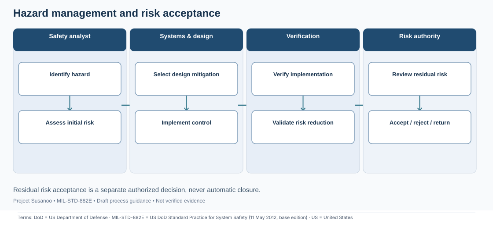
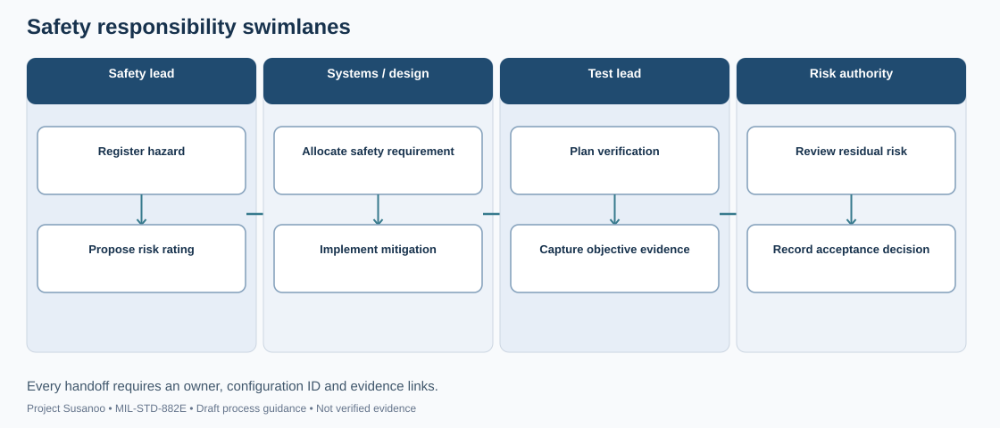
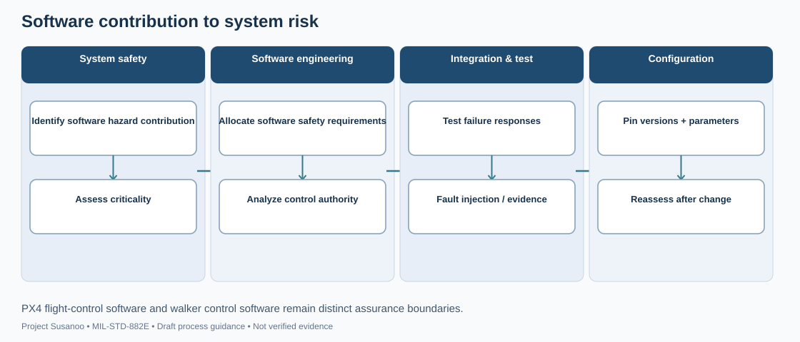
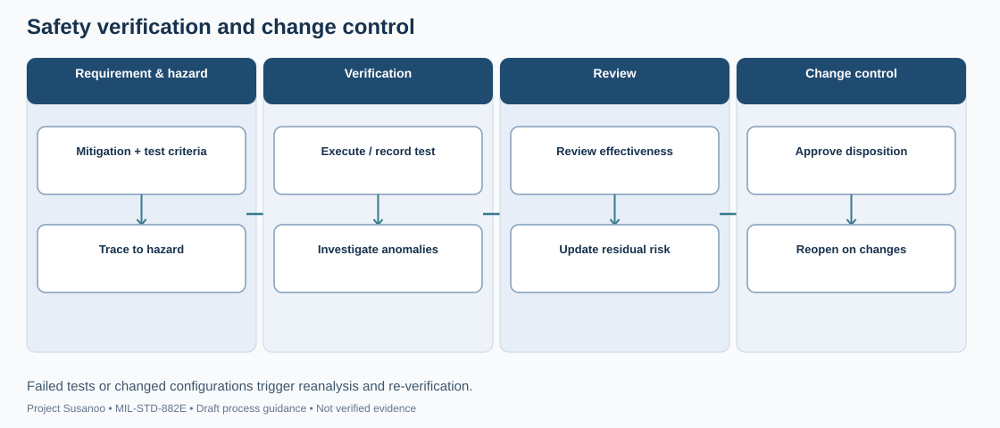

# MIL-STD-882E — Visual Process Atlas

These process maps are **illustrative draft workflows**, not exact normative flowcharts or evidence of completed tasks. Each SVG is accompanied by an editable [Draw.io source folder](https://github.com/jherrodthomas/Project-Susanoo/tree/main/docs/diagrams/mil-std-882e). The source files are version-controlled in the main repository.

## System safety lifecycle

**Handoffs:** Concept & scope → Analysis → Design & controls → Evidence & release → Sustainment. Iterative lifecycle: every configuration change can reopen hazard analysis.

[Edit source](https://github.com/jherrodthomas/Project-Susanoo/blob/main/docs/diagrams/mil-std-882e/safety-lifecycle.drawio)

## Hazard management and risk acceptance

**Handoffs:** Safety analyst → Systems & design → Verification → Risk authority. Residual risk acceptance is a separate authorized decision, never automatic closure.

[Edit source](https://github.com/jherrodthomas/Project-Susanoo/blob/main/docs/diagrams/mil-std-882e/hazard-management.drawio)

## Hazard analysis relationships

**Handoffs:** Concept → Requirements → Subsystems → Integration. Analyses inform each other; the arrows are information flow, not mandatory sequencing.

[Edit source](https://github.com/jherrodthomas/Project-Susanoo/blob/main/docs/diagrams/mil-std-882e/analysis-dependencies.drawio)

## Safety responsibility swimlanes

**Handoffs:** Safety lead → Systems / design → Test lead → Risk authority. Every handoff requires an owner, configuration ID and evidence links.

[Edit source](https://github.com/jherrodthomas/Project-Susanoo/blob/main/docs/diagrams/mil-std-882e/responsibility-swimlanes.drawio)

## Software contribution to system risk

**Handoffs:** System safety → Software engineering → Integration & test → Configuration. PX4 flight-control software and walker control software remain distinct assurance boundaries.

[Edit source](https://github.com/jherrodthomas/Project-Susanoo/blob/main/docs/diagrams/mil-std-882e/software-safety.drawio)

## Safety verification and change control

**Handoffs:** Requirement & hazard → Verification → Review → Change control. Failed tests or changed configurations trigger reanalysis and re-verification.

[Edit source](https://github.com/jherrodthomas/Project-Susanoo/blob/main/docs/diagrams/mil-std-882e/verification-change.drawio)

## Reading the diagrams
Blue headers identify responsible functional lanes; white boxes are work activities. Horizontal arrows denote handoffs; vertical arrows indicate within-lane progression. A human reviewer must verify applicability, deliverables, authority and risk criteria before using a map in a controlled program.
