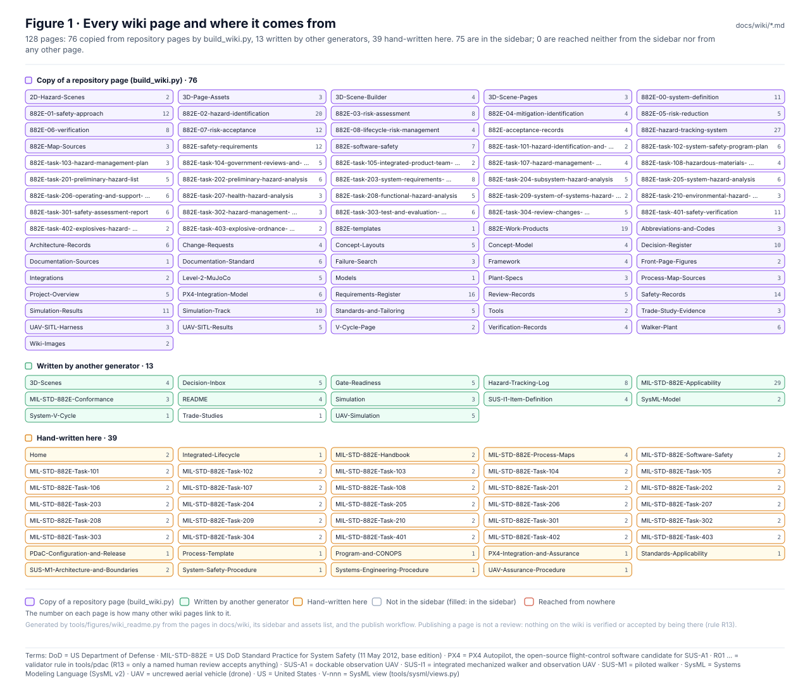
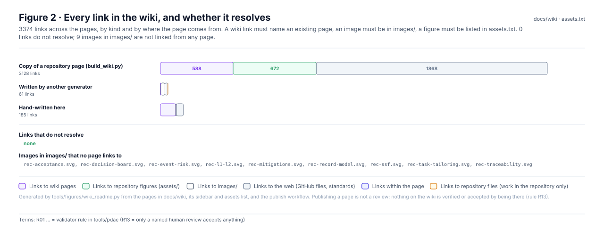
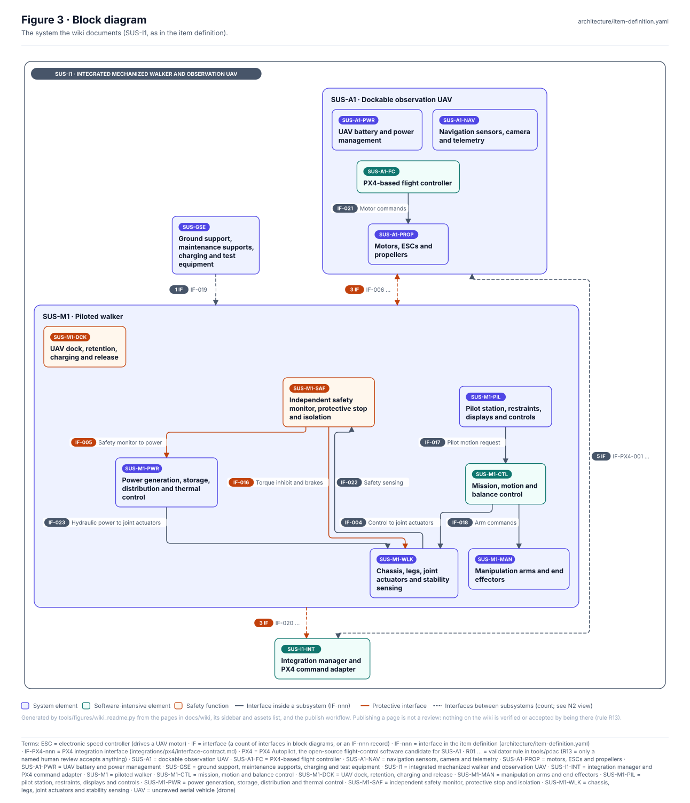
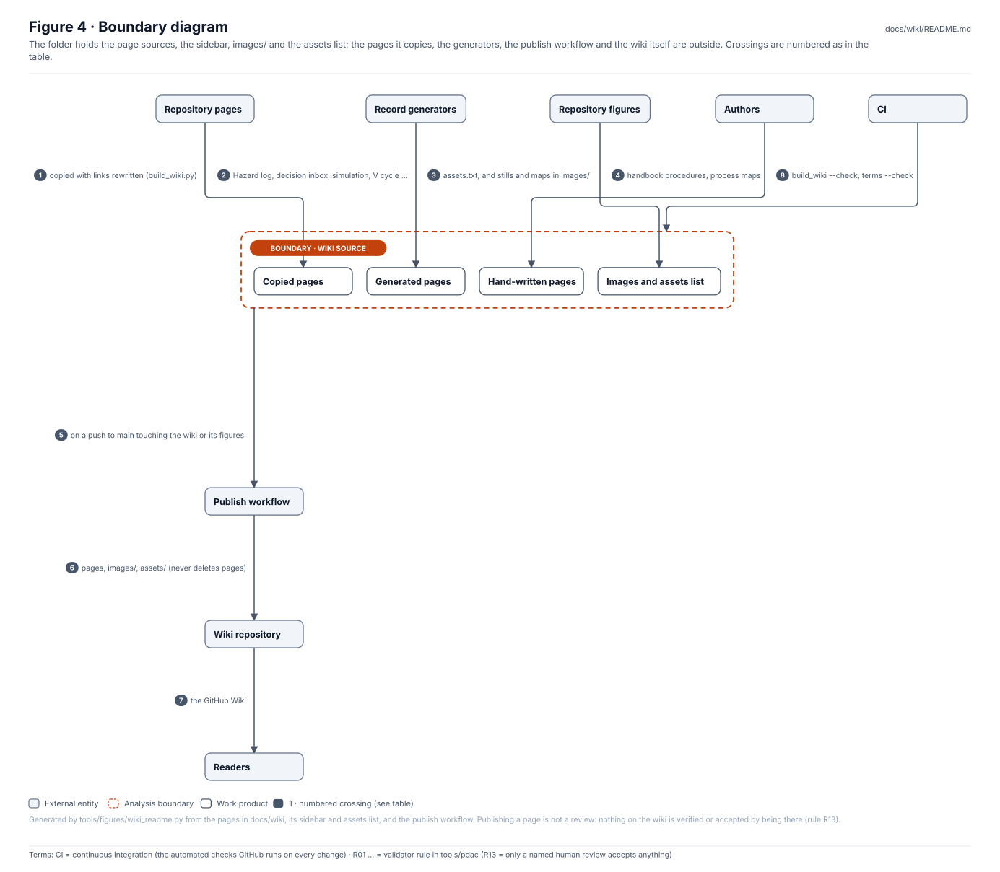
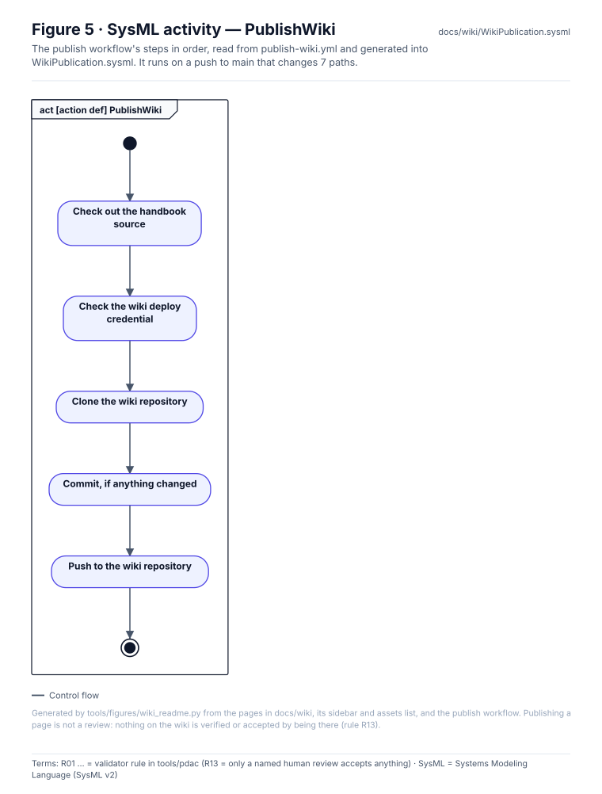
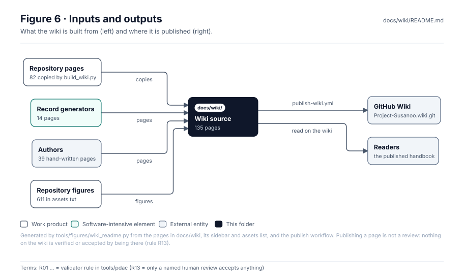

<!-- GENERATED by tools/figures/wiki_readme.py from the pages in docs/wiki and the publish workflow; the text below END GENERATED is hand-written. -->

# Wiki source and publication

> **Status:** 129 pages (77 copied from the repository, 13 generated, 39 hand-written), 3277 links, no broken links. Publishing a page **reviews or accepts nothing** (rule R13).

<!-- terms:start (generated by tools/terms/terms.py; do not edit by hand) -->

<b>Terms on this page (4)</b>: abbreviations and codes explained

| Term | Meaning |
|---|---|
| CI | continuous integration (the automated checks GitHub runs on every change) |
| OMG | Object Management Group, publisher of SysML |
| R01 … | validator rule in tools/pdac (R13 = only a named human review accepts anything) |
| SysML | Systems Modeling Language (SysML v2) |

All terms: [abbreviations and record codes](https://github.com/jherrodthomas/Project-Susanoo/blob/main/docs/terms.md).

<!-- terms:end -->

| Field | Value |
|---|---|
| Entry page | [`Home.md`](Home.md); navigation in [`_Sidebar.md`](_Sidebar.md) |
| Copies | written by `python -m tools.wiki.build_wiki` (`--check` in CI); figures listed in [`assets.txt`](https://github.com/jherrodthomas/Project-Susanoo/blob/main/docs/wiki/assets.txt) (532) |
| Published by | [`publish-wiki.yml`](https://github.com/jherrodthomas/Project-Susanoo/blob/main/.github/workflows/publish-wiki.yml) on a push to `main` that changes `docs/wiki/**`, `docs/readme/**`, `safety/mil-std-882e/**`, `concept/figures/**`, `integrations/px4/figures/**`, `framework/figures/**`, `.github/workflows/publish-wiki.yml` |
| SysML | [`WikiPublication.sysml`](https://github.com/jherrodthomas/Project-Susanoo/blob/main/docs/wiki/WikiPublication.sysml) (generated) |

## Purpose

The source of the project's GitHub Wiki, in wiki filenames. `Home.md` is the entry page and `_Sidebar.md` the navigation. Pages written elsewhere in the repository are copied here with their links rewritten, record generators write their pages here directly, and the handbook procedures are written here by hand. This page counts them, checks every link and shows how the folder is published.

## Pages

| Where it comes from | Pages | In the sidebar |
|---|---|---|
| Copy of a repository page (build_wiki.py) | 77 | 51 |
| Written by another generator | 13 | 12 |
| Hand-written here | 39 | 13 |

| Generator | Pages it writes here |
|---|---|
| `sim/figures/scenes.py` | 1 |
| `sim/figures/uav_scenes.py` | 1 |
| `sim/scenes3d/build_pages.py` | 1 |
| `tools/figures/wiki_readme.py` | 1 |
| `tools/pdac/report.py` | 7 |
| `tools/sysml/views.py` | 1 |
| `tools/vcycle/build_vcycle.py` | 1 |

## Links

| Kind | Links |
|---|---|
| web | 1880 |
| page | 695 |
| asset | 660 |
| image | 41 |
| repo | 1 |

## Block diagram

## Boundary diagram

| # | From | To | Crossing / interaction |
|---|---|---|---|
| 1 | Repository pages | Copied pages | copied with links rewritten (build_wiki.py) |
| 2 | Record generators | Generated pages | Hazard log, decision inbox, simulation, V cycle … |
| 3 | Repository figures | Images and assets list | assets.txt, and stills and maps in images/ |
| 4 | Authors | Hand-written pages | handbook procedures, process maps |
| 5 | Wiki source | Publish workflow | on a push to main touching the wiki or its figures |
| 6 | Publish workflow | Wiki repository | pages, images/, assets/ (never deletes pages) |
| 7 | Wiki repository | Readers | the GitHub Wiki |
| 8 | CI | Wiki source | build_wiki --check, terms --check |

**Explicitly excluded:** the pages' content (each has its own source), review or acceptance of anything, and pages maintained only in the wiki repository (the workflow never deletes them).

## SysML model

[`WikiPublication.sysml`](WikiPublication.sysml) is generated from the publish workflow and validated with the project model by the OMG pilot in CI.

## Inputs and outputs

| Input | Source |
|---|---|
| Repository pages | the folder READMEs listed in `tools/wiki/build_wiki.py` |
| Record pages | the generators named above |
| Figures | `assets.txt` (repository figures) and [`images/`](https://github.com/jherrodthomas/Project-Susanoo/tree/main/docs/wiki/images) |

| Output | Destination |
|---|---|
| Published handbook | the GitHub Wiki (`Project-Susanoo.wiki.git`) |

## Folder contents

| Item | Description | State |
|---|---|---|
| `Home.md`, `_Sidebar.md` | Entry page and navigation (the sidebar's published block is generated) | mixed |
| `*.md` | 129 pages, as in Figure 1 | mixed |
| [`images/`](https://github.com/jherrodthomas/Project-Susanoo/tree/main/docs/wiki/images) | Figures the wiki shows directly, and this page's figures (`wiki-fig-*`) | mixed |
| [`assets.txt`](https://github.com/jherrodthomas/Project-Susanoo/blob/main/docs/wiki/assets.txt) | Repository figures the copied pages use | generated |
| [`WikiPublication.sysml`](https://github.com/jherrodthomas/Project-Susanoo/blob/main/docs/wiki/WikiPublication.sysml) | The publish workflow as SysML | generated |
| `README.md` | This page (generated top) | mixed |

<!-- END GENERATED: content below this line is human-authored and preserved -->
## Controlled publication
1. Edit these pages on a feature branch in the main repository.
2. Review and merge the pull request.
3. Publish the approved pages to the separate `Project-Susanoo.wiki.git` repository, retaining commit provenance.
4. Confirm links and navigation in the live Wiki.
5. Record publication revision and reviewer.

**Important:** GitHub Wikis do not automatically synchronize with the main repository. This initial change provides the source but does not claim live Wiki publication. An authenticated Git-based publishing workflow can be added after Wiki initialization and permissions are confirmed.
