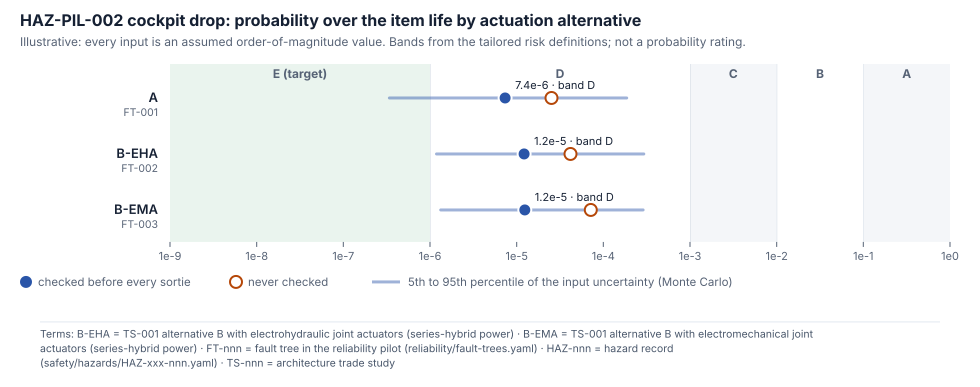
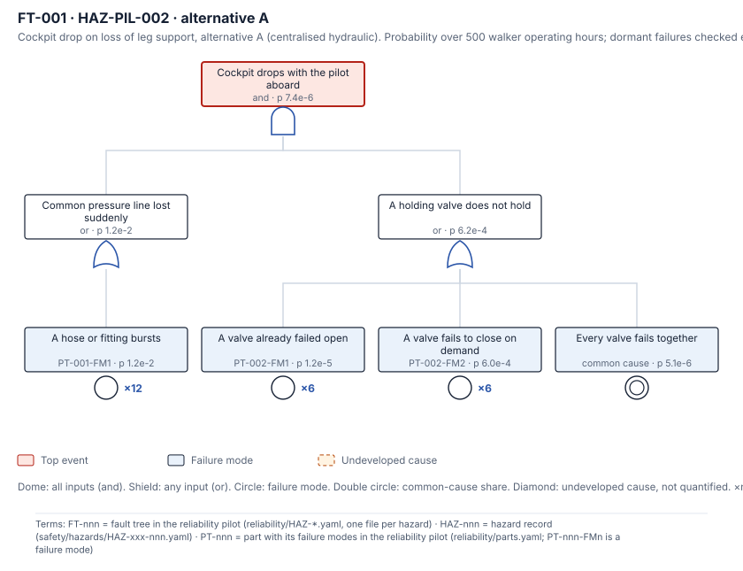
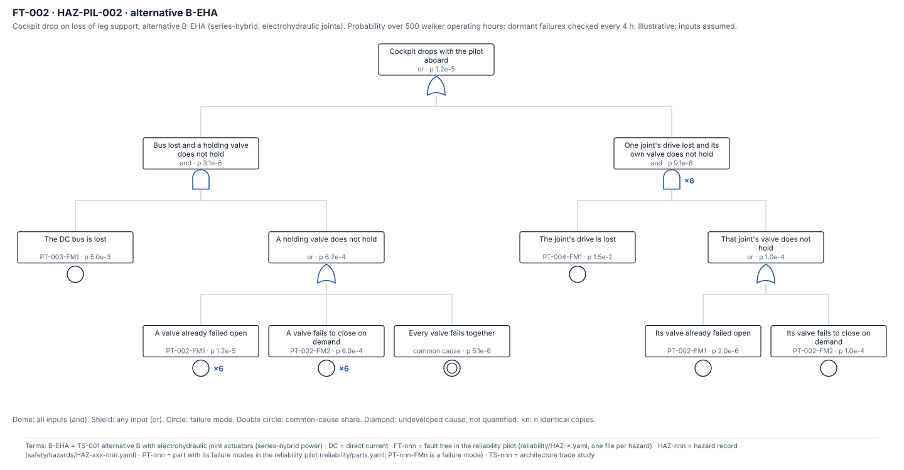
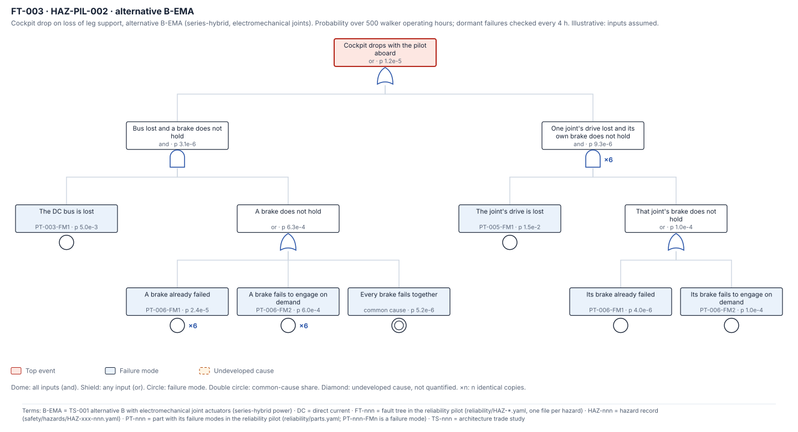

<!-- GENERATED by tools/reliability/build.py from reliability/ and standards/tailoring/mil-std-882e.yaml. Do not edit by hand. -->

# Reliability Pilot

> **Illustrative.** All 12 inputs (failure-mode values and tree parameters) are assumed order-of-magnitude placeholders drafted by an AI at independence I0, not handbook or supplier data. Nothing here is evidence, a probability rating or a risk acceptance, and nothing is written back into a hazard record.

<!-- terms:start (generated by tools/terms/terms.py; do not edit by hand) -->

<b>Terms on this page (21)</b>: abbreviations and codes explained

| Term | Meaning |
|---|---|
| 1A–4F | risk assessment code, severity 1–4 plus probability A–F (e.g. 1C) |
| AI | artificial intelligence (here, an AI assistant drafting at independence level I0) |
| B-EHA | TS-001 alternative B with electrohydraulic joint actuators (series-hybrid power) |
| B-EMA | TS-001 alternative B with electromechanical joint actuators (series-hybrid power) |
| CF1, CF2 … | causal factor in a hazard record (CF1, CF2 …) |
| CL-nnn | concept layout (cad/params/CL-nn.yaml; CL-01 to CL-05, CL-05 the reference layout) |
| DC | direct current |
| DoD | US Department of Defense |
| F-nnn | system function in the item definition |
| FT-nnn | fault tree in the reliability pilot (reliability/fault-trees.yaml) |
| HAZ-nnn | hazard record (safety/hazards/HAZ-xxx-nnn.yaml) |
| I0–I3 | review independence level (I0 none, e.g. the author or an AI, to I3 independent organisation) |
| M1, M2 … | mitigation in a hazard record (M1, M2 …), or a SysML model check rule in tools/sysml |
| MIL-HDBK-217F | US DoD reliability prediction handbook for electronic equipment (Notice 2, 1995) |
| NSWC-11 | US Navy handbook of reliability prediction procedures for mechanical equipment (2011) |
| PT-nnn | part with its failure modes in the reliability pilot (reliability/parts.yaml; PT-nnn-FMn is a failure mode) |
| SUS-RISKDEF-001 | the project's tailored risk definitions (standards/tailoring) |
| SYS-nnn | system safety requirement record (requirements/SYS-nnn.yaml) |
| SysML | Systems Modeling Language (SysML v2) |
| TS-nnn | architecture trade study |
| US | United States |

All terms: [abbreviations and record codes](https://github.com/jherrodthomas/Project-Susanoo/blob/main/docs/terms.md).

<!-- terms:end -->

The pilot asks how likely the top event of **HAZ-PIL-002 CF1** is over the item life, for each TS-001 actuation alternative: leg support is lost suddenly and the load-holding device does not hold, so the cockpit drops with the pilot aboard. The exposure is the tailored item life of 500 walker operating hours, and the result is placed in the tailored probability bands (SUS-RISKDEF-001). The hazard's current rating is 2C (probability C); its target is 2E (probability E).

## Results

| Alternative | Tree | Checked every sortie | Never checked | Monte Carlo 5th / 50th / 95th | Samples per band (C / D / E) |
|---|---|---|---|---|---|
| A | FT-001 | 7.4e-6 (band D) | 2.5e-5 (band D) | 3.4e-7 / 7.8e-6 / 1.9e-4 | 0% / 86% / 14% |
| B-EHA | FT-002 | 1.2e-5 (band D) | 4.2e-5 (band D) | 1.2e-6 / 1.7e-5 / 2.9e-4 | 1% / 95% / 4% |
| B-EMA | FT-003 | 1.2e-5 (band D) | 7.2e-5 (band D) | 1.3e-6 / 1.9e-5 / 2.9e-4 | 1% / 96% / 3% |

**What the numbers say, with these assumed inputs:**

- **A:** 97% of the result is the cut set hose-burst + valve-demand. The biggest driver is PT-002-FM2 (fails to close on the demand itself): its error factor moves the result ×9.8. Band E needs it at or below 1.2e-5 per demand (about 0.12 times the assumed value), other inputs unchanged.
- **B-EHA:** 73% of the result is the cut set drive-lost + own-valve-demand (any of 6 joints). The biggest driver is PT-002-FM2 (fails to close on the demand itself): its error factor moves the result ×9.8. Band E needs it at or below 6.4e-6 per demand (about 0.064 times the assumed value), other inputs unchanged.
- **B-EMA:** 72% of the result is the cut set drive-lost + own-brake-demand (any of 6 joints). The biggest driver is PT-006-FM2 (fails to engage on the demand itself): its error factor moves the result ×9.6. Band E needs it at or below 4.4e-6 per demand (about 0.044 times the assumed value), other inputs unchanged.
- **Checking the holding devices before every sortie** removes most of the dormant-failure contribution (compare the two columns); the on-demand failure is not affected by testing.

## FT-001 · A

| Minimal cut set | Copies | Probability | Share |
|---|---|---|---|
| hose-burst + valve-demand | 1 | 7.2e-6 | 97.2% |
| hose-burst + valve-dormant | 1 | 1.4e-7 | 1.9% |
| hose-burst + valve-common | 1 | 6.1e-8 | 0.8% |

| Failure mode | Result × when the mode is × its error factor |
|---|---|
| PT-002-FM2 | ×9.80 |
| PT-001-FM1 | ×9.48 |
| PT-002-FM1 | ×1.18 |

## FT-002 · B-EHA

| Minimal cut set | Copies | Probability | Share |
|---|---|---|---|
| drive-lost + own-valve-demand | 6 | 8.9e-6 | 73.3% |
| bus-lost + valve-demand | 1 | 3.0e-6 | 24.5% |
| drive-lost + own-valve-dormant | 6 | 1.8e-7 | 1.5% |
| bus-lost + valve-dormant | 1 | 6.0e-8 | 0.5% |
| bus-lost + valve-common | 1 | 2.5e-8 | 0.2% |

| Failure mode | Result × when the mode is × its error factor |
|---|---|
| PT-002-FM2 | ×9.82 |
| PT-004-FM1 | ×7.25 |
| PT-003-FM1 | ×3.22 |
| PT-002-FM1 | ×1.18 |

## FT-003 · B-EMA

| Minimal cut set | Copies | Probability | Share |
|---|---|---|---|
| drive-lost + own-brake-demand | 6 | 8.9e-6 | 71.9% |
| brake-demand + bus-lost | 1 | 3.0e-6 | 24.1% |
| drive-lost + own-brake-dormant | 6 | 3.6e-7 | 2.9% |
| brake-dormant + bus-lost | 1 | 1.2e-7 | 1.0% |
| brake-common + bus-lost | 1 | 2.6e-8 | 0.2% |

| Failure mode | Result × when the mode is × its error factor |
|---|---|
| PT-006-FM2 | ×9.65 |
| PT-005-FM1 | ×7.25 |
| PT-003-FM1 | ×3.22 |
| PT-006-FM1 | ×1.35 |

## Inputs

| Failure mode | Part | Mode | Kind | Value | Error factor | Status | Where a sourced value should come from |
|---|---|---|---|---|---|---|---|
| PT-001-FM1 | High-pressure hydraulic hose or tube assembly with end fittings | Burst, rupture or fitting blow-off | rate | 2.0e-6 per hour | 10 | assumed | NSWC-11 (fluid conductors) or supplier data for the selected hose class |
| PT-002-FM1 | Pilot-operated check valve holding a joint cylinder (load-holding valve) | Fails to close (poppet stuck open, contamination on the seat), dormant until demanded | latent | 1.0e-6 per hour | 10 | assumed | NSWC-11 valves chapter, or supplier data for the selected valve |
| PT-002-FM2 | Pilot-operated check valve holding a joint cylinder (load-holding valve) | Fails to close on the demand itself (pilot line holds it open, slow reseat) | demand | 1.0e-4 per demand | 10 | assumed | NSWC-11 valves chapter, or supplier test data |
| PT-003-FM1 | DC bus feeder, contactor and main cabling (series-hybrid bus) | Sudden loss of the DC bus (contactor drops out, cable or connector open circuit) | rate | 1.0e-5 per hour | 10 | assumed | MIL-HDBK-217F (relays, connectors) with the mission profile, or supplier data |
| PT-004-FM1 | Electrohydraulic joint actuator drive (motor, inverter and pump of one joint) | Sudden loss of drive at one joint (inverter trip, motor winding open, pump shaft failure) | rate | 3.0e-5 per hour | 10 | assumed | MIL-HDBK-217F (inverter electronics) and NSWC-11 (motor, pump), or supplier data |
| PT-005-FM1 | Electromechanical joint actuator drive (motor, inverter and gearbox or roller screw of one joint) | Sudden loss of drive at one joint (inverter trip, motor winding open, coupling failure) | rate | 3.0e-5 per hour | 10 | assumed | MIL-HDBK-217F (inverter electronics) and NSWC-11 (motor, gears), or supplier data |
| PT-006-FM1 | Spring-applied, power-released joint brake | Fails to engage or slips (armature stuck, lining glazed or worn below holding torque), dormant until demanded | latent | 2.0e-6 per hour | 10 | assumed | NSWC-11 brakes and clutches chapter, or supplier data |
| PT-006-FM2 | Spring-applied, power-released joint brake | Fails to engage on the demand itself (armature sticks released) | demand | 1.0e-4 per demand | 10 | assumed | NSWC-11 brakes and clutches chapter, or supplier test data |

| Parameter | Value | Status | Note |
|---|---|---|---|
| joints | 6 | assumed | Load-bearing joints with a holding device: hip, knee and ankle on each leg of the CL-05 biped; one joint that fails to hold is taken to drop the cockpit (conservative) |
| hoses | 12 | assumed | Pressure hoses or tubes on the common line, two per load-bearing joint |
| test_interval_h | 4 | assumed | Holding devices checked before every sortie (about 4 operating hours); the no-test case uses the whole item life |
| beta | 0.05 | assumed | Beta factor: share of holding-device failures that hit every joint at once (shared fluid, shared lot, shared maintenance) |

## How the numbers are computed

- `rate` modes give 1 − e^(−λ T) over T = 500 h; `latent` modes give λ τ / 2 with τ the check interval (or the whole item life when never checked); `demand` modes give their probability per demand.
- `×n` means n identical, independent copies, any one of which fails: 1 − (1 − p)^n.
- The common-cause event is the beta-factor share of the holding-device modes; the independent events are not reduced by it, which is slightly conservative.
- Gates assume independent inputs. Minimal cut sets are found by top-down expansion; their shares use the rare-event approximation.
- Monte Carlo: 4000 samples, seed 1, one lognormal draw per failure mode (median = the assumed value, 95th percentile = value × error factor), shared by every event that uses it.

## Not modelled

- **CF2**, holding that engages too slowly: a design-adequacy question for SYS-009 and HAZ-PIL-002 M3, not a random failure.
- Slow supply decay (an engine stop with charged accumulators): it leaves time for a protective stop.
- Whether one joint that does not hold always drops the cockpit: the pilot assumes it does (conservative).

## Next steps

1. Replace each assumed value with a sourced one (the last column of the inputs table) and set its status.
2. Have the safety lead review the trees and the assumptions; only then can a result inform the hazard's probability, through a review record.
3. Add trees for other hazards and the per-element failure-mode tables for Tasks 204 and 205.

Generated by `tools/reliability/build.py` (`python -m tools.reliability.build`) from `reliability/parts.yaml`, `reliability/fault-trees.yaml` and `standards/tailoring/mil-std-882e.yaml`. Numbers: `safety/generated/reliability.json`.
