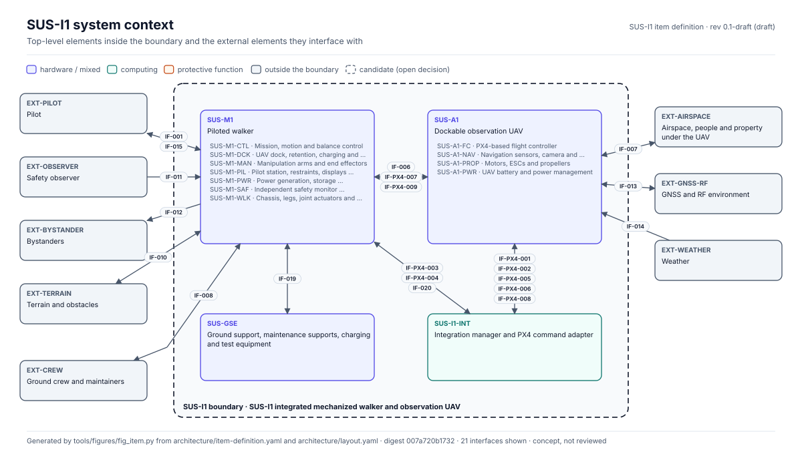
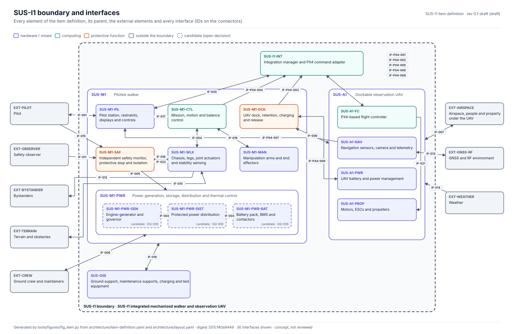

<!-- GENERATED by tools/pdac/report.py from standards/, safety/, requirements/ records. Do not edit by hand; edit the records and re-run. -->

# SUS-I1 Item Definition

**SUS-I1 integrated mechanized walker and observation UAV** · revision 0.1-draft · status draft · configuration SUS-I1-C001. Source record: `architecture/item-definition.yaml`.

> Generated status describes records and automated checks only. It is not a compliance claim, technical review or risk acceptance. All authorities are simulated.

Human-piloted unarmed walker (SUS-M1), dockable unarmed observation UAV (SUS-A1), their integration manager and docking interface, and ground support equipment. Simulation-first concept; no hardware selected.

Figures generated by `tools/figures/fig_item.py` (layout in `architecture/layout.yaml`).

## Functions

| ID | Function | Performed by | Modes | Scenarios |
|---|---|---|---|---|
| F-01 | Piloted locomotion | SUS-M1-CTL, SUS-M1-WLK, SUS-M1-PIL | MOD-04 | SCN-002 |
| F-02 | Payload manipulation | SUS-M1-MAN, SUS-M1-CTL | MOD-05 | SCN-003 |
| F-03 | Pilot readiness, ingress and egress | SUS-M1-PIL, SUS-M1-SAF | MOD-02, MOD-03 | SCN-001, SCN-006 |
| F-04 | Protective stop and fault response | SUS-M1-SAF, SUS-M1-CTL | MOD-09 | SCN-101, SCN-103 |
| F-05 | Power generation, storage, distribution and isolation | SUS-M1-PWR, SUS-M1-SAF | MOD-01, MOD-02 | SCN-102, SCN-108 |
| F-06 | Aerial observation | SUS-A1-FC, SUS-A1-NAV, SUS-A1-PROP | MOD-07 | SCN-004, SCN-105 |
| F-07 | UAV launch, recovery and retention | SUS-M1-DCK, SUS-I1-INT, SUS-A1-FC | MOD-06, MOD-08 | SCN-004, SCN-005, SCN-106, SCN-107 |
| F-08 | UAV charging | SUS-M1-DCK, SUS-A1-PWR | MOD-03, MOD-06 | SCN-005 |
| F-09 | Maintenance support and energy isolation | SUS-GSE, SUS-M1-PWR | MOD-10 | SCN-102, SCN-006 |

## Elements inside the boundary

| ID | Element | Parent | Kind | Protective | Status |
|---|---|---|---|---|---|
| SUS-M1 | Piloted walker | SUS-I1 | system |  | concept |
| SUS-M1-PIL | Pilot station, restraints, displays and controls | SUS-M1 | human-interface |  | concept |
| SUS-M1-CTL | Mission, motion and balance control | SUS-M1 | computing |  | concept |
| SUS-M1-WLK | Chassis, legs, joint actuators and stability sensing | SUS-M1 | mechanical |  | concept |
| SUS-M1-MAN | Manipulation arms and end effectors | SUS-M1 | mechanical |  | concept |
| SUS-M1-SAF | Independent safety monitor, protective stop and isolation | SUS-M1 | computing | yes | concept |
| SUS-M1-DCK | UAV dock, retention, charging and release | SUS-M1 | mixed | yes | concept |
| SUS-M1-PWR | Power generation, storage, distribution and thermal control | SUS-M1 | electrical |  | concept |
| SUS-M1-PWR-GEN | Engine-generator and governor | SUS-M1-PWR | mechanical |  | candidate (DQ-006) |
| SUS-M1-PWR-BAT | Battery pack, BMS and contactors | SUS-M1-PWR | electrical |  | candidate (DQ-006) |
| SUS-M1-PWR-DIST | Protected power distribution | SUS-M1-PWR | electrical |  | candidate (DQ-006) |
| SUS-A1 | Dockable observation UAV | SUS-I1 | system |  | concept |
| SUS-A1-FC | PX4-based flight controller | SUS-A1 | computing |  | concept |
| SUS-A1-NAV | Navigation sensors, camera and telemetry | SUS-A1 | electrical |  | concept |
| SUS-A1-PWR | UAV battery and power management | SUS-A1 | electrical |  | concept |
| SUS-A1-PROP | Motors, ESCs and propellers | SUS-A1 | mechanical |  | concept |
| SUS-I1-INT | Integration manager and PX4 command adapter | SUS-I1 | computing |  | concept |
| SUS-GSE | Ground support, maintenance supports, charging and test equipment | SUS-I1 | mixed |  | concept |

## External elements

| ID | External element | Assumption | Interfaces |
|---|---|---|---|
| EXT-PILOT | Pilot | Trained, restrained pilot; may become incapacitated (SCN-104) | IF-001, IF-015 |
| EXT-OBSERVER | Safety observer | Holds an independent stop and enforces the exclusion zone | IF-011 |
| EXT-CREW | Ground crew and maintainers | Follow isolation procedures; may not | IF-008 |
| EXT-BYSTANDER | Bystanders | Kept outside the exclusion zone by procedure only | IF-012 |
| EXT-TERRAIN | Terrain and obstacles | Slope, payload and ground limits TBD (CONOPS 4) | IF-010 |
| EXT-AIRSPACE | Airspace, people and property under the UAV | Operations inside a defined, unpopulated volume | IF-007 |
| EXT-GNSS-RF | GNSS and RF environment | Signals may be degraded, lost or spoofed | IF-013 |
| EXT-WEATHER | Weather | Wind and precipitation limits TBD | IF-014 |

## Interfaces

| ID | Interface | Endpoints | Kind | Exchange | Hazards | Source |
|---|---|---|---|---|---|---|
| IF-001 | Pilot controls and displays | EXT-PILOT ↔ SUS-M1-PIL | human, data | commands, state, warnings | HAZ-PIL-001 | wiki IF-001 |
| IF-002 | Engine-generator to distribution (candidate, DQ-006) | SUS-M1-PWR-GEN → SUS-M1-PWR-DIST | energy | electric power, voltage, thermal state | — | wiki IF-002 |
| IF-003 | Battery to distribution (candidate, DQ-006) | SUS-M1-PWR-BAT ↔ SUS-M1-PWR-DIST | energy, data | bidirectional power, BMS state | — | wiki IF-003 |
| IF-004 | Control to joint actuators | SUS-M1-CTL ↔ SUS-M1-WLK | data, energy | torque or pressure commands, joint feedback | HAZ-WLK-001, HAZ-WLK-002 | wiki IF-004 |
| IF-005 | Safety monitor to power | SUS-M1-SAF → SUS-M1-PWR | data, energy | inhibit, isolation | HAZ-SAF-001 | wiki IF-005 |
| IF-006 | Walker dock to UAV | SUS-M1-DCK ↔ SUS-A1 | mechanical, energy, data | retention, charging, data, release | HAZ-DCK-001, HAZ-DCK-002 | wiki IF-006 |
| IF-007 | UAV in airspace | SUS-A1 ↔ EXT-AIRSPACE | environment | flight, exposure of people and property | HAZ-INT-001 | wiki IF-007 |
| IF-008 | Maintainer to energy sources | EXT-CREW ↔ SUS-M1-PWR | human, energy | lockout, isolation, inspection, service | HAZ-PWR-001 | wiki IF-008 |
| IF-PX4-001 | Flight state, position and status | SUS-A1-FC → SUS-I1-INT | data | flight state, position, status; freshness and source validity | HAZ-INT-001 | integrations/px4/interface-contract.md |
| IF-PX4-002 | UAV health and arming state | SUS-A1-FC → SUS-I1-INT | data | health, arming state; disagreement handling | HAZ-DCK-001 | integrations/px4/interface-contract.md |
| IF-PX4-003 | Dock occupied and retained | SUS-M1-DCK → SUS-I1-INT | data | occupied/retained state with independent plausibility | HAZ-DCK-002 | integrations/px4/interface-contract.md |
| IF-PX4-004 | Walker posture and stationary state | SUS-M1-CTL → SUS-I1-INT | data | posture, stationary flag for the launch/recovery envelope | HAZ-INT-001 | integrations/px4/interface-contract.md |
| IF-PX4-005 | Launch permit and revoke | SUS-I1-INT → SUS-A1-FC | data | explicit, fail-closed launch authorization | HAZ-INT-001 | integrations/px4/interface-contract.md |
| IF-PX4-006 | Recovery and abort intent | SUS-I1-INT → SUS-A1-FC | data | recovery request, abort; contingency on lost link | HAZ-INT-001 | integrations/px4/interface-contract.md |
| IF-PX4-007 | UAV video and mission cues | SUS-A1-NAV → SUS-M1-PIL | data | video, mission cues; latency, distraction | — | integrations/px4/interface-contract.md |
| IF-PX4-008 | Fault and contingency notification | SUS-I1-INT ↔ SUS-A1-FC | data | time-stamped, prioritised fault notifications | HAZ-INT-001 | integrations/px4/interface-contract.md |
| IF-PX4-009 | Power and charging handshake | SUS-M1-DCK ↔ SUS-A1-PWR | energy, data | charging handshake, rotor inhibit, energy isolation | HAZ-DCK-001 | integrations/px4/interface-contract.md |
| IF-010 | Walker on terrain | SUS-M1-WLK ↔ EXT-TERRAIN | mechanical, environment | contact loads, terrain sensing | HAZ-WLK-002 | concept/architecture.md |
| IF-011 | Observer stop | EXT-OBSERVER → SUS-M1-SAF | human, data | independent stop request | HAZ-SAF-001 | safety/hazards/HAZ-SAF-001.yaml M3 |
| IF-012 | Walker motion near people | SUS-M1-WLK → EXT-BYSTANDER | mechanical, environment | moving structure, exclusion zone | HAZ-WLK-002, HAZ-SAF-001 | concept/CONOPS.md |
| IF-013 | Navigation and telemetry link | SUS-A1-NAV ↔ EXT-GNSS-RF | data, environment | GNSS, telemetry, RF link | HAZ-INT-001 | concept/CONOPS.md |
| IF-014 | Weather on the UAV | EXT-WEATHER → SUS-A1 | environment | wind, precipitation, temperature | HAZ-INT-001 | concept/CONOPS.md |
| IF-015 | Pilot stop request | EXT-PILOT → SUS-M1-SAF | human, data | protective stop request | HAZ-SAF-001 | docs/wiki/SUS-M1-Architecture-and-Boundaries.md (control boundary diagram) |
| IF-016 | Torque inhibit and brakes | SUS-M1-SAF → SUS-M1-WLK | data, energy | torque inhibit, brakes, load holding | HAZ-SAF-001, HAZ-WLK-001 | docs/wiki/SUS-M1-Architecture-and-Boundaries.md (control boundary diagram) |
| IF-017 | Pilot motion request | SUS-M1-PIL → SUS-M1-CTL | data | requested motion, mode | HAZ-PIL-001 | docs/wiki/SUS-M1-Architecture-and-Boundaries.md (control boundary diagram) |
| IF-018 | Arm commands | SUS-M1-CTL ↔ SUS-M1-MAN | data, energy | arm commands, load feedback | — | concept/architecture.md |
| IF-019 | Ground support to walker | SUS-GSE ↔ SUS-M1 | mechanical, energy | maintenance supports, external charging, test connections | HAZ-PWR-001 | concept/architecture.md |
| IF-020 | Launch and recovery authorization | SUS-M1-PIL ↔ SUS-I1-INT | human, data | operator launch/recovery request and authorization, status | HAZ-INT-001 | docs/wiki/SUS-M1-Architecture-and-Boundaries.md (docking diagram) |
| IF-021 | Motor commands | SUS-A1-FC → SUS-A1-PROP | data, energy | motor commands | HAZ-DCK-001 | docs/wiki/SUS-M1-Architecture-and-Boundaries.md (docking diagram) |
| IF-022 | Safety sensing | SUS-M1-WLK → SUS-M1-SAF | data | posture, joint and pressure sensing for the monitor | HAZ-WLK-001 | docs/wiki/SUS-M1-Architecture-and-Boundaries.md (control boundary diagram) |

9 functions, 18 elements, 8 external elements, 30 interfaces. Hazards not yet linked to any interface: none.
