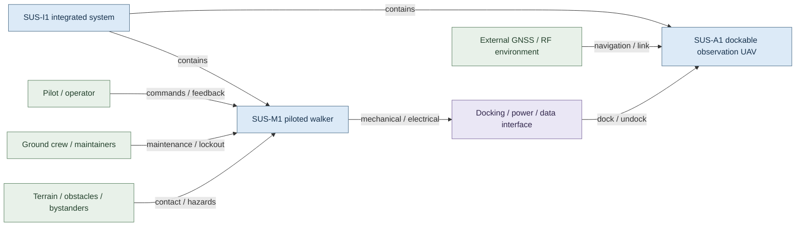
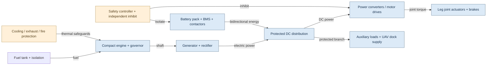
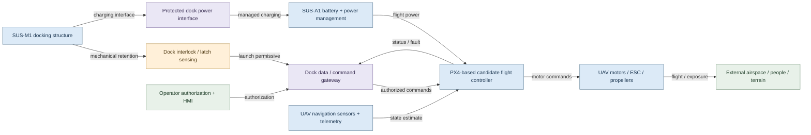

# SUS-M1 / SUS-A1 — Architecture and Boundary Diagrams

> **Status:** Conceptual design baseline for engineering trade studies. No engine, battery, controller, actuator, safety integrity, or physical interface has been selected or verified. These diagrams do not establish risk acceptance or certification.

## Design assumptions

- **SUS-M1:** human-piloted walker, under evaluation for compact engine-generator plus battery series-hybrid power. Electric vs electrohydraulic leg actuation remains an open trade.
- **SUS-A1:** separate unarmed observation UAV, potentially using PX4; its flight assurance boundary is distinct from walker motion control.
- **SUS-I1:** integration boundary covers docking, charging, command authorization, interlocks and system-level hazards.
- **Protective functions:** safety controller, isolation, braking and fault response are proposed functional allocations only. Independence, response time, safe state and performance targets require hazard analysis.

## SUS-I1 system context and boundaries

[Editable Draw.io source](https://github.com/jherrodthomas/Project-Susanoo/blob/main/docs/diagrams/architecture/system-context.drawio)

## SUS-M1 series-hybrid power architecture

[Editable Draw.io source](https://github.com/jherrodthomas/Project-Susanoo/blob/main/docs/diagrams/architecture/powertrain-block.drawio)

## Walker control and protective-function boundary

```mermaid
flowchart LR
  N0["Pilot controls / E-stop request"]:::external
  N1["Mission / motion controller"]:::system
  N2["Sensors: IMU, encoders, force"]:::system
  N3["Motion planning + balance control"]:::system
  N4["Joint drives / hydraulic controls"]:::system
  N5["Brakes / supports / energy isolation"]:::safety
  N6["Independent safety monitor"]:::safety
  N7["Operator HMI / alarms"]:::interface
  N8["Physical walker + terrain"]:::external
  N0 -->|"commands"| N1
  N2 -->|"feedback"| N3
  N1 -->|"requested motion"| N3
  N3 -->|"actuation"| N4
  N4 -->|"force"| N8
  N8 -->|"measured state"| N2
  N2 -->|"safety sensing"| N6
  N0 -->|"stop request"| N6
  N6 -->|"protective action"| N5
  N6 -->|"fault / status"| N7
  N6 -->|"torque inhibit"| N4
  classDef system fill:#dceaf7,stroke:#55758f,color:#17324d
  classDef safety fill:#fff0d9,stroke:#b28a3d,color:#513c16
  classDef external fill:#e8f1e9,stroke:#63886a,color:#23412c
  classDef interface fill:#eae7f5,stroke:#8370a3,color:#30254a
```

[Editable Draw.io source](https://github.com/jherrodthomas/Project-Susanoo/blob/main/docs/diagrams/architecture/control-safety-boundary.drawio)

## SUS-A1 UAV and docking interface boundary

[Editable Draw.io source](https://github.com/jherrodthomas/Project-Susanoo/blob/main/docs/diagrams/architecture/uav-docking-boundary.drawio)

## Boundary/interface register (initial)

| ID | Boundary | Exchange | Key hazard / open question |
|---|---|---|---|
| IF-001 | Pilot ↔ walker control | commands, state, warnings | inadvertent motion, loss of feedback |
| IF-002 | Engine/generator ↔ DC bus | energy, voltage, thermal state | overvoltage, fire, unintended energization |
| IF-003 | Battery ↔ DC bus | bidirectional power, BMS state | thermal runaway, contactor failure |
| IF-004 | Control ↔ actuator | torque/pressure commands, feedback | runaway joint, loss of support |
| IF-005 | Safety monitor ↔ power/drives | inhibit, brake, isolation | common-cause failure, unsafe stop |
| IF-006 | Walker ↔ UAV dock | retention, charging, data, release | premature launch, falling object, exposed propellers |
| IF-007 | UAV ↔ external environment | RF, navigation, flight | lost link, flyaway, collision |
| IF-008 | Maintainer ↔ energy sources | lockout, inspection, service | stored energy, hot surfaces, pressure |

## Required next engineering artifacts

1. System requirements and interface control documents (ICDs), with electrical, mechanical and data interface specifications.
2. Power, mass, duty-cycle and thermal budget; validate engine/battery sizing rather than treating exploratory values as requirements.
3. Actuation trade study: electric versus electrohydraulic, including fail-safe holding, emergency stop and stability.
4. Functional architecture, state machines and fault response (start, walk, hold, degraded, stop, maintenance, dock/undock).
5. Hazard analyses and traceability from interface hazards to safety requirements, verification methods and risk disposition.

**Safety caveat:** A bipedal walker may fall after loss of actuator power; an immediate energy cut is not automatically a safe state. Protective-stop behavior must be analyzed for posture, load, terrain and occupant exposure.
