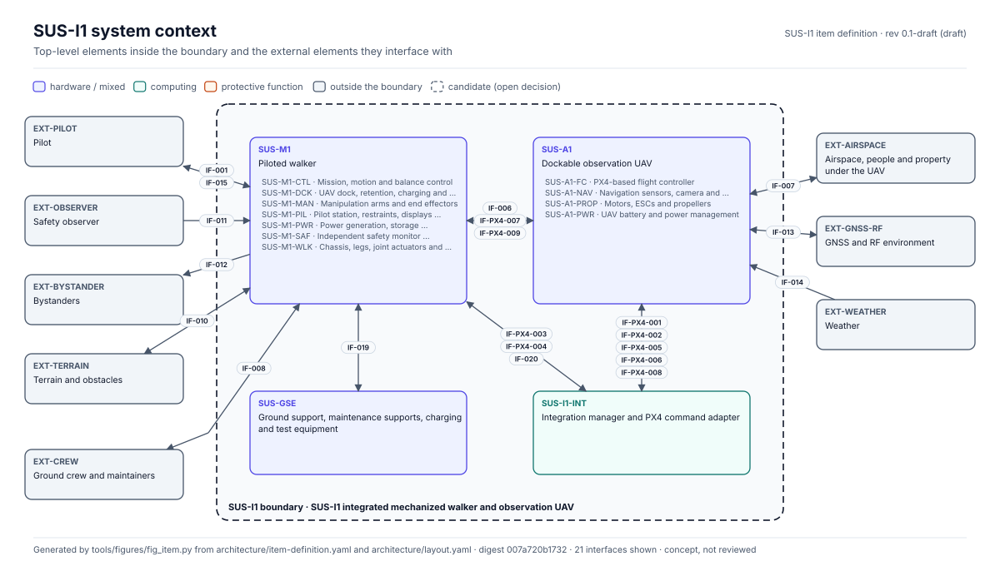
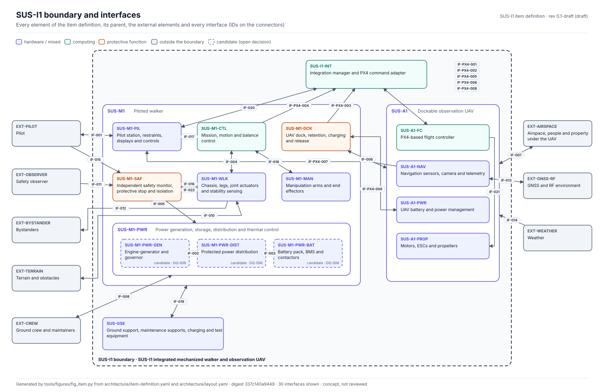
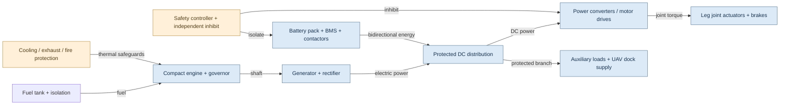
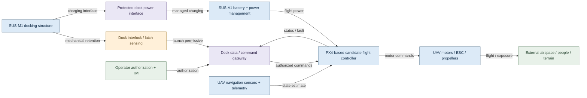

# SUS-M1 / SUS-A1 — Architecture and Boundary Diagrams

> **Status:** Conceptual design baseline for engineering trade studies. No engine, battery, controller, actuator, safety integrity, or physical interface has been selected or verified. These diagrams do not establish risk acceptance or certification.

<!-- terms:start (generated by tools/terms/terms.py; do not edit by hand) -->

<b>Terms on this page (10)</b>: abbreviations and codes explained

| Term | Meaning |
|---|---|
| DQ-nnn | decision question for the project lead (decisions/register.yaml) |
| ICD | interface control document |
| IF-nnn | interface in the item definition (architecture/item-definition.yaml) |
| IF-PX4-nnn | PX4 integration interface (integrations/px4/interface-contract.md) |
| PX4 | PX4 Autopilot, the open-source flight-control software candidate for SUS-A1 |
| SUS-A1 | dockable observation UAV |
| SUS-I1 | integrated mechanized walker and observation UAV |
| SUS-M1 | piloted walker |
| SysML | Systems Modeling Language (SysML v2) |
| UAV | uncrewed aerial vehicle (drone) |

All terms: [abbreviations and record codes](https://github.com/jherrodthomas/Project-Susanoo/blob/main/docs/terms.md).

<!-- terms:end -->

## Design assumptions

- **SUS-M1:** human-piloted walker, under evaluation for compact engine-generator plus battery series-hybrid power. Electric vs electrohydraulic leg actuation remains an open trade.
- **SUS-A1:** separate unarmed observation UAV, potentially using PX4; its flight assurance boundary is distinct from walker motion control.
- **SUS-I1:** integration boundary covers docking, charging, command authorization, interlocks and system-level hazards.
- **Protective functions:** safety controller, isolation, braking and fault response are proposed functional allocations only. Independence, response time, safe state and performance targets require hazard analysis.

## SUS-I1 system context and boundaries

Generated from the item-definition record [`architecture/item-definition.yaml`](https://github.com/jherrodthomas/Project-Susanoo/blob/main/architecture/item-definition.yaml); full tables on [SUS-I1 Item Definition](SUS-I1-Item-Definition).

> The three detailed diagrams below are interim Mermaid views. They are not checked against the records and will be replaced by generated SysML views (port plan step 2). The power architecture they show is an open decision (DQ-006: hydraulic vs series-hybrid; see the [Decision Inbox](Decision-Inbox)).

## SUS-M1 series-hybrid power architecture

## Walker control and protective-function boundary

```mermaid
flowchart LR
  N0["Pilot controls / E-stop request"]:::external
  N1["Mission / motion controller"]:::system
  N2["Sensors: IMU, encoders, force"]:::system
  N3["Motion planning + balance control"]:::system
  N4["Joint drives / hydraulic controls"]:::system
  N5["Brakes / supports / energy isolation"]:::safety
  N6["Independent safety monitor"]:::safety
  N7["Operator HMI / alarms"]:::interface
  N8["Physical walker + terrain"]:::external
  N0 -->|"commands"| N1
  N2 -->|"feedback"| N3
  N1 -->|"requested motion"| N3
  N3 -->|"actuation"| N4
  N4 -->|"force"| N8
  N8 -->|"measured state"| N2
  N2 -->|"safety sensing"| N6
  N0 -->|"stop request"| N6
  N6 -->|"protective action"| N5
  N6 -->|"fault / status"| N7
  N6 -->|"torque inhibit"| N4
  classDef system fill:#dceaf7,stroke:#55758f,color:#17324d
  classDef safety fill:#fff0d9,stroke:#b28a3d,color:#513c16
  classDef external fill:#e8f1e9,stroke:#63886a,color:#23412c
  classDef interface fill:#eae7f5,stroke:#8370a3,color:#30254a
```

## SUS-A1 UAV and docking interface boundary

## Boundary/interface register

The register now lives in the item-definition record, which merges the earlier IF-001..008 rows with the PX4 contract IF-PX4-001..009 and adds IF-010..022. See [SUS-I1 Item Definition](SUS-I1-Item-Definition#interfaces).

## Required next engineering artifacts

1. System requirements and interface control documents (ICDs), with electrical, mechanical and data interface specifications.
2. Power, mass, duty-cycle and thermal budget; validate engine/battery sizing rather than treating exploratory values as requirements.
3. Actuation trade study: electric versus electrohydraulic, including fail-safe holding, emergency stop and stability.
4. Functional architecture, state machines and fault response (start, walk, hold, degraded, stop, maintenance, dock/undock).
5. Hazard analyses and traceability from interface hazards to safety requirements, verification methods and risk disposition.

**Safety caveat:** A bipedal walker may fall after loss of actuator power; an immediate energy cut is not automatically a safe state. Protective-stop behavior must be analyzed for posture, load, terrain and occupant exposure.
