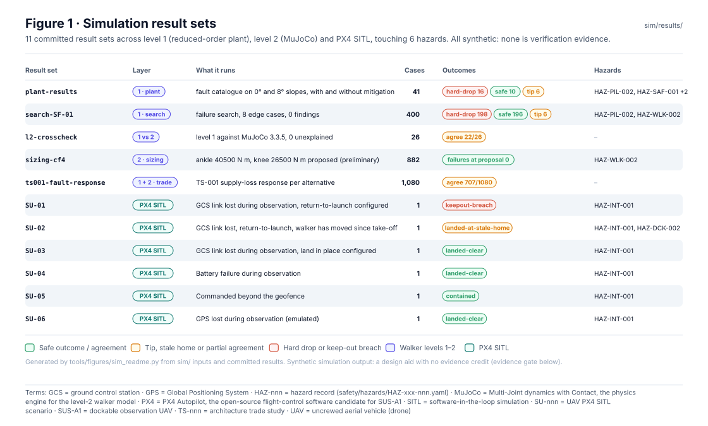
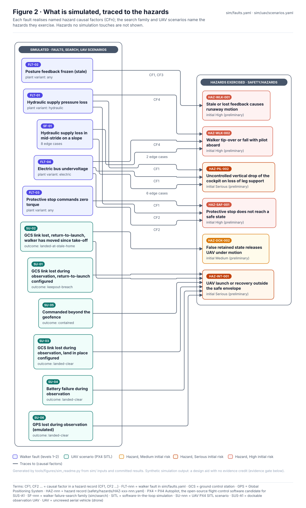
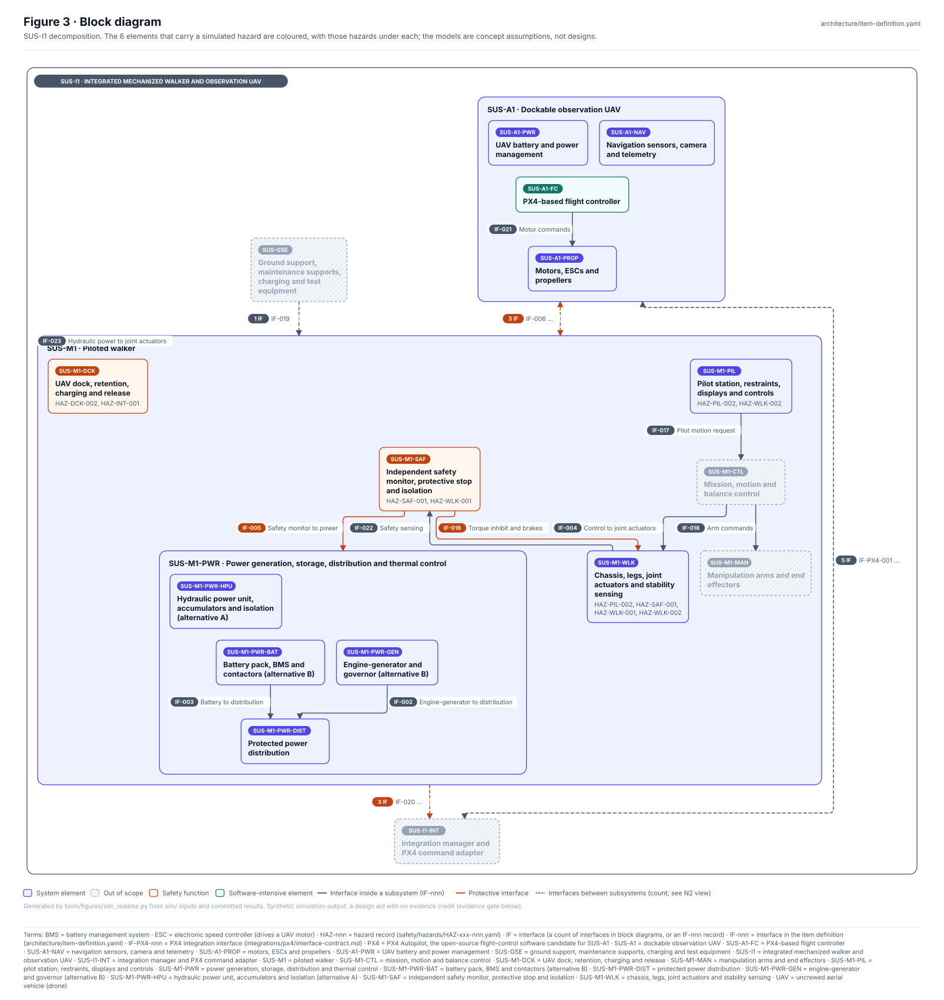
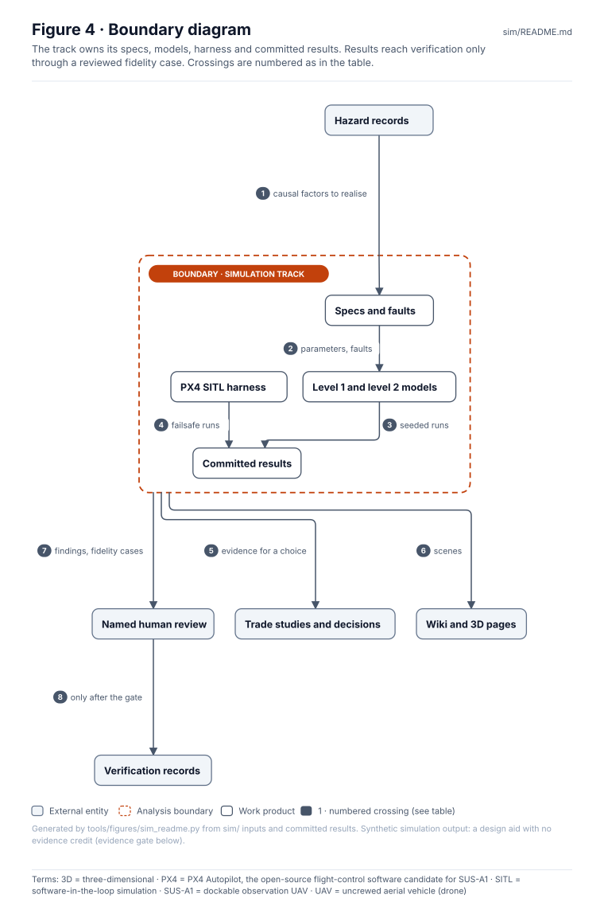
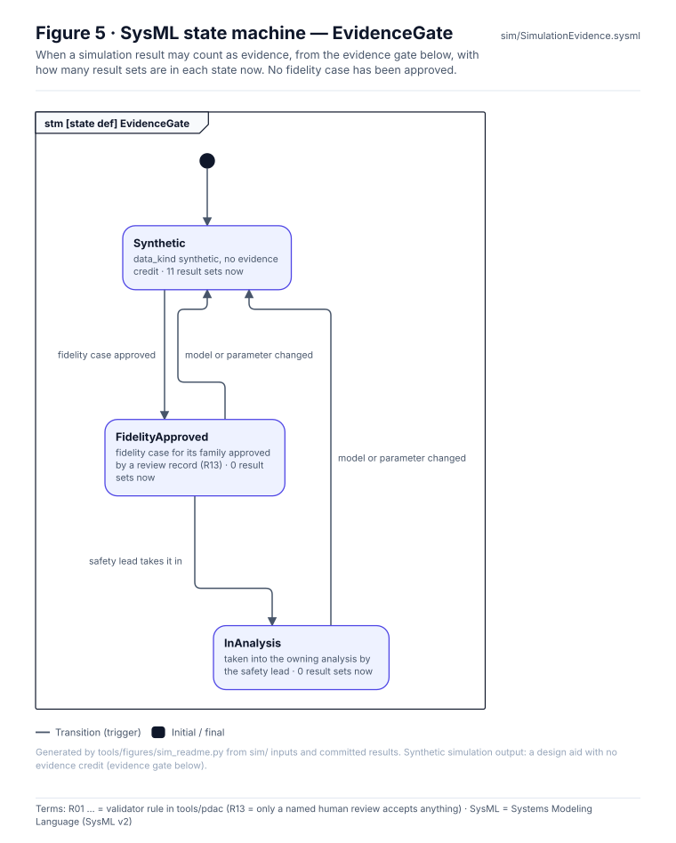
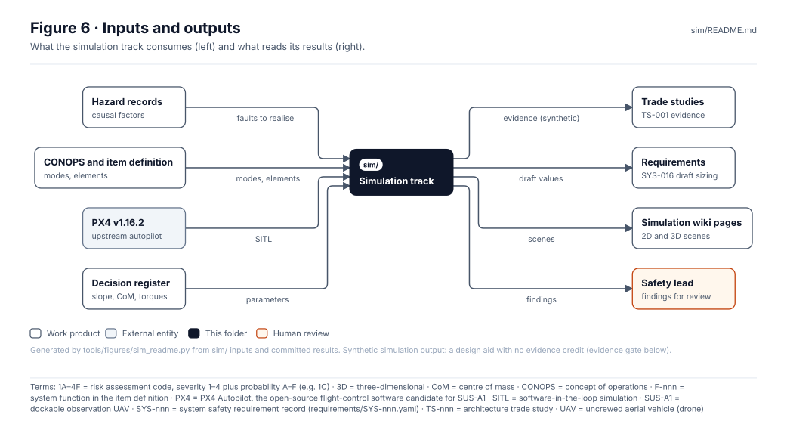

<!-- GENERATED by tools/wiki/build_wiki.py from sim/README.md. Do not edit here; edit the source and re-run. -->

> Published from [`sim/README.md`](https://github.com/jherrodthomas/Project-Susanoo/blob/main/sim/README.md) in the repository.

# Simulation track

> **Status:** 11 committed result sets, all synthetic with **no evidence credit**. They rank risks, find edge cases and guide tests; they never close a hazard, verify a mitigation or support a risk acceptance (evidence gate below).

<!-- terms:start (generated by tools/terms/terms.py; do not edit by hand) -->
<details><summary><b>Terms on this page (27)</b>: abbreviations and codes explained</summary>

| Term | Meaning |
|---|---|
| 1A–4F | risk assessment code, severity 1–4 plus probability A–F (e.g. 1C) |
| 3D | three-dimensional |
| A01–A04 | item-definition validator rule (A01–A04) |
| AI | artificial intelligence (here, an AI assistant drafting at independence level I0) |
| CF1, CF2 … | causal factor in a hazard record (CF1, CF2 …) |
| CI | continuous integration (the automated checks GitHub runs on every change) |
| DQ-nnn | decision question for the project lead (decisions/register.yaml) |
| F-nnn | system function in the item definition |
| FLT-nnn | walker fault in sim/faults.yaml |
| GCS | ground control station |
| GPS | Global Positioning System |
| HAZ-nnn | hazard record (safety/hazards/HAZ-xxx-nnn.yaml) |
| I0–I3 | review independence level (I0 none, e.g. the author or an AI, to I3 independent organisation) |
| MuJoCo | Multi-Joint dynamics with Contact, the physics engine for the level-2 walker model |
| OMG | Object Management Group, publisher of SysML |
| PX4 | PX4 Autopilot, the open-source flight-control software candidate for SUS-A1 |
| R01 … | validator rule in tools/pdac (R13 = only a named human review accepts anything) |
| SIH | simulation-in-hardware, PX4's built-in headless simulator |
| SITL | software-in-the-loop simulation |
| SU-nnn | UAV PX4 SITL scenario |
| SUS-A1 | dockable observation UAV |
| SUS-I1 | integrated mechanized walker and observation UAV |
| SVG | Scalable Vector Graphics, the figure file format |
| SYS-nnn | system safety requirement record (requirements/SYS-nnn.yaml) |
| SysML | Systems Modeling Language (SysML v2) |
| TS-nnn | architecture trade study |
| UAV | uncrewed aerial vehicle (drone) |

All terms: [abbreviations and record codes](https://github.com/jherrodthomas/Project-Susanoo/blob/main/docs/terms.md).

</details>
<!-- terms:end -->

| Field | Value |
|---|---|
| Levels | 1 · reduced-order plant (`plant/`, `search/`) · 2 · MuJoCo (`mujoco/`) · PX4 SITL (`uav/`) |
| Inputs | [`spec/`](Plant-Specs.md), [`faults.yaml`](https://github.com/jherrodthomas/Project-Susanoo/blob/main/sim/faults.yaml) (4 faults), [`search/families.yaml`](https://github.com/jherrodthomas/Project-Susanoo/blob/main/sim/search/families.yaml), [`uav/scenarios.yaml`](https://github.com/jherrodthomas/Project-Susanoo/blob/main/sim/uav/scenarios.yaml) (6 scenarios) |
| Hazards exercised | [HAZ-DCK-002](https://github.com/jherrodthomas/Project-Susanoo/blob/main/safety/hazards/HAZ-DCK-002.yaml), [HAZ-INT-001](https://github.com/jherrodthomas/Project-Susanoo/blob/main/safety/hazards/HAZ-INT-001.yaml), [HAZ-PIL-002](https://github.com/jherrodthomas/Project-Susanoo/blob/main/safety/hazards/HAZ-PIL-002.yaml), [HAZ-SAF-001](https://github.com/jherrodthomas/Project-Susanoo/blob/main/safety/hazards/HAZ-SAF-001.yaml), [HAZ-WLK-001](https://github.com/jherrodthomas/Project-Susanoo/blob/main/safety/hazards/HAZ-WLK-001.yaml), [HAZ-WLK-002](https://github.com/jherrodthomas/Project-Susanoo/blob/main/safety/hazards/HAZ-WLK-002.yaml) |
| SysML model | [`SimulationEvidence.sysml`](https://github.com/jherrodthomas/Project-Susanoo/blob/main/sim/SimulationEvidence.sysml) (generated here) |
| Wiki | [Simulation](Simulation.md), [UAV simulation](UAV-Simulation.md), [3D scenes](3D-Scenes.md) |

## Purpose

Simulation for SUS-I1, following LionDriver's architecture (`assurance/sim`). Each piece of code sits next to the results it writes, and every output is checked in CI with `--check`: the committed file must equal a fresh run, or for PX4 SITL the same outcome classes. Runs are deterministic and seeded where they can be. Results are synthetic design aids; a finding is a draft for the safety lead.

## Result sets



| Result set | Layer | What it runs | Cases | Outcomes | Hazards |
|---|---|---|---|---|---|
| [plant-results](https://github.com/jherrodthomas/Project-Susanoo/blob/main/sim/results/plant-results.md) | 1 · plant | fault catalogue on 0° and 8° slopes, with and without mitigation | 41 | hard-drop 16, safe 10, tip 6 | HAZ-PIL-002, HAZ-SAF-001, HAZ-WLK-001, HAZ-WLK-002 |
| [search-SF-01](https://github.com/jherrodthomas/Project-Susanoo/blob/main/sim/results/search-SF-01.md) | 1 · search | failure search, 8 edge cases, 0 findings | 400 | hard-drop 198, safe 196, tip 6 | HAZ-PIL-002, HAZ-WLK-002 |
| [l2-crosscheck](https://github.com/jherrodthomas/Project-Susanoo/blob/main/sim/results/l2-crosscheck.md) | 1 vs 2 | level 1 against MuJoCo 3.3.5, 0 unexplained | 26 | agree 22/26 | — |
| [sizing-cf4](https://github.com/jherrodthomas/Project-Susanoo/blob/main/sim/results/sizing-cf4.md) | 2 · sizing | ankle 40500 N m, knee 26500 N m proposed (preliminary) | 882 | failures at proposal 0 | HAZ-WLK-002 |
| [ts001-fault-response](https://github.com/jherrodthomas/Project-Susanoo/blob/main/sim/results/ts001-fault-response.md) | 1 + 2 · trade | TS-001 supply-loss response per alternative | 1,080 | agree 897/1080 | — |
| [SU-01](https://github.com/jherrodthomas/Project-Susanoo/blob/main/sim/results/uav/summary.md) | PX4 SITL | GCS link lost during observation, return-to-launch configured | 1 | keepout-breach 1 | HAZ-INT-001 |
| [SU-02](https://github.com/jherrodthomas/Project-Susanoo/blob/main/sim/results/uav/summary.md) | PX4 SITL | GCS link lost, return-to-launch, walker has moved since take-off | 1 | landed-at-stale-home 1 | HAZ-INT-001, HAZ-DCK-002 |
| [SU-03](https://github.com/jherrodthomas/Project-Susanoo/blob/main/sim/results/uav/summary.md) | PX4 SITL | GCS link lost during observation, land in place configured | 1 | landed-clear 1 | HAZ-INT-001 |
| [SU-04](https://github.com/jherrodthomas/Project-Susanoo/blob/main/sim/results/uav/summary.md) | PX4 SITL | Battery failure during observation | 1 | landed-clear 1 | HAZ-INT-001 |
| [SU-05](https://github.com/jherrodthomas/Project-Susanoo/blob/main/sim/results/uav/summary.md) | PX4 SITL | Commanded beyond the geofence | 1 | contained 1 | HAZ-INT-001 |
| [SU-06](https://github.com/jherrodthomas/Project-Susanoo/blob/main/sim/results/uav/summary.md) | PX4 SITL | GPS lost during observation (emulated) | 1 | landed-clear 1 | HAZ-INT-001 |

## What is simulated



| Fault | Name | Variant | Causal factors |
|---|---|---|---|
| FLT-01 | Hydraulic supply pressure loss | hydraulic | HAZ-SAF-001:CF2, HAZ-WLK-002:CF4, HAZ-PIL-002:CF1 |
| FLT-02 | Posture feedback frozen (stale) | any | HAZ-WLK-001:CF1, HAZ-WLK-001:CF3 |
| FLT-03 | Protective stop commands zero torque | any | HAZ-SAF-001:CF1 |
| FLT-04 | Electric bus undervoltage | electric | HAZ-SAF-001:CF2, HAZ-WLK-002:CF4, HAZ-PIL-002:CF1 |

| UAV scenario | Title | Hazards | Outcome |
|---|---|---|---|
| SU-01 | GCS link lost during observation, return-to-launch configured | HAZ-INT-001 | keepout-breach |
| SU-02 | GCS link lost, return-to-launch, walker has moved since take-off | HAZ-INT-001, HAZ-DCK-002 | landed-at-stale-home |
| SU-03 | GCS link lost during observation, land in place configured | HAZ-INT-001 | landed-clear |
| SU-04 | Battery failure during observation | HAZ-INT-001 | landed-clear |
| SU-05 | Commanded beyond the geofence | HAZ-INT-001 | contained |
| SU-06 | GPS lost during observation (emulated) | HAZ-INT-001 | landed-clear |

## Block diagram



Elements and interfaces: [`architecture/item-definition.yaml`](https://github.com/jherrodthomas/Project-Susanoo/blob/main/architecture/item-definition.yaml).

## Boundary diagram



| # | From | To | Crossing / interaction |
|---|---|---|---|
| 1 | Hazard records | Specs and faults | each fault realises named causal factors (`HAZ-x:CFn`) |
| 2 | Specs and faults | Level 1 and level 2 models | sourced, ranged parameters and fault injections |
| 3 | Level 1 and level 2 models | Committed results | seeded runs, regenerated and diffed in CI |
| 4 | PX4 SITL harness | Committed results | failsafe runs; outcome classes compared |
| 5 | Simulation track | Trade studies and decisions | synthetic evidence for a choice, never a verdict |
| 6 | Simulation track | Wiki and 3D pages | scenes drawn from the runs |
| 7 | Simulation track | Named human review | findings and, one day, fidelity cases |
| 8 | Named human review | Verification records | only after the evidence gate is passed |

**Explicitly excluded:** hardware testing, contact after tipping and terrain compliance (not modelled), and any verification credit.

## SysML model

Model of record for the evidence gate: [`SimulationEvidence.sysml`](https://github.com/jherrodthomas/Project-Susanoo/blob/main/sim/SimulationEvidence.sysml), generated by `python3 tools/figures/sim_readme.py` and validated by the OMG pilot in CI (`tools/validate_doc_sysml.sh`).



<details><summary>SysML v2 source</summary>

```sysml
// SimulationEvidence — generated by tools/figures/sim_readme.py from the evidence gate in sim/README.md.
// Do not edit by hand: change the generator and regenerate.
// Status: when a simulation result may count as evidence; not evidence itself.

package SimulationEvidence {
    doc /* Evidence gate for simulation results (sim/README.md; rule R13 for the fidelity case). */
    attribute def FidelityCaseApproved;
    attribute def ModelOrParameterChanged;
    attribute def SafetyLeadTakesItIn;
    state def EvidenceGate {
        doc /* When a simulation result may count as evidence: the evidence gate of sim/README.md. */
        entry; then Synthetic;
        state Synthetic { doc /* data_kind synthetic, no evidence credit */ }
        state FidelityApproved { doc /* fidelity case for its family approved by a review record (R13) */ }
        state InAnalysis { doc /* taken into the owning analysis by the safety lead */ }
        transition t1 first Synthetic accept FidelityCaseApproved then FidelityApproved;
        transition t2 first FidelityApproved accept SafetyLeadTakesItIn then InAnalysis;
        transition t3 first FidelityApproved accept ModelOrParameterChanged then Synthetic;
        transition t4 first InAnalysis accept ModelOrParameterChanged then Synthetic;
    }
}
```

</details>

## Inputs and outputs



| Input | Source |
|---|---|
| Causal factors to realise | [`safety/hazards/`](Safety-Records.md) |
| Modes and elements | [`concept/CONOPS.md`](https://github.com/jherrodthomas/Project-Susanoo/blob/main/concept/CONOPS.md), [architecture](Architecture-Records.md) |
| PX4 Autopilot | upstream v1.16.2 (`uav/fetch_px4.sh`) |
| Parameter decisions | [Decision register](Decision-Register.md) |

| Output | Destination |
|---|---|
| Trade-study evidence | [`results/ts001-fault-response.md`](https://github.com/jherrodthomas/Project-Susanoo/blob/main/sim/results/ts001-fault-response.md) |
| Draft sizing | [`results/sizing-cf4.md`](https://github.com/jherrodthomas/Project-Susanoo/blob/main/sim/results/sizing-cf4.md) (behind SYS-016) |
| Scenes | [Simulation](Simulation.md), [3D scenes](3D-Scenes.md) |
| Findings | the safety lead, for review |

## Folder contents

| Item | Description | State |
|---|---|---|
| [`figures/`](2D-Hazard-Scenes.md) | 2D hazard scenes | folder |
| [`mujoco/`](Level-2-MuJoCo.md) | Level-2 multibody simulation (MuJoCo) | folder |
| [`plant/`](Walker-Plant.md) | Level-1 walker plant | folder |
| [`results/`](Simulation-Results.md) | Simulation results | folder |
| [`scenes3d/`](3D-Scene-Builder.md) | 3D scene builder | folder |
| [`search/`](Failure-Search.md) | Failure search | folder |
| [`spec/`](Plant-Specs.md) | Simulation specifications | folder |
| [`trades/`](Trade-Study-Evidence.md) | Trade-study evidence | folder |
| [`uav/`](UAV-SITL-Harness.md) | UAV simulation harness (PX4 SITL) | folder |
| [`faults.yaml`](https://github.com/jherrodthomas/Project-Susanoo/blob/main/sim/faults.yaml) | Fault catalogue | present |
| [`SimulationEvidence.sysml`](https://github.com/jherrodthomas/Project-Susanoo/blob/main/sim/SimulationEvidence.sysml) | Generated SysML v2 evidence gate | generated |
| [`figures/`](2D-Hazard-Scenes.md) | Generated SVG figures (do not edit) | generated |
| `README.md` | This page: generated above the END marker, hand-written below | generated + hand |

<!-- END GENERATED: content below this line is human-authored and preserved -->

## Evidence gate

**Simulation results here carry no evidence credit.** Every result is labelled `data_kind: synthetic` and *no evidence credit*. A result can count toward verification only after two things happen:
1. a fidelity case is approved for its scenario family, by a review record under rule R13;
2. the safety lead takes it into the owning analysis.

Until then, results rank risks, find edge cases and guide tests. They never close a hazard, verify a mitigation or support a risk acceptance. The AI may not mark simulation results as verification evidence (`CLAUDE.md`).

## Layers

| Layer | Where | Status | What it does |
|---|---|---|---|
| Spec | `spec/walker.yaml` | built | Plant parameters. Each one has a unit, an allowed range, a status (assumed, derived or published) and a source. `plant/spec.py` refuses a value that is unsourced or out of range. |
| Faults | `faults.yaml` | built | FLT-01 hydraulic supply loss, FLT-02 frozen posture feedback, FLT-03 protective stop with zero torque, FLT-04 electric undervoltage. Each traces to hazard causal factors (`HAZ-x:CFn`), checked to exist. |
| 1 · Plant | `plant/walker.py` | built | Reduced-order sagittal walker with stated assumptions A1–A8: a linear inverted pendulum, a force-controlled leg, an actuator capacity fraction, load holding, a protective stop and a pilot reaction model. The hydraulic and electric variants stay open until decision DQ-006. |
| 1 · Report | `plant/report.py` | built | Runs every fault on 0° and 8° slopes, with and without its mitigations, plus the no-fault capability by slope. Writes `results/plant-results.md` and `.json`. |
| 4 · Search | `search/families.yaml`, `search/search.py` | built (1 family) | Seeded Monte Carlo, then cross-entropy falsification. Each worst case is re-run three ways: with rounded parameters, with no fault, and under assumption probes. It is then mapped to a hazard, or raised as a finding. Writes `results/search-SF-01.*` and `results/edge-cases.md`. |
| Scenes | `figures/scenes.py` | built | Animated 2D side views from plant runs: intended run as dashed green, performed run as solid red. The static pose is the end state. Writes `docs/wiki/images/sim-sc-*.svg` and the wiki page `docs/wiki/Simulation.md`. |
| 2 · Scenarios | — | planned | Terrain and mission scenarios as data (slope, step, soft ground, wind, dock approach, link loss). |
| UAV | `uav/` | built | PX4 v1.16.2 SITL with the SIH quadrotor, run headless. `uav/harness.py` acts as the ground station and runs six failsafe scenarios: link loss with return-to-launch, link loss with return after the walker has moved, link loss with land-in-place, battery failure, a command past the geofence, and GPS loss. It writes `results/uav/SU-*.json` from ground truth. `figures/uav_scenes.py` turns those into top-down scenes, `results/uav/summary.md` and `docs/wiki/UAV-Simulation.md`. Outcomes are mapped to hazards by rules in `uav/scenarios.yaml`. |
| 2 · Fidelity | `mujoco/` | built | Level-2 planar two-legged walker in MuJoCo 3.3.5, generated from `spec/walker.yaml` and `spec/walker_l2.yaml`. It has real foot contact, joint torques limited by capacity, mechanical load holding, and a real step during a protective stop. It reuses level 1's cases, faults and outcome definitions. `mujoco/crosscheck.py` runs the fault catalogue, no-fault slopes and every search edge case on both levels and writes `results/l2-crosscheck.*`. Each disagreement carries a note; agreement between two models is not validation against hardware. `mujoco/sizing.py` sweeps joint torque limits over the operating envelope (`mujoco/sizing.yaml`) and writes `results/sizing-cf4.*`, the draft sizing behind SYS-016. `trades/fault_response.py` runs each TS-001 actuation and power alternative's supply-loss mode on both levels (`trades/fault_response.yaml`) and writes `results/ts001-fault-response.*`. |
| 3D | `scenes3d/` | built | `scenes.yaml` defines one scene per hazard or finding that has a motion source: a plant run, a search edge case or a SITL result. `export_scene.py` reads only each scene's `motion` block and writes `scenes3d/out/<id>.json`. `build_pages.py` writes single-file three.js pages (`docs/3d/<id>.html`) that replay that data on parametric walker and UAV models, plus `docs/wiki/3D-Scenes.md`. `render.mjs` renders stills and checks every page in Chromium. **The look never changes the analysis:** environment, condition, camera and variants are look-only, and `tests/test_scenes3d.py` proves the exporter never reads them. |

## Commands

```bash
python -m sim.plant.report          # fault catalogue runs
python -m sim.search.search         # failure search (SF-01)
python -m sim.figures.scenes        # 2D scenes and docs/wiki/Simulation.md
python -m sim.figures.uav_scenes    # UAV scenes, summary and page, built from the committed SITL results
pip install -r sim/mujoco/requirements.txt && python -m sim.mujoco.crosscheck   # level 1 vs level 2 (--compare in CI)
python -m sim.mujoco.sizing         # actuator sizing against CF4, level 2 (--compare in CI)
python -m sim.trades.fault_response # TS-001 supply-loss evidence, levels 1 and 2 (--compare in CI)
python -m sim.scenes3d.export_scene # 3D scene analysis (reads only the motion blocks)
python -m sim.scenes3d.build_pages  # docs/3d/*.html and docs/wiki/3D-Scenes.md
npm pack three@0.170.0 && tar xzf three-0.170.0.tgz && node sim/scenes3d/render.mjs package   # stills + page checks

# PX4 SITL (heavy; also run weekly and on demand by .github/workflows/px4-sitl.yml)
pip install -r sim/uav/requirements.txt -r sim/uav/requirements-px4-build.txt
sim/uav/fetch_px4.sh ~/px4          # clones v1.16.2 with submodules and builds px4_sitl_default (needs cmake, ninja, bc)
python -m sim.uav.harness --px4 ~/px4            # re-run and rewrite sim/results/uav/*.json
python -m sim.uav.harness --px4 ~/px4 --compare  # re-run and compare outcome classes only
python -m unittest discover -s sim/tests -t .
```

The four generator commands accept `--check`, which fails if their committed outputs are stale. Run them in the order above, because the scenes read the search results. SITL runs are not bit-reproducible, so the PX4 results are committed, and `--compare` checks outcome classes rather than exact numbers.

## Honesty rules for scenes and results

- Contact, rotation after tipping and terrain compliance are not modelled. A run stops at the first mishap, and its scene freezes there.
- Every scene is drawn from plant runs. Nothing is hand-animated. Each scene names its hazard or finding, its case, and the synthetic label.
- A finding is a draft for the safety lead. A new hazard or causal factor enters `safety/hazards/` only through review.
- Parameter values are concept assumptions, not design values. Changing one changes the results, and the `--check` steps make that visible in review.
