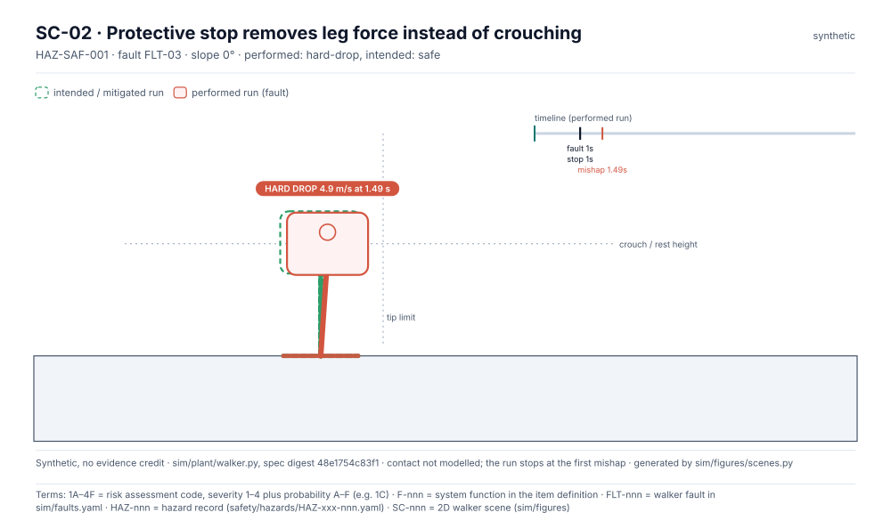
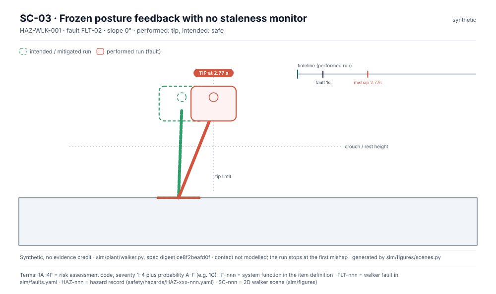
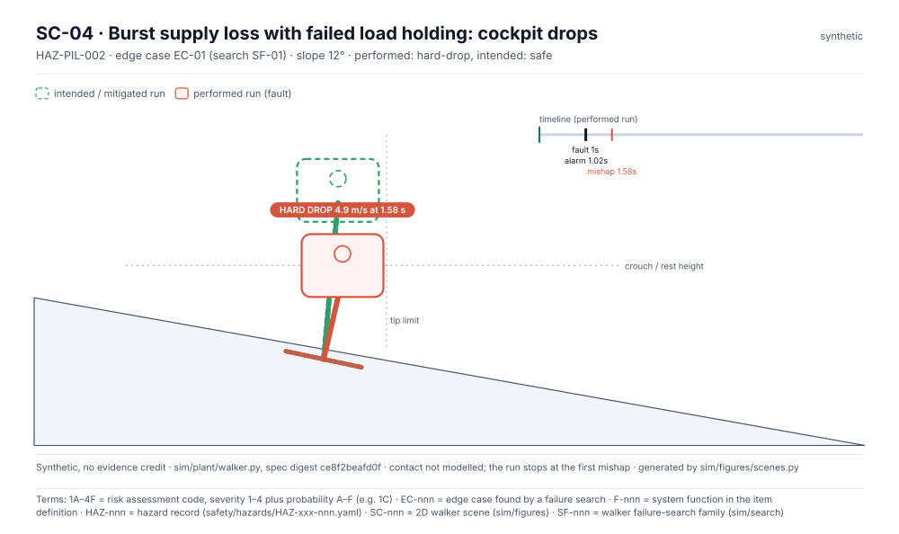

<!-- GENERATED by sim/figures/scenes.py from the simulation results. Do not edit by hand. -->

# Simulation

> Synthetic simulation output; design aid only, no evidence credit (sim/README.md, evidence gate). Results rank risks and guide analysis and tests; they are not verification evidence.

Layer 1 plant (`sim/plant/walker.py`): a reduced-order sagittal walker with stated assumptions A1–A7, parameters in `sim/spec/walker.yaml` (each with a range, status and source), faults in `sim/faults.yaml` traced to hazard causal factors. Layer 4 failure search (`sim/search`): seeded Monte Carlo and cross-entropy falsification; worst cases are re-run without the fault and under assumption probes, then mapped to hazards or raised as findings.

No-fault capability by slope: 0° safe; 4° safe; 8° safe; 10° safe; 12° safe; 15° safe; 20° safe; 25° safe; 30° tip.

Results: [plant results](https://github.com/jherrodthomas/Project-Susanoo/blob/main/sim/results/plant-results.md) · [search SF-01](https://github.com/jherrodthomas/Project-Susanoo/blob/main/sim/results/search-SF-01.md) · [edge cases](https://github.com/jherrodthomas/Project-Susanoo/blob/main/sim/results/edge-cases.md) · [level-1 vs level-2 MuJoCo cross-check](https://github.com/jherrodthomas/Project-Susanoo/blob/main/sim/results/l2-crosscheck.md)

## Scenes

### SC-01 · Slow supply leak on a slope: balance lost before the hold engages

HAZ-WLK-002 · edge case EC-08 (search SF-01) · performed **tip** at 2.92 s, intended safe.

Case: `variant=hydraulic, fault=FLT-01, slope_deg=13.0, tau_leak_s=2.05, pilot_reaction_s=2.6, stride_offset_m=0.27, load_holding=works, monitor=True`

### SC-02 · Protective stop removes leg force instead of crouching

HAZ-SAF-001 · fault FLT-03 · performed **hard-drop** at 1.49 s, intended safe.

Case: `variant=hydraulic, fault=FLT-03, slope_deg=0.0, tau_leak_s=0.3, pilot_reaction_s=1.5, stride_offset_m=0.1, load_holding=works, monitor=True`

### SC-03 · Frozen posture feedback with no staleness monitor

HAZ-WLK-001 · fault FLT-02 · performed **tip** at 2.875 s, intended safe.

Case: `variant=hydraulic, fault=FLT-02, slope_deg=0.0, tau_leak_s=0.3, pilot_reaction_s=1.5, stride_offset_m=0.1, load_holding=works, monitor=False`

### SC-04 · Burst supply loss with failed load holding: cockpit drops

HAZ-PIL-002 · edge case EC-01 (search SF-01) · performed **hard-drop** at 1.575 s, intended safe.

Case: `variant=hydraulic, fault=FLT-01, slope_deg=11.5, tau_leak_s=0.05, pilot_reaction_s=2.1, stride_offset_m=0.19, load_holding=fails, monitor=True`

